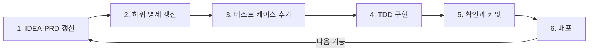

# 클로드 코드로 Todo 앱 만들기 — 가이드

*2026년 10월 18일 · @Jong Cheon Park*

## 이 가이드는 무엇인가

클로드 코드로 앱을 잘 만드는 비결은 **코드보다 문서를 먼저 쓰고, 작은 단위로 하나씩 시키는 것**입니다.

이 가이드는 간단한 Todo 앱을 예시로, 처음부터 배포까지 그대로 따라 할 수 있게 순서대로 정리했습니다.

전체 흐름은 네 단계입니다.

| 단계 | STEP | 하는 일 | 핵심 산출물 |
|---|---|---|---|
| 1. 준비와 기획 | 0~2 | 도구 설치, 아이디어 정리, 작업 규칙 작성 | `IDEA.md`, `CLAUDE.md` |
| 2. 설계 문서 | 3~8 | 무엇을 어떻게 만들지 문서로 확정 | `docs/` 폴더의 명세 6종 |
| 3. 점진적 구현 | 9~13 | 뼈대 → 화면 → API → DB → 부가 기능 순으로 하나씩 | 동작하는 앱 |
| 4. 배포와 반복 | 14~15 | 확인, 배포, 새 기능을 같은 사이클로 추가 | 배포 URL |

### 읽는 방법

- 각 STEP은 **목적 → 할 일 → 클로드에게 보낼 프롬프트 → 확인할 것** 순서로 되어 있습니다.
- 프롬프트 블록은 그대로 복사해 붙여 넣어도 됩니다. ○○ 부분만 내 앱에 맞게 바꾸세요.
- 각 STEP의 **확인할 것**을 통과한 뒤에만 다음 STEP으로 넘어갑니다. 이 습관 하나로 실패의 대부분을 막을 수 있습니다.

### 기억할 세 가지 원칙

1. **문서가 먼저, 코드는 나중:** 클로드는 문서를 기준으로 판단합니다. 문서가 없으면 클로드가 추측하고, 추측은 내 의도와 어긋납니다.
2. **한 번에 하나만:** "Todo 앱 만들어줘"보다 "할 일 추가 API 하나만 만들어줘"가 훨씬 정확합니다.
3. **매번 확인하고 커밋:** 잘 된 상태를 Git에 저장해 두면, 잘못되어도 언제든 되돌릴 수 있습니다.

## STEP 0. 준비하기

**목적:** 클로드 코드가 내 컴퓨터에서 코드를 만들고 실행할 수 있는 환경을 갖춥니다.

### 할 일

1. 필수 프로그램을 설치합니다.

| 프로그램 | 용도 | 설치 확인 명령 |
|---|---|---|
| Node.js (LTS 버전) | 웹 앱 실행 환경 | `node -v` |
| Git | 작업 저장과 되돌리기 | `git --version` |
| VS Code | 코드 확인용 편집기 | 앱 실행 |
| Claude Code | AI 코딩 도구 | `claude --version` |

2. 프로젝트 폴더를 만들고 클로드 코드를 실행합니다.

```bash
mkdir todo-app
cd todo-app
git init
claude
```

3. 첫 인사로 환경을 점검합니다.

```text
지금 폴더 위치와, node/npm/git 버전을 확인해줘.
아직 아무 파일도 만들지 마.
```

### 확인할 것

- [ ] 네 가지 프로그램의 버전이 모두 출력된다.
- [ ] 클로드가 현재 폴더를 `todo-app`으로 인식한다.

**팁:** 클로드가 파일을 바꾸거나 명령을 실행할 때는 허락을 묻습니다. 처음에는 하나씩 읽어 보고 승인하는 습관을 들이세요. 무엇을 하는지 배우는 가장 좋은 방법입니다.

## STEP 1. 아이디어를 한 장으로 정리하기

**목적:** 클로드에게 무엇인가를 시키기 전에, 내가 만들고 싶은 것을 스스로 명확히 합니다. 이 단계는 내가 직접 쓰는 것이 좋고, 클로드는 다듬는 역할만 합니다.

**할 일:** 아래 네 가지를 `docs/IDEA.md`에 적습니다.

1. **한 문장 정의:** "혼자 쓰는 간단한 할 일 목록 웹 앱. 할 일을 추가하고, 완료 표시하고, 삭제할 수 있다."
2. **누가 쓰는가:** "나 혼자. 로그인 없음."
3. **꼭 필요한 기능(MVP)과 지금은 빼는 기능**
4. **버전 로드맵:** 작게 나눠 하나씩 완성할 순서

### IDEA.md 예시

```markdown
# Todo 앱 아이디어

## 한 문장 정의
혼자 쓰는 간단한 할 일 목록 웹 앱

## MVP (꼭 필요한 것)
- 할 일 추가 (제목 필수, 1~100자)
- 할 일 목록 보기 (최신순)
- 완료/미완료 전환 (체크박스)
- 할 일 삭제
- 새로고침해도 데이터 유지

## 지금은 빼는 것
- 로그인, 공유, 알림, 마감일, 카테고리

## 버전 로드맵
- v0.1 화면만 (브라우저 메모리)
- v0.2 API 연결 (서버 메모리)
- v0.3 DB 저장
- v0.4 필터와 수정
- v1.0 배포
```

### 클로드에게 보낼 프롬프트

```text
docs/IDEA.md를 읽고 검토만 해줘. 파일은 수정하지 마.
1) 빠진 것이나 모호한 것이 있는지
2) MVP가 너무 크지 않은지
3) 내가 결정해야 할 질문을 최대 5개만 물어봐줘.
```

### 확인할 것

- [ ] MVP 기능이 5개 안팎이다.
- [ ] "지금은 빼는 것"이 적혀 있다. (클로드가 기능을 임의로 추가하는 것을 막아줌)
- [ ] 클로드의 질문에 모두 답하고 `IDEA.md`에 반영했다.

## STEP 2. CLAUDE.md — 클로드의 작업 규칙 만들기

**목적:** `CLAUDE.md`는 클로드 코드가 매 세션 시작할 때 자동으로 읽는 파일입니다. 여기에 프로젝트 설명, 기술 스택, 규칙을 적어 두면 매번 다시 설명하지 않아도 됩니다. 새 직원에게 주는 "업무 수칙"이라고 생각하면 쉽습니다.

**할 일:** 프로젝트 최상위 폴더에 `CLAUDE.md`를 만듭니다. 처음에는 짧게 시작하고, 클로드가 실수할 때마다 규칙을 한 줄씩 더해 갑니다.

### CLAUDE.md 템플릿

```markdown
# CLAUDE.md - Todo App

## 프로젝트 개요
혼자 쓰는 간단한 할 일 목록 웹 앱 (학습용)

## 기술 스택
- Next.js 15 (App Router), React 19, TypeScript (strict)
- Tailwind CSS
- DB: Postgres (Neon) + Drizzle ORM
- 검증: Zod
- 테스트: Jest + React Testing Library

## 폴더 구조
- app/            : 페이지와 API 라우트
- src/components/ : 화면 컴포넌트
- src/lib/        : 서버 로직, DB
- src/types/      : 공유 타입
- docs/           : 명세 문서

## 반드시 참고할 문서
- docs/PRD.md, docs/TRD.md, docs/DATA_MODEL.md
- docs/API_SPEC.md, docs/COMPONENT_SPEC.md, docs/TEST_CASES.md

## 규칙
- 명세에 없는 기능을 임의로 추가하지 말 것
- any 타입 금지
- 한 번에 한 기능만 작업하고, 끝나면 무엇을 바꿨는지 요약할 것
- 테스트를 삭제하거나 skip하지 말 것
- 테스트가 실패하면 테스트가 아닌 구현을 고칠 것
- console.log는 디버깅 후 제거할 것
- 이해할 수 있게 주석은 한국어로 짧게

## 자주 쓰는 명령
- 개발 서버: npm run dev
- 테스트: npm test
```

### 클로드에게 보낼 프롬프트

```text
docs/IDEA.md를 바탕으로 아래 템플릿을 참고해서 CLAUDE.md를 만들어줘.
아직 다른 파일은 만들지 마.
(위 템플릿 붙여넣기)
```

### 확인할 것

- [ ] 기술 스택과 폴더 구조가 내가 원하는 대로이다.
- [ ] "하지 말 것" 규칙이 들어 있다.
- [ ] 새 세션에서 "CLAUDE.md 규칙을 요약해줘"라고 물었을 때 제대로 답한다.

**팁:** 아직 기술 스택을 잘 모르겠다면 먼저 물어보세요. "Todo 웹 앱을 만들고 무료로 배포하려면 어떤 스택이 좋을지 두세 가지 안을 장단점과 함께 비교해줘."

## STEP 3~8. 명세 문서 작성하기

명세 문서는 **클로드가 초안을 쓰고, 내가 검토하고 승인하는 방식**으로 만듭니다. 반드시 아래 순서대로, 한 번에 하나씩 만들고 앞 문서를 확정한 뒤 다음으로 넘어갑니다. 뒤 문서는 앞 문서를 근거로 쓰기 때문입니다.

| STEP | 문서 | 답하는 질문 | 근거 문서 |
|---|---|---|---|
| 3 | `PRD.md` | 무엇을, 왜 만드는가? | IDEA.md |
| 4 | `TRD.md` | 어떤 기술로, 어떤 구조로? | PRD |
| 5 | `DATA_MODEL.md` | 어떤 데이터를 저장하는가? | PRD, TRD |
| 6 | `API_SPEC.md` | 화면과 서버는 어떻게 대화하는가? | DATA_MODEL |
| 7 | `COMPONENT_SPEC.md` | 화면은 어떤 부품으로 이루어지는가? | PRD, API_SPEC |
| 8 | `TEST_CASES.md` | 제대로 동작하는지 어떻게 확인하는가? | 위 전체 |

모든 문서에 공통으로 쓸 수 있는 검토 프롬프트입니다. 초안을 받을 때마다 보내세요.

```text
방금 쓴 문서를 스스로 검토해줘.
- 앞 문서와 어긋나는 곳
- IDEA.md의 "지금은 빼는 것"이 들어간 곳
- 이해하기 어려운 표현
고치지 말고 목록으로만 알려줘.
```

### STEP 3. PRD.md — 제품 요구사항

**무엇을 담나:** 목표, 사용자, 기능 목록, 사용자 스토리, 범위 밖(하지 않을 것), 성공 기준.

```text
코드는 작성하지 마. docs/IDEA.md를 바탕으로 docs/PRD.md 초안을 써줘.
포함할 항목: 목표, 대상 사용자, 기능 목록(기능 ID 부여: F-01, F-02...),
사용자 스토리("~로서 ~하고 싶다"), 범위 밖, 성공 기준.
```

**검토 포인트:** 기능마다 ID가 있는가? (뒤 문서에서 `F-01`처럼 가리킬 수 있어야 합니다.) IDEA.md에 없는 기능이 들어가지 않았는가?

### STEP 4. TRD.md — 기술 요구사항

**무엇을 담나:** 기술 스택과 선택 이유, 폴더 구조, 데이터 흐름(화면 → API → DB), 에러 처리 방식, 환경 변수.

```text
PRD.md와 CLAUDE.md를 바탕으로 docs/TRD.md를 써줘.
각 기술을 왜 골랐는지 초보자가 이해할 수 있게 한 줄씩 설명하고,
화면에서 버튼을 누른 뒤 DB에 저장되기까지의 흐름을 단계별로 적어줘.
```

**검토 포인트:** CLAUDE.md의 스택과 일치하는가? 내가 모르는 기술이 나오면 "이게 왜 필요해?"라고 물어보세요.

### STEP 5. DATA_MODEL.md — 데이터 모델

**무엇을 담나:** 테이블, 필드 이름, 타입, 제약조건(필수 여부, 길이, 기본값).

| 필드 | 타입 | 제약조건 | 설명 |
|---|---|---|---|
| `id` | `serial` | PK | 자동 증가 번호 |
| `title` | `varchar(100)` | 필수, 1~100자 | 할 일 제목 |
| `completed` | `boolean` | 기본값 `false` | 완료 여부 |
| `createdAt` | `timestamp` | 기본값 `now()` | 만든 시각 |
| `updatedAt` | `timestamp` | 기본값 `now()` | 마지막 수정 시각 |

```text
PRD.md를 바탕으로 docs/DATA_MODEL.md를 써줘.
테이블별로 필드, 타입, 제약조건, 설명을 표로 정리하고,
TypeScript 타입 예시도 함께 적어줘. 테이블은 최소한으로.
```

**검토 포인트:** PRD의 기능을 모두 이 필드만으로 만들 수 있는가? 쓰지 않는 필드가 있지 않은가?

### STEP 6. API_SPEC.md — API 명세

**무엇을 담나:** 주소(엔드포인트), 메서드, 요청 본문, 성공 응답, 에러 응답, 상태 코드.

| 메서드 | 주소 | 하는 일 | 성공 코드 |
|---|---|---|---|
| GET | `/api/todos` | 목록 조회 (최신순) | 200 |
| POST | `/api/todos` | 추가 | 201 |
| PATCH | `/api/todos/:id` | 제목 수정 또는 완료 전환 | 200 |
| DELETE | `/api/todos/:id` | 삭제 | 204 |

```text
DATA_MODEL.md를 바탕으로 docs/API_SPEC.md를 써줘.
엔드포인트마다 요청/응답 JSON 예시, 에러 상황과 상태 코드를 적어줘.
에러 형식은 { "error": { "code": "...", "message": "..." } }로 통일해.
```

**검토 포인트:** 빈 제목, 101자 제목, 없는 id에 대한 에러가 정의되어 있는가?

### STEP 7. COMPONENT_SPEC.md — 화면 부품 명세

**무엇을 담나:** 컴포넌트 목록과 포함 관계, 각 컴포넌트의 Props, 사용자 동작과 결과, 빈 목록·로딩·에러 상태의 화면.

```text
TodoPage
├─ TodoForm      : 입력창 + 추가 버튼
├─ TodoFilter    : 전체 / 진행 중 / 완료 (v0.4)
└─ TodoList
   └─ TodoItem   : 체크박스 + 제목 + 삭제 버튼
```

```text
PRD.md와 API_SPEC.md를 바탕으로 docs/COMPONENT_SPEC.md를 써줘.
컴포넌트 트리, 각 컴포넌트의 Props 타입, 사용자 동작과 결과,
빈 목록/로딩/에러 상태에서 보여줄 문구를 적어줘.
```

**검토 포인트:** 화면 문구(예: "할 일이 없습니다")가 정해져 있는가? 문구가 정해져 있어야 테스트를 쓸 수 있습니다.

### STEP 8. TEST_CASES.md — 테스트 케이스

**무엇을 담나:** 테스트 ID, 대상, 상황, 기대 결과. "완성"의 기준이 되는 문서입니다.

| ID | 대상 | 상황 | 기대 결과 |
|---|---|---|---|
| API-01 | `POST /api/todos` | 제목 "우유 사기" | 201, 생성된 todo 반환, `completed=false` |
| API-02 | `POST /api/todos` | 제목이 빈 문자열 | 400, `VALIDATION_ERROR` |
| API-05 | `DELETE /api/todos/999` | 없는 id | 404, `NOT_FOUND` |
| UI-01 | TodoForm | 제목 입력 후 추가 클릭 | `onAdd` 호출, 입력창 비움 |
| UI-04 | TodoList | 할 일 0개 | "할 일이 없습니다" 표시 |

```text
지금까지의 모든 docs를 바탕으로 docs/TEST_CASES.md를 써줘.
API와 컴포넌트로 나누고, 테스트마다 ID/대상/상황/기대 결과를 표로 적어줘.
정상 케이스뿐 아니라 에러 케이스도 포함해줘. 테스트 코드는 아직 쓰지 마.
```

**검토 포인트:** PRD의 모든 기능 ID가 최소 한 개의 테스트에 연결되는가?

### STEP 3~8 확인할 것

- [ ] `docs/` 폴더에 문서 6개가 모두 있다.
- [ ] 문서마다 검토 프롬프트를 돌리고 직접 읽어 승인했다.
- [ ] Git에 커밋했다: `git add . && git commit -m "docs: 명세 문서 작성"`

## STEP 9. 프로젝트 뼈대 만들기

**목적:** 기능은 하나도 없지만, 실행되고 테스트가 돌아가는 빈 프로젝트를 만듭니다. 집을 짓기 전에 터를 닦는 단계입니다.

### 클로드에게 보낼 프롬프트 (1) — 계획부터

```text
TRD.md를 바탕으로 프로젝트 초기 설정 계획을 세워줘.
실행할 명령어, 설치할 패키지, 만들 폴더를 목록으로만 보여주고
아직 실행하지 마.
```

계획을 읽어 보고 이상한 것이 없으면 승인합니다.

### 클로드에게 보낼 프롬프트 (2) — 실행

```text
좋아, 그 계획대로 진행해줘. 단, 기능 코드는 만들지 말고
1) Next.js 프로젝트 생성 2) 필요한 패키지 설치 3) 폴더 구조 생성
4) Jest 설정과 "1 + 1 = 2" 샘플 테스트 하나까지만 해줘.
끝나면 npm run dev와 npm test를 실행해서 결과를 보여줘.
```

### 확인할 것

- [ ] `npm run dev` 실행 후 브라우저에서 `http://localhost:3000`이 열린다.
- [ ] `npm test`에서 샘플 테스트 1개가 통과한다.
- [ ] 폴더 구조가 `CLAUDE.md`와 같다.
- [ ] `.env` 파일이 `.gitignore`에 들어 있다. (비밀번호가 인터넷에 올라가지 않게)
- [ ] 커밋했다: `git commit -m "chore: 프로젝트 초기 설정"`

**팁:** "계획부터 보여줘 → 승인 → 실행"은 앞으로 모든 큰 작업에 쓰는 기본 패턴입니다. 실행 전에 방향을 바로잡을 수 있어 되돌리는 일이 크게 줄어듭니다.

## STEP 10~13. 점진적으로 구현하기

구현은 **버전 하나 = 동작하는 앱 하나**가 되도록 작게 나눕니다. 각 버전이 끝날 때마다 브라우저에서 직접 눌러 보고 커밋합니다.

### 구현의 기본 단위: TDD 3단계

모든 기능은 아래 세 번의 지시로 나눠 만듭니다. 테스트와 구현을 한 번에 시키지 마세요. 클로드가 테스트를 구현에 맞춰 쉽게 바꾸는 것을 막기 위해서입니다.

| 단계 | 의미 | 프롬프트 템플릿 | 성공 상태 |
|---|---|---|---|
| Red | 테스트만 작성 | "TEST_CASES.md의 ○○만 Red 단계로. 테스트 코드만 쓰고 구현은 만들지 마. 실행해서 실패하는 것을 보여줘." | 테스트 실패 (빨간불) |
| Green | 최소 구현 | "Green 단계. 테스트는 수정하지 말고 통과시키는 최소한의 코드만 써줘." | 테스트 통과 (초록불) |
| Refactor | 코드 정리 | "Refactor 단계. 기능은 추가하지 말고 읽기 쉽게만 정리해줘. 끝나면 테스트를 다시 돌려줘." | 여전히 통과 |

한 기능의 3단계가 끝나면 커밋하고 다음 기능으로 넘어갑니다.

### STEP 10. v0.1 — 화면만 만들기

**목표:** 서버나 DB 없이, 브라우저 안에서만 할 일을 추가·완료·삭제할 수 있는 화면. 새로고침하면 사라져도 괜찮습니다.

진행 순서 (컴포넌트마다 Red → Green → Refactor):

1. 공유 타입 먼저: "DATA_MODEL.md를 보고 `src/types/todo.ts`에 Todo 타입만 만들어줘."
2. `TodoItem` (가장 작은 부품부터)
3. `TodoList` (빈 목록 문구 포함)
4. `TodoForm` (빈 제목이면 추가 안 됨)
5. 페이지에 조립: "세 컴포넌트를 `app/page.tsx`에 조립해줘. 데이터는 `useState`로만 관리해."

- [ ] 추가, 체크, 삭제가 화면에서 동작한다.
- [ ] `npm test` 전부 통과 → 커밋 `feat: v0.1 화면 구현`

### STEP 11. v0.2 — API 만들고 연결하기

**목표:** 화면이 서버 API를 통해 데이터를 주고받습니다. 저장은 아직 서버 메모리(배열)입니다.

1. Zod 검증 스키마: "API_SPEC.md를 보고 할 일 생성/수정 요청의 Zod 스키마만 만들어줘."
2. API를 하나씩 TDD로: POST → GET → PATCH → DELETE
3. 화면 연결: "`src/lib/todoApi.ts`에 API 호출 함수를 모으고, 페이지가 `useState` 대신 이 함수를 쓰도록 바꿔줘."

- [ ] 화면 동작은 v0.1과 똑같다. (내부만 바뀜)
- [ ] 브라우저 개발자 도구(F12) → Network 탭에서 `/api/todos` 요청이 보인다.
- [ ] 커밋 `feat: v0.2 API 연결`

### STEP 12. v0.3 — DB에 저장하기

**목표:** 새로고침하거나 서버를 끄고 켜도 데이터가 남습니다.

1. 직접 할 일: `neon.tech`에서 무료 DB를 만들고, 연결 주소를 `.env.local`에 `DATABASE_URL=...`로 저장합니다. 비밀번호는 클로드에게 채팅으로 보내지 마세요.
2. 스키마: "DATA_MODEL.md대로 Drizzle 스키마를 만들고 마이그레이션을 실행해줘. DATABASE_URL은 .env.local에 있어."
3. 교체: "API의 저장소를 메모리 배열에서 DB로 바꿔줘. API 테스트는 수정하지 말고 모두 통과해야 해."

- [ ] 할 일을 추가하고 새로고침해도 남아 있다.
- [ ] Neon 대시보드에서 데이터가 보인다.
- [ ] 커밋 `feat: v0.3 DB 저장`

### STEP 13. v0.4 — 필터와 수정 추가하기

**목표:** 전체/진행 중/완료 필터, 제목 더블클릭 수정. 이미 명세에 있는 기능이므로 같은 TDD 사이클만 반복합니다.

```text
TEST_CASES.md의 TodoFilter 항목만 Red 단계로 진행해줘. 구현은 만들지 마.
```

- [ ] 필터와 수정이 동작하고 기존 기능도 그대로다.
- [ ] 커밋 `feat: v0.4 필터와 수정`

## STEP 14. 확인하고 배포하기 (v1.0)

**목적:** 명세대로 다 만들었는지 점검한 뒤, 인터넷 주소로 접속할 수 있게 배포합니다.

### 1) 명세 대조 점검

```text
PRD.md의 기능 목록과 TEST_CASES.md를 현재 코드와 대조해줘.
기능 ID별로 구현됨/안 됨/테스트 없음을 표로 보여주고,
명세에 없는데 들어간 코드가 있으면 알려줘. 수정은 하지 마.
```

### 2) 직접 해 보는 수동 테스트

- [ ] 빈 제목, 아주 긴 제목(101자)을 넣어 본다.
- [ ] 할 일 0개일 때 화면 문구가 명세와 같다.
- [ ] 휴대폰 크기(개발자 도구의 모바일 보기)에서도 깨지지 않는다.
- [ ] `npm run build`가 에러 없이 끝난다.

### 3) 배포 (Vercel)

1. GitHub에 저장소를 만들고 올립니다. 클로드에게 "GitHub에 올리는 명령어를 단계별로 알려줘"라고 물어도 됩니다.
2. `vercel.com`에서 GitHub 저장소를 가져옵니다(Import).
3. Vercel 설정의 Environment Variables에 `DATABASE_URL`을 넣습니다.
4. Deploy를 누르고, 받은 주소로 접속해 봅니다.

배포가 실패하면 Vercel의 빌드 로그를 복사해서 클로드에게 보내세요.

```text
Vercel 배포가 아래 로그로 실패했어. 원인을 설명하고 고칠 방법을 먼저 제안해줘.
(로그 붙여넣기)
```

### 확인할 것

- [ ] 배포 주소에서 추가/완료/삭제가 되고 새로고침해도 남는다.
- [ ] 태그를 남긴다: `git tag v1.0 && git push --tags`

## STEP 15. 새 기능을 더하는 반복 사이클

v1.0 이후의 새 기능은 모두 **문서를 먼저 고치고, 그다음 코드**라는 같은 순서로 추가합니다. 예시로 "마감일" 기능을 더해 보겠습니다.

1. **IDEA/PRD 갱신:** "마감일 기능을 추가하려고 해. 어떤 문서를 어떻게 바꿔야 하는지 목록만 보여줘."
2. **하위 명세 갱신:** DATA_MODEL(`dueDate` 필드) → API_SPEC → COMPONENT_SPEC 순서로 하나씩 고치고 검토합니다.
3. **테스트 케이스 추가:** TEST_CASES.md에 새 ID(예: API-10, UI-12)를 더합니다.
4. **TDD 구현:** 새 테스트마다 Red → Green → Refactor.
5. **확인과 커밋:** 기존 테스트까지 모두 통과하는지 확인합니다.
6. **배포:** GitHub에 올리면 Vercel이 자동으로 다시 배포합니다.

### 새 기능 추가 사이클 · 6단계 반복



윗줄(1~3)은 문서, 아랫줄(4~6)은 코드입니다. 배포가 끝나면 다음 기능은 다시 1번부터 시작합니다.

다음에 도전해 볼 만한 기능을 쉬운 순서로 적어 두었습니다.

| 버전 | 기능 | 새로 배우는 것 |
|---|---|---|
| v1.1 | 마감일, 지난 할 일 빨간색 표시 | DB 필드 추가(마이그레이션) |
| v1.2 | 우선순위(높음/보통/낮음) | `const` 객체로 선택지 관리 |
| v1.3 | 칸반 보드(할 일/진행 중/완료)와 드래그앤드롭 | 상태 모델 변경, `@dnd-kit` |
| v2.0 | 로그인과 사용자별 할 일 | 인증, 데이터 소유권 |

**팁:** 기능이 커질수록 "먼저 영향 범위를 분석해줘. 어떤 파일을 바꿔야 하고 기존 기능 중 무엇이 깨질 수 있는지"를 구현 전에 꼭 물어보세요.

## 부록. 좋은 지시 습관과 자주 하는 실수

### 좋은 지시의 다섯 가지 습관

1. **근거 문서를 이름으로 가리킨다:** "API_SPEC.md의 POST /api/todos대로"
2. **범위를 제한한다:** "○○만 해줘", "다른 파일은 건드리지 마"
3. **하지 말 것을 말한다:** "테스트는 수정하지 마", "아직 실행하지 마"
4. **큰 작업은 계획부터:** "계획만 보여줘" → 검토 → "진행해줘"
5. **끝나면 요약과 확인을 요청한다:** "무엇을 바꿨는지 요약하고 테스트를 돌려줘"

| 나쁜 지시 | 좋은 지시 |
|---|---|
| Todo 앱 만들어줘 | `docs/IDEA.md`를 바탕으로 PRD 초안만 써줘. 코드는 쓰지 마. |
| 에러 났어 고쳐줘 | `npm test`에서 아래 에러가 났어. 원인부터 설명하고 고칠 방법을 제안해줘. (에러 붙여넣기) |
| 예쁘게 해줘 | 카드 모양 목록에 완료된 항목은 회색 + 취소선으로 바꿔줘. TodoItem만 수정해. |
| 다 알아서 해줘 | v0.2 범위만. 먼저 작업 계획을 목록으로 보여줘. |

### 자주 하는 실수와 해결법

| 증상 | 원인 | 해결법 |
|---|---|---|
| 요청하지 않은 기능이 생김 | 명세에 "빼는 것"이 없음 | IDEA/PRD에 범위 밖을 적고 CLAUDE.md에 금지 규칙 추가 |
| 테스트를 고쳐서 통과시킴 | 테스트와 구현을 한 번에 지시 | Red/Green을 분리하고 "테스트 수정 금지" 명시 |
| 여러 파일이 한꺼번에 깨짐 | 지시 범위가 너무 큼 | `git restore .`로 되돌리고 더 작게 다시 지시 |
| 대화가 길어지자 규칙을 잊음 | 오래된 대화 내용이 많이 쌓임 | 버전마다 새 세션을 시작. 규칙은 CLAUDE.md에 두기 |
| 같은 에러를 계속 못 고침 | 원인 분석 없이 고치기만 반복 | "고치지 말고 가능한 원인 3가지를 먼저 말해줘" |
| 비밀번호가 GitHub에 올라감 | `.env`가 `.gitignore`에 없음 | 즉시 DB 비밀번호 교체, `.gitignore` 확인 |

### 최종 체크리스트

- [ ] STEP 0: 도구 설치와 폴더 준비
- [ ] STEP 1: `docs/IDEA.md` (MVP, 빼는 것, 로드맵)
- [ ] STEP 2: `CLAUDE.md`
- [ ] STEP 3~8: PRD, TRD, DATA_MODEL, API_SPEC, COMPONENT_SPEC, TEST_CASES
- [ ] STEP 9: 빈 프로젝트 실행 + 샘플 테스트 통과
- [ ] STEP 10: v0.1 화면
- [ ] STEP 11: v0.2 API
- [ ] STEP 12: v0.3 DB
- [ ] STEP 13: v0.4 필터와 수정
- [ ] STEP 14: 점검 후 v1.0 배포
- [ ] STEP 15: 새 기능 하나를 반복 사이클로 추가
