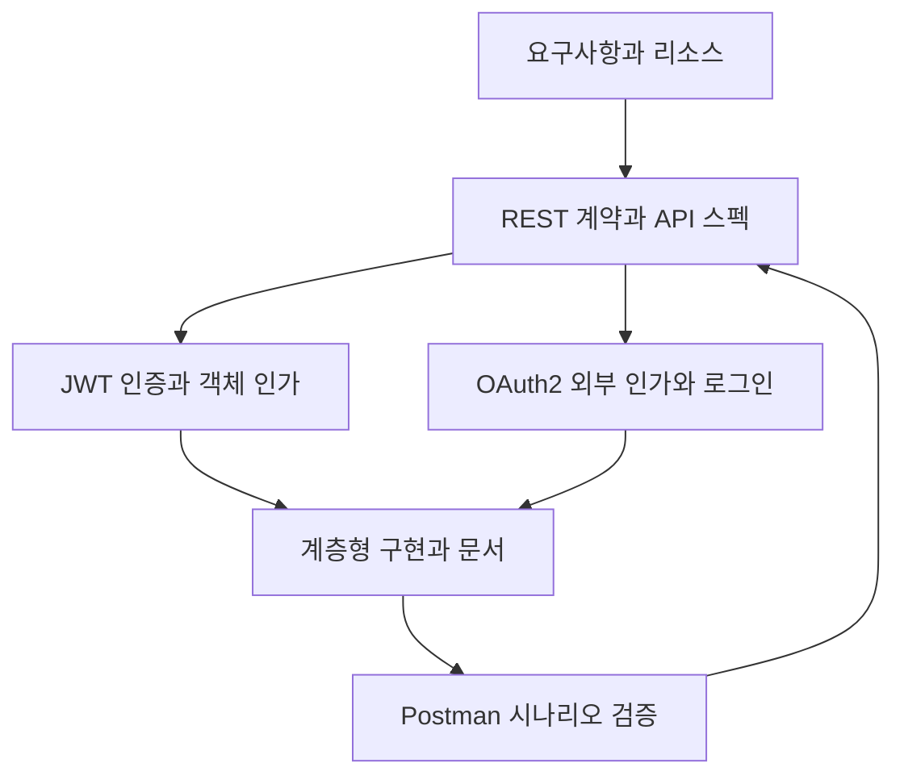
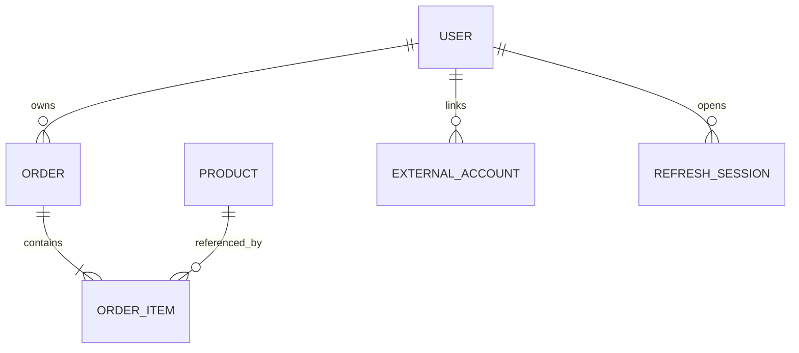

# API 아키텍처 & 인증 보안 설계 — 48시간 강의교안

> 공통 사례: 회원이 상품을 조회하고 자신의 주문을 생성·조회·취소하는 쇼핑 API. Python 3.11 이상, FastAPI, Pydantic v2 기준. 이론에서 설계, 구현, 검증으로 연결한다.

## 전체 목차

| 단원 | 교안 링크 | 시간 | 핵심 산출물 |
|---|---|---:|---|
| 4-1 | [RESTful API 설계 원칙](04-01-rest.md) | 8H | 리소스 관계도, URI·메서드 설계표 |
| 4-2 | [API 스펙 정의](04-02-spec.md) | 8H | 요구사항 추적표, 요청·응답 계약, OpenAPI |
| 4-3 | [JWT 인증 구현](04-03-jwt.md) | 8H | 인증 API, 리프레시 회전·폐기 설계 |
| 4-4 | [OAuth2 소셜 로그인 구현](04-04-oauth.md) | 8H | Authorization Code + PKCE 흐름, 계정 연결 정책 |
| 4-5 | [계층형 아키텍처와 API 문서화](04-05-architecture.md) | 8H | Router·Service·Repository 분리, Swagger 문서 |
| 4-6 | [Postman 기반 API 테스트](04-06-postman.md) | 8H | Collection, 환경변수, 정상·실패·보안 검증 결과 |
| 합계 | 이론·시연 18H + 실습 24H + 검토·평가 6H | **48H** | 설계와 테스트 근거가 있는 API |

## 학습 경로



## 6일 운영표

각 1H는 교육기관의 1교시 기준이며 휴게시간은 기관 시간표에 따른다. 단원마다 3H 이론·시연, 4H 실습, 1H 검토·평가를 배정했다.

| 일차 | 1~3교시 | 4~7교시 | 8교시 |
|---|---|---|---|
| 1일 | REST 제약, HTTP 의미, 리소스 모델링 | URI 개선, CRUD 설계, 실패 응답, 재시도 | 설계 발표와 동료 검토 |
| 2일 | 요구사항 분석, 계약, OpenAPI | 스펙 작성, Pydantic, 문서·구현 비교 | 요구사항 추적 평가 |
| 3일 | 인증·인가, JWT, 토큰 수명 | 로그인·검증, 갱신·폐기, 공격 사례 | 토큰 검증 평가 |
| 4일 | OAuth2·OIDC, Code·PKCE, 계정 연결 | 제공자 설정, 콜백, 실패 흐름, 외부 계정 매핑 | 인증 흐름 설명 |
| 5일 | 계층 책임, 의존성, 문서 자동화 | 코드 분리, 트랜잭션, 예외 변환, 문서 보강 | 구조 리뷰 |
| 6일 | 테스트 전략, Postman, 변수·스크립트 | CRUD·인증·인가·갱신 시나리오, 재실행 | 종합 시연과 평가 |

## 공통 도메인과 권한



| 대상 | 식별자 | 주요 규칙 |
|---|---|---|
| 회원 | user_id | 비밀번호 원문·해시는 응답에서 제외 |
| 상품 | product_id | 가격·재고는 서버 기준 |
| 주문 | order_id | 본인만 조회·취소, 관리자 권한은 별도 정책 |
| 주문 항목 | order_item_id | 주문 시점의 단가 보관 |
| 외부 계정 | provider + subject | 이메일만으로 자동 계정 병합 금지 |
| 갱신 세션 | session_id | 원문 리프레시 토큰 대신 해시 보관 |

## 실습 준비

Windows 11 PowerShell에서 작업 폴더를 만들고 다음을 실행한다. 가상환경 활성화 없이 해당 환경의 Python을 직접 사용한다.

```powershell
py -m venv .venv
.\.venv\Scripts\python.exe -m pip install fastapi uvicorn pydantic PyJWT "pwdlib[argon2]" python-multipart httpx pytest
.\.venv\Scripts\python.exe -m pip freeze > requirements-lock.txt
```

- Postman 설치 또는 사용 가능한 환경을 준비한다. UI 명칭은 버전에 따라 다를 수 있다.
- Markdown은 Mermaid를 지원하는 뷰어에서 연다. VS Code 기본 미리보기에서 도식이 표시되지 않으면 Mermaid 지원 확장을 사용한다.
- 모든 파일을 같은 폴더에 두면 상대 링크가 유지된다. **배포·공유 시 전체 폴더 또는 ZIP을 사용한다.**
- 예제 코드의 범위를 확인한다. 4-1·4-2·4-3은 각각 독립 실행 예제이고, 4-4는 외부 제공자 설정이 필요한 연동 과제, 4-5는 다중 파일 구조 실습이다. 서로 다른 예제를 한 main.py에 합치지 않는다.
- localhost의 HTTP는 로컬 실습용이다. 외부 운영 환경은 HTTPS와 안전한 비밀정보 관리가 필요하다.

## 종합 프로젝트: 주문 API 보안 설계

1. 상품 목록·상세, 주문 생성·조회·취소의 계약을 정한다.
2. 인증된 회원의 ID는 토큰 또는 서버 세션에서 얻는다.
3. 다른 회원의 주문 접근을 차단한다.
4. 소셜 계정을 기존 회원과 안전하게 연결한다.
5. Router·Service·Repository로 분리하고 OpenAPI와 동기화한다.
6. 정상 흐름과 실패 흐름을 Postman으로 증명한다.

| 평가 항목 | 배점 | 통과 근거 |
|---|---:|---|
| 리소스와 HTTP 설계 | 15 | URI·메서드·상태 코드가 일관됨 |
| 스펙과 요구사항 연결 | 15 | 입력·응답·오류·권한이 명시됨 |
| 인증·인가 | 25 | 변조·만료·다른 회원 접근 차단 |
| 갱신·소셜 로그인 | 15 | 회전·폐기와 state·PKCE 설명 및 검증 |
| 구조·문서 | 15 | 책임 분리, 민감정보 제외, 문서 일치 |
| 시나리오 테스트 | 15 | 독립 실행, 실패 근거, 반복 가능 |

## 참고 문서와 기준

검토 기준일: 2026-10-13. 교안은 특정 패키지의 최신 버전 번호를 전제하지 않는다. 설치 후 실제 버전을 고정하고 실행 결과를 확인한다.

- [HTTP 의미 — RFC 9110](https://www.rfc-editor.org/rfc/rfc9110)
- [OpenAPI Specification](https://spec.openapis.org/oas/latest.html) — 예시는 도구 호환성을 고려한 OpenAPI 3.1.0 표기
- [FastAPI 보안 예제](https://fastapi.tiangolo.com/tutorial/security/oauth2-jwt/)
- [OAuth2 Security BCP — RFC 9700](https://www.rfc-editor.org/rfc/rfc9700.html)
- [OWASP API 객체 수준 인가](https://api-security.owasp.org/editions/2023/en/0xa1-broken-object-level-authorization/)
- [FastAPI 문서 메타데이터](https://fastapi.tiangolo.com/tutorial/metadata/)
- [Postman 테스트 스크립트](https://learning.postman.com/docs/tests-and-scripts/write-scripts/test-scripts/)

## 예제 검증 범위

교안 작성 시 Python 3.12, FastAPI 0.143.0, Pydantic 2.13.5, PyJWT 2.15.1, pwdlib 0.3.1, Authlib 1.8.0 환경에서 다음을 확인했다. 이 버전은 검증 환경 기록이며 필수 고정 버전이 아니다.

| 검증 | 결과 |
|---|---|
| 파일 상대 링크·단원 앵커·코드 블록 | 통과 |
| Python 예제 문법 | 통과 |
| 4-1 상품 생성·조회·삭제·실패 | 통과 |
| 4-2 상세 조회·부재·추가 입력 거부 | 통과 |
| 4-3 로그인·토큰 검증·회전·재사용 폐기·로그아웃 | 통과 |
| 4-5 다중 파일 CRUD·OpenAPI 생성 | 통과 |
| 4-4 앱 초기화·로컬 세션·로그아웃 출처 검사 | 통과 |
| 실제 Google 로그인 왕복 | 제공자 자격증명 필요, 미수행 |
| Postman UI·Runner 실행 | 수업 환경에서 수행할 실습으로 제공 |

검증 환경에서는 httpx 관련 전환 안내가 나타났다. 수업 전에 사용하는 FastAPI·Starlette·Authlib 버전의 공식 설치 안내와 호환성을 확인하고 requirements-lock.txt로 환경을 고정한다. 외부 로그인·브라우저 쿠키·DB 동시성·운영 부하의 검증은 로컬 예제 검증과 별도로 수행한다.
