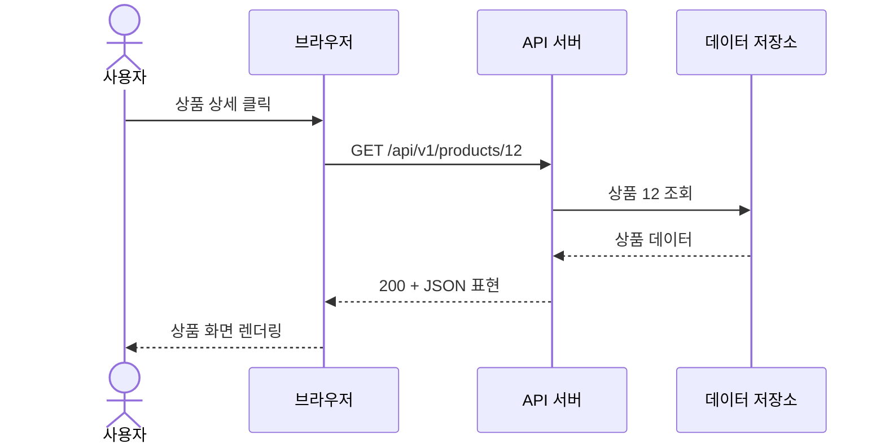
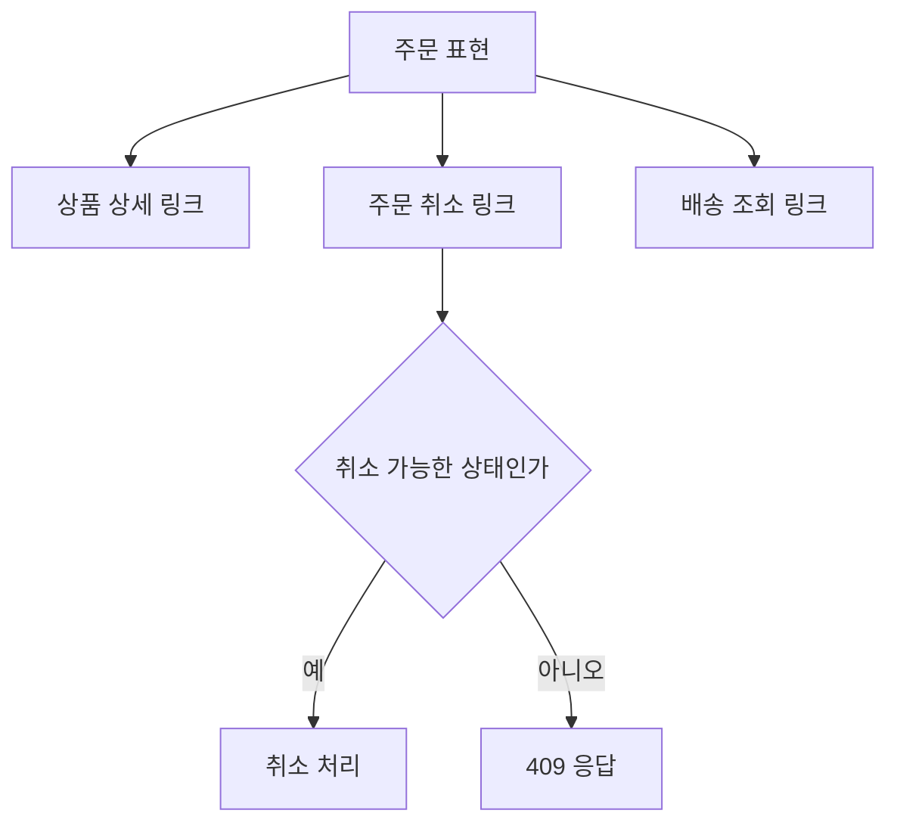
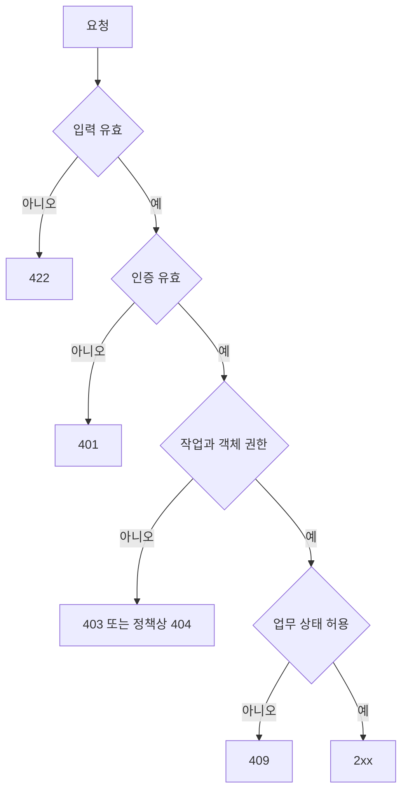
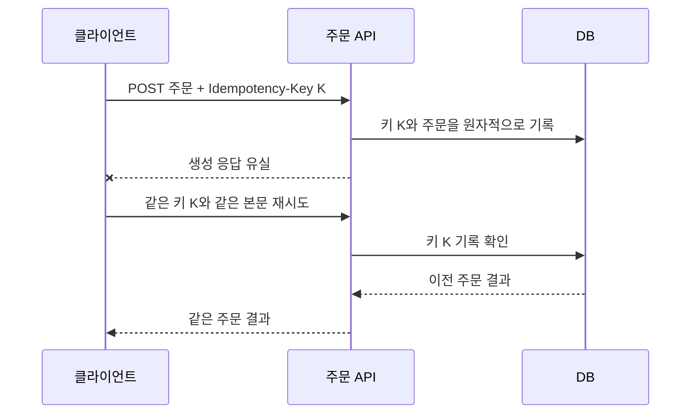

# 4-1. RESTful API 설계 원칙 — 8H

[전체 목차](00-index.md) · [다음: API 스펙](04-02-spec.md)

## 단원 목차

- [1. 학습 목표와 수업 구성](#s1)
- [2. API와 REST의 의미](#s2)
- [3. REST 제약과 리소스](#s3)
- [4. URI와 HTTP 메서드](#s4)
- [5. 상태 코드와 실패 응답](#s5)
- [6. 안전성·멱등성과 재시도](#s6)
- [7. 실행 예제와 실습](#s7)
- [8. 확인 문제와 해설](#s8)

<a id="s1"></a>
## 1. 학습 목표와 수업 구성

리소스를 찾고 관계를 모델링한다. URI·메서드·상태 코드를 업무 의미에 맞게 선택한다. 멱등성과 인증·인가를 구분하여 설명한다.

| 교시 | 내용 | 활동·결과 |
|---|---|---|
| 1 | API, HTTP, REST | 요청을 구성요소로 분해 |
| 2 | REST 제약과 리소스 | 주문 관계도 작성 |
| 3 | URI, 메서드, 상태 코드 | 설계 사례 비교 |
| 4 | 리소스 명명 | 잘못된 URI 10개 개선 |
| 5 | CRUD 계약 | 요청·응답 표 작성 |
| 6 | 실행·오류 | 상품 API 실행과 실패 관찰 |
| 7 | 멱등성·보안 | 재시도와 소유권 시나리오 |
| 8 | 검토·평가 | 설계 설명과 수정 |

<a id="s2"></a>
## 2. API와 REST의 의미

https://github.com/simpleego/AX_Service_Builder/blob/main/04-api-architecture-auth-security/01_API_%EC%A0%84%EC%B2%B4_%EC%95%84%ED%82%A4%ED%85%8D%EC%B2%98.png

API는 프로그램끼리 기능을 이용하는 약속이다. 화면의 버튼은 사람이 보는 접점이고, API는 프로그램이 호출하는 접점이다. 웹 API에서는 HTTP 요청과 응답이 약속을 전달한다.

**REST는 아키텍처 스타일이며 JSON 형식이나 특정 프레임워크 이름이 아니다.** JSON을 주고받는 HTTP API가 자동으로 REST의 모든 제약을 만족하는 것은 아니다.



| 요청 요소 | 예시 | 담당 의미 |
|---|---|---|
| 메서드 | GET | 어떤 종류의 작업인가 |
| 경로 | /products/12 | 어떤 리소스인가 |
| 쿼리 | ?page=1&page_size=20 | 조회 조건은 무엇인가 |
| 헤더 | Accept: application/json | 전달 형식·인증·캐시 등 메타정보 |
| 본문 | {"name":"키보드"} | 생성·변경할 데이터 |

리소스는 데이터베이스 테이블과 반드시 일대일이 아니다. `order-summary`처럼 여러 테이블을 조합한 조회 결과도 리소스로 제공할 수 있다. 리소스의 **표현**은 그 시점에 전달하는 JSON·HTML 등의 데이터이며 실제 DB 행과 구별한다.

<a id="s3"></a>
## 3. REST 제약과 리소스

| 제약 | 쉬운 설명 | API 설계에 적용 |
|---|---|---|
| 클라이언트·서버 분리 | 화면과 업무 처리를 나눔 | 프론트가 DB에 직접 접근하지 않음 |
| 무상태성 | 요청의 의미를 이전 대화에 의존하지 않음 | 요청마다 필요한 인증·조건 전달 |
| 캐시 가능성 | 재사용할 수 있는 응답을 구분 | Cache-Control, ETag 정책 |
| 일관된 인터페이스 | 공통 규칙으로 리소스를 다룸 | 메서드 의미, 표현, 링크 등 |
| 계층형 시스템 | 중간 프록시 등을 둘 수 있음 | Gateway·캐시·서버 뒤의 구조를 감춤 |
| 코드 온 디맨드 | 필요 시 실행 코드를 전달 | 선택 제약, 일반 API에는 생략 가능 |

무상태성은 서버가 DB를 가지면 안 된다는 뜻이 아니다. 주문·회원 등 업무 상태는 저장한다. 대화 맥락을 서버에만 보관해야 다음 요청을 해석할 수 있는 구조와 구별한다. 리프레시 토큰 폐기 목록도 보안 상태로 관리할 수 있다.

일관된 인터페이스에는 리소스 식별, 표현을 통한 조작, 자기 설명적 메시지, 하이퍼미디어에 의한 상태 전이가 포함된다. 실무에서 흔히 RESTful이라고 부르는 API는 하이퍼미디어를 충분히 구현하지 않은 경우도 있다.



```json
{
  "id": 35,
  "status": "pending",
  "links": {
    "self": "/api/v1/orders/35",
    "cancellation": "/api/v1/orders/35/cancellations"
  }
}
```

서버가 취소 링크를 제공해도 권한 검증은 별도로 수행해야 한다. 화면에서 버튼을 숨기는 것만으로 보호되지 않는다.

<a id="s4"></a>
## 4. URI와 HTTP 메서드

URI는 리소스를 식별하고 HTTP 메서드는 작업 의미를 표현한다. 아래 명명 규칙은 팀의 일관성을 위한 실무 규약이며 REST 자체의 필수 철자 규칙은 아니다.

| 개선 전 | 개선 후 | 이유 |
|---|---|---|
| GET /getProducts | GET /products | 명사형 리소스 중심 |
| POST /createProduct | POST /products | 생성 의미는 POST에 포함 |
| GET /deleteOrder?id=3 | DELETE /orders/3 | GET으로 업무 데이터 삭제 금지 |
| GET /orders/3?password=abc | GET /orders/3 + 인증 헤더 | 비밀값의 URL 노출 방지 |
| GET /users/3/orders/7/items/2/product | GET /products/12 | 불필요한 깊은 중첩 축소 |

복수형·소문자·하이픈 등을 팀 규칙으로 정하고 일관되게 사용한다. `/api/v1`은 버전 정책의 한 선택이다. 작은 응답 필드 추가마다 무조건 v2를 만들기보다 호환성 파괴 여부를 판단한다.

| 기능 | 메서드·URI | 정상 응답 | 인증·인가 |
|---|---|---|---|
| 상품 목록 | GET /api/v1/products | 200 | 공개 |
| 상품 상세 | GET /api/v1/products/{id} | 200 | 공개 |
| 상품 등록 | POST /api/v1/products | 201 + Location | 관리자 |
| 상품 전체 교체 | PUT /api/v1/products/{id} | 200 또는 204 | 관리자 |
| 상품 부분 수정 | PATCH /api/v1/products/{id} | 200 또는 204 | 관리자 |
| 주문 생성 | POST /api/v1/orders | 201 | 회원 |
| 내 주문 목록 | GET /api/v1/me/orders | 200 | 본인 |
| 주문 상세 | GET /api/v1/orders/{id} | 200 | 소유자 또는 허용된 관리자 |
| 주문 취소 기록 | POST /api/v1/orders/{id}/cancellations | 201 | 소유자·상태 검사 |

주문 취소는 회계·감사상 주문을 삭제하는 일과 다르므로 취소 리소스를 생성할 수 있다. 단순 CRUD로 표현하기 어려운 업무 동작은 별도 하위 리소스나 명확한 작업 엔드포인트로 모델링하고 계약에 설명한다.

| 위치 | 사용할 때 | 예시 |
|---|---|---|
| Path | 하나를 특정 | /products/12 |
| Query | 필터·정렬·페이지 | ?category=book&page=2 |
| Body | 복합 생성·수정 데이터 | 상품명·가격·재고 |
| Header | 인증·콘텐츠 형식·조건부 요청 | Authorization, If-Match |

<a id="s5"></a>
## 5. 상태 코드와 실패 응답

| 코드 | 의미 | 쇼핑 API 사례 |
|---|---|---|
| 200 | 성공, 응답 있음 | 상품 조회 |
| 201 | 리소스 생성 | 주문 생성 |
| 204 | 성공, 응답 본문 없음 | 삭제 성공 |
| 400 | 잘못된 요청 | 계약상 허용되지 않는 요청 |
| 401 | 유효한 인증 정보 부족 | 만료·변조·누락 토큰 |
| 403 | 권한 부족 | 일반 회원의 관리자 작업 |
| 404 | 찾을 수 없음 | 존재하지 않는 상품 |
| 409 | 현재 상태와 충돌 | 이미 배송된 주문 취소 |
| 422 | 처리할 입력 검증 실패 | FastAPI의 가격 음수 검증 |
| 429 | 요청 제한 초과 | 로그인 반복 실패 제한 |
| 500 | 서버 내부 오류 | 예상하지 못한 처리 실패 |

API는 업무 검증 실패를 400 또는 422 중 일관된 정책으로 정할 수 있다. FastAPI 기본 검증 응답은 422이며 자동 생성되는 `detail` 구조를 사용한다. 사용자 정의 오류와 혼동하지 않게 문서에 실제 구조를 적는다.



위 도식은 개념상 분류다. 실제 프레임워크의 검증·의존성 실행 순서와 권한 숨김 정책에 따라 응답 우선순위를 정하고 테스트한다. 다른 회원의 주문 존재를 숨기고 싶다면 부재·권한 부족 모두 404로 응답하는 정책도 가능하다.

<a id="s6"></a>
## 6. 안전성·멱등성과 재시도

**안전성**은 요청한 작업이 서버의 업무 상태 변경을 의도하지 않는다는 의미다. **멱등성**은 동일 요청을 여러 번 수행해도 의도된 최종 효과가 같다는 의미다. 로그 기록처럼 부수 효과가 생겨도 안전성이 자동으로 깨지는 것은 아니다.

| 메서드 | 안전 | 멱등 | 설명 |
|---|---|---|---|
| GET, HEAD | 예 | 예 | 조회 목적 |
| PUT | 아니오 | 예 | 동일 표현으로 교체 |
| DELETE | 아니오 | 예 | 최종적으로 리소스 제거 |
| POST | 아니오 | 일반적으로 아님 | 생성이 중복될 수 있음 |
| PATCH | 아니오 | 보장되지 않음 | 변경 연산 정의에 따라 달라짐 |

DELETE 첫 요청이 204이고 두 번째가 404여도 멱등성은 성립할 수 있다. 응답이 같은지를 보는 것이 아니라 의도한 최종 효과를 본다. PATCH로 `stock=5`를 설정하는 것과 `stock += 1`은 재실행 효과가 다르다.



Idempotency-Key는 자동 기능이 아니다. 사용자·요청 경로·키 범위, 보관 시간, 본문 해시, 동시성 처리, 같은 키·다른 본문의 409 정책을 서버에서 구현해야 한다. ETag와 If-Match는 동시 수정 충돌을 감지하는 별도 수단이다.

캐시는 공개 상품과 개인 주문에 다른 정책을 적용한다. 개인 응답에는 `Cache-Control: no-store` 등을 검토하고 공유 캐시에 타인의 정보가 남지 않도록 한다. CORS는 브라우저의 출처 정책이며 사용자 인증이나 객체 인가를 대신하지 않는다.

<a id="s7"></a>
## 7. 실행 예제와 실습

아래를 별도 폴더의 `main.py`로 저장한다. 메모리 저장 예제는 재시작 시 초기화되며 관리자 인증은 다음 단원에서 추가한다. 이 서버는 로컬 설계 실습용이다.

```python
from fastapi import FastAPI, HTTPException, Response
from pydantic import BaseModel, Field

app = FastAPI(title="상품 API", version="1.0.0")

class ProductIn(BaseModel):
    name: str = Field(min_length=1, max_length=100)
    price: int = Field(ge=0)

class ProductOut(ProductIn):
    id: int

products: dict[int, ProductOut] = {}
next_id = 1

@app.post("/api/v1/products", response_model=ProductOut, status_code=201)
def create_product(body: ProductIn, response: Response):
    global next_id
    item = ProductOut(id=next_id, **body.model_dump())
    products[next_id] = item
    next_id += 1
    response.headers["Location"] = f"/api/v1/products/{item.id}"
    return item

@app.get("/api/v1/products/{product_id}", response_model=ProductOut)
def get_product(product_id: int):
    if product_id not in products:
        raise HTTPException(404, "상품을 찾을 수 없습니다.")
    return products[product_id]

@app.delete("/api/v1/products/{product_id}", status_code=204)
def delete_product(product_id: int):
    if product_id not in products:
        raise HTTPException(404, "상품을 찾을 수 없습니다.")
    del products[product_id]
    return Response(status_code=204)
```

```powershell
.\.venv\Scripts\python.exe -m uvicorn main:app --reload
```

`http://127.0.0.1:8000/docs`에서 POST로 `{"name":"키보드","price":30000}`를 등록한다. 응답 ID를 GET과 DELETE에 사용한다. `price=-1`은 422, 없는 ID는 404, 삭제 성공은 본문 없는 204인지 관찰한다.

| 실습 | 과제 | 완료 기준 |
|---|---|---|
| A | 회원·상품·주문·취소 URI 설계 | 메서드·권한·응답까지 10행 이상 |
| B | 상품 목록과 페이지 조회 추가 | page≥1, page_size 1~100 검증 |
| C | PUT과 PATCH 구분 | 누락 필드·null 처리 규칙 명시 |
| D | 주문 재시도 정책 작성 | 키 중복과 동시 요청 처리 설명 |
| E | 개인 주문 접근 설계 | user_id를 Body에서 신뢰하지 않음 |

PATCH에서 선택 필드의 기본값을 None으로 지정하고 `exclude_unset=True`를 사용하면 누락과 명시적인 null을 구분할 수 있다. 그러나 명시적 null이 허용되지 않는 필드라면 추가 검증으로 거부해야 한다.

<a id="s8"></a>
## 8. 확인 문제와 해설

1. GET /orders/3/cancel은 왜 부적절한가? → 조회 요청으로 업무 상태를 바꾸어 안전성 의미를 위반한다.
2. DELETE를 반복했는데 404가 나왔다. 멱등성 위반인가? → 아니다. 제거된 최종 효과가 같다면 성립한다.
3. JSON으로 응답하면 REST인가? → 아니다. JSON은 표현 형식이며 REST는 제약을 가진 스타일이다.
4. /orders/35의 35를 알면 누구나 조회할 수 있는가? → 아니다. 토큰 검증 뒤에도 소유권을 검사한다.
5. PUT과 PATCH의 차이는? → 대상 표현 교체와 부분 변경이며, 누락 필드 정책을 계약에 명시해야 한다.

**제출물:** 리소스 관계도, API 설계표, 재시도·캐시·권한 정책 1쪽.

## 공식 참고

- [RFC 9110 — HTTP 메서드·응답 의미](https://www.rfc-editor.org/rfc/rfc9110)
- [REST 원전 — Fielding, Chapter 5](https://ics.uci.edu/~fielding/pubs/dissertation/rest_arch_style.htm)
- [OWASP — 객체 수준 인가](https://api-security.owasp.org/editions/2023/en/0xa1-broken-object-level-authorization/)

[전체 목차](00-index.md) · [다음 단원](04-02-spec.md)
