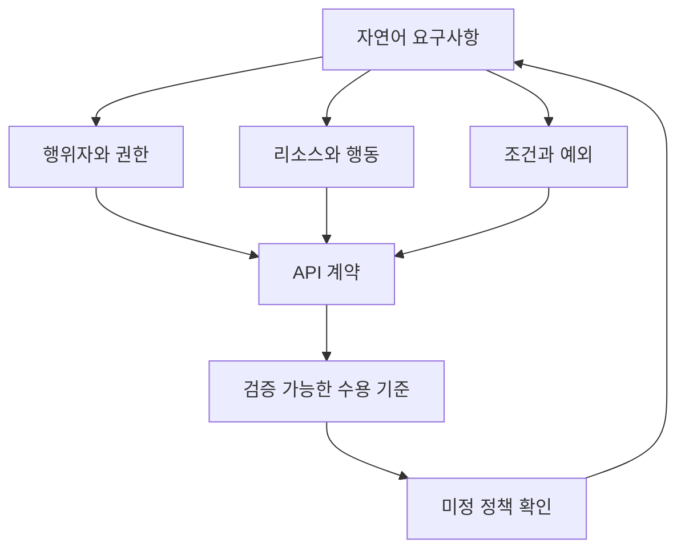
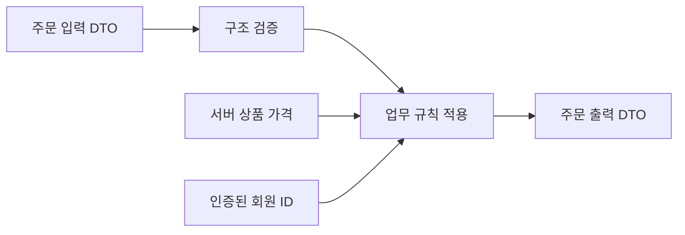
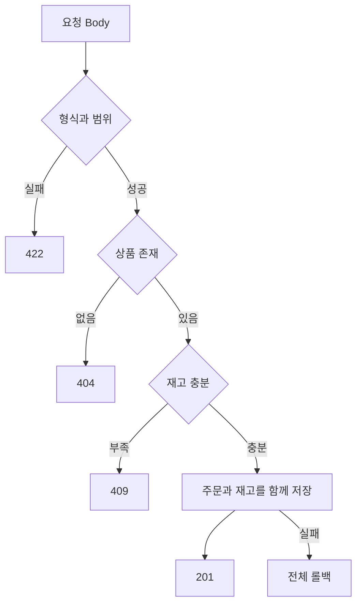
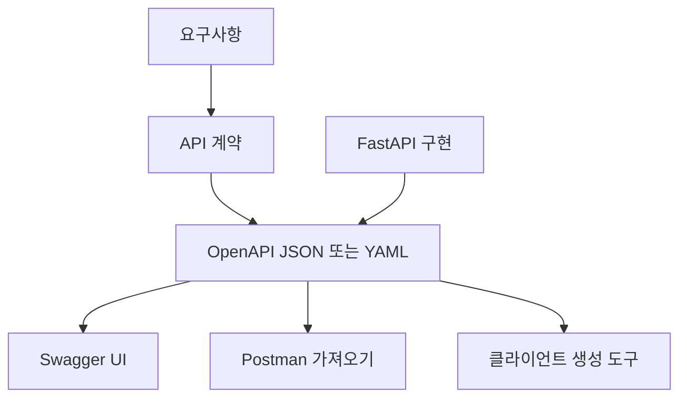

# 4-2. API 스펙 정의 — 8H

[전체 목차](00-index.md) · [이전: REST](04-01-rest.md) · [다음: JWT](04-03-jwt.md)

## 단원 목차

- [1. 목표와 시간표](#s1)
- [2. 자연어를 계약으로 바꾸기](#s2)
- [3. 요청·응답 설계](#s3)
- [4. 예외·권한·업무 규칙](#s4)
- [5. OpenAPI로 명세 표현](#s5)
- [6. FastAPI 실행 예제](#s6)
- [7. AI 협업과 스펙 검토 실습](#s7)
- [8. 평가와 해설](#s8)

<a id="s1"></a>
## 1. 목표와 시간표

자연어에서 행위자·리소스·조건을 추출하고 빠진 정책을 질문으로 바꾼다. 요청·응답·오류·권한을 포함한 API 계약을 정의한다. 명세와 구현 차이를 검증한다.

| 교시 | 내용 | 결과 |
|---|---|---|
| 1 | 요구사항 분해 | 행위자·행동·대상 표시 |
| 2 | 입력·출력 계약 | 타입·필수·범위 표 |
| 3 | OpenAPI·스키마 | YAML 구조 읽기 |
| 4 | 상품·주문 스펙 작성 | 6개 이상 엔드포인트 |
| 5 | Pydantic 구현 | 입력·출력 모델 분리 |
| 6 | 오류·권한 계약 | 상태 코드와 테스트 연결 |
| 7 | AI 초안 리뷰 | 누락·추측·충돌 수정 |
| 8 | 평가 | 추적표와 스펙 제출 |

<a id="s2"></a>
## 2. 자연어를 계약으로 바꾸기

“회원은 상품 여러 개를 주문하고 자신의 주문을 볼 수 있다.”는 좋은 시작이지만 구현할 만큼 구체적이지 않다. 수량·재고·가격·중복 주문·취소 가능 상태 같은 조건이 빠져 있다.



| 자연어 표현 | 추출 내용 | 결정할 계약 |
|---|---|---|
| 회원은 | 인증된 사용자 | Bearer 토큰 필요 |
| 상품 여러 개 | items 배열 | 1~20개, 중복 상품 정책 |
| 주문하고 | 주문 생성 | POST /orders |
| 자신의 주문 | 객체 소유권 | 토큰 subject와 주문 owner 비교 |
| 볼 수 있다 | 목록·상세 조회 | GET /me/orders, GET /orders/{id} |

### 요구사항 추적표

| ID | 요구사항 | API | 수용 기준 |
|---|---|---|---|
| R01 | 상품 조회 | GET /products/{id} | 존재 시 200, 부재 시 404 |
| R02 | 회원 주문 | POST /orders | 유효 입력 시 201, 서버 가격으로 계산 |
| R03 | 내 주문 목록 | GET /me/orders | 타인 주문이 목록에 포함되지 않음 |
| R04 | 본인 주문 상세 | GET /orders/{id} | 타인 주문에는 정책상 404 |
| R05 | 미배송 주문 취소 | POST /orders/{id}/cancellations | 배송 후 409 |
| R06 | 인증 만료 대응 | POST /auth/refresh | 새 access, 이전 refresh 재사용 차단 |

**미정 정책은 AI가 사실처럼 채우게 하지 않는다.** “주문 수량은 최대 몇 개?”, “가격이 결제 전 바뀌면 어떻게 할까?”, “재고 부족은 409인가?”를 결정 목록에 넣는다. 본 교안에서는 항목 1~20개, 항목 수량 1~99, 재고 부족 409를 교육용 정책으로 채택한다.

<a id="s3"></a>
## 3. 요청·응답 설계

API 스펙은 주소만 적은 목록이 아니라 두 프로그램이 서로 의존할 수 있는 계약이다.

| 계약 요소 | 주문 생성 예시 |
|---|---|
| 식별 | createOrder, POST /api/v1/orders |
| 요청 형식 | Content-Type: application/json |
| 인증 | Authorization: Bearer access_token |
| 입력 | items: [{product_id, quantity}] |
| 성공 | 201, Location: /api/v1/orders/35 |
| 출력 | id, status, items, total_amount |
| 오류 | 401, 404, 409, 422 |
| 부작용 | 주문·항목 기록과 재고 반영 |
| 동시성 | 하나의 DB 트랜잭션, 재고 경쟁 처리 |



DTO는 계층 사이에서 전달하는 데이터 구조다. 요청 DTO에는 사용자가 지정할 수 있는 필드만 포함하고, 응답 DTO에는 공개할 필드만 포함한다.

```json
{
  "items": [
    {"product_id": 12, "quantity": 2},
    {"product_id": 25, "quantity": 1}
  ]
}
```

사용자가 `user_id`, `role`, `total_amount`, `price`를 보내서 서버 결정을 덮어쓰게 하면 안 된다. 서버가 회원 ID와 상품 단가를 결정한다. 금액은 원 단위 정수 또는 DB Decimal 등 명확한 단위를 사용하고 이진 부동소수점에 맡기지 않는다.

```json
{
  "id": 35,
  "status": "pending",
  "items": [{"product_id": 12, "quantity": 2, "unit_price": 30000}],
  "total_amount": 60000
}
```

위 두 JSON은 구조 예시이며 동일 주문의 요청·응답 쌍은 아니다. 실제 문서의 쌍 예시는 항목 수·가격·합계가 일치해야 한다.

### 필드 명세

| 필드 | 타입 | 필수 | 검증 | 설명 |
|---|---|---|---|---|
| items | 배열 | 예 | 길이 1~20 | 주문 항목 |
| product_id | 정수 | 예 | >0, DB 존재 | 상품 식별자 |
| quantity | 정수 | 예 | 1~99 | 수량 |
| total_amount | 정수 | 응답 전용 | ≥0 | 서버 계산 총액, KRW |
| status | 문자열 enum | 응답 전용 | pending/cancelled 등 | 업무 상태 |

필수 여부와 null 허용은 다르다. 필수 필드라도 null을 허용할 수 있고, 선택 필드라도 값이 존재하면 null을 거부할 수 있다. 문서·Pydantic·DB 제약을 함께 확인한다.

<a id="s4"></a>
## 4. 예외·권한·업무 규칙



구조 검증은 입력 모양과 범위를 확인하고 업무 검증은 DB·현재 상태·정책을 확인한다. 수량이 0이면 구조 검증 실패, 수량이 5인데 재고가 3이면 업무 충돌이다.

### 오류 계약 선택

교육용 기본 코드에서는 FastAPI의 `{"detail": ...}` 응답을 사용한다. 팀 프로젝트에서 아래처럼 통일된 오류 스키마를 선택했다면 예외 핸들러와 검증 오류 핸들러를 함께 구현해야 한다.

```json
{
  "error": {
    "code": "OUT_OF_STOCK",
    "message": "재고가 부족합니다.",
    "request_id": "req-001"
  }
}
```

| 상황 | 상태 | 사용자 정보 | 서버 기록 |
|---|---:|---|---|
| 비밀번호 실패 | 401 | 일반화된 로그인 실패 | 계정 식별·시도·시각, 비밀번호 제외 |
| 타인 주문 접근 | 404 정책 | 주문을 찾을 수 없음 | 주체·대상·차단 결과 |
| 재고 부족 | 409 | 재고 충돌 안내 | 상품·요청량·시점 |
| 내부 장애 | 500 | 일반화된 메시지·요청 ID | 스택·원인, 민감정보 제거 |

AI가 “인증 필요”라고 적었다고 인가가 완성된 것은 아니다. 역할 검사와 객체 소유권을 따로 적는다. 로그인한 A가 B의 주문을 읽는 문제는 JWT 서명 검증만으로 해결되지 않는다.

<a id="s5"></a>
## 5. OpenAPI로 명세 표현

OpenAPI는 HTTP API의 기계가 읽는 설명 형식이다. Swagger UI는 이를 화면에서 탐색·실행하게 해 주는 도구다. 명세와 뷰어를 구별한다.



다음은 독립적인 상품 조회 스펙이다. 최신 표준 번호를 무조건 사용할 필요는 없으며 사용하는 도구가 지원하는 버전을 선택한다.

```yaml
openapi: 3.1.0
info:
  title: 상품 API
  version: 1.0.0
servers:
  - url: http://127.0.0.1:8000
paths:
  /api/v1/products/{product_id}:
    get:
      operationId: getProduct
      summary: 상품 상세 조회
      tags: [products]
      parameters:
        - name: product_id
          in: path
          required: true
          schema:
            type: integer
            minimum: 1
      responses:
        '200':
          description: 조회 성공
          content:
            application/json:
              schema:
                $ref: '#/components/schemas/ProductOut'
        '404':
          description: 상품 없음
          content:
            application/json:
              schema:
                $ref: '#/components/schemas/ErrorOut'
components:
  schemas:
    ProductOut:
      type: object
      required: [id, name, price]
      properties:
        id: {type: integer}
        name: {type: string}
        price: {type: integer, minimum: 0}
    ErrorOut:
      type: object
      required: [detail]
      properties:
        detail: {type: string}
  securitySchemes:
    bearerAuth:
      type: http
      scheme: bearer
      bearerFormat: JWT
```

보안 스키마 선언만으로 보호되지 않는다. 보호할 operation에 `security: [{bearerAuth: []}]`를 선언하고 서버 검증도 구현한다. 위 상품 조회는 공개이므로 security를 적용하지 않았다. 이 YAML은 표기 학습용 축약 명세로, 전체 명세에는 입력 검증 실패인 422도 포함한다.

<a id="s6"></a>
## 6. FastAPI 실행 예제

별도 실습 폴더의 main.py로 저장한다. 필드 설명·예제·응답 모델이 자동 문서에 반영되는 과정을 확인한다.

```python
from fastapi import FastAPI, HTTPException, Path
from pydantic import BaseModel, ConfigDict, Field

app = FastAPI(title="상품 계약 실습", version="1.0.0")

class ProductOut(BaseModel):
    id: int
    name: str
    price: int

class ProductCreate(BaseModel):
    model_config = ConfigDict(extra="forbid")
    name: str = Field(min_length=1, max_length=100, examples=["키보드"])
    price: int = Field(ge=0, description="원 단위 정수")

class ErrorOut(BaseModel):
    detail: str

products = {12: ProductOut(id=12, name="키보드", price=30000)}

@app.get(
    "/api/v1/products/{product_id}",
    response_model=ProductOut,
    summary="상품 상세 조회",
    operation_id="getProduct",
    tags=["products"],
    responses={404: {"model": ErrorOut, "description": "상품 없음"}},
)
def get_product(product_id: int = Path(gt=0)):
    product = products.get(product_id)
    if product is None:
        raise HTTPException(404, "상품을 찾을 수 없습니다.")
    return product

@app.post("/api/v1/products/validate", response_model=ProductCreate)
def validate_product(body: ProductCreate):
    # 저장 API가 아니라 입력 검증을 관찰하는 교육용 엔드포인트
    return body
```

```powershell
.\.venv\Scripts\python.exe -m uvicorn main:app --reload
```

- `/docs`에서 요청 경로·응답 스키마·자동 422 문서를 확인한다.
- `/openapi.json`에서 `operationId`, `responses`, `components`를 찾는다.
- `/products/validate`에 `role:"admin"`을 추가하면 `extra="forbid"`에 의해 422인지 확인한다.
- JSON 바디와 Path의 역할을 구분한다. operationId는 클라이언트 생성에서 사용하므로 전체 명세에서 유일하게 만든다.

<a id="s7"></a>
## 7. AI 협업과 스펙 검토 실습

```text
다음 요구사항에서 API 스펙 초안을 작성하라.
대상: 회원이 상품을 주문하고 자신의 주문을 조회·취소한다.
출력: 요구사항 ID, 메서드, URI, 입력 스키마, 성공 응답,
오류 응답, 역할·소유권, 동시성·재시도 정책, 검증 시나리오.
미정 정책은 '확인 필요'로 표시하고 임의로 확정하지 마라.
user_id·price·total_amount는 사용자 입력으로 신뢰하지 마라.
모든 성공·실패 응답을 구현 가능한 계약으로 작성하라.
```

| 단계 | 사람 | AI | 검증 |
|---|---|---|---|
| 초안 | 정책·제약 제공 | 표와 스키마 생성 | 누락·추측 표시 |
| 비교 | 기존 코드·DB 확인 | 계약 차이 목록 | 이름·타입·상태 비교 |
| 결정 | 미정 정책 확정 | 문서 반영 | 변경 영향 확인 |
| 구현 | 책임·권한 설계 | 코드 초안 보조 | 실행·부정 테스트 |

실습 A: 주문 생성 명세를 작성하고 최소 8개 실패·경계 시나리오를 연결한다. 실습 B: 스펙에 `total_amount`가 입력 필드로 포함된 AI 초안을 수정한다. 실습 C: “회원 주문 조회”를 목록과 상세로 나누고 소유권 검사 위치를 적는다.

<a id="s8"></a>
## 8. 평가와 해설

1. 스펙에 200만 있으면 충분한가? → 실패·권한·검증 응답이 빠져 프론트와 테스트가 추측하게 된다.
2. 요청·DB·응답 모델을 같게 쓰면 생기는 문제는? → 비밀번호 해시 노출이나 서버 전용 필드 변경 위험이 생긴다.
3. 문서에 JWT 필요라고 쓰면 보호되는가? → 문서는 계약이고 서버 검증을 구현해야 한다.
4. AI가 모호한 수량 제한을 100으로 적었다면? → 정책 근거를 확인하고 미정으로 되돌리거나 사람이 승인한 값을 반영한다.

**제출물:** 요구사항 추적표, API 명세 6개 이상, OpenAPI 파일 또는 자동 명세, 불일치 검토 기록.

## 공식 참고

- [OpenAPI 표준](https://spec.openapis.org/oas/latest.html)
- [FastAPI 응답 모델](https://fastapi.tiangolo.com/tutorial/response-model/)
- [FastAPI 메타데이터](https://fastapi.tiangolo.com/tutorial/metadata/)

[전체 목차](00-index.md) · [다음 단원](04-03-jwt.md)
