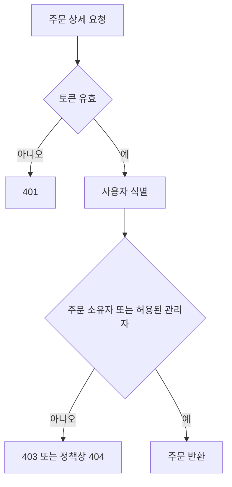
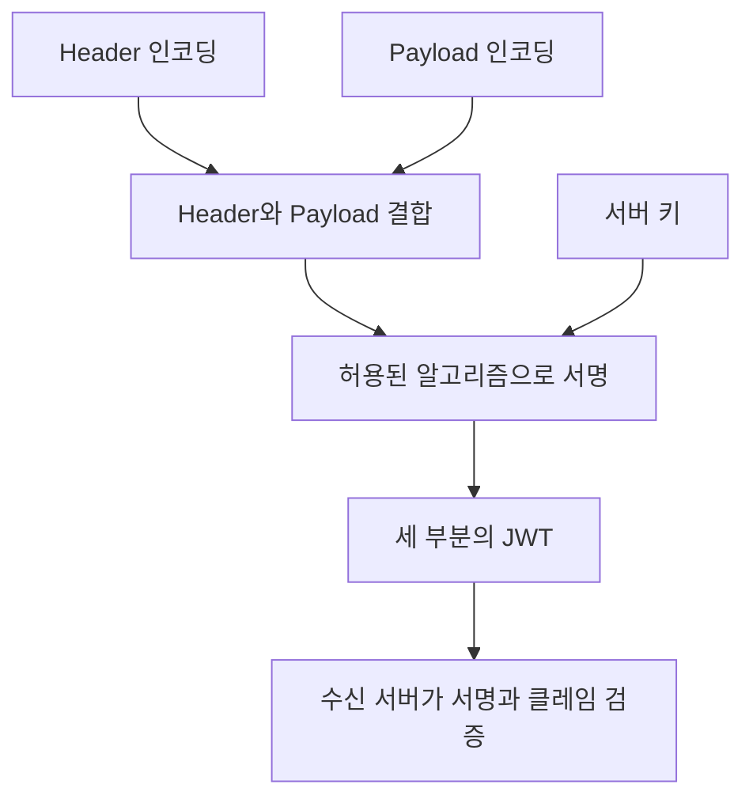
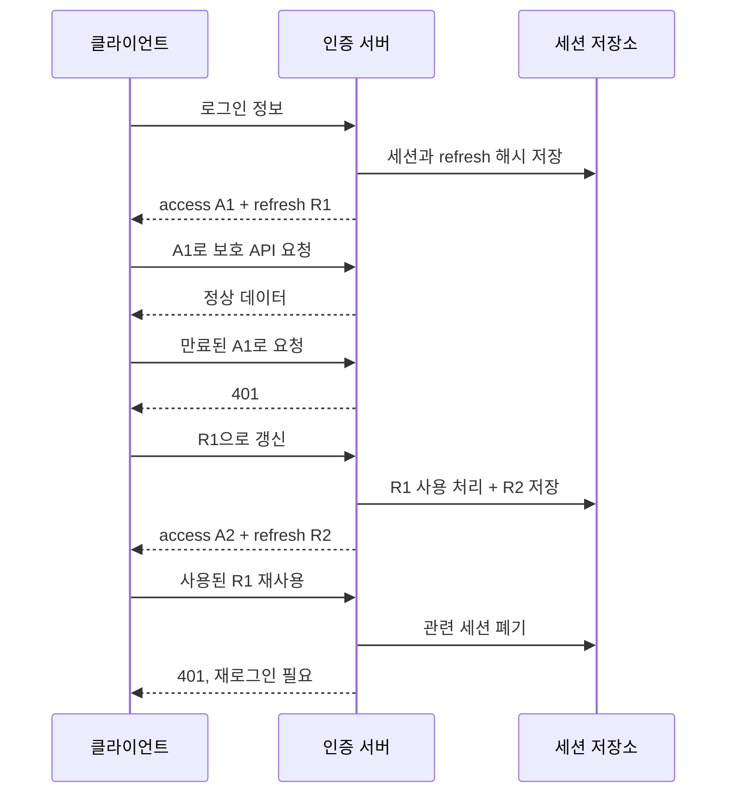
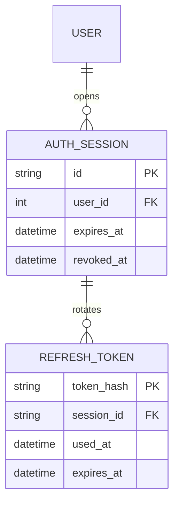

# 4-3. JWT 인증 구현 — 8H

[전체 목차](00-index.md) · [이전: 스펙](04-02-spec.md) · [다음: OAuth2](04-04-oauth.md)

## 단원 목차

- [1. 목표와 시간표](#s1)
- [2. 인증과 인가](#s2)
- [3. JWT 구조와 검증](#s3)
- [4. 토큰 수명·저장·갱신](#s4)
- [5. 독립 실행 인증 API](#s5)
- [6. 운영 설계로 확장](#s6)
- [7. 실습과 확인 문제](#s7)

<a id="s1"></a>
## 1. 목표와 시간표

JWT의 서명·클레임을 설명하고 인증과 객체 인가를 구분한다. 로그인·검증·갱신·로그아웃을 구현한다. 만료·변조·리프레시 재사용을 차단한다.

| 교시 | 내용 | 활동 |
|---|---|---|
| 1 | 인증·인가, 비밀번호 해시 | 로그인·권한 사례 분류 |
| 2 | JWT 구조·검증 | 클레임·서명 비교 |
| 3 | 수명·회전·폐기 | 시퀀스 설명 |
| 4 | 로그인·/me | 실행 코드 구성 |
| 5 | refresh·logout | 토큰 갱신 관찰 |
| 6 | 부정 테스트 | 변조·누락·재사용 차단 |
| 7 | 소유권·운영 설계 | DB 회전·쿠키 정책 |
| 8 | 평가 | 인증 흐름 시연 |

<a id="s2"></a>
## 2. 인증과 인가

**인증(Authentication)**은 “누구인가?”, **인가(Authorization)**는 “이 작업과 이 대상에 접근해도 되는가?”를 확인한다. 로그인한 사용자가 다른 회원의 주문을 읽으면 인증은 성공했지만 인가가 실패한 것이다.



| 보안 단계 | 무엇을 확인 | 실패 사례 |
|---|---|---|
| 비밀번호 검증 | 저장된 해시와 입력 비교 | 틀린 비밀번호 |
| 토큰 검증 | 서명·만료·발급자·대상 | 위조 JWT |
| 사용자 확인 | 존재·활성 상태 | 탈퇴 회원 |
| 기능 인가 | 역할·권한 | 회원의 관리자 API |
| 객체 인가 | 주체와 리소스 관계 | 타인 주문 ID 접근 |

비밀번호는 복호화 가능한 암호문 대신 검증용 해시를 저장한다. Argon2 같은 비밀번호 전용 해시를 사용하며 라이브러리가 salt를 관리하게 한다. 빠른 SHA-256만으로 비밀번호를 저장하는 방식과 구별한다. 단, 충분히 무작위인 리프레시 토큰의 저장용 해시는 SHA-256 등을 사용할 수 있다.

<a id="s3"></a>
## 3. JWT 구조와 검증

JWT는 클레임을 담는 형식이다. 여기서는 서명된 JWS 형태의 JWT를 사용한다. **Base64url은 암호화가 아니므로 payload 내용은 읽을 수 있다.** 비밀번호·주민번호·민감한 개인정보를 넣지 않는다.

| 부분 | 내용 | 역할 |
|---|---|---|
| Header | alg, typ | 서명 형식 등의 정보 |
| Payload | sub, exp, iss, aud 등 | 주체·유효기간·사용 대상 |
| Signature | 키로 계산한 서명 | 위변조 검증 |



| 클레임 | 설명 | 검증 이유 |
|---|---|---|
| sub | 사용자 식별자 | 누가 호출했는지 식별 |
| exp | 만료 시각 | 오래된 토큰 거부 |
| iat | 발급 시각 | 발급 시점 확인 |
| nbf | 이 시각 전 사용 금지 | 미래 효력 토큰 제어 |
| iss | 발급자 | 다른 발급자의 토큰 거부 |
| aud | 수신 대상 | 다른 API용 토큰 거부 |
| jti | 개별 토큰 ID | 추적·폐기 정책 지원 |
| token_use | 서비스 전용 구분 | access와 다른 용도 혼동 방지 |

`jwt.decode()`에 허용 알고리즘을 서버 설정으로 지정한다. 토큰의 alg를 그대로 신뢰해서 선택하지 않는다. 필수 클레임의 **존재**와 **값**을 모두 확인한다. sub가 유효해도 비활성 사용자나 폐기된 세션은 거부한다.

HS256은 발급·검증이 같은 비밀키를 사용하므로 검증 서버도 토큰을 발급할 능력이 있다. RS256 등은 발급용 개인키와 검증용 공개키를 구분한다. 서비스 수·키 배포·회전 정책에 따라 선택하며 JWT 자체가 강력한 보안을 자동으로 보장하지 않는다.

<a id="s4"></a>
## 4. 토큰 수명·저장·갱신

| 구분 | Access token | Refresh token |
|---|---|---|
| 목적 | API 접근 | 새 access 발급 |
| 교육 예시 수명 | 10분 | 세션 최대 7일 |
| 형식 | 서명된 JWT | 무작위 opaque 문자열 |
| 전달 대상 | 보호 API | refresh·logout API |
| 서버 저장 | 정책에 따라 세션 확인 | 해시·수명·사용 여부·세션 |
| 탈취 영향 | 만료까지 API 접근 가능 | 반복 갱신 위험, 회전·폐기로 대응 |

10분·7일은 표준 강제값이 아니라 교육용 정책이다. 이 예제는 세션의 절대 만료를 유지하므로 갱신할 때마다 7일이 늘어나지 않는다.



갱신은 이전 토큰 사용 처리와 새 토큰 저장을 원자적으로 수행한다. 사용된 토큰을 즉시 삭제하면 재사용한 토큰의 세션을 식별할 수 없으므로 재사용 감지용 기록을 만료 정책에 맞춰 유지한다. 탈취와 네트워크 재시도를 완벽히 구별하기 어렵기 때문에 클라이언트는 refresh 동시 호출을 하나로 합치는 제어가 필요하다.

### 브라우저 저장 선택

| 선택 | 장점 | 주의점 |
|---|---|---|
| access를 JS 메모리에 보관 | 지속 저장 감소 | 새로고침 시 사라짐, XSS 영향 존재 |
| localStorage | 구현 단순 | XSS가 토큰을 읽을 수 있음 |
| HttpOnly 쿠키 | JS의 직접 읽기 차단 | 자동 전송되므로 CSRF·SameSite·출처 정책 필요 |
| 서버 BFF 세션 | 브라우저에 제공자 토큰 숨김 | 서버 세션·쿠키·CSRF 관리 필요 |

쿠키는 HttpOnly·Secure·SameSite·Path·Domain을 환경과 흐름에 맞춰 설정한다. SameSite만으로 모든 CSRF 대응을 대체하지 않는다. 이 단원의 JSON 토큰 전달은 Postman 학습용이며 웹 서비스 저장 전략은 별도 선택해야 한다.

<a id="s5"></a>
## 5. 독립 실행 인증 API

공통 설치 목록을 사용한다. 아래를 별도 폴더의 main.py로 저장한다. 이 예제는 **단일 프로세스 메모리 저장소**이며 재시작 시 세션이 사라진다. 잠금은 한 프로세스 안에서만 유효하다. 운영에서는 DB 트랜잭션과 영속 저장이 필요하다.

```python
import hashlib
import os
import secrets
import threading
from datetime import datetime, timedelta, timezone
from uuid import uuid4

import jwt
from jwt.exceptions import InvalidTokenError
from pwdlib import PasswordHash
from fastapi import Depends, FastAPI, HTTPException
from fastapi.security import HTTPAuthorizationCredentials, HTTPBearer
from pydantic import BaseModel, ConfigDict

app = FastAPI(title="JWT 인증 실습")
SECRET = os.environ["JWT_SECRET"]
if len(SECRET.encode()) < 32:
    raise RuntimeError("JWT_SECRET은 충분히 무작위인 32바이트 이상이어야 합니다.")
ISSUER, AUDIENCE = "class-api", "class-client"
password_hash = PasswordHash.recommended()
# 강의용 계정. 운영에서는 회원 DB에서 읽는다.
users = {"student": {"id": "1", "hash": password_hash.hash("class-password"),
                     "active": True}}
bearer = HTTPBearer(auto_error=False)
lock = threading.RLock()
sessions = {}
refresh_records = {}

class LoginIn(BaseModel):
    model_config = ConfigDict(extra="forbid")
    username: str
    password: str

class RefreshIn(BaseModel):
    model_config = ConfigDict(extra="forbid")
    refresh_token: str

class TokenOut(BaseModel):
    access_token: str
    refresh_token: str
    token_type: str = "bearer"
    expires_in: int = 600

class MeOut(BaseModel):
    id: str
    username: str


def now():
    return datetime.now(timezone.utc)


def unauthorized():
    return HTTPException(401, "유효한 인증 정보가 필요합니다.",
                         headers={"WWW-Authenticate": "Bearer"})


def digest(token):
    return hashlib.sha256(token.encode()).hexdigest()


def issue_pair(sid):
    session = sessions[sid]
    current = now()
    access = jwt.encode({
        "sub": session["uid"], "sid": sid, "jti": str(uuid4()),
        "iat": current, "exp": current + timedelta(minutes=10),
        "iss": ISSUER, "aud": AUDIENCE, "token_use": "access",
    }, SECRET, algorithm="HS256")
    raw = secrets.token_urlsafe(32)
    refresh_records[digest(raw)] = {"sid": sid, "used": False}
    return TokenOut(access_token=access, refresh_token=raw)


@app.post("/api/v1/auth/login", response_model=TokenOut)
def login(body: LoginIn):
    user = users.get(body.username)
    # 부재 계정에도 해시 검증을 수행해 시간차를 줄이는 교육 예시
    stored_hash = user["hash"] if user else users["student"]["hash"]
    valid = password_hash.verify(body.password, stored_hash)
    if not user or not valid or not user["active"]:
        raise unauthorized()
    with lock:
        sid = str(uuid4())
        sessions[sid] = {"uid": user["id"], "expires": now() + timedelta(days=7),
                         "revoked": False}
        return issue_pair(sid)


def current_user(
    credentials: HTTPAuthorizationCredentials | None = Depends(bearer),
):
    if credentials is None or credentials.scheme.lower() != "bearer":
        raise unauthorized()
    try:
        payload = jwt.decode(
            credentials.credentials, SECRET, algorithms=["HS256"],
            issuer=ISSUER, audience=AUDIENCE,
            options={"require": ["sub", "exp", "iat", "iss", "aud", "sid", "jti"]},
        )
        if payload.get("token_use") != "access":
            raise unauthorized()
    except InvalidTokenError:
        raise unauthorized()
    with lock:
        session = sessions.get(payload["sid"])
        if (not session or session["revoked"] or session["expires"] <= now()
                or session["uid"] != payload["sub"]):
            raise unauthorized()
    for username, user in users.items():
        if user["id"] == payload["sub"] and user["active"]:
            return {"id": user["id"], "username": username}
    raise unauthorized()


@app.get("/api/v1/me", response_model=MeOut)
def me(user=Depends(current_user)):
    return user


@app.post("/api/v1/auth/refresh", response_model=TokenOut)
def refresh(body: RefreshIn):
    with lock:
        record = refresh_records.get(digest(body.refresh_token))
        if not record:
            raise unauthorized()
        session = sessions[record["sid"]]
        if record["used"]:
            session["revoked"] = True  # 사용된 토큰 재사용: 세션 전체 폐기
            raise unauthorized()
        if session["revoked"] or session["expires"] <= now():
            raise unauthorized()
        if not any(u["id"] == session["uid"] and u["active"] for u in users.values()):
            session["revoked"] = True
            raise unauthorized()
        record["used"] = True
        return issue_pair(record["sid"])


@app.post("/api/v1/auth/logout", status_code=204)
def logout(body: RefreshIn):
    with lock:
        record = refresh_records.get(digest(body.refresh_token))
        if record:
            sessions[record["sid"]]["revoked"] = True
    # 존재 여부와 관계없이 204: 반복 호출 정책
    return None
```

PowerShell에서 키를 만들고 실행한다. 생성된 키를 Git이나 문서에 복사하지 않는다.

```powershell
$env:JWT_SECRET = (.\.venv\Scripts\python.exe -c "import secrets; print(secrets.token_hex(32))")
.\.venv\Scripts\python.exe -m uvicorn main:app --reload
```

| 순서 | 요청 | 입력·기대 |
|---|---|---|
| 1 | POST /api/v1/auth/login | JSON: username=student, password=class-password → 200 |
| 2 | GET /api/v1/me | Bearer access_token → id·username만 반환 |
| 3 | POST /api/v1/auth/refresh | JSON: refresh_token=R1 → A2·R2 |
| 4 | GET /api/v1/me | A2 → 200 |
| 5 | POST /api/v1/auth/refresh | 이전 R1 재사용 → 401·세션 폐기 |
| 6 | GET /api/v1/me | A2도 폐기 세션 때문에 401 |
| 7 | 다시 로그인 후 logout | 새 refresh 전달 → 204, 새 access도 401 |

예제는 access 요청마다 세션 상태를 조회하므로 JWT만으로 완전히 무상태 검증하는 구조가 아니다. 그 대신 로그아웃·재사용 감지 후 access도 즉시 차단한다. 이 선택의 성능·가용성 비용을 설명할 수 있어야 한다.

<a id="s6"></a>
## 6. 운영 설계로 확장



회전 처리 의사코드:

```text
BEGIN
  토큰 해시로 토큰·세션 조회 및 필요한 행 잠금
  사용된 토큰이면 세션 폐기 상태 기록
  폐기 변경을 COMMIT한 뒤 인증 실패 응답
  유효하면 이전 토큰 used_at 기록
  새 무작위 토큰의 해시 저장
COMMIT
새 토큰 쌍 응답
```

예외를 던지면서 트랜잭션 전체를 롤백하면 재사용 감지 시 기록한 폐기도 사라질 수 있다. **폐기 기록이 실제로 커밋된 뒤 401을 반환하는지** 확인한다. 사용 완료 기록은 재사용 탐지 기간 동안 보존하고 만료 레코드를 정리한다.

| 운영 변경 | 목적 |
|---|---|
| DB·Redis 등 공유 저장소 | 여러 프로세스에서 세션 상태 공유 |
| DB 잠금·조건부 UPDATE | 동시에 같은 refresh가 두 번 성공하는 문제 방지 |
| 사용자 상태·역할 확인 | 탈퇴·정지·권한 변경 반영 |
| 키 회전·키 ID 정책 | 키 교체와 이전 토큰의 검증 기간 관리 |
| 로그인 제한·관측 | 반복 추측과 토큰 악용 탐지 |
| 민감정보 제거 로그 | Authorization·비밀번호·토큰 원문 제외 |

객체 인가 예시 — 기존 주문 서비스에 통합하는 코드 조각이다:

```python
# order = repository.get(order_id)로 조회한 뒤
if order is None or order.user_id != int(current_user["id"]):
    raise HTTPException(404, "주문을 찾을 수 없습니다.")
```

Body의 user_id나 프론트가 보내는 role은 인가 근거가 아니다. 관리자 예외가 있다면 서버가 검증한 역할에만 적용한다.

<a id="s7"></a>
## 7. 실습과 확인 문제

| 실습 | 조작 | 기대 |
|---|---|---|
| A | 토큰 한 글자 변경 | 401 |
| B | 토큰 없이 /me | 401 |
| C | 만료 JWT 사용 | 401 |
| D | aud·iss를 다르게 발급한 테스트 토큰 | 401 |
| E | access 대신 refresh를 Bearer로 사용 | 401 |
| F | 이전 refresh 재사용 | 401 + 세션 폐기 |
| G | 타인 주문 ID 요청 | 403 또는 명세상 404 |

만료·iss·aud 테스트는 학습용 키로 별도 토큰을 발급하거나 access 수명을 일시적으로 줄여 수행한다. 코드를 바꾼 뒤 정상 수명 정책으로 복원한다.

1. JWT payload에 비밀번호를 넣어도 서명했으니 안전한가? → 아니다. 서명은 암호화가 아니다.
2. refresh는 반드시 JWT여야 하는가? → 아니다. 무작위 opaque 토큰도 적합하다.
3. 로그아웃하면 모든 JWT가 자동으로 무효인가? → 아니다. 폐기 확인 또는 짧은 수명 같은 정책이 필요하다.
4. 회전을 메모리 dict로 구현한 서버를 여러 worker로 실행하면? → 서로 다른 상태를 보므로 운영 동작을 보장하지 못한다.
5. 비밀번호 해시와 refresh 해시에 같은 방식이 필요한가? → 아니다. 비밀번호의 낮은 엔트로피와 무작위 토큰의 높은 엔트로피가 다르다.

**제출물:** 실행 인증 API, 검증 결과표, 갱신 시퀀스, 서버 저장·폐기 정책.

## 공식 참고

- [FastAPI — JWT·pwdlib·PyJWT](https://fastapi.tiangolo.com/tutorial/security/oauth2-jwt/)
- [JWT — RFC 7519](https://www.rfc-editor.org/rfc/rfc7519)
- [JWT 보안 권고 — RFC 8725](https://www.rfc-editor.org/rfc/rfc8725)
- [OAuth2 보안 권고 — RFC 9700](https://www.rfc-editor.org/rfc/rfc9700.html)

[전체 목차](00-index.md) · [다음 단원](04-04-oauth.md)
