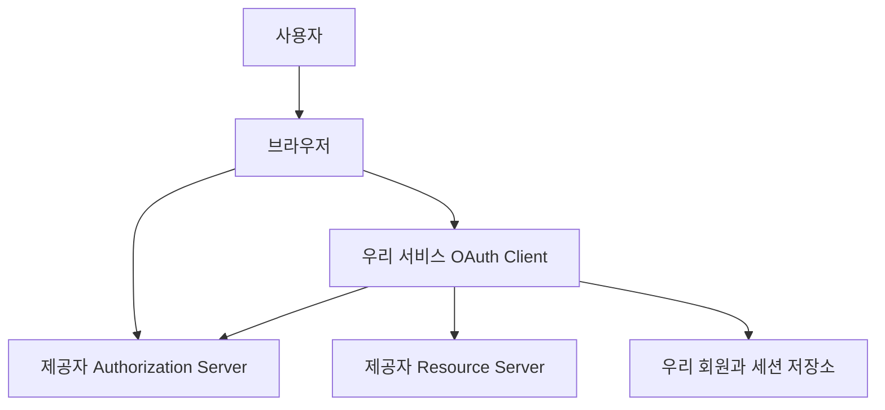
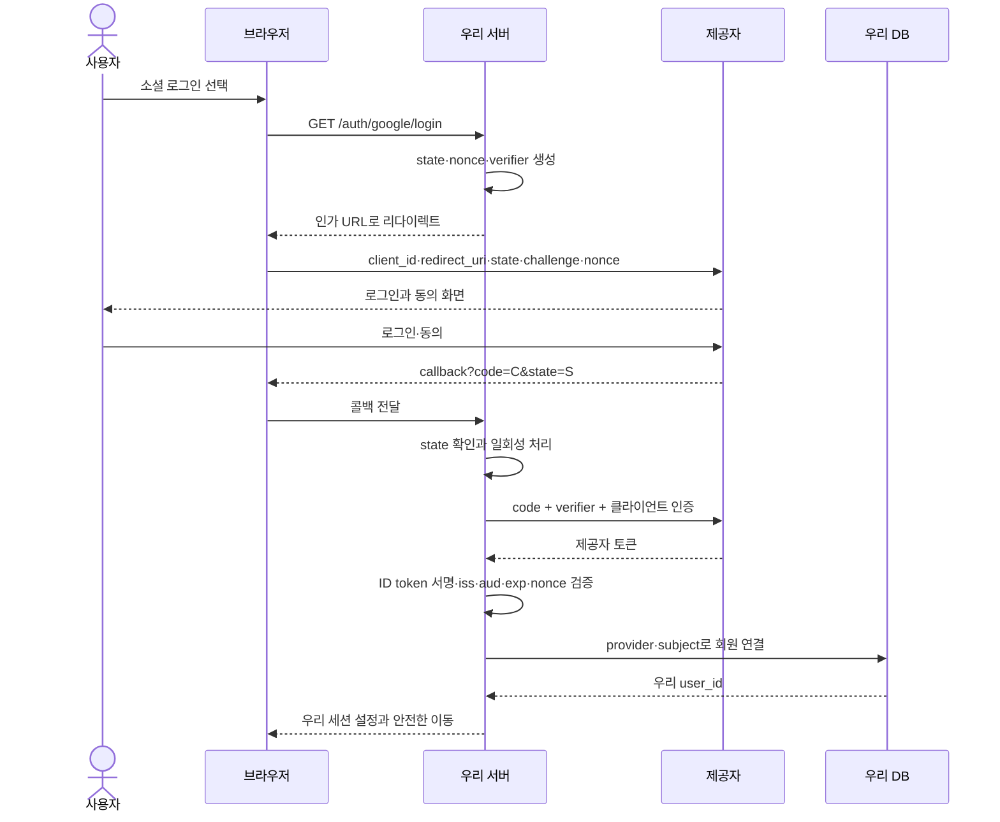
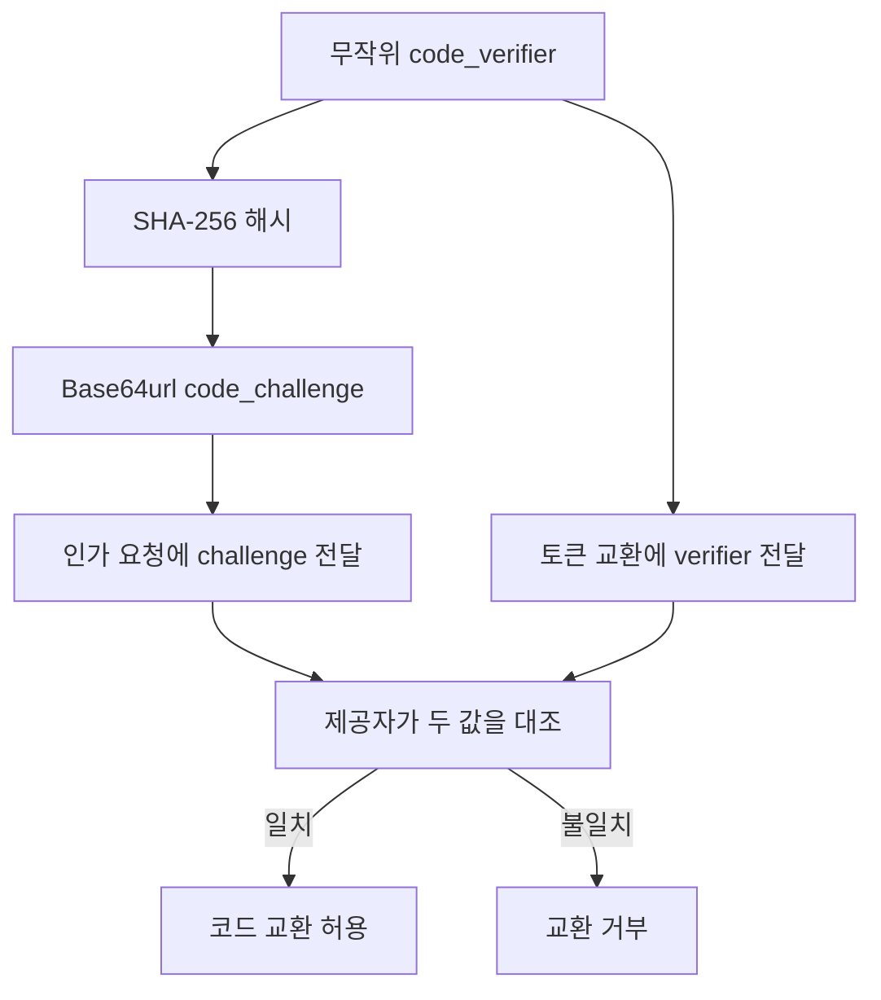
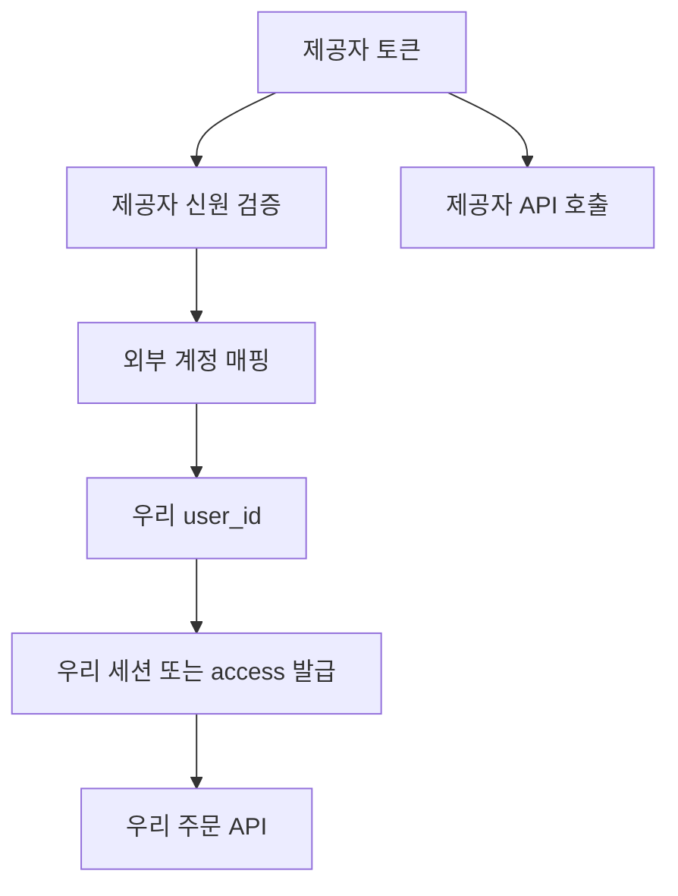
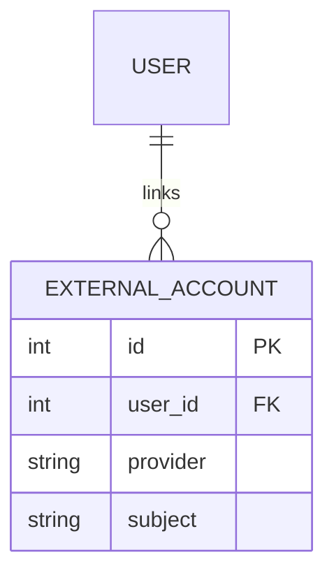
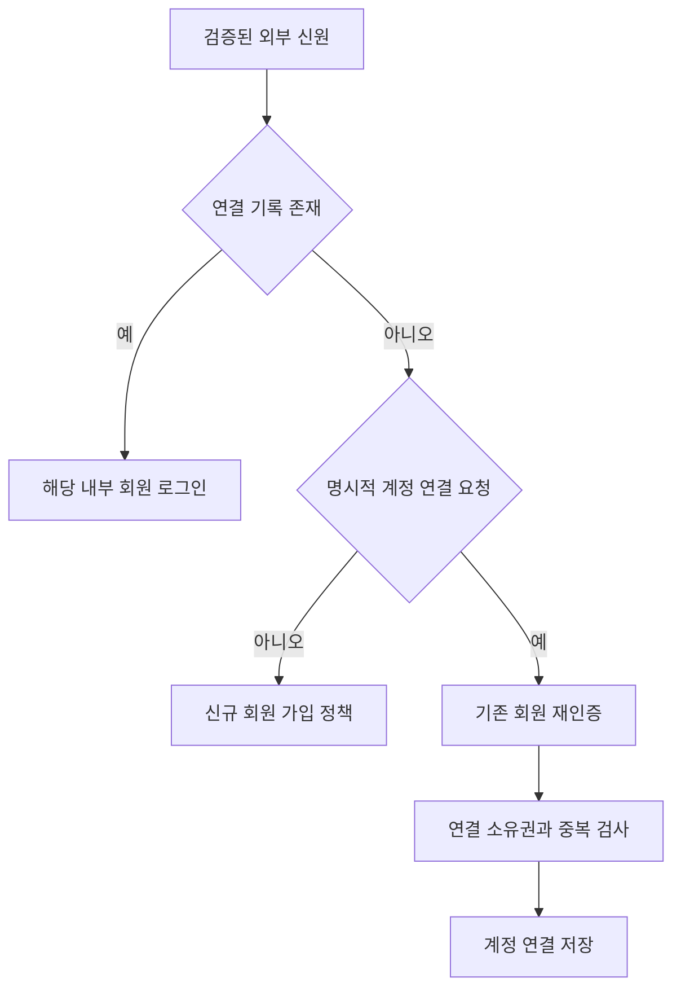

# 4-4. OAuth2 소셜 로그인 구현 — 8H

[전체 목차](00-index.md) · [이전: JWT](04-03-jwt.md) · [다음: 계층형 아키텍처](04-05-architecture.md)

## 단원 목차

- [1. 목표와 시간표](#s1)
- [2. OAuth2·OIDC·JWT 구분](#s2)
- [3. Authorization Code + PKCE](#s3)
- [4. 안전한 로그인 설계](#s4)
- [5. Google OIDC 연동 예제](#s5)
- [6. 계정 연결과 실패 처리](#s6)
- [7. 실습·평가](#s7)

<a id="s1"></a>
## 1. 목표와 시간표

OAuth2의 역할과 인가 흐름을 설명한다. 로그인에는 OIDC 또는 제공자가 정의한 신원 확인 과정이 필요함을 구분한다. state·PKCE·nonce·redirect URI·토큰 검증의 역할을 이해하고 콜백을 구현한다.

| 교시 | 내용 | 활동 |
|---|---|---|
| 1 | 역할·프로토콜 구분 | 세 종류 토큰 분류 |
| 2 | Code·PKCE | 요청 흐름 도식 |
| 3 | 보안·계정 연결 | 실패·오용 사례 분석 |
| 4 | 앱 등록·환경 설정 | redirect URI 일치 확인 |
| 5 | 로그인·콜백 | 제공자 로그인 시연 |
| 6 | 로컬 사용자 연결 | provider·subject 매핑 |
| 7 | 취소·오류·로그아웃 | 부정 시나리오 검증 |
| 8 | 평가 | 흐름과 보안 통제 설명 |

<a id="s2"></a>
## 2. OAuth2·OIDC·JWT 구분


OAuth2는 사용자가 앱에 **외부 자원 접근 권한을 위임**하는 프레임워크다. 로그인에 필요한 신원 확인 표준은 OAuth2 위의 OpenID Connect(OIDC)가 제공한다. OIDC가 없는 제공자는 자신의 사용자 정보 API를 통해 로그인 신원을 확인하는 방식이므로 해당 제공자의 문서를 따라야 한다.

| 이름 | 무엇인가 | 이 사례에서 역할 |
|---|---|---|
| OAuth2 | 인가 프레임워크 | 앱의 제한된 외부 API 접근 |
| OIDC | 신원 확인 계층 | 검증 가능한 ID token과 subject |
| JWT | 토큰 표현 형식 | ID token 또는 서비스 access 형식 |
| Bearer | 토큰 소지로 사용하는 방식 | Authorization 헤더 |

OAuth2 access token이 항상 JWT인 것은 아니다. ID token은 사용자를 인증하기 위한 것이며 우리 상품 API의 access token을 대신해 쓰지 않는다.

| 토큰 | 발급자 | 대상 | 사용처 |
|---|---|---|---|
| 제공자 access token | Google 등 | 제공자 API | 사용자 정보·허용 외부 자원 |
| 제공자 ID token | OIDC 제공자 | 등록된 client_id | 제공자 신원 확인 |
| 우리 access token/세션 | 우리 서버 | 우리 API·웹서비스 | 상품·주문 서비스 인증 |



Resource Owner는 사용자, Client는 우리 앱, Authorization Server는 로그인·동의·토큰 발급 시스템, Resource Server는 토큰으로 보호된 외부 API다. 서버가 같은 회사에 있어도 논리적 역할은 구별한다.

<a id="s3"></a>
## 3. Authorization Code + PKCE



백엔드 웹앱은 client secret을 서버에 보관한다. SPA·모바일 같은 public client는 secret을 안전하게 숨길 수 없으므로 secret을 내장해 보안 수단으로 삼지 않는다. PKCE는 public client에서 특히 중요하며 본 수업은 서버 웹앱에도 적용하는 구성을 사용한다.



| 값 | 해결하는 문제 | 관리 |
|---|---|---|
| state | 요청·콜백 연결, 로그인 CSRF 방어 | 무작위·사용자 세션 연결·일회성·짧은 TTL |
| code_verifier | 코드 탈취자가 교환하는 문제 | 임시 보관·교환 시만 전송 |
| nonce | ID token과 로그인 시도 연결 | 요청 nonce와 검증된 ID token 비교 |
| redirect_uri | 코드가 돌아갈 목적지 | 등록 값과 정확히 일치, 임의 주소 금지 |

PKCE를 사용한다고 모든 CSRF·계정 연결·리다이렉트 문제가 해결되지는 않는다. 본 교안에서는 state도 함께 사용한다. Authorization Code는 짧은 수명·일회성 교환용이고 API에 계속 사용하는 토큰이 아니다. 새 서비스는 Implicit Grant나 Resource Owner Password Credentials 방식 대신 제공자·환경에 맞는 Code 흐름을 선택한다.

<a id="s4"></a>
## 4. 안전한 로그인 설계

### 콜백 검증 순서

1. 시작한 세션·state·유효기간을 확인한다.
2. 제공자의 취소·오류 응답을 일반화된 오류로 변환한다.
3. 등록된 redirect URI와 PKCE verifier로 코드를 교환한다.
4. OIDC에서는 신뢰하는 메타데이터·공개키로 ID token을 검증한다.
5. issuer·audience·expiry·nonce 등 필요한 클레임을 확인한다.
6. 검증된 subject를 내부 회원 ID에 매핑한다.
7. 우리 서비스의 토큰 또는 서버 세션을 새로 발급한다.

검증 라이브러리가 지원하는 항목·issuer 정책을 확인하고 오류를 삼키지 않는다. 사용자 제공 URL을 discovery URL로 받아 서버가 임의 주소를 조회하게 하지 않는다.

### 제공자 토큰과 우리 서비스 인증의 경계



로그인만 필요하면 제공자 토큰을 장기 보관할 필요가 없을 수 있다. Gmail·Calendar 등의 외부 자원을 계속 호출해야 한다면 동의 범위, 저장 암호화, 제공자 refresh·회수 정책을 별도로 설계한다. 우리 refresh와 제공자 refresh는 수명·대상·발급자가 다르다.

<a id="s5"></a>
## 5. Google OIDC 연동 예제

이 예제는 실제 제공자 앱 등록이 있어야 전체 실행이 가능하다. 외부 로그인을 직접 재구현하지 않고 Authlib의 Starlette 연동을 이용한다. Google 설정은 제공자 콘솔의 현재 안내를 따르며 수업 전에 테스트 사용자·동의 화면·OAuth 웹 클라이언트를 준비한다.

### 준비

```powershell
.\.venv\Scripts\python.exe -m pip install Authlib httpx itsdangerous
$env:GOOGLE_CLIENT_ID = "발급받은-client-id"
$env:GOOGLE_CLIENT_SECRET = "발급받은-client-secret"
$env:SESSION_SECRET = (.\.venv\Scripts\python.exe -c "import secrets; print(secrets.token_hex(32))")
```

인가된 redirect URI에 **http://127.0.0.1:8000/auth/google/callback**을 등록하고 시작 URL에도 127.0.0.1을 사용한다. localhost와 127.0.0.1, 포트, 경로, http·https를 서로 다른 값으로 취급한다. 로컬 HTTP 허용 조건은 제공자 설정을 확인한다.

### main.py — 로컬 연동 실습

```python
import os
import secrets
import time
from uuid import uuid4

import httpx
from authlib.integrations.starlette_client import OAuth, OAuthError
from fastapi import FastAPI, HTTPException, Request
from fastapi.responses import RedirectResponse
from starlette.middleware.sessions import SessionMiddleware

app = FastAPI(title="OIDC 소셜 로그인 실습")
app.add_middleware(
    SessionMiddleware,
    secret_key=os.environ["SESSION_SECRET"],
    session_cookie="oauth_handshake",
    max_age=300,
    same_site="lax",
    https_only=False,  # 로컬 HTTP용. 외부 운영은 HTTPS + True
)

oauth = OAuth()
oauth.register(
    name="google",
    client_id=os.environ["GOOGLE_CLIENT_ID"],
    client_secret=os.environ["GOOGLE_CLIENT_SECRET"],
    server_metadata_url="https://accounts.google.com/.well-known/openid-configuration",
    client_kwargs={"scope": "openid email profile", "code_challenge_method": "S256"},
)
CALLBACK = "http://127.0.0.1:8000/auth/google/callback"
external_accounts = {}  # (provider, subject) -> local user_id
app_sessions = {}       # 무작위 세션 ID -> 우리 회원·만료

@app.get("/auth/google/login")
async def google_login(request: Request):
    return await oauth.google.authorize_redirect(request, CALLBACK)

@app.get("/auth/google/callback")
async def google_callback(request: Request):
    try:
        # 라이브러리가 state, PKCE 교환, OIDC ID token 검증을 처리
        token = await oauth.google.authorize_access_token(request)
    except OAuthError:
        request.session.clear()
        raise HTTPException(400, "소셜 로그인 요청을 확인할 수 없습니다.")
    except httpx.HTTPError:
        request.session.clear()
        raise HTTPException(502, "로그인 제공자와 통신할 수 없습니다.")
    identity = token.get("userinfo")
    if not identity or not identity.get("sub"):
        raise HTTPException(400, "검증된 사용자 정보가 필요합니다.")
    key = ("google", identity["sub"])
    uid = external_accounts.setdefault(key, str(uuid4()))
    # 외부 토큰·이메일을 쿠키에 넣지 않고 우리 세션 ID만 설정
    old_sid = request.cookies.get("app_session")
    if old_sid:
        app_sessions.pop(old_sid, None)
    sid = secrets.token_urlsafe(32)
    app_sessions[sid] = {"uid": uid, "expires": time.time() + 3600}
    request.session.clear()
    response = RedirectResponse("/me", status_code=303)
    response.set_cookie("app_session", sid, max_age=3600,
                        httponly=True, secure=False, samesite="lax")
    return response

@app.get("/me")
def me(request: Request):
    session = app_sessions.get(request.cookies.get("app_session"))
    if not session or session["expires"] <= time.time():
        raise HTTPException(401, "로그인이 필요합니다.")
    return {"id": session["uid"]}

@app.post("/auth/logout", status_code=204)
def logout(request: Request):
    # 로컬 실습의 동일 출처 CSRF 검사. 운영은 배포 출처·CSRF 토큰 정책 적용.
    if request.headers.get("origin") != "http://127.0.0.1:8000":
        raise HTTPException(403, "허용되지 않은 요청 출처입니다.")
    app_sessions.pop(request.cookies.get("app_session"), None)
    from fastapi import Response
    response = Response(status_code=204)
    response.delete_cookie("app_session")
    return response
```

```powershell
.\.venv\Scripts\python.exe -m uvicorn main:app --reload
```

브라우저에서 `/auth/google/login`을 연다. 성공하면 `/me`에 우리 회원 ID가 표시된다. 같은 제공자 계정으로 재로그인하면 같은 내부 회원에 연결된다. `/me` 화면에서 개발자 도구 Console로 다음을 실행하여 로그아웃한다.

```javascript
await fetch('/auth/logout', {method: 'POST', credentials: 'same-origin'});
location.reload();
```

**예제 범위:** 단일 프로세스·메모리 계정 매핑과 세션이다. SessionMiddleware의 임시 handshake 쿠키는 서명되지만 암호화되지 않는다. 제공자 토큰은 저장하지 않는다. 운영에서는 OAuth 거래 state·nonce·verifier를 서버 저장소에 보관하는 세션 구성을 검토하고, 자체 세션도 영속 저장·만료 정리·사용자 상태 확인을 구현한다. 안전한 키 관리, HTTPS·Secure 쿠키, 전체 상태 변경 API의 CSRF 대응이 필요하다.

검증 실패는 사용 중인 Authlib 버전과 JOSE 구현에 따라 다른 예외 유형으로 나타날 수 있다. 잘못된 ID token·nonce에 대해 5xx가 새지 않도록 실제 버전의 예외를 확인하고 일반화된 400 응답에 연결하는 확장 실습을 수행한다. 검증 실패를 로그인 성공으로 처리해서는 안 된다.

<a id="s6"></a>
## 6. 계정 연결과 실패 처리



DB에는 `(provider, subject)` 또는 OIDC의 `(issuer, subject)`에 유일 제약을 둔다. 이메일은 변경되거나 검증되지 않을 수 있어 식별 기준으로 단독 사용하지 않는다.



“이메일이 같으니 자동 병합”은 다른 계정의 권한을 얻는 위험을 만들 수 있다. 기존 회원에 연결하려면 로그인 상태, 재인증, 외부 계정 검증, 사용자 동의, 유일 제약을 함께 확인한다. 마지막 로그인 수단 연결을 해제할 때도 계정 접근 가능성을 고려한다.

| 실패 | 관찰 | 대응 |
|---|---|---|
| 동의 취소 | error=access_denied | 원문 오류 노출 없이 로그인 화면 안내 |
| state 변조·누락 | 콜백 검증 실패 | 400, 로그인 다시 시작 |
| redirect 불일치 | 제공자 오류 | 정확한 등록 값·실행 주소 확인 |
| code 재사용 | 토큰 교환 거부 | 새 로그인 시작 |
| nonce·aud 불일치 | ID token 거부 | 세션 발급 금지 |
| 제공자 장애 | timeout·5xx | 제한 시간·일반화된 502/503 |
| 임의 return URL | 외부 주소 유도 | 허용한 상대 경로·목적지만 사용 |

우리 서비스 로그아웃과 제공자 로그아웃·앱 연결 해제는 다르다. 서비스 세션을 지웠다고 제공자 계정 전체가 로그아웃되지는 않는다.

<a id="s7"></a>
## 7. 실습·평가

- 실습 A: 네트워크 탭에서 state·nonce·code_challenge_method=S256을 확인하되 토큰·코드는 보고서에서 마스킹한다.
- 실습 B: 같은 회원으로 2회 로그인하여 내부 ID가 유지되는지 확인한다.
- 실습 C: 정상 콜백, state 누락·변조, 제공자 동의 취소를 검증한다.
- 실습 D: 계정 연결 테이블과 재인증 절차를 작성한다.
- 실습 E: 4-3과 통합할 경우 매핑된 user_id로 **우리** 세션·토큰을 발급하도록 설계한다. 제공자 token을 우리 JWT 검증에 전달하지 않는다.

실제 자격증명이 없다면 제공자 역할을 맡는 테스트 서버로 흐름·실패 테스트를 수행할 수 있다. 실제 소셜 로그인 완료 판정은 등록된 제공자와 브라우저 왕복이 성공한 뒤 한다.

1. OAuth2 자체가 로그인 신원 표준인가? → 인가 프레임워크이며 OIDC 또는 제공자 신원 API가 필요하다.
2. client secret을 JS에 넣으면? → 공개되어 비밀이 될 수 없다.
3. state와 nonce는 같은가? → 콜백 연결과 ID token 로그인 시도 연결로 역할이 다르다.
4. ID token으로 주문 API를 호출해도 되는가? → 우리 API 계약에 맞는 자체 인증 정보를 사용한다.

**제출물:** 로그인 시퀀스, 제공자 설정표(비밀값 제외), 정상·실패 결과, 외부 계정 연결 정책.

## 공식 참고

- [OAuth2 Security BCP](https://www.rfc-editor.org/rfc/rfc9700.html)
- [PKCE — RFC 7636](https://www.rfc-editor.org/rfc/rfc7636)
- [Google OIDC](https://developers.google.com/identity/openid-connect/openid-connect)
- [Authlib 웹 클라이언트](https://docs.authlib.org/en/latest/oauth2/client/web/)
- [Authlib Starlette 연동](https://docs.authlib.org/en/v1.7.0/oauth2/client/web/starlette.html)

[전체 목차](00-index.md) · [다음 단원](04-05-architecture.md)
