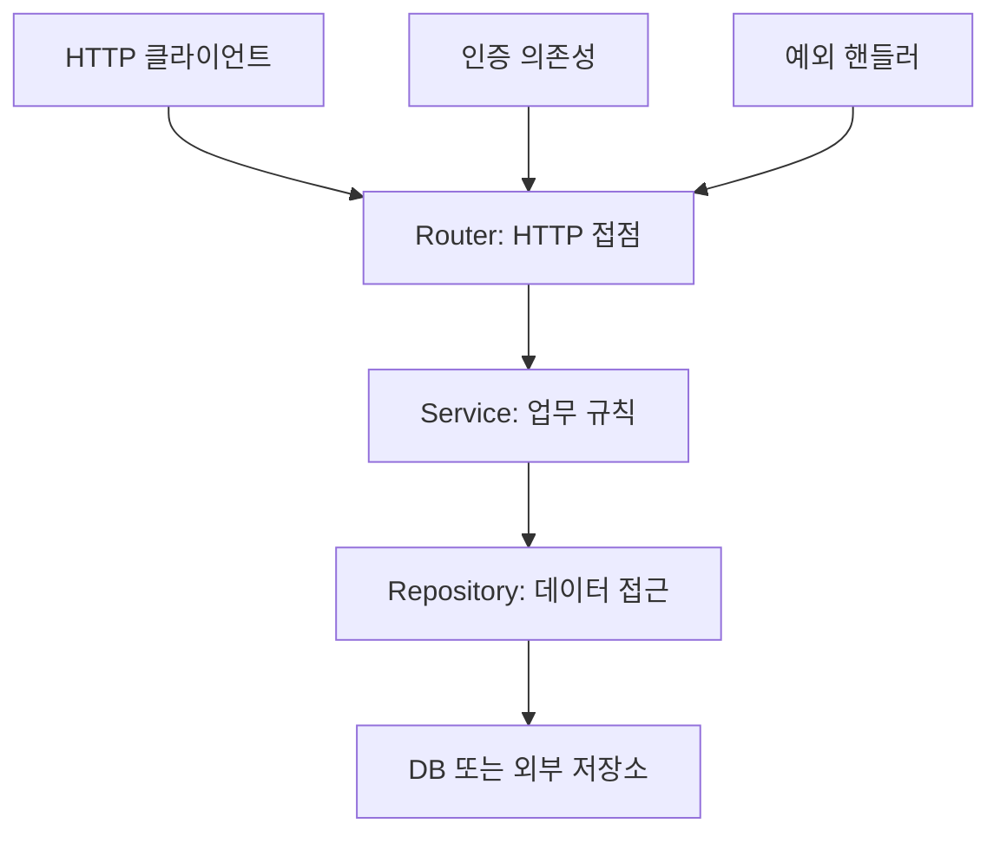
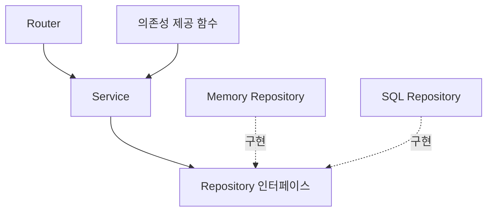
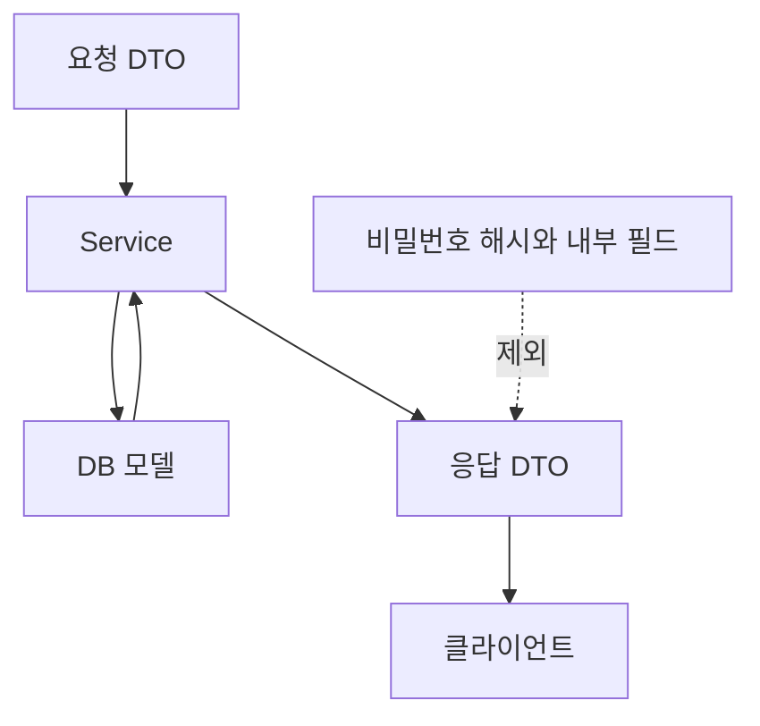
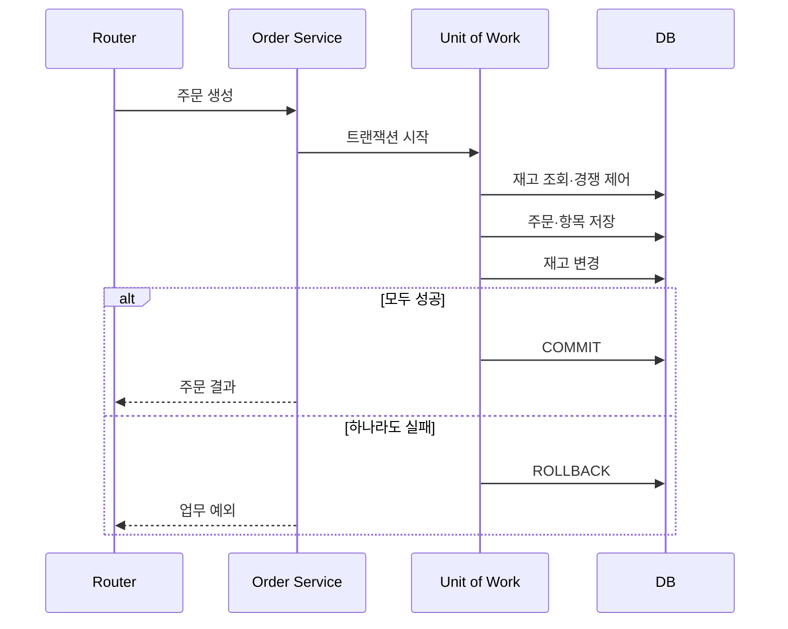
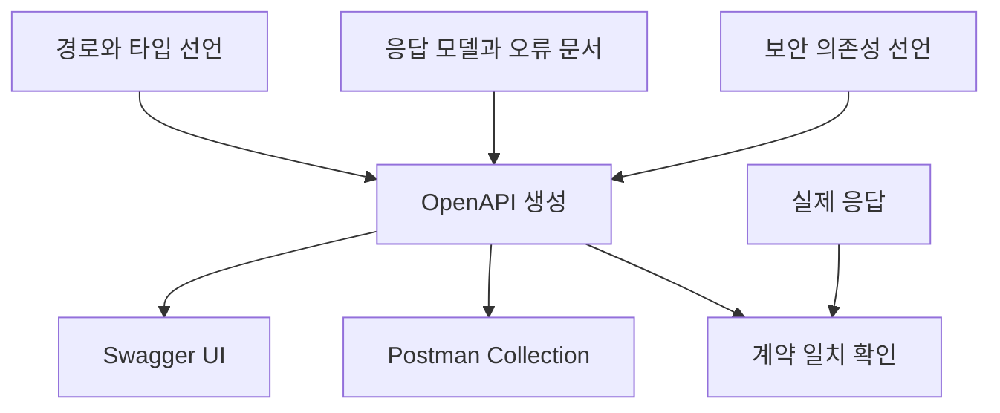

# 4-5. 계층형 아키텍처와 API 문서화 — 8H

[전체 목차](00-index.md) · [이전: OAuth2](04-04-oauth.md) · [다음: Postman](04-06-postman.md)

## 단원 목차

- [1. 목표와 시간표](#s1)
- [2. 왜 계층을 나누는가](#s2)
- [3. 책임·의존성·데이터 모델](#s3)
- [4. 트랜잭션과 예외 변환](#s4)
- [5. 다중 파일 실행 예제](#s5)
- [6. Swagger와 문서 자동화](#s6)
- [7. 구조 개선 실습과 평가](#s7)

<a id="s1"></a>
## 1. 목표와 시간표

Router·Service·Repository의 책임을 분리한다. 의존성 주입과 트랜잭션 경계를 설명한다. 응답 모델·오류 계약·인증 스키마를 자동 문서와 일치시킨다.

| 교시 | 내용 | 결과 |
|---|---|---|
| 1 | 계층 분리 | 기존 코드 책임 표시 |
| 2 | 모델·DI | 의존성 도식 |
| 3 | 예외·트랜잭션·문서 | 오류 변환 정책 |
| 4 | 프로젝트 구조 | 패키지·모듈 구성 |
| 5 | CRUD 분리 | 실행 예제 |
| 6 | 문서 보강 | 응답·오류·예제 명시 |
| 7 | 인증·저장소 교체 | 통합 설계 |
| 8 | 평가 | 구조 리뷰·문서 확인 |

<a id="s2"></a>
## 2. 왜 계층을 나누는가


하나의 엔드포인트에서 HTTP 파싱·가격 계산·SQL·로그·토큰 검증까지 수행하면 업무 규칙을 바꾸거나 저장소를 교체할 때 여러 책임을 동시에 수정하게 된다. 계층은 **변경 이유와 책임**을 나누는 수단이다. 작은 앱에서 무조건 많은 폴더를 만드는 것이 목적은 아니다.



| 계층 | 담당 | 피할 것 |
|---|---|---|
| Router | 입력·인증 의존성·HTTP 응답 | SQL·복잡한 업무 계산 |
| Service | 주문 가능 조건·합계·상태 전이 | Request·Response 객체 의존 |
| Repository | 조회·저장·DB 매핑 | HTTP 상태 코드 결정 |
| Schema/DTO | 입력·출력 계약 | 비밀번호 해시 공개 |
| Domain/Model | 업무 개념·불변조건 | HTTP에 종속된 표현 |
| Infra/설정 | DB 연결·비밀값·외부 클라이언트 | 비밀값 하드코딩 |

계층형 시스템이라는 REST 제약은 프록시·Gateway 등 네트워크 중간 계층에 대한 것이다. 이 단원의 앱 내부 Router·Service 분리는 그 제약과 이름이 비슷하지만 서로 다른 설계 관점이다.

<a id="s3"></a>
## 3. 책임·의존성·데이터 모델

런타임 요청은 Router → Service → Repository로 흐른다. 의존성을 추상화하면 Service가 구체적인 SQLAlchemy 구현 대신 저장소 인터페이스를 사용할 수 있다. 처음에는 명확한 책임 분리부터 적용하고 필요할 때 인터페이스를 도입한다.



```python
# 인터페이스 설명용 코드 조각
from typing import Protocol

class ProductReader(Protocol):
    def get(self, product_id: int) -> dict | None: ...

# ProductReader와 같은 get 메서드를 가진 객체는 구조적으로 사용할 수 있다.
```

의존성 주입(DI)은 Service가 저장소를 내부에서 고정 생성하기보다 외부에서 전달받게 하는 방식이다. FastAPI의 Depends는 필요한 객체를 제공하는 함수를 연결한다. 그 자체가 DB·보안·트랜잭션 구현을 대신하지는 않는다.

### 모델을 구분하는 이유

| 모델 | 의미 | 상품·회원 사례 |
|---|---|---|
| 요청 모델 | 사용자가 보낼 수 있는 값 | name·price |
| DB 모델 | 저장 구조 | id·created_at·password_hash |
| 응답 모델 | 외부에 공개할 값 | id·name, 해시 제외 |
| 업무 모델 | 업무 불변조건 | 주문 상태·합계 |



<a id="s4"></a>
## 4. 트랜잭션과 예외 변환

주문 생성에서 주문 행만 저장되고 재고 반영이 실패하면 데이터가 어긋난다. 업무 작업 단위로 트랜잭션을 묶어야 한다. Repository 메서드마다 독립 commit을 해 버리면 Service가 전체 원자성을 보장하기 어렵다.



외부 결제 요청과 DB 트랜잭션은 하나의 로컬 DB 트랜잭션으로 자동 묶이지 않는다. 긴 네트워크 대기를 DB 잠금 안에 넣지 않고, 상태 전이·중복 방지·보상·outbox 등의 별도 설계를 검토한다.

| 내부 상황 | 내부 예외 | HTTP 변환 |
|---|---|---|
| 상품 부재 | ProductNotFound | 404 |
| 재고 부족 | OutOfStock | 409 |
| 권한 부족 | PermissionDenied | 403 또는 숨김 404 |
| DB 장애 | 인프라 예외 | 500/503 정책 |

Service는 HTTPException 대신 업무 예외를 발생시키고 Router 또는 앱 예외 핸들러가 HTTP 의미로 바꿀 수 있다. 오류 로그에는 요청 ID·업무 ID·결과를 남기되 비밀번호·토큰·개인정보 전체를 남기지 않는다.

동기 SQLAlchemy 호출을 `async def`에 넣었다고 자동 비동기가 되지는 않는다. sync 경로에서 동기 DB를 사용하거나 async DB 드라이버·AsyncSession을 함께 구성한다.

<a id="s5"></a>
## 5. 다중 파일 실행 예제

아래 7개 파일을 안내된 상대 위치로 저장한다. `app/__init__.py`는 빈 파일이다. 인증은 제외한 **로컬 CRUD 구조 실습**이며 공개 서버로 배포하지 않는다. 메모리 저장소는 단일 프로세스용이다.

| 경로 | 역할 |
|---|---|
| app/__init__.py | 패키지 표시, 빈 파일 |
| app/schemas.py | 요청·응답 모델 |
| app/repository.py | 메모리 저장소 |
| app/service.py | 업무 규칙·업무 예외 |
| app/dependencies.py | 객체 제공 |
| app/router.py | HTTP 접점 |
| app/main.py | 앱 생성·예외 처리 |

### app/schemas.py

```python
from pydantic import BaseModel, ConfigDict, Field

class ProductIn(BaseModel):
    model_config = ConfigDict(extra="forbid")
    name: str = Field(min_length=1, max_length=100, examples=["키보드"])
    price: int = Field(ge=0, description="KRW 원 단위")

class ProductOut(ProductIn):
    id: int

class ErrorOut(BaseModel):
    detail: str
```

### app/repository.py

```python
from threading import RLock

class MemoryProductRepository:
    def __init__(self):
        self.rows = {}
        self.next_id = 1
        self.lock = RLock()

    def list(self):
        with self.lock:
            return [dict(row) for row in self.rows.values()]

    def get(self, product_id):
        with self.lock:
            row = self.rows.get(product_id)
            return dict(row) if row is not None else None

    def create(self, values):
        with self.lock:
            row = {**values, "id": self.next_id}
            self.rows[self.next_id] = row
            self.next_id += 1
            return dict(row)

    def replace(self, product_id, values):
        with self.lock:
            if product_id not in self.rows:
                return None
            row = {**values, "id": product_id}
            self.rows[product_id] = row
            return dict(row)

    def delete(self, product_id):
        with self.lock:
            return self.rows.pop(product_id, None) is not None
```

### app/service.py

```python
class ProductNotFound(Exception):
    pass

class ProductService:
    def __init__(self, repository):
        self.repository = repository

    def list(self):
        return self.repository.list()

    def get(self, product_id):
        row = self.repository.get(product_id)
        if row is None:
            raise ProductNotFound()
        return row

    def create(self, values):
        return self.repository.create(values)

    def replace(self, product_id, values):
        row = self.repository.replace(product_id, values)
        if row is None:
            raise ProductNotFound()
        return row

    def delete(self, product_id):
        if not self.repository.delete(product_id):
            raise ProductNotFound()
```

현재 상품 사례는 업무 규칙이 적어 Service가 얇다. 주문 취소·재고·가격 정책이 추가되면 Service에 위치시킨다. 의미 없는 전달 메서드만 늘리는 구조를 목표로 하지 않는다.

### app/dependencies.py

```python
from app.repository import MemoryProductRepository
from app.service import ProductService

repository = MemoryProductRepository()

def get_product_service():
    return ProductService(repository)
```

Repository는 교육용 공유 객체다. DB 버전에서는 요청별 Session의 생성·정리 수명을 설정하고 동시 요청 간에 Session 객체를 공유하지 않는다.

### app/router.py

```python
from typing import Annotated
from fastapi import APIRouter, Depends, Path, Response
from app.dependencies import get_product_service
from app.schemas import ProductIn, ProductOut, ErrorOut
from app.service import ProductService

router = APIRouter(prefix="/api/v1/products", tags=["products"])
ServiceDep = Annotated[ProductService, Depends(get_product_service)]
ProductId = Annotated[int, Path(gt=0)]
not_found = {404: {"model": ErrorOut, "description": "상품 없음"}}

@router.get("", response_model=list[ProductOut], summary="상품 목록")
def list_products(service: ServiceDep):
    return service.list()

@router.post("", response_model=ProductOut, status_code=201, summary="상품 생성")
def create_product(body: ProductIn, response: Response, service: ServiceDep):
    row = service.create(body.model_dump())
    response.headers["Location"] = f"/api/v1/products/{row['id']}"
    return row

@router.get("/{product_id}", response_model=ProductOut,
            summary="상품 상세", responses=not_found)
def get_product(product_id: ProductId, service: ServiceDep):
    return service.get(product_id)

@router.put("/{product_id}", response_model=ProductOut,
            summary="상품 교체", responses=not_found)
def replace_product(product_id: ProductId, body: ProductIn, service: ServiceDep):
    return service.replace(product_id, body.model_dump())

@router.delete("/{product_id}", status_code=204,
               summary="상품 삭제", responses=not_found)
def delete_product(product_id: ProductId, service: ServiceDep):
    service.delete(product_id)
    return Response(status_code=204)
```

### app/main.py

```python
from fastapi import FastAPI, Request
from fastapi.responses import JSONResponse
from app.router import router
from app.service import ProductNotFound

app = FastAPI(
    title="계층형 상품 API", version="1.0.0",
    description="Router·Service·Repository 분리 실습용 API",
    openapi_tags=[{"name": "products", "description": "상품 CRUD"}],
)
app.include_router(router)

@app.exception_handler(ProductNotFound)
async def product_not_found(request: Request, exc: ProductNotFound):
    return JSONResponse(status_code=404, content={"detail": "상품을 찾을 수 없습니다."})
```

프로젝트 루트에서 실행한다.

```powershell
.\.venv\Scripts\python.exe -m uvicorn app.main:app --reload --port 8000
```

| 관찰 | 의미 |
|---|---|
| POST → 201·Location | 생성 계약 |
| GET 목록·상세 → 200 | 읽기 계약 |
| PUT에 name 누락 → 422 | 전체 교체 입력 요구 |
| DELETE → 204·빈 본문 | 삭제 계약 |
| 삭제한 ID를 GET → 404 | 예외 핸들러 변환 |
| /openapi.json → 스키마 | 구현에서 자동 문서 생성 |

<a id="s6"></a>
## 6. Swagger와 문서 자동화

| 주소 | 기본 역할 |
|---|---|
| /openapi.json | 기계가 읽는 API 명세 |
| /docs | Swagger UI, 요청 실행 |
| /redoc | 다른 형태의 API 문서 뷰어 |

환경 설정으로 경로를 변경하거나 문서를 비활성화할 수 있다. 문서를 숨겨도 API가 보호되지는 않는다. 인증·인가·네트워크 접근 정책은 독립적으로 구현한다.



### 문서 체크리스트

- summary는 기능을 짧게 설명하고 description에는 업무 조건을 적는다.
- operationId는 중복 없이 유지한다.
- 입력의 필수·범위·예시와 응답 단위·시간대·enum을 적는다.
- 성공 응답만 아니라 401·403/404·409·422 등 실제 실패를 문서화한다.
- response_model로 공개 필드를 제한한다.
- Bearer 보안 의존성을 실제 경로에 연결하고 `/docs`의 Authorize를 확인한다.
- 오류 핸들러를 바꾸면 명세의 오류 모델도 바꾼다.

### JWT 통합 과제

4-3의 인증 코드를 모듈로 정리하고 `current_user`를 읽기 가능한 별도 의존성으로 내보낸다. 로그인·refresh·logout은 `auth_router`로 분리하여 main의 app에 include한다. 상품 변경은 인증된 관리자만, 주문 상세는 소유자만 허용한다.

```python
# 통합 후 Router 의존성 예시. auth 모듈은 과제로 구성한다.
# user = Depends(current_user)
# service.create_order(user_id=user["id"], items=body.items)
```

실습용 student 계정에는 역할이 없다. 관리자 역할을 DB 또는 서버 관리 값에서 조회하도록 추가해야 상품 관리자 인가 과제가 완성된다. 클라이언트가 보내는 role을 신뢰하지 않는다.

<a id="s7"></a>
## 7. 구조 개선 실습과 평가

| 실습 | 과제 | 통과 근거 |
|---|---|---|
| A | 한 파일 CRUD를 분리 | Router에서 직접 저장소 조작 제거 |
| B | 저장소를 교체 | Router의 HTTP 계약 유지 |
| C | 주문 취소 규칙 추가 | Service가 상태 검증, HTTP는 핸들러가 결정 |
| D | JWT 의존성 통합 | 누락·변조·권한 부족 차단 |
| E | OpenAPI 문서 비교 | 실제 오류 본문과 스키마 일치 |
| F | 로그 구조 설계 | request_id·결과 포함, 토큰 원문 제외 |

1. 폴더가 많으면 좋은 아키텍처인가? → 책임·변경 범위·검증 가능성이 좋아야 한다.
2. Repository가 HTTPException을 던져도 되는가? → 가능하지만 HTTP 결합이 생긴다. 업무 예외와 경계 변환을 권장한다.
3. 자동 문서에 없는 업무 규칙은 자동으로 생성되는가? → 아니다. 설명·오류 계약·테스트를 직접 보강한다.
4. 두 Repository 메서드가 각각 commit하면 주문 전체 원자성이 보장되는가? → 아니다. 업무 단위 트랜잭션 경계가 필요하다.

**제출물:** 코드 구조, 책임표, 자동 API 문서, 업무 예외·트랜잭션 설계.

## 공식 참고

- [FastAPI — 큰 애플리케이션 구조](https://fastapi.tiangolo.com/tutorial/bigger-applications/)
- [FastAPI — 의존성](https://fastapi.tiangolo.com/tutorial/dependencies/)
- [FastAPI — 문서 메타데이터](https://fastapi.tiangolo.com/tutorial/metadata/)

[전체 목차](00-index.md) · [다음 단원](04-06-postman.md)
