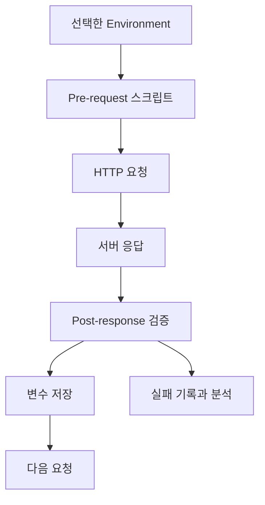
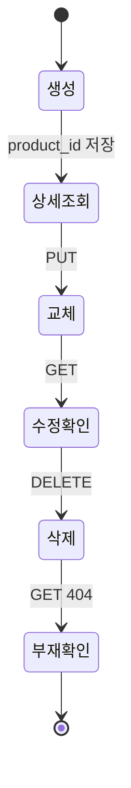
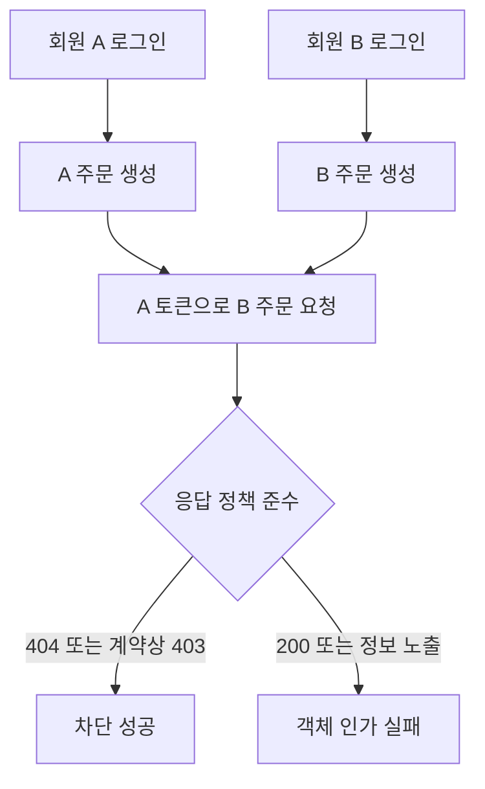
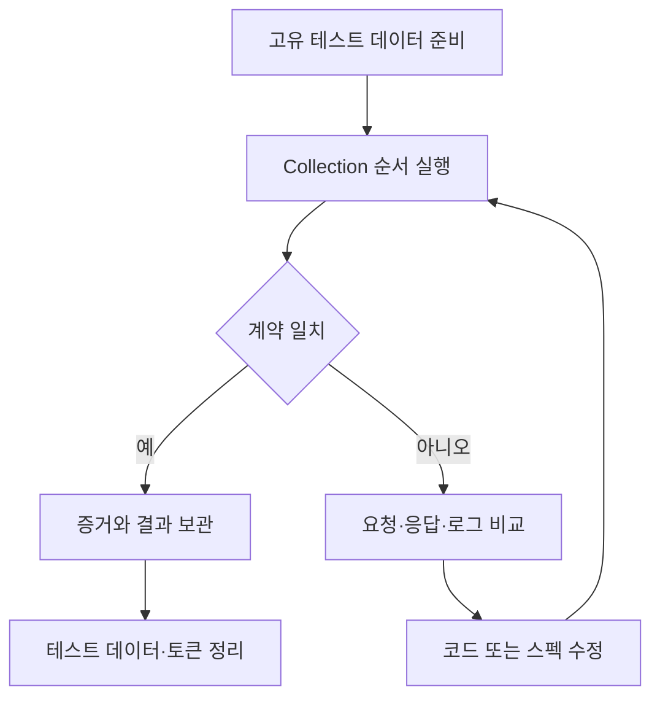

# 4-6. Postman 기반 API 테스트 — 8H

[전체 목차](00-index.md) · [이전: 계층형 아키텍처](04-05-architecture.md)

## 단원 목차

- [1. 목표와 시간표](#s1)
- [2. 테스트 전략과 준비](#s2)
- [3. 요청·변수·스크립트](#s3)
- [4. 상품 CRUD 시나리오](#s4)
- [5. 인증·갱신·로그아웃 시나리오](#s5)
- [6. 객체 인가·경계·실패 테스트](#s6)
- [7. 반복 실행과 결과 보고](#s7)
- [8. 종합 평가와 해설](#s8)

<a id="s1"></a>
## 1. 목표와 시간표

Postman으로 HTTP 요청을 구성하고 상태·본문·헤더를 검증한다. 환경변수와 응답 스크립트로 시나리오를 연결한다. 정상 동작뿐 아니라 인증 실패·객체 인가·갱신 재사용을 증명한다.

| 교시 | 내용 | 결과 |
|---|---|---|
| 1 | 테스트 종류·계약 | 테스트 대상 표 |
| 2 | Postman 요청·변수 | 환경과 Collection |
| 3 | pm.test·스크립트 | 상태·본문·헤더 검사 |
| 4 | CRUD 정상·실패 | 상품 시나리오 |
| 5 | 인증·갱신 | 토큰 전달과 회전 |
| 6 | 소유권·경계·동시성 | 보안 검증 |
| 7 | 반복 실행·정리 | 재실행 결과·실패 분석 |
| 8 | 평가 | 종합 시연과 보고서 |

<a id="s2"></a>
## 2. 테스트 전략과 준비


테스트는 “응답이 왔다”를 확인하는 것이 아니라 스펙의 기대와 실제를 비교하는 일이다. 200만 검사하면 다른 회원의 주문이 새거나 금액이 틀리는 문제를 놓칠 수 있다.

| 종류 | 목적 | 예시 |
|---|---|---|
| 단위 테스트 | 작은 업무 규칙 | 취소 가능 상태 |
| API 통합 테스트 | HTTP와 내부 처리 | POST 입력·DB·응답 |
| 계약 테스트 | 명세와 실제 일치 | 필드 타입·오류 구조 |
| 시나리오 테스트 | 여러 요청의 연결 | 생성→조회→삭제 |
| 보안 부정 테스트 | 허용되지 않는 요청 차단 | 타인 주문 접근 |
| 성능·동시성 테스트 | 부하·경쟁 상태 | 같은 refresh 병렬 교환 |

Postman은 API·시나리오 검증에 유용하지만 한 번의 응답 시간으로 전체 성능을 판정하거나 순차 Runner만으로 동시성 안전을 증명할 수 없다.

### 실습 서버 구분

| 환경변수 | 값 | 대상 |
|---|---|---|
| product_base_url | http://127.0.0.1:8000 | 4-5 상품 CRUD 서버 |
| auth_base_url | http://127.0.0.1:8001 | 4-3 JWT 서버 |
| base_url | 통합 프로젝트 주소 | 주문·소유권 확장 과제 |
| product_id | 요청 결과로 설정 | 상품 식별자 |
| access_token | 로그인·갱신 결과 | 현재 API 접근 |
| refresh_token | 로그인·갱신 결과 | 현재 갱신 토큰 |
| previous_refresh | 갱신 전 값 | 재사용 차단 테스트 |

두 서버는 독립 예제다. 4-5는 상품 요청에 인증이 없고, 4-3은 인증 요청만 있다. 상품 관리자·주문 소유권 테스트는 4-5의 통합 과제를 완료한 서버에서 수행한다.

인증 서버 실행:

```powershell
# 4-3의 main.py가 있는 폴더에서 실행
$env:JWT_SECRET = (.\.venv\Scripts\python.exe -c "import secrets; print(secrets.token_hex(32))")
.\.venv\Scripts\python.exe -m uvicorn main:app --reload --port 8001
```

Collection을 `API-Security-48H`로 만들고 `01-Products`, `02-Auth`, `03-Authorization` 폴더를 둔다. 요청의 Scripts → Post-response에 응답 검증을 작성한다. 버전에 따라 Tests라는 이름일 수 있다.

<a id="s3"></a>
## 3. 요청·변수·스크립트



### 기본 요청

- Method: POST
- URL: `{{product_base_url}}/api/v1/products`
- Body: raw → JSON
- Header: `Content-Type: application/json`
- Body: `{"name":"실습 상품","price":30000}`

헤더에 지정한 Content-Type과 실제 바디 형식을 맞춘다. JSON을 text로 보내거나 form-data를 JSON처럼 취급하면 계약과 달라질 수 있다.

### 상태·본문·헤더 검사

```javascript
pm.test('201 생성 성공', () => {
  pm.response.to.have.status(201);
});
pm.test('상품 계약 검증', () => {
  const data = pm.response.json();
  pm.expect(data.id).to.be.a('number');
  pm.expect(data.name).to.eql('실습 상품');
  pm.expect(data.price).to.eql(30000);
});
pm.test('Location 헤더 검증', () => {
  const data = pm.response.json();
  pm.expect(pm.response.headers.get('Location'))
    .to.eql(`/api/v1/products/${data.id}`);
});
if (pm.response.code === 201) {
  const data = pm.response.json();
  if (typeof data.id === 'number') {
    pm.environment.set('product_id', String(data.id));
  }
}
```

상태 검증이 실패했다고 모든 뒤 스크립트가 자동으로 중단되는 것은 아니다. 성공 여부를 확인한 뒤 변수 값을 저장하고, 다음 요청 전에 필요한 값이 있는지 확인한다.

```javascript
// 상품 상세 요청의 Pre-request
if (!pm.environment.get('product_id')) {
  throw new Error('상품 생성 요청을 먼저 실행하세요.');
}
```

변수는 환경·컬렉션·로컬 등 범위가 다르다. 같은 이름을 여러 범위에 중복 정의하면 잘못된 값이 선택될 수 있다. 본 교안의 토큰·ID는 선택한 Environment에만 저장한다. 비밀값을 포함한 환경을 외부 공유·공개 내보내기하지 않는다.

<a id="s4"></a>
## 4. 상품 CRUD 시나리오



| 번호 | 요청 | 바디 | 기대 |
|---|---|---|---|
| P01 | POST /products | name=실습 상품, price=30000 | 201, ID·Location |
| P02 | GET /products/{{product_id}} | 없음 | 200, 동일 상품 |
| P03 | PUT /products/{{product_id}} | name=수정 상품, price=35000 | 200, 변경값 |
| P04 | GET /products/{{product_id}} | 없음 | 200, 저장된 변경값 |
| P05 | DELETE /products/{{product_id}} | 없음 | 204, 빈 본문 |
| P06 | GET /products/{{product_id}} | 없음 | 404, detail |
| P07 | POST /products | name=오류 상품, price=-1 | 422 |
| P08 | PUT /products/999999999 | 유효 상품 데이터 | 404 |
| P09 | POST /products | name 누락 | 422 |
| P10 | POST /products | role=admin 추가 | 422 |

표의 경로는 `/api/v1` 아래다. 가격과 이름을 검사하는 P04 스크립트:

```javascript
pm.test('변경 내용이 저장되었다', () => {
  pm.response.to.have.status(200);
  const data = pm.response.json();
  pm.expect(data.name).to.eql('수정 상품');
  pm.expect(data.price).to.eql(35000);
  pm.expect(String(data.id)).to.eql(pm.environment.get('product_id'));
});
```

삭제 스크립트에서는 JSON 파싱을 하지 않는다.

```javascript
pm.test('204에는 응답 본문이 없다', () => {
  pm.response.to.have.status(204);
  pm.expect(pm.response.text()).to.eql('');
});
```

404와 422의 오류 모양이 다르다는 점도 검사한다.

```javascript
// 404 응답용
pm.test('404 오류 계약', () => {
  pm.response.to.have.status(404);
  pm.expect(pm.response.json().detail).to.be.a('string');
});
```

```javascript
// FastAPI 기본 422 응답용
pm.test('422 검증 오류 계약', () => {
  pm.response.to.have.status(422);
  const detail = pm.response.json().detail;
  pm.expect(detail).to.be.an('array').that.is.not.empty;
  pm.expect(detail[0]).to.have.property('loc');
});
```

<a id="s5"></a>
## 5. 인증·갱신·로그아웃 시나리오

로그인: `POST {{auth_base_url}}/api/v1/auth/login`

```json
{"username":"student","password":"class-password"}
```

Post-response:

```javascript
pm.test('로그인 성공과 토큰 계약', () => {
  pm.response.to.have.status(200);
  const data = pm.response.json();
  pm.expect(data.access_token).to.be.a('string').that.is.not.empty;
  pm.expect(data.refresh_token).to.be.a('string').that.is.not.empty;
  pm.expect(data.token_type).to.eql('bearer');
  pm.expect(data.expires_in).to.eql(600);
});
if (pm.response.code === 200) {
  const data = pm.response.json();
  if (data.access_token && data.refresh_token) {
    pm.environment.set('access_token', data.access_token);
    pm.environment.set('refresh_token', data.refresh_token);
    pm.environment.unset('previous_refresh');
  }
}
```

`GET {{auth_base_url}}/api/v1/me`의 Authorization을 Bearer Token으로 선택하고 Token에는 `{{access_token}}`을 넣는다. 이 예제는 HTTPBearer로 보안 스키마를 선언하므로 JWT 단원 코드와 문서가 일치한다.

```javascript
pm.test('내 정보에 비밀정보가 없다', () => {
  pm.response.to.have.status(200);
  const data = pm.response.json();
  pm.expect(data.id).to.eql('1');
  pm.expect(data.username).to.eql('student');
  pm.expect(data).not.to.have.property('password');
  pm.expect(data).not.to.have.property('hash');
  pm.expect(data).not.to.have.property('refresh_token');
});
```

갱신: `POST {{auth_base_url}}/api/v1/auth/refresh`

```json
{"refresh_token":"{{refresh_token}}"}
```

Pre-request에서 이전 값을 저장한다.

```javascript
const refresh = pm.environment.get('refresh_token');
if (!refresh) throw new Error('로그인을 먼저 실행하세요.');
pm.environment.set('previous_refresh', refresh);
```

Post-response:

```javascript
pm.test('refresh 회전', () => {
  pm.response.to.have.status(200);
  const data = pm.response.json();
  pm.expect(data.refresh_token)
    .not.to.eql(pm.environment.get('previous_refresh'));
});
if (pm.response.code === 200) {
  const data = pm.response.json();
  pm.environment.set('access_token', data.access_token);
  pm.environment.set('refresh_token', data.refresh_token);
}
```

| 순서 | 요청 | 토큰 | 기대 |
|---|---|---|---|
| A01 | 로그인 | 계정 정보 | 200, A1·R1 |
| A02 | /me | A1 | 200 |
| A03 | /refresh | R1 | 200, A2·R2 |
| A04 | /me | A2 | 200 |
| A05 | /refresh | previous_refresh=R1 | 401·세션 폐기 |
| A06 | /me | A2 | 401 |
| A07 | 다시 로그인 | 계정 정보 | 200, 새 세션 |
| A08 | /logout | 현재 refresh | 204 |
| A09 | /me | 현재 access | 401 |
| A10 | /refresh | 현재 refresh | 401 |

A05는 별도 요청으로 만들고 **갱신 성공용 Pre-request·Post-response를 붙이지 않는다.** Body에 `{{previous_refresh}}`만 사용한다. 그렇지 않으면 이전 값을 새 값으로 덮어써 재사용 테스트가 실패한다.

로그아웃: `POST /api/v1/auth/logout`, Body는 현재 refresh_token이다. 반환은 본문 없는 204다. 인증이 필요한 /me와 달리 이 교육용 logout은 refresh 소지로 세션을 폐기하는 정책이다.

### 변조·누락·잘못된 비밀번호

- /me의 Authorization을 No Auth로 바꾼 별도 요청 → 401.
- 토큰을 무작위 문자열로 바꾼 요청 → 401.
- password를 틀리게 입력한 별도 로그인 요청 → 401.
- 만료를 확인하려면 교육용 access 수명을 잠시 줄이거나 만료 테스트 토큰을 발급한다.

단일 글자 변조는 JWT signature의 끝 글자보다 payload 중간 등 확실히 바이트가 바뀌는 위치를 사용한다. 인코딩 말단의 미사용 비트만 바꾸면 같은 바이트로 해석될 수 있어 좋은 변조 테스트가 아니다.

<a id="s6"></a>
## 6. 객체 인가·경계·실패 테스트

아래는 **주문 통합 과제 서버**의 스펙 기반 테스트다. 기본 상품·JWT 예제만으로 주문 테스트를 실행할 수 없다. A·B 두 회원과 각 회원의 주문을 준비한다.



| ID | 테스트 | 기대 |
|---|---|---|
| S01 | A의 주문을 A가 조회 | 200 |
| S02 | B의 주문을 A가 조회 | 이 교안의 주문 스펙은 404 |
| S03 | A 목록에서 B 주문 검색 | 포함되지 않음 |
| S04 | Body에 user_id=B 추가 | 거부 또는 서버가 필드 무시, 계약대로 |
| S05 | Body에 낮은 price 추가 | 서버 가격 유지 또는 입력 거부 |
| S06 | 일반 회원의 상품 등록 | 403 |
| S07 | 만료 토큰으로 주문 생성 | 401 |
| S08 | 재고보다 큰 수량 | 409 |
| S09 | 배송된 주문 취소 | 409 |
| S10 | 동일 Idempotency-Key·같은 본문 | 동일 주문, 중복 생성 없음 |
| S11 | 같은 키·다른 본문 | 정한 정책상 409 |

권한 실패 응답에 주문 총액·배송지 등이 포함되지 않는지도 확인한다. 조회만 아니라 수정·취소·삭제·목록·파일 접근에서도 소유권을 검사한다.

| 경계 | 테스트값 | 기준 |
|---|---|---|
| quantity | 0, 1, 99, 100 | 1~99만 구조 검증 통과 |
| items 길이 | 0, 1, 20, 21 | 1~20만 통과 |
| product_id | 0, 음수, 문자열, 부재 정수 | 구조·존재 검증 구분 |
| 필수 필드 | 누락, null, 정상값 | 계약의 필수·null 정책 |
| Content-Type | JSON·잘못된 형식 | 문서화한 입력 정책 |

동시에 같은 refresh 토큰을 두 번 교환하는 테스트는 병렬 요청 도구나 자동 테스트로 수행한다. 순차 Runner 성공만으로 회전의 원자성을 증명하지 않는다. “실패 응답 발생”과 “실제 DB 폐기 상태 반영”을 같이 확인한다.

<a id="s7"></a>
## 7. 반복 실행과 결과 보고



1. Environment의 base URL을 확인한다.
2. 이전 product_id·토큰을 지우고 생성·로그인부터 시작한다.
3. Runner에서 상품·인증 요청의 순서를 유지한다.
4. 실패 후에도 나머지 요청이 실행될 수 있음을 감안해 결과를 해석한다.
5. 테스트 상품은 삭제하고 세션은 로그아웃으로 정리한다.
6. Export 전 토큰·비밀번호·개인정보를 제거한다.

| 결과 항목 | 작성 예 |
|---|---|
| 테스트 ID | A05 |
| 연결 요구사항 | R06 |
| 사전 조건 | R1이 이미 갱신에 사용됨 |
| 요청 요약 | POST refresh, 사용 완료 토큰 |
| 기대 | 401, 세션 폐기 |
| 실제 | 401, 후속 /me도 401 |
| 판정 | 통과 |
| 증거 | 마스킹한 응답·서버 상태 |

서버 시간·네트워크 조건에 따른 응답 시간은 관찰 지표로 기록한다. 명확한 성능 목표와 측정 조건이 없는 상태에서 “500ms 이하면 정상”을 보편적인 판정 기준으로 쓰지 않는다.

<a id="s8"></a>
## 8. 종합 평가와 해설

### 완료 기준

- 상품 생성·조회·교체·삭제가 순서대로 재실행된다.
- 삭제 응답에 본문이 없고 없는 상품은 404다.
- 입력 범위·추가 필드를 검증한다.
- 로그인·갱신·재사용 감지·로그아웃 결과를 설명한다.
- 통합 과제에서는 A·B 소유권과 관리자 기능을 검증한다.
- 실제 오류 스키마와 문서가 일치한다.
- 제출 Collection·환경 파일에 실제 토큰과 비밀값이 없다.

1. 200이면 업무 결과도 맞는가? → 아니다. 필드·값·소유권·저장 효과를 검사한다.
2. 삭제 응답을 pm.response.json()으로 읽으면? → 204는 빈 본문이므로 파싱 오류가 날 수 있다.
3. refresh 성공 스크립트를 재사용 실패 요청에 붙이면? → 이전 토큰 변수가 덮어써져 테스트 의도가 깨질 수 있다.
4. 단일 순차 실행으로 DB 경쟁 상태가 안전하다고 말할 수 있는가? → 아니다. 병렬·원자성 검증이 필요하다.
5. Postman에서 Bearer 토큰을 지정하면 서버 검증이 없어도 안전한가? → 아니다. 클라이언트가 헤더를 만드는 것일 뿐이다.

**제출물:** Collection, 비밀값이 제거된 Environment, 테스트 결과표, 주요 실패 분석, 개선된 API 스펙.

## 공식 참고

- [Postman 테스트 스크립트](https://learning.postman.com/docs/tests-and-scripts/write-scripts/test-scripts/)
- [pm.test·pm.expect](https://learning.postman.com/latest-v-12/docs/tests-and-scripts/write-scripts/postman-sandbox-reference/pm-test-expect)
- [OWASP 객체 수준 인가](https://api-security.owasp.org/editions/2023/en/0xa1-broken-object-level-authorization/)

[전체 목차](00-index.md) · [이전 단원](04-05-architecture.md)
