# 과목 4 강의안 — API 아키텍처 & 인증 보안 설계
### 실습 프로젝트: TagTodo (태그 기반 스마트 할일 관리 서비스)
---

## 📅 전체 일정 한눈에 보기

| 일차 | 주제 | 이론 키워드 | TagTodo 실습 |
|:---:|---|---|---|
| 1 | API를 보는 눈 — REST 원칙 | 자원·URI·HTTP 메서드·상태코드 | TagTodo API 명세서 손으로 작성 |
| 2 | 코드를 정리하는 법 — 계층형 아키텍처 | 라우터·서비스·리포지토리 | TagTodo를 3계층 구조로 리팩터링 |
| 3 | 비밀번호와 신분증 — 해싱·JWT 기초 | bcrypt, JWT 구조 | 회원가입·로그인 직접 구현 |
| 4 | 출입증 교체하기 — 토큰 재발급 전략 | Access/Refresh, 토큰 회전 | 자동 재발급·로그아웃(폐기) 구현 |
| 5 | 대리인에게 맡기기 — OAuth2 | Authorization Code 플로우 | 소셜 로그인 1종 연동 |
| 6 | 내 것만 보이게 하기 — 접근 제어 | 소유권 검증, 인가(Authorization) | 태그 필터링 + 본인 리소스 보호 |
| 7 | 약속을 문서로 — 문서화·검증 | Swagger, Postman | 전체 시나리오 자동 테스트 |

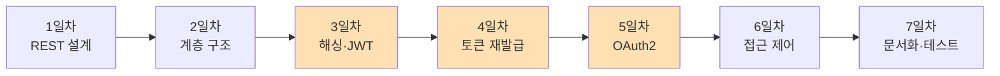
> 🟧 주황색 3일(3~5일차)이 이 과목의 핵심 — **인증**입니다.

---

## 🧩 TagTodo 복습 (1일차 시작 전 5분 리마인드)

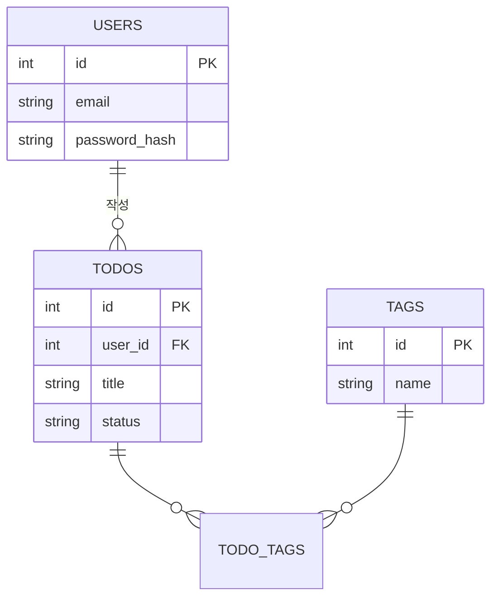
> 과목 2·3에서 이미 TODOS·TAGS CRUD와 DB를 만들었습니다. 과목 4에서는 **"누가 이 API를 쓸 수 있는가"**를 추가합니다.

---

# 1일차 — API를 보는 눈: REST 원칙

### 🎯 학습 목표
- URI와 HTTP 메서드만 보고 "무슨 동작인지" 읽을 수 있다.
- TagTodo의 모든 기능을 REST 규칙에 맞는 엔드포인트로 설계할 수 있다.

### ⏰ 시간표
| 시간 | 내용 |
|---|---|
| 09:00~11:00 | 이론① API 개념, HTTP 메서드·상태코드 |
| 11:00~13:00 | 이론② URI 설계 규칙, API 스타일 비교 |
| 14:00~17:30 | 실습: TagTodo API 명세서 작성 (손으로) |
| 17:30~18:00 | 회고 |

---

### 📖 이론

#### 비유로 시작하기
> API는 **식당의 메뉴판**과 같습니다. 손님(클라이언트)은 메뉴판에 적힌 대로만 주문(요청)할 수 있고, 주방(서버)은 정해진 방식으로만 응답합니다. 메뉴판에 없는 걸 즉흥적으로 요구하면 혼란이 생기듯, API도 **정해진 약속(규칙)**이 있어야 합니다. REST는 그 "메뉴판 작성 규칙"입니다.

#### API 요청 한 번의 여정

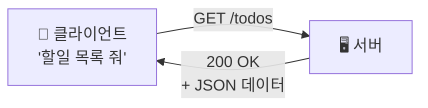

#### HTTP 메서드 = "어떤 동작인가"

| 메서드 | 일상 비유 | 의미 | 예시 |
|---|---|---|---|
| GET | "~좀 보여줘" | 조회 | `GET /todos` |
| POST | "~새로 만들어줘" | 생성 | `POST /todos` |
| PUT | "~통째로 바꿔줘" | 전체 수정 | `PUT /todos/3` |
| PATCH | "~일부만 바꿔줘" | 부분 수정 | `PATCH /todos/3` |
| DELETE | "~지워줘" | 삭제 | `DELETE /todos/3` |

#### 상태 코드 = "결과가 어땠는가"

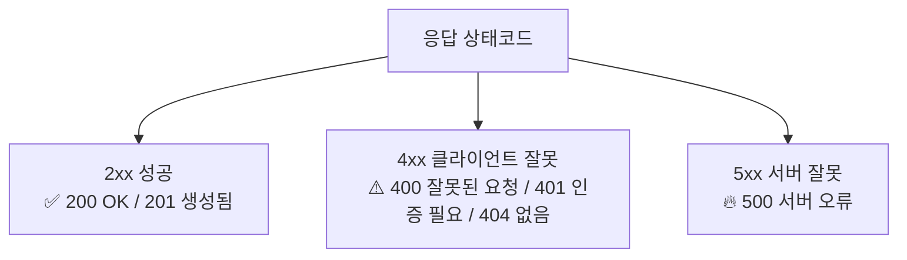

> 🔑 **외우는 팁**: 4로 시작하면 "네 잘못(요청이 이상함)", 5로 시작하면 "내(서버) 잘못".

#### URI 설계 규칙 — 좋은 예 / 나쁜 예

| 규칙 | 👍 좋은 예 | 👎 나쁜 예 |
|---|---|---|
| 자원은 명사·복수형 | `GET /todos` | `GET /getTodoList` |
| 행위는 메서드로 표현 | `DELETE /todos/3` | `POST /deleteTodo/3` |
| 계층 관계 표현 | `GET /users/1/todos` | `GET /todos?owner=1` |
| 소문자·하이픈 | `/todo-tags` | `/TodoTags` |

#### API 스타일은 왜 REST를 쓰나

| 스타일 | 장점 | 단점 | 입문자에게 |
|---|---|---|---|
| **REST** | 규칙이 단순, 세상에 예제가 제일 많음 | 화면마다 필요한 데이터가 다르면 비효율 | ⭐ 지금 배우기 가장 쉬움 |
| GraphQL | 필요한 데이터만 골라 받음 | 서버 설계가 더 복잡 | 나중에 |
| gRPC | 매우 빠름 | 브라우저에서 직접 쓰기 어려움 | 나중에 |

---

### 💻 실습: TagTodo API 명세서 작성 (AI 없이, 종이/표로)

**과제**: 아래 표를 완성하세요. (코드 작성 아님 — 설계만)

| 기능 | 메서드 | URI | 성공 코드 |
|---|---|---|---|
| 회원가입 | | | |
| 로그인 | | | |
| 내 할일 목록 조회 | | | |
| 할일 생성 | | | |
| 할일 수정 | | | |
| 할일 삭제 | | | |
| 태그별 필터링 | | | |

> 강사는 돌아다니며 "이 URI에 동사가 숨어있지 않나요?" 식으로 소크라테스식 질문으로 피드백합니다.

### ✅ 1일차 체크리스트
- [ ] HTTP 메서드 5개를 설명할 수 있다
- [ ] 2xx/4xx/5xx의 차이를 설명할 수 있다
- [ ] TagTodo API 명세서 초안을 작성했다

---

# 2일차 — 코드를 정리하는 법: 계층형 아키텍처

### 🎯 학습 목표
- 왜 코드를 계층으로 나누는지 설명할 수 있다.
- TagTodo를 라우터/서비스/리포지토리 구조로 리팩터링할 수 있다.

### ⏰ 시간표
| 시간 | 내용 |
|---|---|
| 09:00~11:00 | 이론① 계층형 아키텍처 개념 |
| 11:00~13:00 | 이론② API 명세서를 OpenAPI 문서로 옮기기 (직접 작성) |
| 14:00~17:30 | 실습: TagTodo 3계층 리팩터링 |
| 17:30~18:00 | 회고 |

---

### 📖 이론

#### 비유로 시작하기
> 식당에 비유하면: **홀 서빙(라우터)**은 주문만 받고, **주방(서비스)**이 요리하고, **창고 관리자(리포지토리)**가 재료를 가져다줍니다. 서빙 직원이 직접 창고에서 재료를 꺼내 요리까지 하면 — 효율은 빨라 보여도, 사람이 바뀌거나 메뉴가 늘면 전부 꼬입니다.

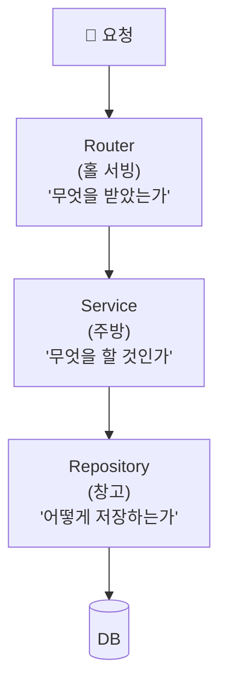

#### 계층을 나누는 이유

| 나누지 않으면 | 나누면 |
|---|---|
| 함수 하나가 300줄 | 함수마다 역할이 분명 |
| 테스트하려면 DB까지 다 띄워야 함 | 서비스 로직만 따로 테스트 가능 |
| DB를 바꾸면 전체 코드 수정 | 리포지토리만 교체 |

#### TagTodo 폴더 구조

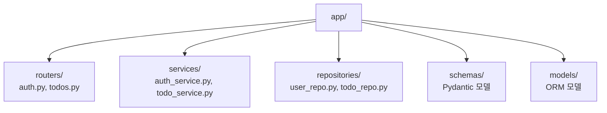

---

### 💻 실습: TagTodo 3계층 리팩터링 (AI 없이)

1. 기존(과목2~3) Todo CRUD 코드를 `routers / services / repositories`로 **직접 나눠서** 옮기기
2. "라우터에 비즈니스 로직이 남아있지 않은가?" 서로 코드 리뷰 (페어)

> 💡 OpenAPI 문서도 손으로 — 자연어로 쓴 1일차 명세서를 보며 `openapi.yaml`에 직접 옮겨 적습니다. (AI 자동 생성 금지 — 명세를 "쓰는 감각" 자체가 학습 목표)

### ✅ 2일차 체크리스트
- [ ] 라우터/서비스/리포지토리 역할을 각각 한 문장으로 말할 수 있다
- [ ] TagTodo가 3계층으로 분리되었다

---

# 3일차 — 비밀번호와 신분증: 해싱 & JWT 기초

### 🎯 학습 목표
- 비밀번호를 "그대로" 저장하면 안 되는 이유를 설명할 수 있다.
- JWT의 3부분 구조를 설명하고, 로그인 API를 직접 구현할 수 있다.

### ⏰ 시간표
| 시간 | 내용 |
|---|---|
| 09:00~11:00 | 이론① 왜 비밀번호를 암호화해야 하는가 (bcrypt) |
| 11:00~13:00 | 이론② JWT란 무엇인가 |
| 14:00~17:30 | 실습: 회원가입·로그인 API 직접 구현 |
| 17:30~18:00 | 회고 |

---

### 📖 이론

---

---

---

---

#### 비유로 시작하기
> 비밀번호를 그대로 저장하는 건 **금고 비밀번호를 포스트잇에 적어 금고 옆에 붙여두는 것**과 같습니다. 해킹당하면 그대로 다 털립니다. 그래서 우리는 비밀번호를 **"지문"**(해시)으로 바꿔 저장합니다 — 지문만 보고 원래 얼굴을 복원할 수 없는 것처럼, 해시만 보고 원래 비밀번호를 알아낼 수 없습니다.

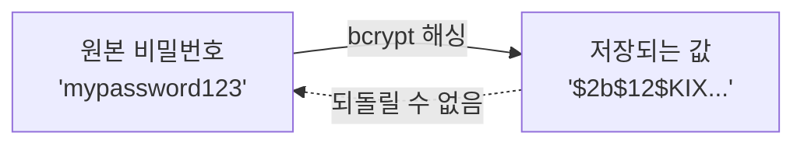

| 저장 방식 | 안전성 |
|---|---|
| 평문 그대로 저장 | ❌ 절대 금지 |
| 단순 암호화(복호화 가능) | ⚠️ 키 탈취 시 위험 |
| **bcrypt 해싱(단방향)** | ✅ 표준 |

#### JWT = "서명된 신분증"

> 로그인에 성공하면 서버가 **신분증(토큰)**을 발급합니다. 이 신분증에는 "누구인지(sub)"와 "언제까지 유효한지(exp)"가 적혀 있고, 위조 방지를 위해 서버만 아는 비밀키로 **서명**이 찍혀 있습니다.

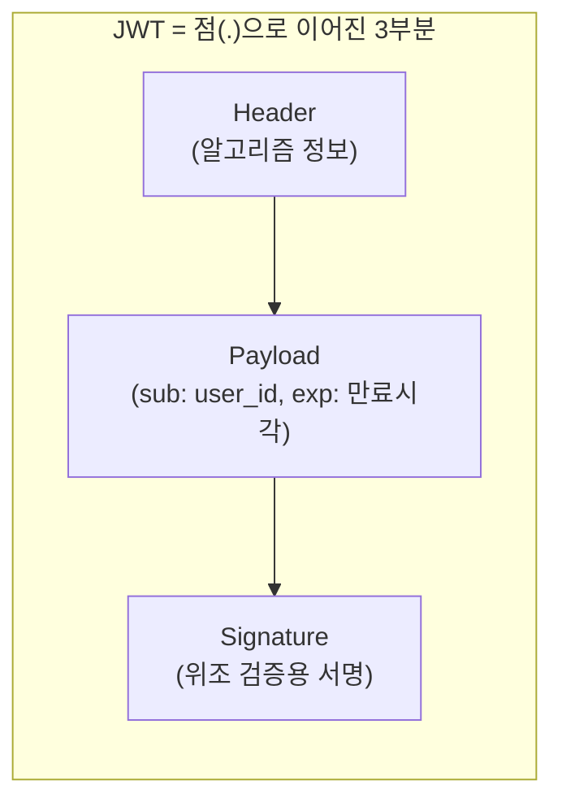

#### 로그인 흐름

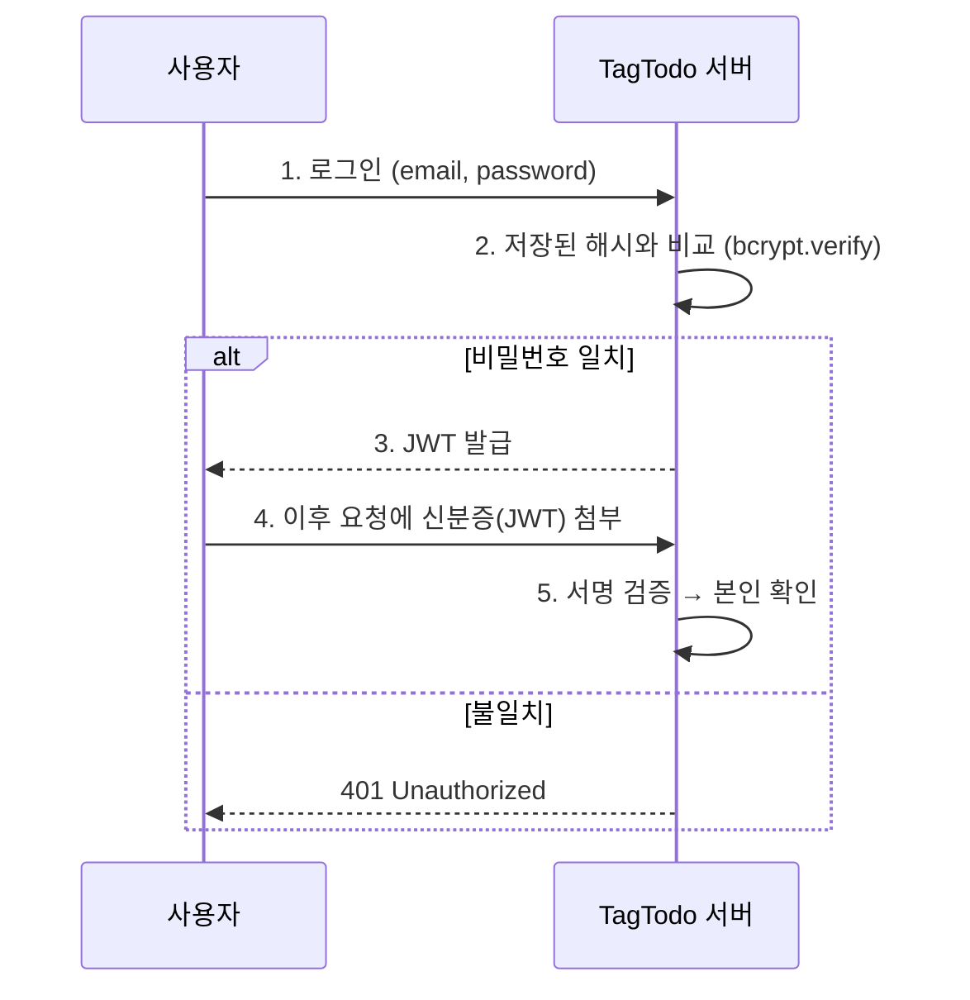

---

### 💻 실습: 회원가입·로그인 직접 구현 (AI 없이)

1. `POST /auth/signup` — bcrypt로 비밀번호 해싱 후 저장
2. `POST /auth/login` — 해시 비교 + JWT 발급
3. `GET /todos`에 `Authorization: Bearer <JWT>` 없으면 401 반환하도록 보호

> ⚠️ 이 날은 **디버깅이 가장 많이 발생하는 날**입니다. "비밀번호가 맞는데 로그인이 안 돼요" → 해싱 비교 로직, "토큰이 이상해요" → 서명 검증 순서를 함께 짚어줍니다. (AI에 물어보지 않고 **에러 메시지를 직접 읽는 습관**을 들이는 것이 이 날의 숨은 목표)

### ✅ 3일차 체크리스트
- [ ] bcrypt 해싱이 "단방향"인 이유를 설명할 수 있다
- [ ] JWT의 3부분을 설명할 수 있다
- [ ] 로그인 → 토큰 발급 → 보호된 API 접근이 동작한다

---

# 4일차 — 출입증 교체하기: 토큰 재발급 전략

### 🎯 학습 목표
- Access Token과 Refresh Token을 나누는 이유를 설명할 수 있다.
- 재발급·로그아웃(토큰 폐기)을 구현할 수 있다.

### ⏰ 시간표
| 시간 | 내용 |
|---|---|
| 09:00~11:00 | 이론① 왜 토큰을 두 개로 나누는가 |
| 11:00~13:00 | 이론② 토큰 회전·폐기 전략 |
| 14:00~17:30 | 실습: 리프레시 API·로그아웃 구현 |
| 17:30~18:00 | 회고 |

---

### 📖 이론

#### 비유로 시작하기
> 회사 출입증을 생각해보세요. **임시 출입증(Access Token)**은 유효기간이 짧고(30분), 매번 로비에서 새로 받기 번거로우니 **등록된 사원증(Refresh Token)**으로 임시 출입증을 재발급받습니다. 사원증을 분실하면? 그 사원증을 **정지(폐기)**시키면 됩니다.

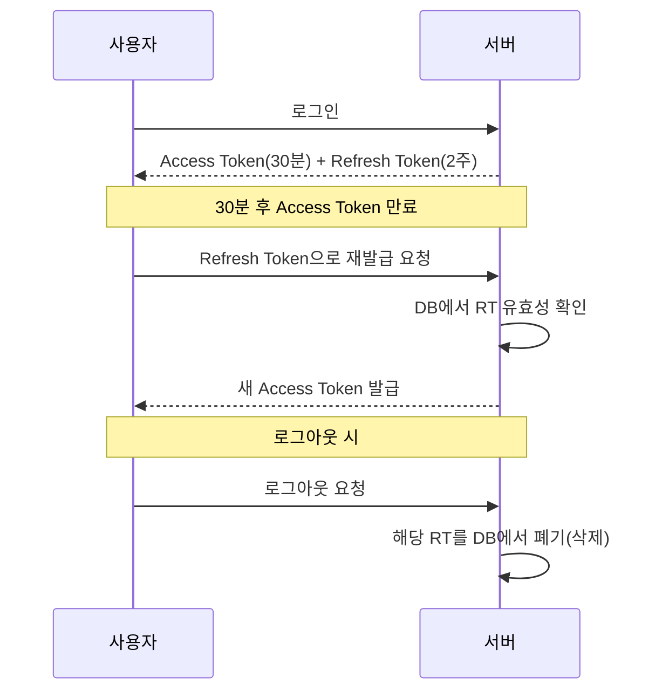

#### 왜 둘로 나누는가

| 방식 | 장점 | 단점 |
|---|---|---|
| Access Token만 길게(2주) 사용 | 구현 단순 | 탈취당하면 2주간 위험 노출 |
| **Access(짧게) + Refresh(길게) 분리** | 탈취돼도 피해 시간 짧음, 즉시 폐기 가능 | 구현이 한 단계 더 필요 |

> 🔑 **핵심 질문**: "만약 Access Token을 누가 훔쳐갔다면?" → 30분만 피해 → Refresh Token은 DB에 저장해두었으니 **강제 폐기(로그아웃)**가 가능합니다.

---

### 💻 실습: 재발급·로그아웃 구현 (AI 없이)

1. Refresh Token을 DB 테이블(SESSIONS)에 저장
2. `POST /auth/refresh` — RT 검증 → 새 AT 발급
3. `POST /auth/logout` — 해당 RT를 DB에서 삭제(폐기)
4. 일부러 만료된 토큰으로 요청해보고 401이 뜨는지 확인

### ✅ 4일차 체크리스트
- [ ] Access/Refresh를 분리하는 이유를 설명할 수 있다
- [ ] 재발급 API가 동작한다
- [ ] 로그아웃 시 토큰이 실제로 무효화된다

---

# 5일차 — 대리인에게 맡기기: OAuth2 소셜 로그인

### 🎯 학습 목표
- "구글로 로그인"이 내부적으로 어떤 절차인지 설명할 수 있다.
- TagTodo에 소셜 로그인 1종을 연동할 수 있다.

### ⏰ 시간표
| 시간 | 내용 |
|---|---|
| 09:00~11:00 | 이론① OAuth2 개념 |
| 11:00~13:00 | 이론② Authorization Code 흐름 상세 |
| 14:00~17:30 | 실습: 소셜 로그인 연동 |
| 17:30~18:00 | 회고 |

---

### 📖 이론

#### 비유로 시작하기
> 호텔에서 **발레파킹**을 맡길 때, 내 자동차 "마스터키" 전체를 주지 않고 **주차만 가능한 발레키**를 줍니다. OAuth2도 마찬가지입니다 — TagTodo에 구글 **비밀번호**를 직접 주는 게 아니라, 구글이 "이 사람이 맞다"는 **증명서(토큰)**만 TagTodo에 건네줍니다.

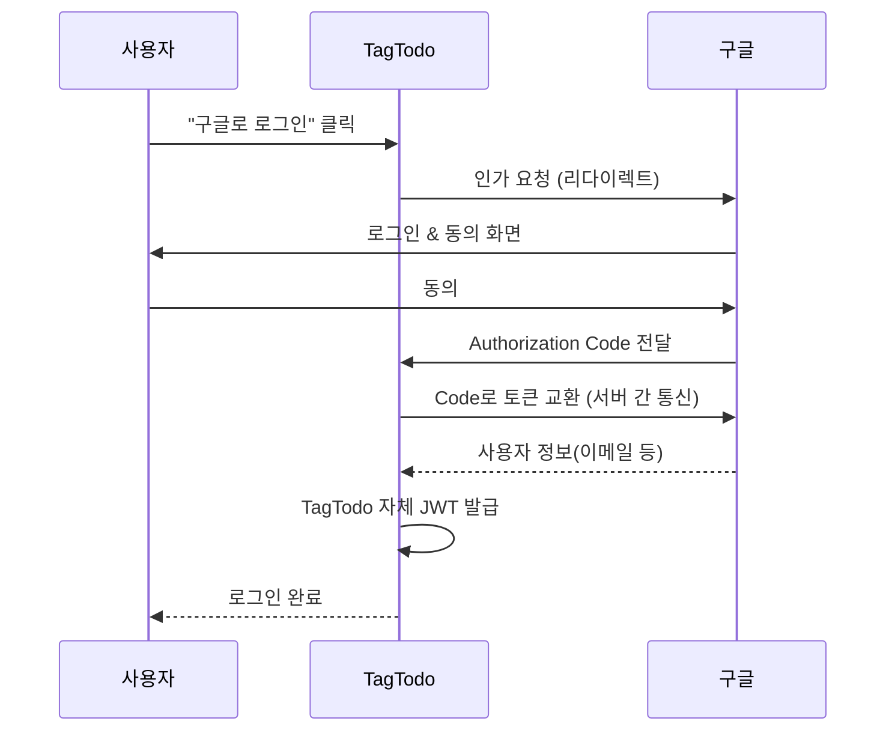

> 🔑 **핵심**: 비밀번호는 **절대 TagTodo를 거치지 않습니다.** 구글과 사용자 사이에서만 오갑니다.

| 비교 | 자체 로그인(JWT만) | 소셜 로그인(OAuth2) |
|---|---|---|
| 장점 | 외부 의존 없음 | 비밀번호 관리 부담 없음, 가입 전환율↑ |
| 단점 | 비밀번호 분실 대응 필요 | 외부 서비스 장애 영향받음 |

---

### 💻 실습: 소셜 로그인 연동 (AI 없이, 공식 문서만 참고)

1. 구글(또는 카카오) 개발자 콘솔에서 앱 등록
2. Authorization Code 교환 로직 구현
3. 받은 이메일로 TagTodo 회원 매핑 → 자체 JWT 발급

> 💡 이 날은 "공식 문서 읽는 법"을 가르치는 날이기도 합니다. AI에게 물어보는 대신 **구글 OAuth2 공식 문서**를 함께 읽습니다.

### ✅ 5일차 체크리스트
- [ ] OAuth2 플로우를 그림 없이 말로 설명할 수 있다
- [ ] 소셜 로그인이 TagTodo에서 동작한다

---

# 6일차 — 내 것만 보이게 하기: 접근 제어

### 🎯 학습 목표
- 인증(Authentication)과 인가(Authorization)의 차이를 설명할 수 있다.
- "내 할일만" 보이고 수정할 수 있도록 소유권 검증을 구현할 수 있다.

### ⏰ 시간표
| 시간 | 내용 |
|---|---|
| 09:00~11:00 | 이론① 인증 vs 인가 |
| 11:00~13:00 | 이론② 소유권 기반 접근 제어 패턴 |
| 14:00~17:30 | 실습: TagTodo 소유권 검증 + 태그 필터링 완성 |
| 17:30~18:00 | 회고 |

---

### 📖 이론

#### 비유로 시작하기
> **인증(Authentication)**은 "이 사람이 누구인가"를 확인하는 것(신분증 검사), **인가(Authorization)**는 "이 사람이 이걸 해도 되는가"를 확인하는 것(출입 구역 확인)입니다. 신분증이 있다고 모든 방에 들어갈 수 있는 건 아니죠.

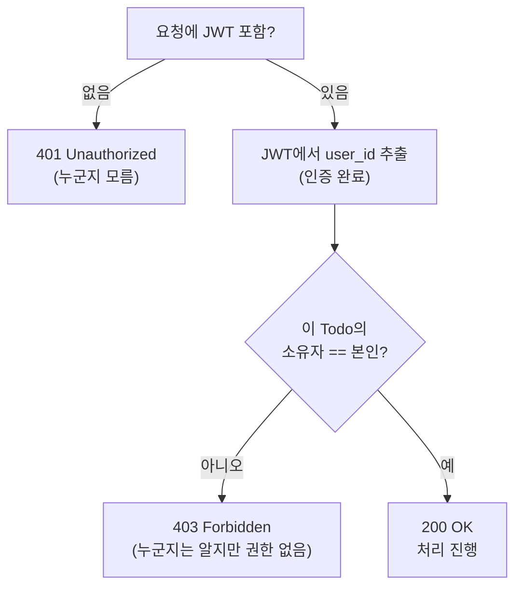

| 상태코드 | 의미 | 비유 |
|---|---|---|
| 401 | 인증 실패 | "누구신지부터 알려주세요" |
| 403 | 인가 실패 | "누군지는 알겠는데, 거긴 못 들어가요" |

---

### 💻 실습: 소유권 검증 + 태그 필터링 (AI 없이)

1. `GET /todos/{id}`, `PUT`, `DELETE`에 "요청자 == todo.user_id" 검증 추가
2. 다른 사용자 계정으로 로그인해 403이 뜨는지 직접 테스트
3. `GET /todos?tag=공부&status=진행중` 필터링 완성

### ✅ 6일차 체크리스트
- [ ] 401과 403의 차이를 예시로 설명할 수 있다
- [ ] 다른 사람의 할일에 접근 시 403이 뜬다
- [ ] 태그 필터링이 동작한다

---

# 7일차 — 약속을 문서로: Swagger & Postman 검증

### 🎯 학습 목표
- Swagger 문서가 왜 "코드와 항상 일치하는 설명서"인지 이해한다.
- Postman으로 TagTodo 전체 시나리오를 자동 검증할 수 있다.

### ⏰ 시간표
| 시간 | 내용 |
|---|---|
| 09:00~11:00 | 이론① Swagger / OpenAPI |
| 11:00~13:00 | 이론② Postman 시나리오 테스트 |
| 14:00~17:00 | 실습: Postman Collection 작성 & 실행 |
| 17:00~17:30 | **과목 종합 데모 발표** |
| 17:30~18:00 | 회고 & 과목 5 예고 |

---

### 📖 이론

#### 비유로 시작하기
> Swagger는 **자동으로 업데이트되는 사용 설명서**입니다. 사람이 손으로 쓴 설명서는 코드가 바뀌어도 설명서는 그대로인 경우가 많지만, Swagger는 코드에서 직접 뽑아내므로 **항상 최신 상태**입니다.

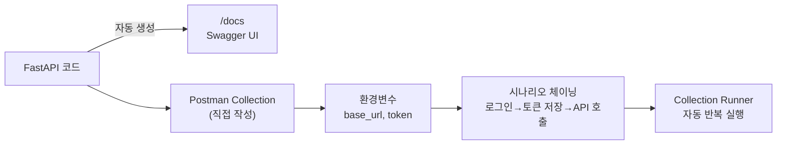

| 도구 | 역할 | 비유 |
|---|---|---|
| Swagger | "문서를 보여주는 창" | 자동 생성되는 사용설명서 |
| Postman | "직접 시켜보고 확인하는 도구" | 체크리스트 들고 실제로 눌러보는 검수관 |

---

### 💻 실습: Postman Collection 작성 (AI 없이)

TagTodo 전체 시나리오를 Postman으로 직접 구성합니다.

1. 회원가입 → 로그인(토큰을 변수로 저장) → 할일 생성 → 태그 필터 조회 → 소유권 위반 시도(403 확인) → 토큰 재발급 → 로그아웃
2. 각 요청에 `pm.test()`로 상태코드·응답 형식 검증 스크립트 작성
3. Collection Runner로 전체 시나리오 1클릭 실행 확인

### ✅ 7일차 체크리스트 (= 과목 4 수료 기준)
- [ ] Swagger 문서가 실제 API와 일치한다
- [ ] Postman 시나리오 15개 이상이 모두 통과한다
- [ ] TagTodo 인증·인가 전체 플로우가 완성되었다

---

## 🎓 과목 4 마무리 — 과목 5로 넘기는 산출물

| 산출물 | 용도 |
|---|---|
| TagTodo 인증 API 전체(로그인/재발급/소셜/권한) | 과목 5 프론트엔드가 그대로 연동 |
| Swagger 문서(`/docs`) | 과목 5 수강생의 API 레퍼런스 |
| Postman Collection | 과목 5 통합 시 회귀 테스트 기준 |

> 💡 **AI 활용 전환 지점**: 과목 4~5에서는 모든 걸 직접 구현했습니다. 이후 **2차 기본 프로젝트**부터는 지금 손으로 익힌 패턴을 기준 삼아 "AI가 생성한 코드가 이 패턴과 맞는지" 스스로 판단할 수 있게 됩니다 — 그것이 지금까지 AI 없이 연습한 이유입니다.
