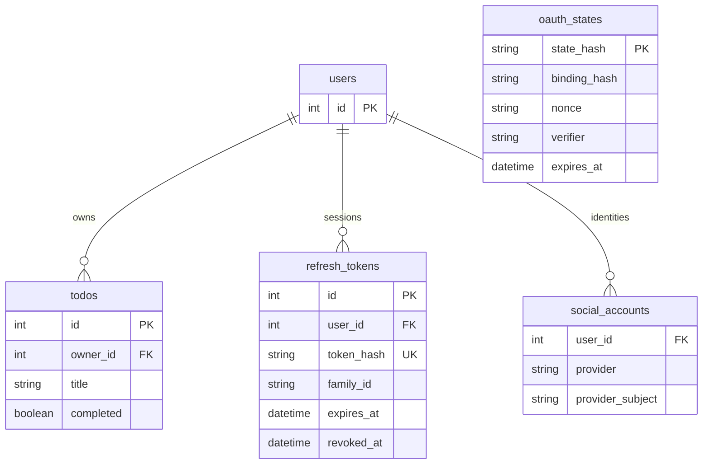

# MySQL 준비

## 사전 조건

MySQL은 이미 설치·실행 중이라고 가정합니다. MySQL 8.0.16 이상(권장 8.4 LTS), InnoDB, utf8mb4를 사용합니다. 앱 실행 계정과 스키마 관리 계정을 분리합니다. 현재 컴퓨터에서 MySQL 관리자에 접속할 수 있어야 합니다.

```sql
SELECT VERSION();
SHOW VARIABLES LIKE 'character_set_server';
```

## 준비 순서

1. `database/00-admin.sql`의 예시 비밀번호를 실제 값으로 바꿉니다.
2. 터미널에서 `mysql -u root -p`로 접속합니다. 비밀번호를 명령 인자에 넣지 않습니다.
3. MySQL 프롬프트에서 아래 파일을 절대 경로로 읽습니다. Windows에서도 `/`를 쓰면 편리합니다.

```sql
SOURCE D:/AX_FullStack_Builder/04-api-architecture-auth-security/LectureNote/database/00-admin.sql;
SOURCE D:/AX_FullStack_Builder/04-api-architecture-auth-security/LectureNote/database/01-schema.sql;
USE todo_course;
SHOW TABLES;
SELECT id,email FROM users;
```

MySQL Workbench에서는 두 SQL 파일을 순서대로 열고 실행해도 됩니다. `01-schema.sql`은 CREATE TABLE 권한이 있는 관리자로 실행합니다. 앱에는 SELECT/INSERT/UPDATE/DELETE만 부여되어 있습니다. 이미 같은 이름의 다른 테이블이 있으면 IF NOT EXISTS는 구조를 바꾸지 않으므로 `SHOW CREATE TABLE`로 비교하거나 새 실습 DB를 만드세요.

4. 각 버전의 `.env.example`을 `.env`로 복사하고 같은 DB 접속 정보를 입력합니다.
5. 앱 계정 접속과 서버 `/health` 응답을 확인합니다.

```powershell
mysql -u todo_app -p -h localhost todo_course
```

기존 계정의 비밀번호는 `CREATE USER IF NOT EXISTS`로 바뀌지 않습니다. 필요하면 관리자 세션에서 다음을 실행합니다.

```sql
ALTER USER 'todo_app'@'localhost' IDENTIFIED BY 'YourNewStrongPassword';
```

DB가 다른 서버에 있으면 `.env`의 DB_HOST와 MySQL 사용자 host 정책을 함께 변경해야 합니다. 원격 MySQL은 수업망의 지정 앱 호스트만 허용합니다. 임의의 `'%'` 계정과 root 앱 접속은 사용하지 않습니다.

## 테이블 역할과 관계



|테이블|사용 시작|중요 제약/설계|
|---|---|---|
|users|v01|1번은 로그인 불가 공용 계정. 로컬 email UNIQUE, 소셜 전용 email/password는 NULL|
|todos|v01|owner FK, title 1~200자, completed 0/1, owner+id/owner+completed 인덱스|
|refresh_tokens|v03|토큰 해시 UNIQUE, family별 폐기, 절대 만료 7일|
|social_accounts|v04|provider+provider_subject UNIQUE, 이메일 자동 병합 금지|
|oauth_states|v04|state 해시 PK, 브라우저 바인딩, 10분 만료, 한 번 사용 후 삭제|

초기 SQL은 모든 버전용 테이블을 한 번에 준비합니다. v01~v02는 인증 테이블을 사용하지 않습니다. 후속 버전에서 매번 DB를 초기화할 필요가 없습니다. v03 회원가입은 AUTO_INCREMENT로 2번 이후 사용자를 생성하며 1번의 공용 데이터를 넘겨받지 않습니다.

## 확인용 쿼리

```sql
SELECT id,email,created_at FROM users;
SELECT id,owner_id,title,completed FROM todos ORDER BY id DESC;
SELECT user_id,family_id,expires_at,revoked_at FROM refresh_tokens ORDER BY id DESC;
SELECT provider,provider_subject,user_id FROM social_accounts;
EXPLAIN SELECT * FROM todos WHERE owner_id=2 ORDER BY id DESC LIMIT 20;
```

refresh 원문과 비밀번호 원문은 조회할 수 없어야 합니다. `database/02-maintenance.sql`은 만료 임시 state와 수명이 끝난 refresh 기록 정리용입니다. 아직 세션 수명이 남은 폐기 refresh 기록을 지우면 재사용 탐지가 불가능해지므로 보관합니다.

앱 ORM은 SQL과 같은 테이블을 매핑하지만 스키마를 자동 변경하지 않습니다. 운영 변경은 3과목의 Alembic 마이그레이션으로 관리하세요. DB 시간대는 연결마다 UTC로 설정하고, 만료 비교도 UTC로 수행합니다.
