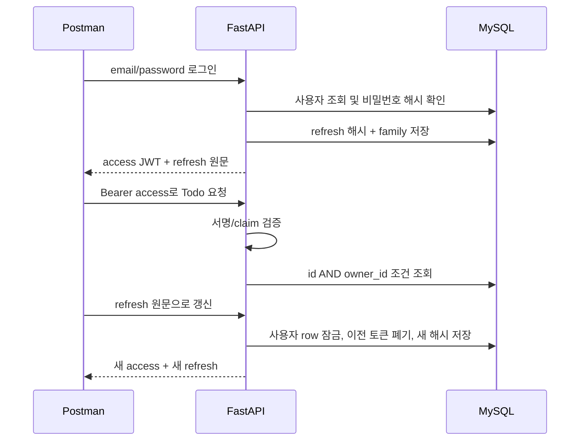

# JWT·리프레시 토큰·Google 로그인

## JWT 구현 순서

1. `users.password_hash`에 salt:scrypt 결과를 저장합니다. 복호화 기능은 없습니다.
2. 회원가입 DTO와 중복 이메일 UNIQUE 제약을 확인합니다.
3. 로그인 성공 시 15분 access JWT와 7일 opaque refresh token을 발급합니다.
4. `HTTPBearer` 의존성이 JWT의 HS256 서명, exp, iat, iss, aud, sub, type을 검증합니다.
5. JWT sub를 owner_id로 사용하고 모든 Todo 쿼리에 소유권 조건을 넣습니다.
6. refresh는 SHA-256만 DB에 저장하고 사용 시 기존 토큰을 폐기하고 새 토큰을 발급합니다.
7. 이전 refresh가 다시 오면 해당 family의 새 토큰까지 모두 폐기합니다.

JWT는 암호문이 아니므로 payload에 비밀번호·API 키·민감한 개인정보를 넣지 않습니다. `.env`의 JWT_SECRET을 바꾸면 이전 access JWT는 검증에 실패합니다. 여러 서버에서는 동일한 비밀 설정과 DB를 공유해야 합니다.



refresh/logout은 사용자 행 잠금으로 동일 사용자의 요청을 직렬화합니다. 재사용 탐지 후 토큰 폐기는 commit하고 나서 401을 반환해야 합니다. 예외를 먼저 던져 롤백하면 폐기 효과가 사라집니다. 회전해도 최초 세션의 절대 만료는 연장하지 않습니다. 병렬 refresh는 한 요청만 성공하고 나머지는 family 폐기로 이어질 수 있으므로 클라이언트는 refresh를 한 번만 실행하고 결과를 공유해야 합니다. 네트워크 실패 후 이전 토큰으로 재시도하면 재사용으로 처리되는 엄격한 정책입니다.

로그아웃은 현재 family의 refresh만 폐기하며 다른 기기의 로그인은 유지합니다. 이미 발급된 access JWT는 최대 15분 동안 유효합니다. 즉시 로그아웃이 필요하면 JWT jti denylist 또는 서버 세션 버전 조회를 추가해야 합니다.

## Google OAuth2/OIDC 설정

OAuth2는 권한 위임 프로토콜이고, 여기서 사용자 인증은 OIDC의 ID Token으로 처리합니다. Google access token을 이 앱의 Bearer JWT로 사용하지 않습니다.

1. Google Cloud Console에서 실습용 프로젝트와 Google Auth Platform 동의 화면을 구성합니다.
2. 테스트 모드이면 로그인할 계정을 테스트 사용자로 추가합니다.
3. OAuth 클라이언트 유형을 **웹 애플리케이션**으로 만듭니다.
4. 승인된 리디렉션 URI에 아래 값을 정확히 등록합니다.

```text
http://localhost:8000/api/auth/google/callback
```

5. 선택한 v04~v06의 `.env`에 GOOGLE_CLIENT_ID, GOOGLE_CLIENT_SECRET, GOOGLE_REDIRECT_URI를 채우고 서버를 다시 실행합니다.
6. 브라우저에서 `http://localhost:8000/api/auth/google`을 엽니다.
7. Google 계정 선택·동의 후 callback 화면에 앱 TokenPair JSON이 표시됩니다.
8. Postman local 환경의 `accessToken`, `refreshToken`에 응답 값을 넣습니다. `03 Google manual follow-up` 폴더에서 Todo 생성·목록을 확인합니다.

브라우저와 callback에서 **localhost/127.0.0.1을 섞지 마세요**. 쿠키와 정확한 redirect_uri 일치가 필요합니다. 수업용 JSON 화면은 토큰 전달 과정을 보여주기 위한 방식입니다. 실제 프런트에서는 서버 세션/BFF 또는 일회용 코드 전달 등 별도 보관·교환 정책을 설계하세요.

## 요청 검증의 역할

|수단|저장/확인 위치|방어 목적|
|---|---|---|
|state|DB에는 해시, callback에서 비교|로그인 시작과 callback 연결|
|브라우저 binding 쿠키|HttpOnly, SameSite=Lax, DB에는 해시|다른 브라우저의 로그인 요청 주입 방지|
|nonce|DB와 검증된 ID Token 비교|ID Token 재전송 방지|
|PKCE S256|서버 verifier, Google challenge|인가 코드 탈취 후 교환 방지|
|Google ID Token 검증|google-auth 라이브러리|서명, issuer, audience, exp 확인|
|provider + sub UNIQUE|social_accounts|안정된 외부 사용자 식별·중복 방지|

state는 10분 후 만료되며 한 번 소비되면 재사용할 수 없습니다. 같은 브라우저에서 동시에 여러 Google 로그인 창을 열면 마지막 binding 쿠키가 이전 요청을 무효화합니다. 로그인은 한 창에서 진행하세요. 이메일이 같아도 로컬 계정과 자동 병합하지 않으며, 수동 계정 연결은 별도 재인증 기능이 필요한 확장 과제입니다.

Postman만으로 Google의 대화형 계정 선택·동의 화면을 대체할 수 없습니다. callback URL을 복사해 Postman에서 다시 호출하면 브라우저 쿠키가 없거나 이미 state가 소비되어 400이 나오는 것이 정상입니다. 자동 테스트는 Google 응답을 mock하고, 실제 연동은 브라우저에서 별도로 확인합니다.

## 실패 실습

- 토큰 없이 Todo 요청 → 401.
- JWT 마지막 서명 바꾸기 또는 exp가 지난 토큰 → 401.
- A의 Todo ID를 B의 JWT로 조회/수정/삭제 → 404.
- refresh 성공 후 이전 refresh 재전송 → 401, 이어서 새 refresh도 401.
- 로그아웃 후 같은 refresh → 401. 기존 access는 만료 전까지 동작 가능.
- `/api/auth/google/callback?state=wrong&code=wrong` → 설정 완료 상태에서 400.
- Google 설정 없음 → 시작 요청 503.
- 사용자 동의 취소 → 유효 state 소비 후 400 OAUTH_DENIED.

## 운영 확장 과제

실제 서비스에는 HTTPS, 인증 엔드포인트의 IP/계정별 요청 제한, 보안 로그(토큰/비밀번호 제외), 이메일 검증·비밀번호 재설정, secret 교체, 의존성 잠금/취약점 점검, 쿠키 기반 refresh의 CSRF 정책, DB 백업·TLS를 추가합니다. 수업 서버에는 이 운영 기능을 모두 구현하지 않았습니다. APP_ENV=production에서는 OAuth 쿠키가 Secure이므로 HTTPS로 접근해야 합니다.

참고: [Google OIDC 공식 문서](https://developers.google.com/identity/openid-connect/openid-connect), [OAuth 보안 BCP RFC 9700](https://www.rfc-editor.org/rfc/rfc9700.html), [FastAPI 보안 튜토리얼](https://fastapi.tiangolo.com/tutorial/security/oauth2-jwt/).
