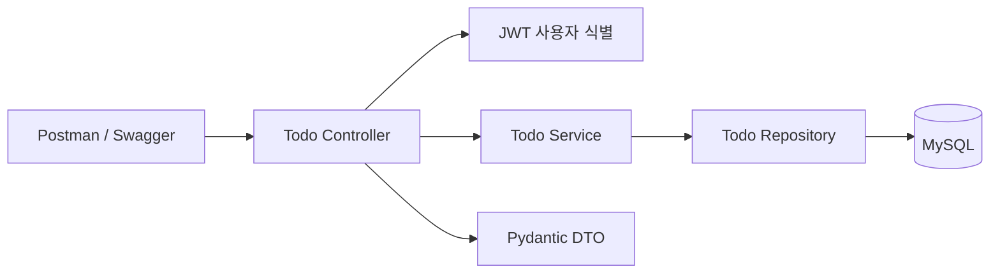

# 계층형 아키텍처와 버전별 변경 지도

## 최종 구조

```text
versions/v06-postman/
  app/main.py              앱 조립, 예외 처리, 보안 헤더, health
  app/database.py          환경 설정, 엔진, 요청별 Session 의존성
  app/models.py            SQLAlchemy ORM 테이블 매핑
  app/schemas.py           Todo 요청/응답 DTO와 검증
  app/identity.py          사용자 식별 의존성 연결
  app/security.py          비밀번호 해시, JWT 검증, 토큰 발급
  app/auth.py              로컬 가입/로그인/refresh/logout
  app/oauth.py             Google Authorization Code + OIDC
  app/todos.py             Controller: 경로/메서드/HTTP 계약
  app/todo_service.py      Service: 업무 규칙/트랜잭션
  app/todo_repository.py   Repository: 데이터 접근/소유권 조건
  requirements.txt
  .env.example
```



Controller는 Request/Response/상태코드를 다루고, Service는 생성·수정·삭제 규칙과 commit을 결정하며, Repository는 ORM 쿼리를 실행합니다. `get_db`는 요청마다 Session을 만들고, 오류 시 rollback하고, 끝나면 close합니다. 단순 CRUD라도 트랜잭션 책임을 숨기지 않고 Service에서 보여줍니다. 수업 가독성을 위해 Service의 오류는 FastAPI HTTPException을 사용하며, 엄격한 도메인 독립 설계는 도메인 예외와 HTTP 매퍼를 분리하는 확장 과제로 남겼습니다.

이 단계의 계층 분리는 Todo 도메인에 적용합니다. auth/oauth는 보안 흐름을 한 파일에서 따라갈 수 있도록 별도 기능 모듈로 유지합니다. 다음 실습으로 AuthService/TokenRepository/OAuthProvider 인터페이스를 추출할 수 있습니다.

## 버전 차이

|비교|구체적인 변경|
|---|---|
|v01→v02|OpenAPI JSON 활성화. DTO를 기반으로 문서가 생성되는 방식과 요구사항 추적 학습|
|v02→v03|security.py/auth.py 추가, identity.py를 JWT 검증 의존성으로 교체. Todo 소유권 조건은 동일|
|v03→v04|oauth.py 추가, models의 social/state 매핑 활용, main에 Google 라우터 연결|
|v04→v05|todos.py 내 Repository/Service를 독립 파일로 이동. /docs Swagger UI 활성화|
|v05→v06|서버 API 동작 유지. postman/와 tests/를 사용하여 회귀·부정 테스트 완성|

DB 모델은 모든 버전에 완성형으로 포함하되 단계별로 필요한 테이블만 사용합니다. 스키마 준비 때문에 인증 실습이 중단되지 않도록 한 선택입니다. v01~v04에서 한 파일 내부에도 Repository/Service 클래스를 두어, v05에서 동작 변경 없이 파일과 책임의 경계를 추출하는 연습을 할 수 있습니다.

## Swagger 실습

1. v05 또는 v06 서버를 실행하고 `/docs`를 엽니다.
2. register → login 순서로 요청합니다.
3. accessToken 값을 복사해 **Authorize**에 입력합니다. HTTPBearer UI에는 토큰 값만 넣습니다.
4. Todo POST/GET/PATCH/DELETE를 실행하고 `/openapi.json`의 DTO 제약과 비교합니다.
5. title max_length를 변경해 명세가 자동 변경되는지 확인하고 잘못된 입력을 보내 검증합니다.

문서화 자동화는 DTO/라우트 메타데이터에서 OpenAPI를 생성하고 Swagger가 렌더링하는 방식입니다. 별도 수작업 OpenAPI 파일이 런타임 코드와 어긋나지 않도록 `/openapi.json`을 기준으로 삼습니다. `scripts/export_openapi.py`로 정적 JSON도 내보낼 수 있습니다.
