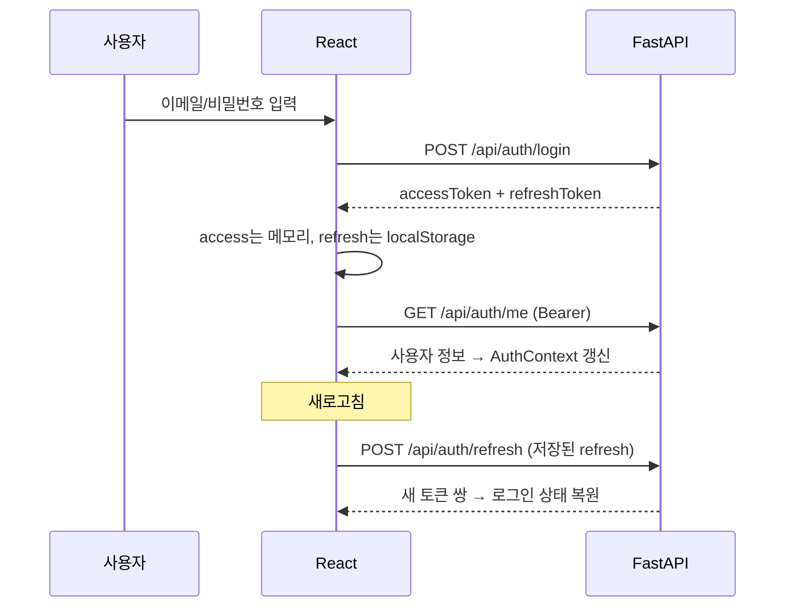
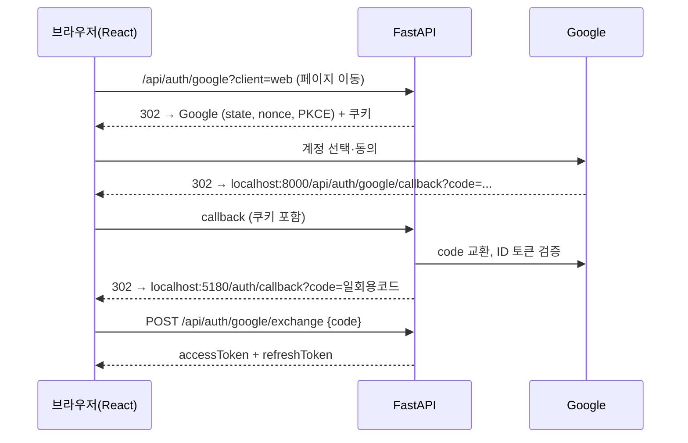

# Social Auth Todo — React 프론트엔드

socialAuth 백엔드(FastAPI)를 사용하는 React 앱입니다. 이메일 회원가입/로그인, Google 로그인, 할 일 관리 기능이 있습니다.
**React Hook과 Context API를 보여주는 것**을 목표로 만들었습니다.

| 항목 | 내용 |
|---|---|
| 기술 | React 19, React Router 7, Vite 6 (추가 상태관리 라이브러리 없음) |
| 주소 | http://localhost:5180 |
| 백엔드 | http://localhost:8000 (Vite 프록시로 `/api` 연결) |

## 실행

백엔드가 먼저 실행 중이어야 합니다.

```powershell
# 1) 백엔드 (D:\socialAuth)
.venv\Scripts\python -m uvicorn app.main:app --reload --port 8000

# 2) 프론트엔드 (D:\socialAuth\frontend)
npm install     # 최초 1회
npm run dev
```

브라우저에서 **http://localhost:5180**을 엽니다. `127.0.0.1`이 아니라 `localhost`로 열어야 Google 로그인 쿠키가 맞습니다.

> 포트 5180은 고정입니다. 백엔드 `.env`의 `FRONTEND_URL=http://localhost:5180`과 같아야 Google 로그인 후 앱으로 돌아올 수 있습니다.

## 기능

- **회원가입:** 비밀번호 12자 이상 실시간 안내, 가입 후 자동 로그인
- **로그인:** 이메일/비밀번호, 또는 **Google 계정**
- **로그인 유지:** 새로고침해도 refresh 토큰으로 자동 복원
- **토큰 자동 갱신:** access 토큰(15분)이 만료되면 다음 요청 때 자동으로 재발급하고 원래 요청을 다시 보냄
- **할 일:** 추가, 완료 체크, 더블클릭으로 제목 수정, 삭제, 전체/진행 중/완료 필터
- **세션 패널:** 회원 번호, 가입 방식, access 토큰 남은 시간, JWT 내용 보기, 수동 갱신 버튼
- **다크 모드:** 선택값을 기억함
- **알림(토스트):** 성공/실패 메시지

## 폴더 구조

```
src/
├─ main.jsx                 Provider 조립 (Theme → Toast → Auth)
├─ App.jsx                  라우팅 (/login, /register, /auth/callback, /)
├─ api/
│  ├─ tokenStore.js         토큰 보관소 (React 밖의 외부 스토어)
│  ├─ client.js             fetch 래퍼: 401이면 refresh 후 재시도, refresh는 동시에 1번만
│  ├─ endpoints.js          authApi, todoApi
│  └─ messages.js           서버 오류코드 → 한국어 문장
├─ context/
│  ├─ AuthContext.jsx       로그인 상태 + login/register/logout/Google 로그인
│  ├─ ToastContext.jsx      알림
│  └─ ThemeContext.jsx      라이트/다크 테마
├─ hooks/
│  ├─ useAuth.js, useToast.js, useTheme.js   useContext 래퍼
│  ├─ useTodos.js           할 일 목록 상태와 API 호출
│  ├─ useLocalStorage.js    localStorage에 저장되는 useState
│  └─ useCountdown.js       남은 시간 카운트다운
├─ components/              Header, AuthForm, GoogleButton, RouteGuards, TodoForm, TodoItem, TodoFilter, SessionPanel
└─ pages/                   LoginPage, RegisterPage, GoogleCallbackPage, TodosPage
```

## Hook 사용 위치

| Hook | 어디서 | 무엇을 하나 |
|---|---|---|
| `useState` | `AuthForm`, `TodoForm`, `TodoItem`, `ToastContext` | 입력값, 수정 모드, 알림 목록 같은 화면 상태 |
| `useState` 지연 초기화 | `useLocalStorage` | 첫 렌더링 때만 localStorage 읽기 (`useState(() => ...)`) |
| `useReducer` | `AuthContext`, `useTodos` | 상태 변경을 action으로 표현 (`AUTHENTICATED`, `ADDED`, `REMOVED` …) |
| `useEffect` | `AuthContext` | 앱 시작 시 세션 복원, 세션 만료 감지 |
| | `useTodos` | 목록 조회, cleanup에서 `AbortController`로 요청 취소 |
| | `useCountdown` | `setInterval` 등록과 cleanup에서 `clearInterval` |
| | `ThemeContext` | `<html data-theme>`에 테마 반영 (React 밖 DOM과 동기화) |
| `useContext` | `useAuth`, `useToast`, `useTheme` | Context 값 읽기. Provider 밖에서 쓰면 오류를 던짐 |
| `useCallback` | `AuthContext`, `ToastContext`, `useTodos` | 하위로 내려보내는 함수 참조 고정 |
| `useMemo` | `useTodos` | 필터링된 목록, 완료 통계 계산 |
| | 모든 Context | Provider `value` 객체를 필요할 때만 새로 생성 |
| | `SessionPanel` | 토큰이 바뀔 때만 JWT 디코딩 |
| `useRef` | `AuthForm`, `TodoForm`, `TodoItem` | 입력칸 포커스 (DOM 접근) |
| | `GoogleCallbackPage` | 일회용 코드를 **딱 한 번만** 교환 (StrictMode 이중 실행 방지) |
| | `ToastContext`, `AuthContext` | 렌더링과 무관한 값 보관 (id 카운터, 타이머, 직접 로그아웃 여부) |
| `useId` | `AuthForm` | label과 input을 연결하는 고유 id |
| `useSyncExternalStore` | `AuthContext` | React 밖 `tokenStore`를 구독. 자동 refresh로 토큰이 바뀌면 화면 즉시 갱신 |
| `React.memo` | `TodoItem` | props가 같으면 다시 그리지 않음 (`useCallback`과 함께 써야 효과) |
| 커스텀 Hook | `useTodos`, `useLocalStorage`, `useCountdown`, `useAuth` … | 여러 Hook을 묶어 재사용 |

## Context 구조

```
<StrictMode>
  <BrowserRouter>
    <ThemeProvider>          theme, toggleTheme
      <ToastProvider>        showToast
        <AuthProvider>       status, user, accessToken, login, logout, startGoogleLogin ...
          <App />
```

- `AuthProvider`가 내부에서 `useToast()`를 쓰므로 `ToastProvider`가 바깥에 있어야 합니다.
- `Header`는 `useAuth`와 `useTheme`을 함께 사용합니다. 여러 Context를 동시에 구독하는 예입니다.
- Provider의 `value`를 `useMemo`로 감싸지 않으면, Provider가 다시 렌더링될 때마다 새 객체가 만들어집니다. 그러면 그 Context를 쓰는 모든 컴포넌트가 다시 렌더링됩니다.

## 인증 흐름

### 이메일 로그인 / 로그인 유지



### 토큰 자동 갱신 (`api/client.js`)

1. 요청에 access 토큰을 붙여 보냅니다.
2. 401이 오면 refresh 토큰으로 새 토큰을 받고 원래 요청을 한 번 더 보냅니다.
3. **refresh 요청은 동시에 1개만 보냅니다.** 서버는 이미 쓴 refresh 토큰이 다시 오면 탈취로 보고 세션 전체를 폐기합니다. 그래서 여러 요청이 동시에 401을 받아도 refresh는 한 번만 하고, 결과(Promise)를 공유합니다.
4. refresh도 실패하면 토큰을 지웁니다. 그러면 `AuthContext`가 이를 감지해 "세션 만료" 알림을 띄우고 로그인 화면으로 보냅니다.

### Google 로그인



- 앱 토큰을 URL에 넣지 않습니다. URL에는 **60초 동안 한 번만 쓸 수 있는 코드**만 담기고, React가 이 코드를 POST로 보내 토큰과 바꿉니다.
- `client=web` 없이 시작하면 기존처럼 callback 화면에 토큰 JSON이 표시됩니다. Postman 테스트와 수업 실습용입니다.

## 이번에 추가한 백엔드 기능

| 변경 | 내용 |
|---|---|
| `GET /api/auth/me` | 로그인한 사용자 정보: `id`, `email`, `hasPassword`, 연결된 소셜 계정 |
| `GET /api/auth/google?client=web` | 로그인이 끝나면 React 앱으로 돌아가도록 표시하는 쿠키 추가 |
| `POST /api/auth/google/exchange` | 일회용 코드를 앱 토큰으로 교환 (실패 시 400 `INVALID_HANDOFF`) |
| `login_handoffs` 테이블 | 일회용 코드의 해시와 60초 만료 시각 저장 |
| `.env`의 `FRONTEND_URL` | `http://localhost:5180` |

## 주의 (수업용 단순화)

- refresh 토큰을 `localStorage`에 저장합니다. XSS 공격에 노출될 수 있으므로, 실제 서비스에서는 HttpOnly 쿠키나 BFF(Backend for Frontend) 방식을 권장합니다.
- 할 일은 최대 100개까지만 불러옵니다(페이지 나누기 미구현).
- 개발 모드(StrictMode)에서는 effect가 두 번 실행되어 `/me`, 목록 조회 요청이 두 번 보일 수 있습니다. 정상입니다. 운영 빌드(`npm run build`)에서는 한 번만 실행됩니다.
