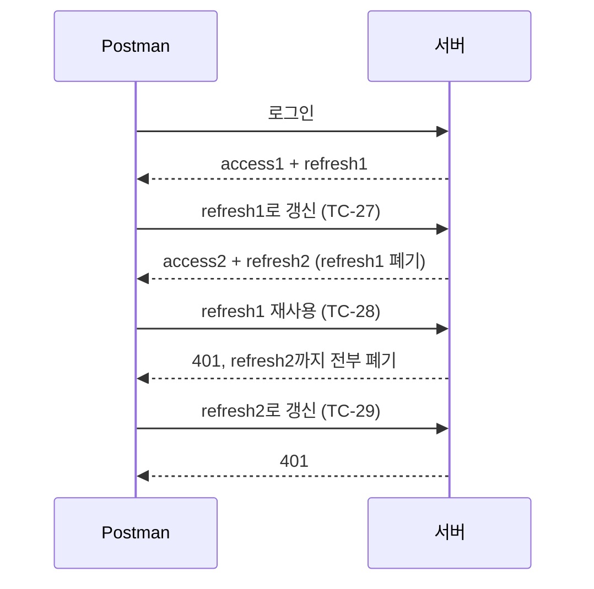

# Postman 테스트 가이드 — 회원가입 · 로그인 · 소셜 인증

socialAuth 백엔드의 **회원가입, 로그인(JWT), 토큰 갱신/로그아웃, Todo 소유권, Google 소셜 인증, 역할 기반 인가**를 Postman으로 검증하는 방법을 설명합니다.

| 항목 | 내용 |
|---|---|
| 컬렉션 파일 | [`postman_test.json`](postman_test.json) (Postman Collection v2.1) |
| 테스트 케이스 | 61개 (자동 56개 + Google 로그인 후 수동 5개) |
| 검증(assertion) | 130개 (자동 123개 + 수동 7개) |
| 대상 서버 | `http://localhost:8000` |
| 검증 결과 | 2026-11-06 Postman CLI 1.82: 자동 56개 요청, 123개 검증 모두 통과 (07 인가 폴더 포함) |

---

## 1. 사전 준비

1. **서버 실행** (작업 폴더 `E:\SocialOAuth`에서)

   ```powershell
   .venv\Scripts\python -m uvicorn app.main:app --reload --port 8000
   ```

   브라우저에서 `http://localhost:8000/health`가 `{"status":"ok"}`이면 준비 완료입니다.

2. **MariaDB 실행 중**이어야 합니다 (DB: `social_auth`).

3. **Google 소셜 테스트(06 폴더)를 하려면** `.env`에 `GOOGLE_CLIENT_ID`, `GOOGLE_CLIENT_SECRET`이 들어 있어야 합니다. 설정 방법은 [Google_OAuth.md](Google_OAuth.md)를 참고하세요.

> 주소는 반드시 `localhost`를 쓰세요. `127.0.0.1`을 섞으면 Google 로그인 쿠키와 redirect URI가 맞지 않습니다.

---

## 2. 컬렉션 가져오기 (Import)

1. Postman 실행 → 왼쪽 위 **Import** 클릭
2. `E:\SocialOAuth\postman_test.json` 파일을 끌어다 놓기
3. 왼쪽 Collections에 **"socialAuth - 회원가입·소셜 인증 테스트"**가 생깁니다.

환경(Environment)은 따로 만들 필요가 없습니다. 필요한 값은 모두 **컬렉션 변수**로 들어 있습니다.

### 컬렉션 변수

컬렉션을 클릭한 뒤 **Variables** 탭에서 볼 수 있습니다.

| 변수 | 기본값 | 설명 |
|---|---|---|
| `baseUrl` | `http://localhost:8000` | 서버 주소 |
| `password` | `Password1234!` | 테스트 회원 비밀번호 (12자 이상) |
| `email`, `emailB` | (자동) | TC-02 실행 시 `qa_시간@example.com` 형태로 자동 생성 |
| `userId` | (자동) | 가입한 회원 id |
| `accessToken`, `refreshToken` | (자동) | 로그인 시 자동 저장 |
| `oldRefreshToken` | (자동) | 갱신 전 refresh 토큰 (재사용 테스트용) |
| `accessTokenB` | (자동) | 두 번째 회원(B)의 토큰 |
| `todoId` | (자동) | 생성한 Todo id |
| `googleState` | (자동) | Google 로그인 시작 시 받은 state |
| `googleAccessToken`, `googleRefreshToken` | **직접 입력** | 브라우저 Google 로그인 후 받은 토큰 |
| `googleTodoId` | (자동) | Google 사용자가 만든 Todo id |
| `adminEmail`, `adminPassword` | `admin@example.com` / `AdminPassword1234!` | 07 폴더용 관리자 계정 (DB에서 role=admin 지정 필요) |
| `adminAccessToken`, `adminUserId` | (자동) | TC-51·52에서 저장 |

---

## 3. 실행 방법

### 방법 A — 전체 자동 실행 (Collection Runner)

1. 컬렉션 이름 옆 **⋯ → Run collection**
2. 순서를 바꾸지 말고 **Run** 클릭
3. 결과 화면에서 모든 테스트가 초록색(Passed)인지 확인합니다.

> **반드시 위에서부터 순서대로 실행하세요.** 앞 요청이 저장한 변수(이메일, 토큰, Todo id)를 뒤 요청이 사용합니다. 요청 하나만 따로 실행하면 변수가 비어 실패할 수 있습니다.

`googleAccessToken`이 비어 있으면 06 폴더(TC-42~46)는 **자동으로 건너뜁니다(Skipped)**. 실패가 아닙니다.

### 방법 B — Postman CLI로 실행

```bash
postman collection run postman_test.json
```

마지막 요약 표에서 `failed`가 모두 0이면 성공입니다.

### 방법 C — 하나씩 실행하며 공부하기

각 요청을 열고 **Send**를 누른 뒤, 아래쪽 **Test Results** 탭에서 어떤 검증이 통과했는지 확인합니다. 이 경우에도 위에서부터 순서대로 실행하세요.

---

## 4. 테스트 케이스 상세

오류 응답은 모두 같은 형식입니다.

```json
{ "error": { "code": "오류코드" } }
```

### 00 Health

| ID | 요청 | 기대 결과 | 확인 내용 |
|---|---|---|---|
| TC-01 | `GET /health` | 200 | `status = ok`, 보안 헤더 `X-Content-Type-Options: nosniff` |

### 01 회원가입 — `POST /api/auth/register`

요청 본문: `{"email": "...", "password": "..."}`

| ID | 상황 | 기대 결과 | 확인 내용 |
|---|---|---|---|
| TC-02 | 정상 가입 | **201** | `id`, `email`만 반환되고 비밀번호는 응답에 없음. `Cache-Control: no-store` |
| TC-03 | 같은 이메일로 다시 가입 | 409 `EMAIL_EXISTS` | 이메일 UNIQUE 제약 |
| TC-04 | 대문자로만 바꾼 같은 이메일 | 409 `EMAIL_EXISTS` | 서버가 이메일을 소문자로 저장하므로 같은 계정으로 판단 |
| TC-05 | 비밀번호 12자 미만 | 422 `VALIDATION_ERROR` | 오류 위치가 `password`, 응답에 입력한 비밀번호 원문이 없음 |
| TC-06 | 이메일 형식 오류 | 422 `VALIDATION_ERROR` | 이메일 형식 검증 |
| TC-07 | 허용되지 않은 필드(`role: admin`) 포함 | 422 `VALIDATION_ERROR` | 정의되지 않은 필드는 거부 (권한 상승 시도 차단) |

**정상 요청 예시**
```json
{ "email": "qa_1793866000000@example.com", "password": "Password1234!" }
```
**응답 (201)**
```json
{ "id": 5, "email": "qa_1793866000000@example.com" }
```

### 02 로그인 — `POST /api/auth/login`

| ID | 상황 | 기대 결과 | 확인 내용 |
|---|---|---|---|
| TC-08 | 틀린 비밀번호 | 401 `LOGIN_FAILED` | |
| TC-09 | 없는 계정 | 401 `LOGIN_FAILED` | 틀린 비밀번호와 **같은 오류코드** → 계정 존재 여부를 숨김 |
| TC-10 | 비밀번호 필드 누락 | 422 `VALIDATION_ERROR` | |
| TC-11 | 정상 로그인 | **200** | 아래 참고. 토큰을 변수에 자동 저장 |

**TC-11 응답 예시**
```json
{
  "accessToken": "eyJhbGciOiJIUzI1NiIs...",
  "refreshToken": "yVuiqq3vxqX7n84IWjY_...",
  "tokenType": "Bearer",
  "expiresIn": 900
}
```

TC-11에서 확인하는 내용:
- `tokenType = Bearer`, `expiresIn = 900`(15분)
- `refreshToken`은 43자 무작위 문자열(JWT가 아님)
- access JWT payload: `sub` = 회원 id, `type = access`, `iss = todo-api`, `aud = todo-client`, 유효기간 900초

> JWT는 암호화가 아니라 서명만 된 것이라 payload를 누구나 읽을 수 있습니다. 그래서 비밀번호 같은 민감 정보는 넣지 않습니다.

### 03 인증 · Todo 소유권

Todo API는 `Authorization: Bearer {{accessToken}}` 헤더가 필요합니다.

| ID | 상황 | 기대 결과 | 확인 내용 |
|---|---|---|---|
| TC-12 | 토큰 없이 목록 조회 | 401 `UNAUTHORIZED` | `WWW-Authenticate: Bearer` 헤더 |
| TC-13 | 서명 마지막 글자를 바꾼 JWT | 401 `UNAUTHORIZED` | 위조 토큰 거부 |
| TC-14 | refresh 토큰을 Bearer로 사용 | 401 `UNAUTHORIZED` | access 토큰만 허용 |
| TC-15 | Todo 생성 | **201** | `Location: /api/todos/{id}` 헤더, 한글 제목 저장, `completed` 기본값 false |
| TC-16 | 내 목록 | 200 | `page`, `limit` 반환, 방금 만든 Todo 포함 |
| TC-17 | 내 Todo 상세 | 200 | 응답 형식 |
| TC-18 | 완료 처리 `{"completed": true}` | 200 | `completed = true` |
| TC-19 | 빈 PATCH `{}` | 422 `VALIDATION_ERROR` | 바꿀 필드가 하나 이상 필요 |
| TC-20 | 회원 B 가입 | 201 | 소유권 테스트용 두 번째 회원 |
| TC-21 | 회원 B 로그인 | 200 | `accessTokenB` 저장 |
| TC-22 | **B가 A의 Todo 조회** | 404 `TODO_NOT_FOUND` | 남의 데이터 접근 차단(IDOR 방지) |
| TC-23 | **B가 A의 Todo 삭제** | 404 `TODO_NOT_FOUND` | 남의 데이터 삭제 차단 |
| TC-24 | B의 목록 | 200, 빈 목록 | A의 Todo가 섞이지 않음 |
| TC-25 | A가 Todo 삭제 | 204 | |
| TC-26 | 삭제 후 조회 | 404 `TODO_NOT_FOUND` | |

> **403이 아니라 404인 이유:** "남의 Todo"와 "없는 Todo"에 같은 응답을 줘야, 다른 사람의 Todo id가 존재하는지조차 알 수 없습니다.

### 04 토큰 갱신 · 로그아웃

| ID | 요청 | 기대 결과 | 확인 내용 |
|---|---|---|---|
| TC-27 | `POST /api/auth/refresh` (현재 refresh) | **200** | 새 토큰 쌍 발급, 새 refresh는 이전과 다름 (회전) |
| TC-28 | 이전 refresh 재사용 | 401 `REFRESH_REUSED_OR_EXPIRED` | 탈취된 토큰 재사용으로 판단 |
| TC-29 | TC-27에서 받은 **새** refresh | 401 `REFRESH_REUSED_OR_EXPIRED` | 재사용이 감지되면 같은 로그인 세션(family)의 토큰을 **모두** 폐기 |
| TC-30 | 형식이 틀린 refresh | 422 `VALIDATION_ERROR` | 43자 형식 검증 |
| TC-31 | 형식은 맞지만 없는 refresh | 401 `INVALID_REFRESH` | |
| TC-32 | 다시 로그인 | 200 | 새 세션 시작 |
| TC-33 | `POST /api/auth/logout` | **204** | 현재 세션의 refresh 폐기 |
| TC-34 | 로그아웃한 refresh로 갱신 | 401 `REFRESH_REUSED_OR_EXPIRED` | |
| TC-35 | 로그아웃 후 access JWT로 목록 조회 | **200** | access JWT는 만료(15분)까지 유효 |

**refresh 토큰 회전 흐름**



> **TC-35가 200인 이유:** JWT는 서버가 따로 저장하지 않고 서명만 확인하므로, 로그아웃해도 이미 발급된 access 토큰은 만료 전까지 쓸 수 있습니다. 즉시 차단하려면 JWT 차단 목록(denylist) 같은 추가 기능이 필요합니다. access 토큰 수명을 15분으로 짧게 둔 이유이기도 합니다.

### 05 Google 소셜 인증 (자동)

실제 Google 계정 로그인 없이 서버의 OAuth 보안 로직을 검증합니다.

| ID | 요청 | 기대 결과 | 확인 내용 |
|---|---|---|---|
| TC-36 | `GET /api/auth/google` (리다이렉트 따라가지 않음) | **302** | 아래 참고 |
| TC-37 | `callback?state=wrong&code=wrong` | 400 `INVALID_STATE` | 서버가 발급하지 않은 state 거부 |
| TC-38 | `callback?code=wrong` (state 없음) | 400 `INVALID_STATE` | |
| TC-39 | 실제 state + **다른 브라우저 쿠키** | 400 `INVALID_STATE` | state를 훔쳐도 원래 브라우저가 아니면 거부 (로그인 CSRF 방지) |
| TC-40 | 실제 state + 올바른 쿠키 + 가짜 code | 401 `OAUTH_FAILED` | state 검증은 통과, Google이 가짜 code를 거부 |
| TC-41 | TC-40과 같은 state로 다시 호출 | 400 `INVALID_STATE` | **state는 한 번만 사용 가능** (TC-40에서 이미 소비됨) |

TC-36에서 확인하는 내용 (`Location` 헤더의 Google 주소):
- `https://accounts.google.com/o/oauth2/v2/auth`로 이동
- `response_type=code`, `scope=openid email profile`
- `redirect_uri = http://localhost:8000/api/auth/google/callback`
- `state`, `nonce`가 충분히 긴 무작위 값
- PKCE: `code_challenge_method=S256`, `code_challenge` 43자
- `oauth_binding` 쿠키: `HttpOnly`, `SameSite=Lax`

**각 보안 값의 역할**

| 값 | 저장 위치 | 막는 공격 |
|---|---|---|
| state | DB(해시) ↔ callback 파라미터 | 위조된 callback 요청 |
| oauth_binding 쿠키 | 브라우저(HttpOnly) ↔ DB(해시) | 다른 브라우저에서 로그인 결과를 끼워 넣기 |
| nonce | DB ↔ Google ID 토큰 | ID 토큰 재전송 |
| PKCE verifier | 서버만 보관 | 인가 code를 가로채 토큰으로 교환 |

> TC-40은 서버가 실제로 Google 토큰 서버에 요청을 보내므로 **인터넷 연결**이 필요하고, `.env`에 Google 설정이 있어야 합니다. 설정이 없으면 05 폴더 전체가 `503 OAUTH_NOT_CONFIGURED`로 실패합니다.

### 06 Google 수동 후속 (브라우저 로그인 후)

Postman은 Google 계정 선택·동의 화면을 대신할 수 없습니다. 그래서 브라우저에서 로그인해 토큰을 받은 뒤 Postman에 넣어 테스트합니다.

**준비 순서**
1. Chrome에서 `http://localhost:8000/api/auth/google` 접속 → Google 계정으로 로그인
2. 화면에 표시된 JSON에서 두 값을 복사
   ```json
   {"accessToken":"eyJ...","refreshToken":"yVu...","tokenType":"Bearer","expiresIn":900}
   ```
3. Postman 컬렉션 → **Variables** 탭에서 입력 후 **Save**
   - `googleAccessToken` ← `accessToken` 값
   - `googleRefreshToken` ← `refreshToken` 값
4. 15분 안에 컬렉션을 실행합니다(access 토큰 만료 전).

| ID | 요청 | 기대 결과 | 확인 내용 |
|---|---|---|---|
| TC-42 | Google 사용자로 Todo 생성 | 201 | 소셜 로그인 사용자도 로컬 사용자와 같은 방식으로 API 사용 |
| TC-43 | Google 사용자 목록 | 200 | 방금 만든 Todo 포함 |
| TC-44 | **로컬 회원 A**가 Google 사용자 Todo 조회 | 404 `TODO_NOT_FOUND` | 가입 방식이 달라도 소유권 분리 |
| TC-45 | Google 사용자 Todo 삭제 | 204 | 테스트 데이터 정리 |
| TC-46 | Google 사용자 refresh | 200 | 새 토큰을 변수에 자동 저장 |

> **주의 (TC-46):** TC-46이 refresh 토큰을 회전시키므로 브라우저에서 복사한 원래 refresh 토큰은 더 이상 쓸 수 없습니다. 새 값은 컬렉션 변수에 자동 저장됩니다. 단, Collection Runner의 변수 변경은 실행 설정에 따라 저장되지 않을 수 있으니, 다음에 다시 실행할 때 401이 나오면 브라우저 로그인부터 다시 하세요.

**Google 콜백을 Postman에서 직접 부르면?**
브라우저 주소창의 callback URL을 복사해 Postman에서 호출하면 `400 INVALID_STATE`가 나옵니다. Postman에는 브라우저의 `oauth_binding` 쿠키가 없고, 브라우저에서 이미 state를 사용했기 때문입니다. 정상 동작입니다.

### 07 인가 (역할 기반 관리자 API)

**인증과 인가의 차이**를 확인하는 폴더입니다.
- **401 (인증 실패):** 토큰이 없거나 잘못되어 누구인지 모르는 경우
- **403 (인가 실패):** 누구인지는 알지만 그 일을 할 권한이 없는 경우

**관리자 계정 준비 (최초 1회, 이미 되어 있음)**

첫 관리자는 API로 만들 수 없습니다. 아직 허락해 줄 관리자가 없기 때문입니다. 그래서 일반 회원으로 가입한 뒤 DB에서 역할을 바꿉니다.

1. 회원가입: `POST /api/auth/register`에 `{"email":"admin@example.com","password":"AdminPassword1234!"}`
2. DB에서 관리자 지정
   ```sql
   UPDATE social_auth.users SET role = 'admin' WHERE email = 'admin@example.com';
   ```
3. 컬렉션 변수 `adminEmail`, `adminPassword`에 같은 값이 들어 있는지 확인합니다(기본값으로 들어 있음).

`adminEmail`이나 `adminPassword`가 비어 있으면 TC-51~61은 자동으로 건너뜁니다.

| ID | 요청 | 기대 결과 | 확인 내용 |
|---|---|---|---|
| TC-47 | 토큰 없이 `GET /api/admin/users` | 401 `UNAUTHORIZED` | 인증이 인가보다 먼저 검사됨 |
| TC-48 | 일반 회원 A의 `GET /api/auth/me` | 200, `role: "user"` | 가입하면 기본 역할은 user |
| TC-49 | A가 회원 목록 조회 | 403 `FORBIDDEN` | 로그인했어도 권한이 없으면 거부 |
| TC-50 | A가 자기 역할을 admin으로 변경 시도 | 403 `FORBIDDEN` | 스스로 권한을 올릴 수 없음 |
| TC-51 | 관리자 로그인 | 200 | `adminAccessToken` 저장 |
| TC-52 | 관리자 `GET /api/auth/me` | 200, `role: "admin"` | `adminUserId` 저장 |
| TC-53 | 관리자가 회원 목록 조회 | 200 | `items/page/limit/total` 형식, 비밀번호 해시 미포함 |
| TC-54 | `?role=admin` 필터 | 200 | 관리자만 나옴 |
| TC-55 | 관리자가 A를 admin으로 승격 | 200, `role: "admin"` | 역할 변경 |
| TC-56 | A가 **이전에 받은 토큰 그대로** 회원 목록 조회 | 200 | 역할을 DB에서 읽으므로 재로그인 없이 즉시 반영 |
| TC-57 | 관리자가 A를 다시 user로 | 200 | 권한 회수 |
| TC-58 | A가 같은 토큰으로 다시 조회 | 403 `FORBIDDEN` | 회수도 즉시 반영 |
| TC-59 | 역할에 `superuser` 입력 | 422 `VALIDATION_ERROR` | 정해진 역할(user/admin)만 허용 |
| TC-60 | 없는 회원(id 4294967295) 역할 변경 | 404 `USER_NOT_FOUND` | |
| TC-61 | 관리자가 자기 자신의 역할 변경 | 409 `CANNOT_CHANGE_OWN_ROLE` | 마지막 관리자가 권한을 잃는 사고 방지 |

> **참고:** 역할을 JWT 안에 넣으면 DB 조회는 줄지만, 권한을 회수해도 토큰이 만료될 때까지(최대 15분) 남습니다. TC-56과 TC-58은 이 프로젝트가 왜 DB에서 역할을 읽는지 보여 주는 테스트입니다.

---

## 5. DB에서 결과 확인하기

```sql
USE social_auth;

-- 가입 방식별 회원 목록
SELECT u.id,
       COALESCE(u.email, s.provider_email) AS email,
       IF(s.id IS NULL, 'local', s.provider) AS 가입방식,
       u.created_at
FROM users u
LEFT JOIN social_accounts s ON s.user_id = u.id;

-- refresh 토큰 상태 (revoked_at이 채워진 것은 폐기된 토큰)
SELECT user_id, family_id, expires_at, revoked_at FROM refresh_tokens ORDER BY id DESC;

-- 진행 중인 Google 로그인 state
SELECT COUNT(*) FROM oauth_states;
```

- `users.password_hash`는 `salt:해시` 형태라 원래 비밀번호를 알 수 없습니다.
- `refresh_tokens`에도 토큰 원문이 아니라 SHA-256 해시만 저장됩니다.

**테스트 회원 정리** — 자동 테스트는 실행할 때마다 `qa_...@example.com` 회원을 2명씩 만듭니다. 정리하려면 아래를 실행하세요(연결된 Todo와 토큰도 함께 삭제됩니다).

```sql
DELETE FROM users WHERE email LIKE 'qa\_%@example.com';
DELETE FROM oauth_states WHERE expires_at < UTC_TIMESTAMP();
```

---

## 6. 문제 해결

| 증상 | 원인 | 해결 |
|---|---|---|
| 모든 요청이 `Could not send request` / `ECONNREFUSED` | 서버가 꺼져 있음 | 1장의 명령으로 서버 실행 |
| TC-02가 409 | 이메일 자동 생성이 안 됨 | TC-02를 단독 실행하지 말고 폴더/컬렉션 단위로 실행 |
| 03 폴더가 모두 401 | `accessToken` 변수가 비어 있거나 만료(15분) | 02 폴더(TC-11)부터 다시 실행 |
| 05 폴더가 503 `OAUTH_NOT_CONFIGURED` | `.env`에 Google 값 없음 | [Google_OAuth.md](Google_OAuth.md) 참고 후 서버 재시작 |
| TC-36이 200 (Google 로그인 HTML) | 리다이렉트를 따라감 | 요청 **Settings → Automatically follow redirects**를 끔 (컬렉션에는 이미 꺼져 있음) |
| TC-39가 401 | 쿠키 자동 전송이 켜져 있어 올바른 쿠키가 같이 감 | 요청 **Settings → Disable cookie jar**를 켬 (컬렉션에는 이미 설정됨) |
| TC-40이 400 | TC-36을 건너뛰어 state가 없거나 10분 넘게 지남 | 05 폴더를 처음부터 다시 실행 |
| 06 폴더가 Skipped | `googleAccessToken` 미입력 | 4장 06 폴더 준비 순서 참고 |
| 06 폴더가 401 | Google 토큰 만료 또는 이미 회전됨 | 브라우저에서 Google 로그인을 다시 하고 토큰 재입력 |
| 브라우저 Google 로그인 후 `OAUTH_FAILED` | PC 시계 오차 등 | 서버 로그의 `OAUTH_FAILED ...` 줄에서 원인 확인 |
