# AX 풀스택 AI 서비스 스타터킷을 위한 React 실전 과정

## 목차

- [1. 과정 개요](#section-1)
- [2. React를 어느 수준까지 학습할 것인가](#section-2)
- [3. 배우지 않아도 되는 React 영역](#section-3)
- [4. 반드시 익혀야 할 핵심 내용](#section-4)
- [DAY 1. Vanilla JS에서 React 사고방식으로 전환](#day-1)
  - [학습목표](#day-1-goals)
  - [1교시 — React가 필요한 이유](#day-1-1)
  - [2교시 — 개발환경과 프로젝트 생성](#day-1-2)
  - [3교시 — JSX](#day-1-3)
  - [4교시 — Component](#day-1-4)
  - [5교시 — Props](#day-1-5)
  - [6교시 — List Rendering](#day-1-6)
  - [7교시 — Component 설계 실습](#day-1-7)
  - [8교시 — AI 활용 실습](#day-1-8)
- [DAY 2. State · Event · Form](#day-2)
  - [학습목표](#day-2-goals)
  - [1교시 — State](#day-2-1)
  - [2교시 — Event](#day-2-2)
  - [3교시 — Form](#day-2-3)
  - [4교시 — 객체 State](#day-2-4)
  - [5교시 — 조건부 렌더링](#day-2-5)
  - [6교시 — CRUD UI 설계](#day-2-6)
  - [7교시 — CRUD 실습](#day-2-7)
  - [8교시 — AI 코드 리뷰](#day-2-8)
- [DAY 3. FastAPI REST API와 React 연결](#day-3)
  - [학습목표](#day-3-goals)
  - [1교시 — 전체 구조 이해](#day-3-1)
  - [2교시 — GET](#day-3-2)
  - [3교시 — useEffect](#day-3-3)
  - [4교시 — POST](#day-3-4)
  - [5교시 — PUT / DELETE](#day-3-5)
  - [6교시 — API 모듈 분리](#day-3-6)
  - [7교시 — 오류 처리](#day-3-7)
  - [8교시 — 통합 CRUD 실습](#day-3-8)
- [DAY 4. Router · JWT · 인증 기반 구조](#day-4)
  - [학습목표](#day-4-goals)
  - [1교시 — Router](#day-4-1)
  - [2교시 — React Router](#day-4-2)
  - [3교시 — Layout](#day-4-3)
  - [4교시 — JWT 전체 흐름](#day-4-4)
  - [5교시 — 인증 State](#day-4-5)
  - [6교시 — Protected Route](#day-4-6)
  - [7교시 — Token 포함 API 호출](#day-4-7)
  - [8교시 — 인증 통합 실습](#day-4-8)
- [DAY 5. AI 서비스 + 스타터킷 구조 + Build](#day-5)
  - [학습목표](#day-5-goals)
  - [1교시 — AI 서비스 UI 설계](#day-5-1)
  - [2교시 — LangChain API 연결](#day-5-2)
  - [3교시 — AI 서비스 State](#day-5-3)
  - [4교시 — 재사용 가능한 프로젝트 구조](#day-5-4)
  - [5교시 — 환경변수](#day-5-5)
  - [6교시 — Production Build](#day-5-6)
  - [7교시 — AI 코드 품질 점검](#day-5-7)
  - [8교시 — 최종 미니 프로젝트](#day-5-8)
- [5일 전체 프로젝트 발전 과정](#project-evolution)
- [최종 프로젝트 구조](#final-project-structure)
- [AI 활용 수준도 단계적으로 높인다](#ai-levels)
- [수강생 평가방법](#evaluation)
- [좋은 평가문제 예](#evaluation-examples)
- [강사가 특히 강조해야 할 7가지](#seven-points)
- [40시간 교육시간 요약](#summary-40h)
- [최종 도달 수준](#final-level)
- [과정 설계의 핵심 원칙](#design-principles)

---

<a id="section-1"></a>
## 1. 과정 개요

### 과정명

**AI와 함께하는 React 기반 풀스택 프론트엔드 개발**

### 교육시간

- 5일
- 1일 8시간
- 총 40시간

### 프로젝트 연계

최종적으로 다음 구조를 구현할 수 있는 수준을 목표로 한다.

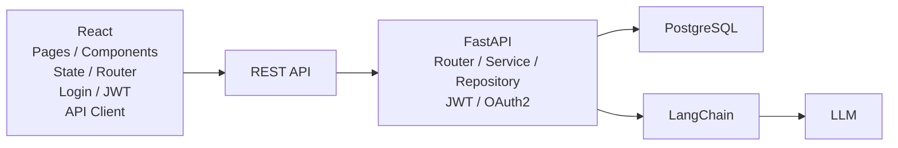

React 자체가 목적이 아니라,

> **React를 사용하여 FastAPI 기반 AI 서비스를 사용할 수 있는 프론트엔드를 설계하고 AI와 함께 구현·검증·수정하는 능력**

을 목표로 한다.

---

<a id="section-2"></a>
## 2. React를 어느 수준까지 학습할 것인가

React 학습 수준을 네 단계로 나누면 다음과 같다.

| 단계 | 수준 | 학습 내용 |
|---|---|---|
| Level 1 | React 사용 | JSX, Component |
| Level 2 | 웹앱 구현 | Props, State, Event, Form |
| **Level 3** | **풀스택 연동** | **Router, REST API, 인증, 구조화, 재사용** |
| Level 4 | 프론트엔드 전문 | Redux, 복잡한 상태관리, 최적화, SSR 등 |

### 본 과정 목표

**Level 3까지**

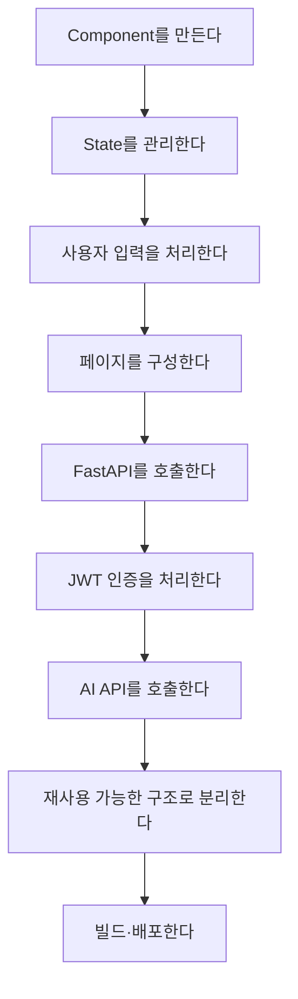

여기까지 수행할 수 있으면 충분하다.

---

<a id="section-3"></a>
## 3. 배우지 않아도 되는 React 영역

40시간 과정에서는 다음 내용은 과감하게 제외하거나 개념 소개 정도로 제한한다.

```text
Redux / Redux Toolkit 심화
useReducer 심화
React Context 전역 상태관리 심화
useMemo / useCallback 성능 최적화
React 내부 렌더링 알고리즘
Virtual DOM 구현 원리
React Compiler 내부 구조
SSR / SSG
Next.js
Micro Frontend
복잡한 Design Pattern
Webpack 내부 설정
고급 Custom Hook 설계
```

필요한 시점에 AI의 도움을 받아 추가하는 방식이 효율적이다.

---

<a id="section-4"></a>
## 4. 반드시 익혀야 할 핵심 내용

| 영역 | 중요도 | 목표 |
|---|---:|---|
| JSX | ★★★★☆ | JSX 코드를 읽고 수정 |
| Component | ★★★★★ | UI를 기능별로 분리 |
| Props | ★★★★★ | 컴포넌트 간 데이터 전달 |
| State | ★★★★★ | 화면 상태 관리 |
| Event | ★★★★★ | 사용자 행동 처리 |
| Form | ★★★★★ | 입력 데이터 관리 |
| 배열 렌더링 | ★★★★★ | API 목록 데이터 표시 |
| 조건부 렌더링 | ★★★★★ | Loading/Error/Empty 표시 |
| useEffect | ★★★★☆ | 외부 API와 동기화 |
| Router | ★★★★★ | SPA 페이지 구성 |
| REST API | ★★★★★ | FastAPI 연동 |
| JWT | ★★★★★ | 인증 기반 API 요청 |
| Context | ★★★☆☆ | 로그인 상태 정도만 공유 |
| Custom Hook | ★★★☆☆ | 반복 로직 분리 |
| 환경변수 | ★★★★☆ | API URL 등 관리 |
| Build | ★★★★☆ | 배포 파일 생성 |
| Git | ★★★★☆ | 프로젝트 버전 관리 |

---

<a id="day-1"></a>
# DAY 1. Vanilla JS에서 React 사고방식으로 전환

<a id="day-1-goals"></a>
## 학습목표

1. Vanilla JS와 React의 차이를 설명할 수 있다.
2. JSX를 읽고 수정할 수 있다.
3. 화면을 Component로 분리할 수 있다.
4. Props를 사용하여 Component를 재사용할 수 있다.
5. AI에게 Component 구조를 설계하도록 요청하고 결과를 검토할 수 있다.

---

<a id="day-1-1"></a>
## 1교시 — React가 필요한 이유

### 기존 Vanilla JS

```javascript
const title = document.querySelector("#title");
title.innerText = "상품 목록";
```

### React

```jsx
function App() {
    const title = "상품 목록";
    return <h1>{title}</h1>;
}
```

핵심 비교:

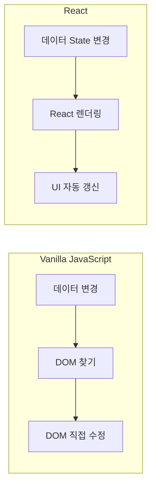

### 반드시 이해해야 할 개념

> React에서는 DOM을 직접 바꾸기보다 **데이터를 변경하고 UI가 그 상태를 표현하도록 만든다.**

---

<a id="day-1-2"></a>
## 2교시 — 개발환경과 프로젝트 생성

Vite를 이용하여 React 프로젝트를 생성한다.

Vite는 React 템플릿, 개발 서버, Production Build 기능을 제공한다.  
참고: [Vite 공식 가이드](https://vite.dev/guide/)

```bash
npm create vite@latest
```

구조 확인:

```text
my-app/
├─ public/
├─ src/
│   ├─ App.jsx
│   ├─ main.jsx
│   └─ assets/
├─ package.json
└─ vite.config.js
```

실습:

```bash
npm install
npm run dev
```

---

<a id="day-1-3"></a>
## 3교시 — JSX

다음 내용을 중심으로 한다.

```jsx
const name = "React";

function App() {
    return (
        <div>
            <h1>{name}</h1>
        </div>
    );
}
```

학습 내용:

- JSX 기본 구조
- `{}`를 이용한 JavaScript 표현식
- `className`
- `style`
- 조건부 출력
- 배열 출력

세세한 JSX 문법 암기는 지양한다.

---

<a id="day-1-4"></a>
## 4교시 — Component

React에서는 UI를 재사용 가능한 작은 Component 단위로 구성한다.  
참고: [React 공식 문서 - UI 설명하기](https://react.dev/learn/describing-the-ui)

기존:

```jsx
function App() {
    return (
        <div>
            <header>...</header>
            <main>...</main>
            <footer>...</footer>
        </div>
    );
}
```

분리:

```text
App
├─ Header
├─ Navigation
├─ Main
└─ Footer
```

---

<a id="day-1-5"></a>
## 5교시 — Props

```jsx
function ProductCard({ name, price }) {
    return (
        <div>
            <h3>{name}</h3>
            <p>{price}원</p>
        </div>
    );
}
```

사용:

```jsx
<ProductCard
    name="AI 노트북"
    price={1200000}
/>
```

핵심 흐름:

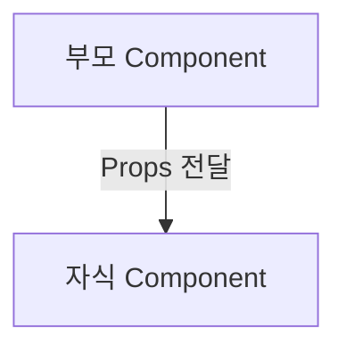

---

<a id="day-1-6"></a>
## 6교시 — List Rendering

API에서는 대부분 배열 데이터가 들어오므로 매우 중요하다.

```jsx
products.map(product => (
    <ProductCard
        key={product.id}
        product={product}
    />
))
```

다음 구조를 이해한다.

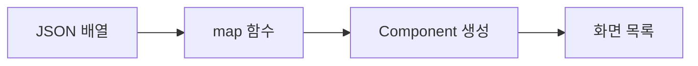

---

<a id="day-1-7"></a>
## 7교시 — Component 설계 실습

### 요구사항

상품관리 화면을 다음 Component로 분리한다.

```text
App
├─ Header
├─ ProductPage
│  ├─ SearchBar
│  ├─ ProductList
│  │  └─ ProductCard
│  └─ Pagination
└─ Footer
```

학생이 먼저 구조를 설계한 뒤 AI에게 검토하게 한다.

---

<a id="day-1-8"></a>
## 8교시 — AI 활용 실습

AI 요청 예:

> 다음 쇼핑몰 화면을 React Component로 분리해줘. Header, 검색창, 상품목록, 상품카드, 페이지네이션, Footer를 포함하고 각 Component의 역할과 Props도 정의해줘.

### 학생이 검증할 내용

- Component가 너무 작게 나뉘지 않았는가?
- 동일 UI를 재사용할 수 있는가?
- Props는 적절한가?
- 부모/자식 관계가 적절한가?

### DAY 1 산출물

```text
react-starter/
└─ src/
   └─ components/
      ├─ Header.jsx
      ├─ ProductCard.jsx
      ├─ ProductList.jsx
      └─ Footer.jsx
```

---

<a id="day-2"></a>
# DAY 2. State · Event · Form

<a id="day-2-goals"></a>
## 학습목표

1. React State의 역할을 설명할 수 있다.
2. 이벤트를 처리할 수 있다.
3. Form 입력 상태를 관리할 수 있다.
4. CRUD 화면을 구현할 수 있다.

---

<a id="day-2-1"></a>
## 1교시 — State

```jsx
const [count, setCount] = useState(0);
```

핵심 흐름:

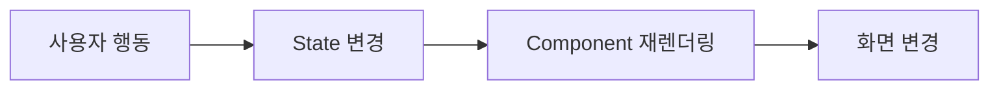

State 문법보다 **상태 변화와 렌더링의 관계**를 이해시키는 것이 중요하다.

---

<a id="day-2-2"></a>
## 2교시 — Event

```jsx
<button onClick={handleClick}>
    저장
</button>
```

```jsx
function handleClick() {
    console.log("저장");
}
```

학습 범위:

- `onClick`
- `onChange`
- `onSubmit`

이 세 가지를 중심으로 한다.

---

<a id="day-2-3"></a>
## 3교시 — Form

```jsx
const [name, setName] = useState("");

<input
    value={name}
    onChange={(e) => setName(e.target.value)}
/>
```

데이터 흐름:

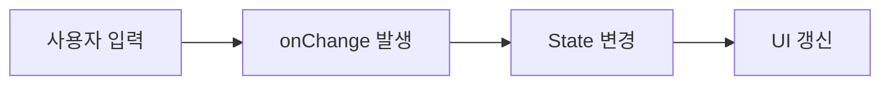

---

<a id="day-2-4"></a>
## 4교시 — 객체 State

실제 회원가입 Form:

```jsx
const [form, setForm] = useState({
    username: "",
    email: "",
    password: ""
});
```

여러 입력값을 하나의 객체로 관리하는 방법을 익힌다.

---

<a id="day-2-5"></a>
## 5교시 — 조건부 렌더링

반드시 다음 4개의 UI 상태를 다룬다.

```text
Loading
Success
Empty
Error
```

예:

```jsx
if (loading) {
    return <p>로딩 중...</p>;
}

if (error) {
    return <p>오류가 발생했습니다.</p>;
}
```

---

<a id="day-2-6"></a>
## 6교시 — CRUD UI 설계

```text
ProductPage
├─ ProductForm
└─ ProductList
   └─ ProductCard
      ├─ 수정
      └─ 삭제
```

아직 서버를 연결하지 않고 State로 CRUD를 경험한다.

---

<a id="day-2-7"></a>
## 7교시 — CRUD 실습

기능:

- 상품 등록
- 상품 조회
- 상품 수정
- 상품 삭제

---

<a id="day-2-8"></a>
## 8교시 — AI 코드 리뷰

AI에게 완성된 코드를 제공하고 다음 항목을 검토하도록 한다.

1. 불필요한 State
2. 중복 코드
3. Component 분리가 필요한 부분
4. 잘못된 이벤트 처리
5. 개선 가능한 부분

중요한 점:

> AI에게 수정부터 맡기기 전에 학생이 먼저 문제를 찾는다.

### DAY 2 산출물

**서버 없이 동작하는 React 상품관리 CRUD**

---

<a id="day-3"></a>
# DAY 3. FastAPI REST API와 React 연결

<a id="day-3-goals"></a>
## 학습목표

1. React에서 HTTP 요청을 처리할 수 있다.
2. FastAPI와 JSON 데이터를 주고받을 수 있다.
3. GET/POST/PUT/DELETE를 사용할 수 있다.
4. API 코드를 UI와 분리할 수 있다.

---

<a id="day-3-1"></a>
## 1교시 — 전체 구조 이해

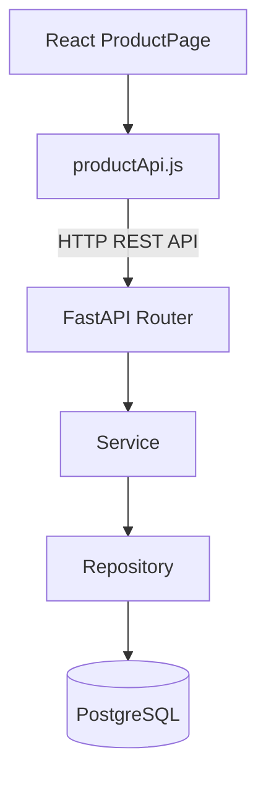

---

<a id="day-3-2"></a>
## 2교시 — GET

FastAPI:

```http
GET /api/products
```

React:

```javascript
const response = await fetch(
    "http://localhost:8000/api/products"
);

const data = await response.json();
```

---

<a id="day-3-3"></a>
## 3교시 — useEffect

`useEffect`는 외부 시스템과 React Component를 동기화하는 용도로 이해한다. 네트워크나 외부 시스템과 연결되지 않은 단순 계산에 Effect를 남용하지 않는다.  
참고: [React 공식 문서 - useEffect](https://react.dev/reference/react/useEffect)

```jsx
useEffect(() => {
    loadProducts();
}, []);
```

흐름:

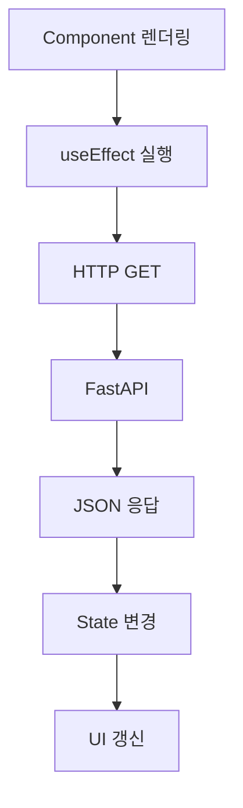

---

<a id="day-3-4"></a>
## 4교시 — POST

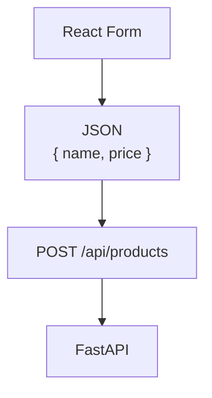

---

<a id="day-3-5"></a>
## 5교시 — PUT / DELETE

```http
PUT /api/products/10
DELETE /api/products/10
```

CRUD에서 각 HTTP Method의 역할을 구분한다.

---

<a id="day-3-6"></a>
## 6교시 — API 모듈 분리

좋지 않은 구조:

```text
ProductPage.jsx
  fetch()
  fetch()
  fetch()
  fetch()
```

개선:

```text
src/
├─ api/
│  └─ productApi.js
├─ pages/
│  └─ ProductPage.jsx
└─ components/
   └─ ProductForm.jsx
```

예:

```javascript
export async function getProducts() {
    const response = await fetch(`${API_URL}/products`);
    return response.json();
}
```

---

<a id="day-3-7"></a>
## 7교시 — 오류 처리

반드시 다루어야 하는 오류:

- 400
- 401
- 403
- 404
- 422
- 500
- CORS
- Network Error
- 잘못된 JSON

Browser Developer Tools의 다음 기능을 활용한다.

- Network
- Console
- Application

---

<a id="day-3-8"></a>
## 8교시 — 통합 CRUD 실습

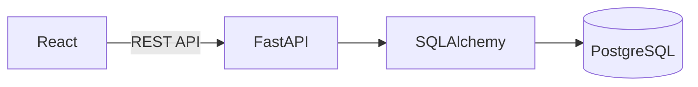

### DAY 3 산출물

**React + FastAPI + PostgreSQL 상품관리 CRUD**

---

<a id="day-4"></a>
# DAY 4. Router · JWT · 인증 기반 구조

<a id="day-4-goals"></a>
## 학습목표

1. SPA의 Routing을 이해한다.
2. React Router로 여러 화면을 구성한다.
3. JWT 로그인 구조를 이해한다.
4. 인증 API를 호출할 수 있다.
5. 보호된 페이지를 구현할 수 있다.

이번 과정에서는 FastAPI가 백엔드를 담당하므로 React Router의 복잡한 풀스택 기능보다는 **클라이언트 Routing**에 집중한다.  
참고: [React Router 공식 문서](https://reactrouter.com/)

---

<a id="day-4-1"></a>
## 1교시 — Router

```text
/
├─ /login
├─ /register
├─ /dashboard
├─ /products
├─ /products/:id
├─ /chat
└─ /mypage
```

---

<a id="day-4-2"></a>
## 2교시 — React Router

URL과 화면 Component의 관계를 이해한다.

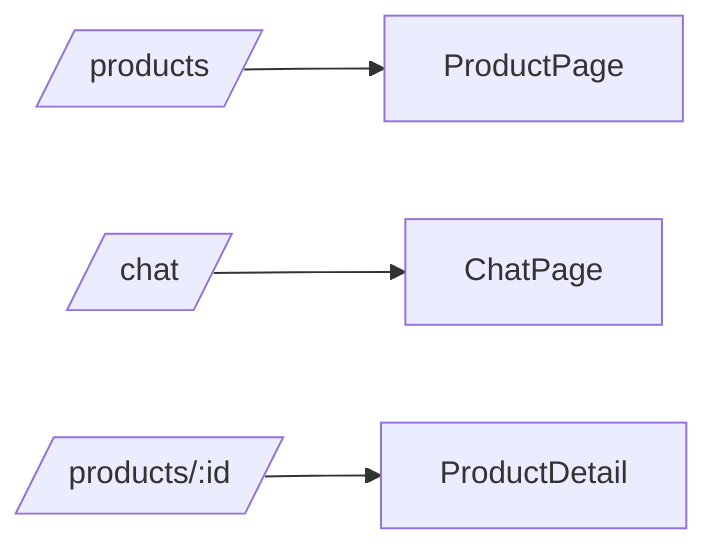

동적 URL도 경험한다.

```text
/products/:id
```

---

<a id="day-4-3"></a>
## 3교시 — Layout

```text
AppLayout
├─ Header
├─ Navigation
├─ Outlet
└─ Footer
```

재사용 가능한 스타터킷에서 매우 중요하다.

---

<a id="day-4-4"></a>
## 4교시 — JWT 전체 흐름

로그인 과정:

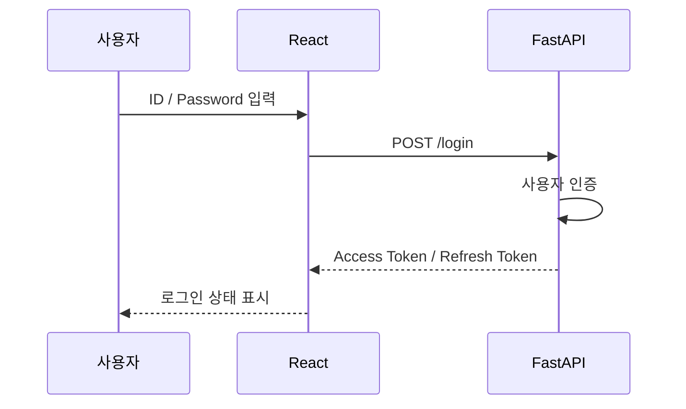

인증된 API 요청:

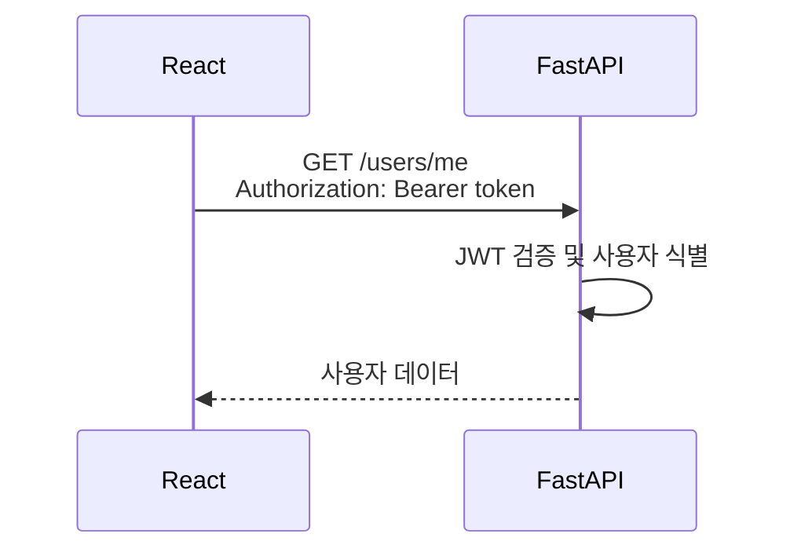

---

<a id="day-4-5"></a>
## 5교시 — 인증 State

예:

```text
AuthContext
├─ user
├─ token
├─ login()
└─ logout()
```

Context는 로그인 상태 공유 정도의 범위에서 사용하고 Redux까지 확대하지 않는다.

---

<a id="day-4-6"></a>
## 6교시 — Protected Route

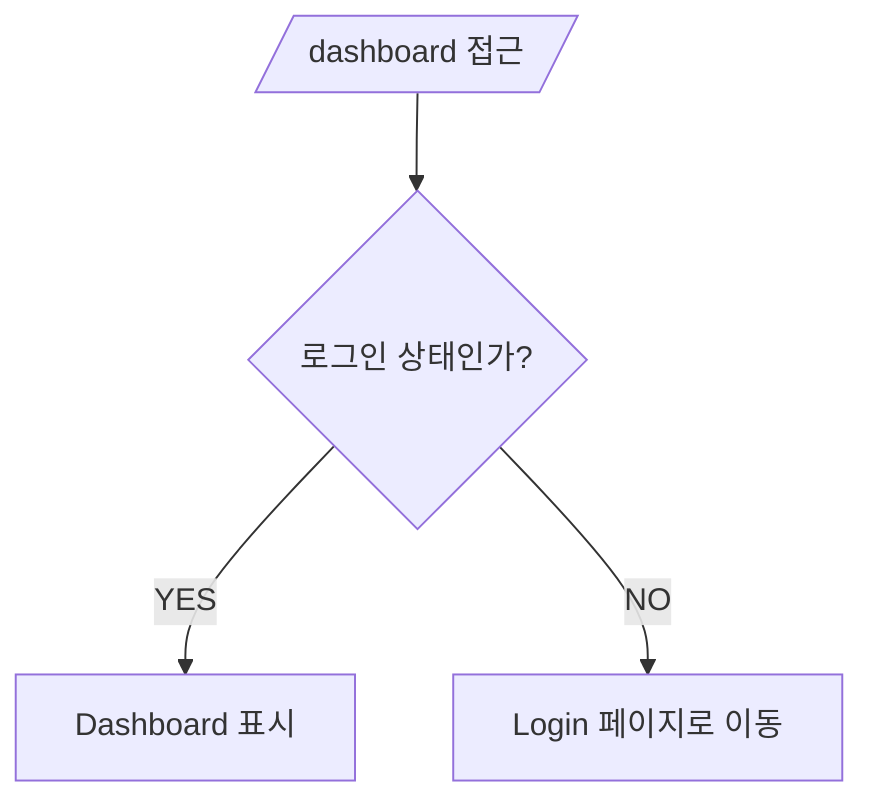

---

<a id="day-4-7"></a>
## 7교시 — Token 포함 API 호출

```javascript
fetch(url, {
    headers: {
        Authorization: `Bearer ${token}`
    }
});
```

반복되는 인증 요청을 API Client로 분리한다.

---

<a id="day-4-8"></a>
## 8교시 — 인증 통합 실습

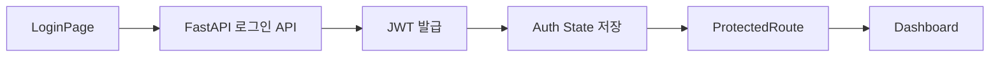

### DAY 4 산출물

**JWT 로그인을 지원하는 React + FastAPI 서비스**

---

<a id="day-5"></a>
# DAY 5. AI 서비스 + 스타터킷 구조 + Build

<a id="day-5-goals"></a>
## 학습목표

1. AI API를 React에 연결할 수 있다.
2. AI 응답의 비동기 상태를 관리할 수 있다.
3. 재사용 가능한 프로젝트 구조를 설계할 수 있다.
4. 환경변수를 관리할 수 있다.
5. Build와 CI/CD의 관계를 이해한다.
6. AI를 활용하여 전체 코드를 점검할 수 있다.

---

<a id="day-5-1"></a>
## 1교시 — AI 서비스 UI 설계

예:

```text
┌──────────────────────────┐
│ AI Assistant             │
├──────────────────────────┤
│                          │
│ 사용자 질문              │
│                          │
│ AI 답변                  │
│                          │
├──────────────────────────┤
│ 질문 입력          [전송] │
└──────────────────────────┘
```

Component:

```text
ChatPage
├─ ChatMessageList
│  └─ ChatMessage
└─ ChatInput
```

---

<a id="day-5-2"></a>
## 2교시 — LangChain API 연결

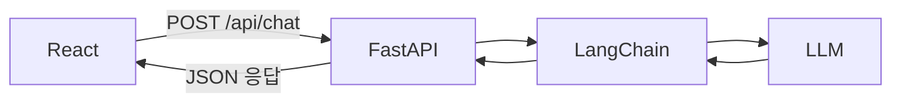

요청 예:

```json
{
    "question": "FastAPI란 무엇인가?"
}
```

응답 예:

```json
{
    "answer": "FastAPI는 Python 기반..."
}
```

---

<a id="day-5-3"></a>
## 3교시 — AI 서비스 State

기본 상태:

```text
messages
input
loading
error
```

처리 흐름:

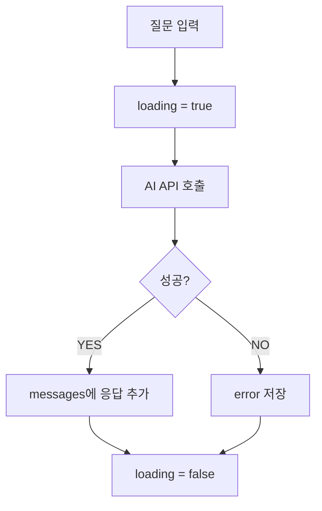

---

<a id="day-5-4"></a>
## 4교시 — 재사용 가능한 프로젝트 구조

최종적으로 다음 정도를 권장한다.

```text
frontend/
└─ src/
   ├─ api/
   │  ├─ client.js
   │  ├─ authApi.js
   │  ├─ productApi.js
   │  └─ chatApi.js
   ├─ components/
   │  ├─ common/
   │  ├─ layout/
   │  ├─ product/
   │  └─ chat/
   ├─ pages/
   │  ├─ HomePage.jsx
   │  ├─ LoginPage.jsx
   │  ├─ ProductPage.jsx
   │  ├─ ChatPage.jsx
   │  └─ MyPage.jsx
   ├─ contexts/
   │  └─ AuthContext.jsx
   ├─ hooks/
   ├─ utils/
   ├─ App.jsx
   └─ main.jsx
```

---

<a id="day-5-5"></a>
## 5교시 — 환경변수

개발 환경:

```text
VITE_API_URL=http://localhost:8000
```

Production:

```text
VITE_API_URL=https://api.example.com
```

코드에 서버 주소를 반복해서 직접 작성하지 않는다.

---

<a id="day-5-6"></a>
## 6교시 — Production Build

```bash
npm run build
```

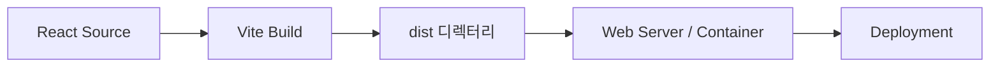

---

<a id="day-5-7"></a>
## 7교시 — AI 코드 품질 점검

AI에게 단순히 `코드 고쳐줘`라고 하지 않고 다음 관점으로 검토한다.

1. Component 책임이 명확한가?
2. 중복 코드가 있는가?
3. State가 불필요하게 많지 않은가?
4. `useEffect`를 불필요하게 사용하지 않았는가?
5. API 코드가 UI와 분리되어 있는가?
6. 오류 처리가 되어 있는가?
7. 인증 처리가 일관적인가?
8. 환경변수가 분리되어 있는가?
9. 재사용 가능한가?
10. 다른 개발자가 Fork해서 이해할 수 있는가?

---

<a id="day-5-8"></a>
## 8교시 — 최종 미니 프로젝트

### 미션

다음 기능을 가진 **AI 서비스 스타터킷 Frontend**를 완성한다.

### 필수 기능

- [ ] Header / Layout
- [ ] React Router
- [ ] 회원가입
- [ ] 로그인
- [ ] JWT 인증
- [ ] Protected Page
- [ ] REST CRUD
- [ ] AI Chat
- [ ] Loading 처리
- [ ] Error 처리
- [ ] API Module
- [ ] 환경변수
- [ ] Production Build
- [ ] README

---

<a id="project-evolution"></a>
# 5일 전체 프로젝트 발전 과정

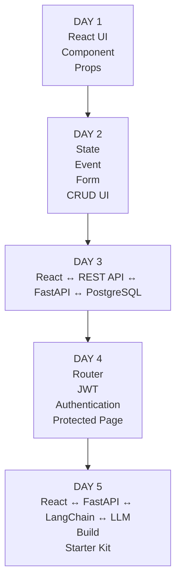

---

<a id="final-project-structure"></a>
# 최종 프로젝트 구조

```text
AX Fullstack AI Starter Kit
├── frontend/
│   ├── React
│   ├── Router
│   ├── Components
│   ├── Auth
│   ├── API Client
│   └── AI Chat
├── backend/
│   ├── FastAPI
│   ├── JWT
│   ├── Service
│   ├── Repository
│   └── LangChain
├── database/
│   └── PostgreSQL
├── docker/
├── tests/
├── .github/
│   └── workflows/
└── README.md
```

---

<a id="ai-levels"></a>
# AI 활용 수준도 단계적으로 높인다

```mermaid
flowchart TD
    L1["Level 1 — 코드 생성<br/>React Login Component를 만들어줘"] -->
    L2["Level 2 — 코드 설명<br/>State와 Event 흐름을 설명해줘"] -->
    L3["Level 3 — 코드 수정<br/>로그인 실패 오류 메시지를 추가해줘"] -->
    L4["Level 4 — 코드 리뷰<br/>Component 책임과 State 구조를 리뷰해줘"] -->
    L5["Level 5 — 구조 설계<br/>FastAPI + React JWT 인증 구조를 설계해줘"] -->
    L6["Level 6 — 프로젝트 Agent 활용<br/>프로젝트를 분석하고 수정·테스트·보고해줘"]
```

**5일차에는 Level 5~6까지 경험시키는 것이 목표다.**

---

<a id="evaluation"></a>
# 수강생 평가방법

기존 방식처럼 React 코드를 처음부터 암기하여 작성하는 평가보다는 다음 방법을 권장한다.

| 평가 | 비중 |
|---|---:|
| React 코드 독해 | 15% |
| Component 구조 설계 | 20% |
| State/Event 이해 | 15% |
| API 연동 | 20% |
| 오류 분석 및 수정 | 15% |
| AI 활용 및 코드 검증 | 15% |

---

<a id="evaluation-examples"></a>
# 좋은 평가문제 예

### 문제 1

다음 Component의 문제점을 찾아 수정하시오.

### 문제 2

다음 화면을 Component 구조로 설계하시오.

```text
Dashboard
상품관리
AI Chat
회원정보
```

### 문제 3

다음 API를 사용하는 React 코드를 AI를 활용하여 작성하고 결과를 검증하시오.

```http
GET /api/products
POST /api/products
PUT /api/products/{id}
DELETE /api/products/{id}
```

### 문제 4

로그인 후 `/mypage` 호출에서 HTTP 401 오류가 발생하였다. 다음을 조사하시오.

- React 문제인가?
- JWT 문제인가?
- Authorization Header가 있는가?
- Token이 만료되었는가?
- FastAPI 인증 문제인가?

### 문제 5

AI가 생성한 React 코드에서 불필요한 State와 `useEffect`를 찾아 수정하시오.

---

<a id="seven-points"></a>
# 강사가 특히 강조해야 할 7가지

React를 가르친 뒤 학생이 다음 질문에 답할 수 있으면 성공적이다.

### ① Component

> 이 화면을 어떤 Component로 나눌 것인가?

### ② Props

> 이 데이터는 어느 Component에서 어느 Component로 전달되는가?

### ③ State

> 어떤 데이터를 State로 관리해야 하는가?

### ④ Event

> 사용자가 버튼을 눌렀을 때 어떤 함수가 실행되는가?

### ⑤ API

> 이 화면은 어떤 FastAPI endpoint를 호출하는가?

### ⑥ Authentication

> 이 API 요청에 JWT가 필요한가?

### ⑦ Debugging

> 문제가 React에 있는가, HTTP에 있는가, FastAPI에 있는가, DB에 있는가?

---

<a id="summary-40h"></a>
# 40시간 교육시간 요약

| 일차 | 핵심 주제 | 시간 |
|---|---|---:|
| DAY 1 | React 사고방식 / JSX / Component / Props | 8H |
| DAY 2 | State / Event / Form / CRUD UI | 8H |
| DAY 3 | REST API / FastAPI / PostgreSQL 연동 | 8H |
| DAY 4 | Router / JWT / 인증 | 8H |
| DAY 5 | LangChain 연동 / 구조화 / Build / AI 개발 | 8H |
| **합계** | | **40H** |

---

<a id="final-level"></a>
# 최종 도달 수준

```mermaid
flowchart TD
    Req[요구사항] --> Comp[Component 설계]
    Comp --> React[React 화면 구현]
    React --> State[State 관리]
    React --> Router[Router 구성]
    State --> API[REST API]
    Router --> API
    API --> FastAPI[FastAPI]
    FastAPI --> PostgreSQL[(PostgreSQL)]
    FastAPI --> LangChain[LangChain]
    LangChain --> LLM[LLM]
    FastAPI --> Auth[JWT / Authentication]
    Auth --> Build[Build / Deploy]
    Build --> Starter[GitHub Starter Kit]
```

수강생이 React 코드를 모두 암기할 필요는 없다.

대신,

1. 화면을 Component로 분리하고
2. State의 위치를 결정하고
3. API 흐름을 이해하고
4. JWT 인증 구조를 이해하며
5. AI가 만든 React 코드를 읽고 수정하고
6. 오류 발생 지점을 Frontend/API/Backend로 구분하고
7. 다른 사람이 Fork해서 사용할 수 있도록 구조화

할 수 있어야 한다.

이 수준이면 **AX 풀스택 AI 서비스 스타터킷 구축 프로젝트에 필요한 React 학습 수준으로 충분하다.**

---

<a id="design-principles"></a>
# 과정 설계의 핵심 원칙

이번 React 과정에서 가장 중요한 변화는 다음과 같다.

```mermaid
flowchart LR
    subgraph Traditional[기존 React 교육]
        T1[JSX] --> T2[Component] --> T3[Props] --> T4[State] --> T5[Hook 중심 학습] --> T6[React 문법 학습]
    end

    subgraph AX[AX 과정 React 교육]
        A1[화면 요구사항] --> A2[Component 설계] --> A3[State 설계] --> A4[AI와 React 구현]
        A4 --> A5[FastAPI 연결] --> A6[JWT 인증] --> A7[AI Service 연결]
        A7 --> A8[Test / Debug] --> A9[Build] --> A10[Reusable Starter Kit]
    end
```

즉 **React 자체를 배우는 40시간이 아니라, React를 이용해 AI 풀스택 서비스를 구축하는 방법을 배우는 40시간**으로 구성한다.
