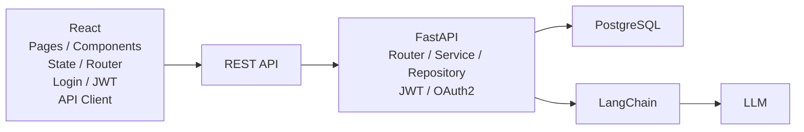
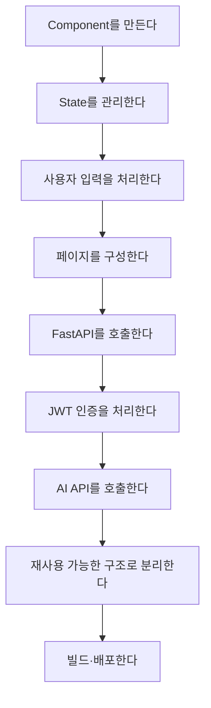

# AX 풀스택 AI 서비스 스타터킷을 위한 React 실전 과정
# 목차
  
- [1. 과정 개요](#1-과정-개요)
- [2. React를 어느 수준까지 학습할 것인가](#2-react를-어느-수준까지-학습할-것인가)
- [3. 배우지 않아도 되는 React 영역](#3-배우지-않아도-되는-react-영역)
- [4. 반드시 익혀야 할 핵심 내용](#4-반드시-익혀야-할-핵심-내용)
- [DAY 1. Vanilla JS에서 React 사고방식으로 전환](#day-1-vanilla-js에서-react-사고방식으로-전환)
  - [학습목표](#학습목표)
  - [1교시 — React가 필요한 이유](#1교시--react가-필요한-이유)
  - [2교시 — 개발환경과 프로젝트 생성](#2교시--개발환경과-프로젝트-생성)
  - [3교시 — JSX](#3교시--jsx)
  - [4교시 — Component](#4교시--component)
  - [5교시 — Props](#5교시--props)
  - [6교시 — List Rendering](#6교시--list-rendering)
  - [7교시 — Component 설계 실습](#7교시--component-설계-실습)
  - [8교시 — AI 활용 실습](#8교시--ai-활용-실습)
- [DAY 2. State · Event · Form](#day-2-state--event--form)
  - [학습목표](#학습목표-1)
  - [1교시 — State](#1교시--state)
  - [2교시 — Event](#2교시--event)
  - [3교시 — Form](#3교시--form)
  - [4교시 — 객체 State](#4교시--객체-state)
  - [5교시 — 조건부 렌더링](#5교시--조건부-렌더링)
  - [6교시 — CRUD UI 설계](#6교시--crud-ui-설계)
  - [7교시 — CRUD 실습](#7교시--crud-실습)
  - [8교시 — AI 코드 리뷰](#8교시--ai-코드-리뷰)
- [DAY 3. FastAPI REST API와 React 연결](#day-3-fastapi-rest-api와-react-연결)
  - [학습목표](#학습목표-2)
  - [1교시 — 전체 구조 이해](#1교시--전체-구조-이해)
  - [2교시 — GET](#2교시--get)
  - [3교시 — useEffect](#3교시--useeffect)
  - [4교시 — POST](#4교시--post)
  - [5교시 — PUT / DELETE](#5교시--put--delete)
  - [6교시 — API 모듈 분리](#6교시--api-모듈-분리)
  - [7교시 — 오류 처리](#7교시--오류-처리)
  - [8교시 — 통합 CRUD 실습](#8교시--통합-crud-실습)
- [DAY 4. Router · JWT · 인증 기반 구조](#day-4-router--jwt--인증-기반-구조)
  - [학습목표](#학습목표-3)
  - [1교시 — Router](#1교시--router)
  - [2교시 — React Router](#2교시--react-router)
  - [3교시 — Layout](#3교시--layout)
  - [4교시 — JWT 전체 흐름](#4교시--jwt-전체-흐름)
  - [5교시 — 인증 State](#5교시--인증-state)
  - [6교시 — Protected Route](#6교시--protected-route)
  - [7교시 — Token 포함 API 호출](#7교시--token-포함-api-호출)
  - [8교시 — 인증 통합 실습](#8교시--인증-통합-실습)
- [DAY 5. AI 서비스 + 스타터킷 구조 + Build](#day-5-ai-서비스-+-스타터킷-구조-+-build)
  - [학습목표](#학습목표-4)
  - [1교시 — AI 서비스 UI 설계](#1교시--ai-서비스-ui-설계)
  - [2교시 — LangChain API 연결](#2교시--langchain-api-연결)
  - [3교시 — AI 서비스 State](#3교시--ai-서비스-state)
  - [4교시 — 재사용 가능한 프로젝트 구조](#4교시--재사용-가능한-프로젝트-구조)
  - [5교시 — 환경변수](#5교시--환경변수)
  - [6교시 — Production Build](#6교시--production-build)
  - [7교시 — AI 코드 품질 점검](#7교시--ai-코드-품질-점검)
  - [8교시 — 최종 미니 프로젝트](#8교시--최종-미니-프로젝트)
- [5일 전체 프로젝트 발전 과정](#5일-전체-프로젝트-발전-과정)
- [최종 프로젝트 구조](#최종-프로젝트-구조)
- [AI 활용 수준도 단계적으로 높인다](#ai-활용-수준도-단계적으로-높인다)
- [수강생 평가방법](#수강생-평가방법)
- [좋은 평가문제 예](#좋은-평가문제-예)
- [강사가 특히 강조해야 할 7가지](#강사가-특히-강조해야-할-7가지)
- [40시간 교육시간 요약](#40시간-교육시간-요약)
- [최종 도달 수준](#최종-도달-수준)
- [과정 설계의 핵심 원칙](#과정-설계의-핵심-원칙)

## 1. 과정 개요

### 과정명

**AI와 함께하는 React 기반 풀스택 프론트엔드 개발**

### 교육시간

- 5일
- 1일 8시간
- 총 40시간

### 프로젝트 연계

최종적으로 다음 구조를 구현할 수 있는 수준을 목표로 한다.



React 자체가 목적이 아니라,

> **React를 사용하여 FastAPI 기반 AI 서비스를 사용할 수 있는 프론트엔드를 설계하고 AI와 함께 구현·검증·수정하는 능력**

을 목표로 한다.

---

# 2. React를 어느 수준까지 학습할 것인가

React 학습 수준을 네 단계로 나누면 다음과 같다.

| 단계 | 수준 | 학습 내용 |
|---|---|---|
| Level 1 | React 사용 | JSX, Component |
| Level 2 | 웹앱 구현 | Props, State, Event, Form |
| **Level 3** | **풀스택 연동** | **Router, REST API, 인증, 구조화, 재사용** |
| Level 4 | 프론트엔드 전문 | Redux, 복잡한 상태관리, 최적화, SSR 등 |

### 본 과정 목표

**Level 3까지**

즉,



여기까지 수행할 수 있으면 충분하다.

---

# 3. 배우지 않아도 되는 React 영역

40시간 과정에서는 다음 내용은 과감하게 제외하거나 개념 소개 정도로 제한한다.

```text
Redux / Redux Toolkit 심화

useReducer 심화

React Context 전역 상태관리 심화

useMemo / useCallback 성능 최적화

React 내부 렌더링 알고리즘

Virtual DOM 구현 원리

React Compiler 내부 구조

SSR / SSG

Next.js

Micro Frontend

복잡한 Design Pattern

Webpack 내부 설정

고급 Custom Hook 설계
```

필요한 시점에 AI의 도움을 받아 추가하는 방식이 효율적이다.

---

# 4. 반드시 익혀야 할 핵심 내용

| 영역 | 중요도 | 목표 |
|---|---:|---|
| JSX | ★★★★☆ | JSX 코드를 읽고 수정 |
| Component | ★★★★★ | UI를 기능별로 분리 |
| Props | ★★★★★ | 컴포넌트 간 데이터 전달 |
| State | ★★★★★ | 화면 상태 관리 |
| Event | ★★★★★ | 사용자 행동 처리 |
| Form | ★★★★★ | 입력 데이터 관리 |
| 배열 렌더링 | ★★★★★ | API 목록 데이터 표시 |
| 조건부 렌더링 | ★★★★★ | Loading/Error/Empty 표시 |
| useEffect | ★★★★☆ | 외부 API와 동기화 |
| Router | ★★★★★ | SPA 페이지 구성 |
| REST API | ★★★★★ | FastAPI 연동 |
| JWT | ★★★★★ | 인증 기반 API 요청 |
| Context | ★★★☆☆ | 로그인 상태 정도만 공유 |
| Custom Hook | ★★★☆☆ | 반복 로직 분리 |
| 환경변수 | ★★★★☆ | API URL 등 관리 |
| Build | ★★★★☆ | 배포 파일 생성 |
| Git | ★★★★☆ | 프로젝트 버전 관리 |

---

# DAY 1. Vanilla JS에서 React 사고방식으로 전환

## 학습목표

1. Vanilla JS와 React의 차이를 설명할 수 있다.
2. JSX를 읽고 수정할 수 있다.
3. 화면을 Component로 분리할 수 있다.
4. Props를 사용하여 Component를 재사용할 수 있다.
5. AI에게 Component 구조를 설계하도록 요청하고 결과를 검토할 수 있다.

---

## 1교시 — React가 필요한 이유

### 기존 Vanilla JS

```javascript
const title = document.querySelector("#title");

title.innerText = "상품 목록";
```

### React

```jsx
function App() {
    const title = "상품 목록";

    return <h1>{title}</h1>;
}
```

핵심 비교:

```mermaid
graph LR
  subgraph Vanilla[Vanilla JavaScript]
    V1[데이터 변경] --> V2[DOM 찾기] --> V3[DOM 직접 수정]
  end
  subgraph ReactFlow[React]
    R1[데이터(State) 변경] --> R2[React] --> R3[UI 자동 갱신]
  end
```

### 반드시 이해해야 할 개념

> React에서는 DOM을 직접 바꾸기보다  
> **데이터를 변경하고 UI가 그 상태를 표현하도록 만든다.**

---

## 2교시 — 개발환경과 프로젝트 생성

Vite를 이용하여 React 프로젝트를 생성한다.

Vite는 공식적으로 React 템플릿을 제공하며 개발 서버와 production build 기능을 제공한다. :chatgpt-content-reference{index="1"}

```bash
npm create vite@latest
```

구조 확인:

```text
my-app/

├─ public/
├─ src/
│   ├─ App.jsx
│   ├─ main.jsx
│   └─ assets/
│
├─ package.json
└─ vite.config.js
```

실습:

```bash
npm install
npm run dev
```

---

# 3교시 — JSX

다음 내용을 중심으로 한다.

```jsx
const name = "React";

function App() {
    return (
        <div>
            <h1>{name}</h1>
        </div>
    );
}
```

학습 내용:

- JSX 기본 구조
- `{}`를 이용한 JavaScript 표현식
- className
- style
- 조건부 출력
- 배열 출력

세세한 JSX 문법 암기는 지양한다.

---

# 4교시 — Component

React 공식 학습 문서에서도 UI를 재사용 가능한 작은 Component 단위로 구성하는 방식을 핵심으로 다룬다. :chatgpt-content-reference{index="2"}

기존:

```jsx
function App() {
    return (
        <div>
            <header>...</header>
            <main>...</main>
            <footer>...</footer>
        </div>
    );
}
```

분리:

```text
App

├─ Header
├─ Navigation
├─ Main
│
└─ Footer
```

---

# 5교시 — Props

```jsx
function ProductCard({ name, price }) {
    return (
        <div>
            <h3>{name}</h3>
            <p>{price}원</p>
        </div>
    );
}
```

사용:

```jsx
<ProductCard
    name="AI 노트북"
    price={1200000}
/>
```

핵심:

```text
Parent
  │
  │ Props
  ▼
Child Component
```

---

# 6교시 — List Rendering

API에서는 대부분 배열 데이터가 들어오므로 매우 중요하다.

```jsx
products.map(product => (
    <ProductCard
        key={product.id}
        product={product}
    />
))
```

다음 구조를 이해한다.

```mermaid
graph TD
  JSON["JSON 배열"] --> Map[map()] --> Comp[Component] --> UI[화면 목록]
```

---

# 7교시 — Component 설계 실습

### 요구사항

We include rest of file unchanged but we removed placeholder "[...]" etc where found.
