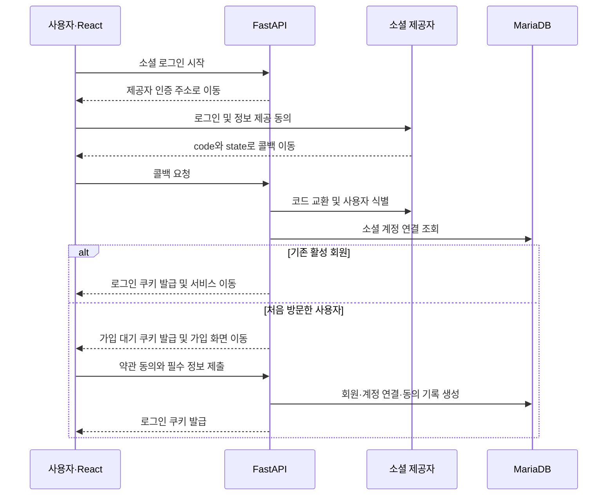

# 소셜 인증 회원가입 개발 가이드

**React 프론트엔드 · Python FastAPI 백엔드 · MariaDB 기준**

소셜 제공자는 **사용자가 어떤 외부 계정으로 인증했는지** 확인해 줍니다. 우리 백엔드는 그 결과를 검증하고, **우리 서비스의 회원을 찾거나 생성한 뒤 로그인 세션을 발급**합니다.

예를 들어 사용자가 **네이버로 계속하기**를 누르면 네이버가 외부 계정을 확인합니다. FastAPI는 네이버가 반환한 사용자 식별자로 MariaDB를 조회합니다. 이미 연결된 계정이면 로그인하고, 처음 방문한 사용자라면 약관 동의와 필수 정보 입력을 거쳐 가입을 완료합니다. 프론트엔드에서는 버튼 하나지만, 백엔드에서는 이 지점에서 기존 회원 로그인과 신규 회원가입이 갈립니다.

이 가이드는 **FastAPI가 콜백과 토큰 교환을 담당하고, 브라우저에는 우리 서비스의 세션 쿠키를 발급하는 방식**을 기준으로 합니다. 운영에서는 `https://app.example.com`에서 React를 제공하고 `/api`를 FastAPI로 연결하는 동일 출처 구성을 가정합니다.

---


---

## 1. 개발자가 먼저 알아야 할 개념

| 개념 | 이 기능에서 하는 일 |
|---|---|
| OAuth 2.0 | 사용자가 허용한 범위에서 우리 백엔드가 소셜 제공자의 API를 호출할 수 있게 합니다. |
| OpenID Connect, OIDC | OAuth 2.0 위에 인증 정보를 추가합니다. 검증된 `id_token`에서 사용자 식별자 `sub`를 얻을 수 있습니다. |
| Authorization Code | 소셜 제공자가 브라우저를 통해 콜백에 전달하는 일회용 코드입니다. FastAPI가 이를 제공자의 토큰 엔드포인트에서 교환합니다. |
| 제공자 Access Token | 네이버 프로필 조회처럼 소셜 제공자의 API를 호출할 때 사용합니다. |
| ID Token | OIDC에서 제공자가 발급한 인증 결과입니다. 백엔드가 서명과 발급자, 대상 등을 검증합니다. |
| `state` | 현재 브라우저의 로그인 시작 요청과 콜백을 연결합니다. 무작위로 생성하고 짧게 보관하며 한 번만 사용합니다. |
| PKCE | 코드 교환 시 로그인 시작 단계에서 만든 `code_verifier`를 요구해, 탈취된 코드가 사용되는 위험을 줄입니다. 지원하는 제공자에서는 `S256`을 사용합니다. |
| `nonce` | OIDC 요청과 반환된 ID Token을 연결합니다. 요청에 넣은 값이 검증된 ID Token 안의 값과 일치해야 합니다. |
| 우리 서비스 세션 | React에서 `/api/auth/me`나 주문 API를 호출할 때 FastAPI가 내부 회원을 식별하는 데 사용합니다. |

개발 중에는 **어느 서버가 발급했고 어느 서버가 검증하는 값인지** 구분합니다. 네이버 Access Token은 네이버 프로필 API에 보내고, 우리 서비스의 주문 API는 우리 서비스 세션으로 보호합니다. [OAuth 2.0 보안 표준][rfc] · [Google OIDC][google] · [네이버 로그인 API][naver]

### 제공자별 사용자 식별 방식

| 제공자 | 백엔드가 사용자 정보를 얻는 방법 | 회원 연결에 사용하는 값 |
|---|---|---|
| Google | OIDC ID Token을 검증합니다. | 검증된 `sub` |
| 네이버 | 코드를 Access Token으로 교환한 뒤 `GET /v1/nid/me`를 호출합니다. HTTP 상태와 응답 결과를 확인합니다. | 프로필 응답의 `response.id` |
| 카카오 | 사용자 정보 API를 호출하거나, 앱에서 OIDC를 활성화한 경우 ID Token을 검증합니다. | 사용자 정보 API의 `id` 또는 OIDC의 `sub`. 앱에서 채택한 경로와 저장 규칙을 일관되게 적용합니다. |

DB에서는 이 값을 문자열 `provider_subject`로 정규화합니다. 예를 들어 `(naver, abc123)`과 `(google, abc123)`은 서로 다른 외부 계정입니다. 동일 제공자에서 서로 다른 앱 등록이나 발급자까지 지원한다면 식별자의 유효 범위에 맞게 네임스페이스도 분리합니다. 이메일은 변경되거나 동의 범위에 따라 누락될 수 있으므로 회원 연결 키로 사용하지 않습니다. [Google OIDC][google] · [네이버 프로필 API][profile] · [카카오 로그인 REST API][kakao]

## 2. 버튼 클릭부터 가입 완료까지



**소셜 인증 성공과 회원가입 완료 사이에 가입 대기 상태를 둡니다.** 사용자가 네이버에서 정보 제공에 동의한 뒤 우리 서비스의 약관 화면을 닫았다면 가입 대기 정보만 만료됩니다. 회원 정보와 소셜 계정 연결은 가입 완료 요청이 성공할 때 함께 생성합니다.

### 프론트엔드와 백엔드가 합의할 API

| 메서드와 경로 | 역할 | 결과 예시 |
|---|---|---|
| `GET /api/auth/{provider}/start` | 인증 요청 정보 저장, 제공자 화면으로 이동 | `302` |
| `GET /api/auth/{provider}/callback` | `state` 검증, 코드 교환, 회원 판별 | 기존 회원은 `/`, 신규는 `/signup/complete`, 실패는 `/login?reason=…` |
| `GET /api/auth/signup/pending` | 가입 대기 여부와 화면에 필요한 최소 정보 조회 | `200` 또는 `401` |
| `POST /api/auth/signup/complete` | 약관과 입력값 검증, 회원 생성, 로그인 세션 발급 | `201`, 입력 오류 `422`, 처리 불가 충돌 `409` 등 |
| `GET /api/auth/me` | 현재 로그인한 내부 회원과 화면에 필요한 권한 정보 조회 | `200` 또는 `401` |
| `POST /api/auth/logout` | 서버 로그인 세션 폐기, 브라우저 쿠키 삭제 | `204` |

콜백에서 React로 전달하는 오류는 `cancelled`, `login_expired`, `temporarily_unavailable` 같은 **우리 서비스의 고정 코드**로 제한합니다. 제공자의 원문 오류나 토큰을 화면 URL에 싣지 않습니다.

## 3. 프론트엔드 개발자가 해야 할 작업

### 3.1 로그인 버튼으로 브라우저 이동

소셜 로그인 시작은 링크나 `window.location.assign()`으로 **브라우저 전체를 이동**시키면 됩니다. 그 뒤 사용자는 소셜 제공자 화면에서 직접 로그인합니다.

```jsx
export default function SocialLoginButtons() {
  return (
    <div>
      <a href="/api/auth/naver/start">네이버로 계속하기</a>
      <a href="/api/auth/google/start">Google로 계속하기</a>
    </div>
  );
}
```

React는 인증을 시작하고 결과 화면을 표시합니다. 제공자 Client Secret, 코드 교환, 토큰 검증은 FastAPI에 둡니다. 화면 디자인에는 제공자의 로그인 버튼 및 로고 가이드를 적용합니다.

### 3.2 로그인과 가입 대기 화면 구분

| 화면 상태 | React가 할 일 |
|---|---|
| 앱 최초 접속 또는 새로고침 | `/api/auth/me`를 호출합니다. 응답 전에는 확인 중 상태를 표시합니다. |
| 로그인 확인 `200` | 이름, 마이페이지, 로그아웃 버튼 등을 표시합니다. |
| 비로그인 `401` | 로그인 화면을 표시합니다. 네트워크 장애나 `5xx`는 별도 재시도 상태로 처리합니다. |
| 가입 완료 화면 | `/api/auth/signup/pending`으로 유효한 가입 대기 상태인지 확인합니다. |
| 약관 및 추가 정보 입력 | 필수·선택 동의를 구분하고, 이메일이 제공되지 않는 상황도 처리합니다. |
| 가입 완료 | `POST /api/auth/signup/complete` 성공 후 `/api/auth/me`를 다시 조회합니다. |
| 사용자 취소·인증 만료 | 원인을 짧게 안내하고 로그인 버튼을 다시 사용할 수 있게 합니다. |

React Context나 상태 관리 라이브러리에는 `/me`의 **화면 표시용 회원 정보**를 보관할 수 있습니다. 관리 메뉴를 숨기는 UI 처리와 별개로, 관리자 API는 FastAPI에서 권한을 다시 확인합니다.

### 3.3 개발 중 쿠키와 CORS

운영과 로컬에서 모두 `/api`를 같은 출처로 쓰려면, 로컬에서는 Vite 개발 서버의 `/api` 프록시를 사용할 수 있습니다. 콜백을 포함해 **브라우저가 실제로 방문하는 URL**을 제공자 콘솔과 FastAPI 설정에 동일하게 등록합니다.

React와 FastAPI에 서로 다른 출처로 직접 접속한다면, 브라우저의 API 요청에는 `credentials: "include"`를 넣고 FastAPI에는 허용할 프론트 출처와 `allow_credentials=True`를 명시합니다. 예를 들어 `localhost:5173`과 `localhost:8000`은 포트가 달라 서로 다른 출처입니다. 제공자 화면으로 이동하는 브라우저 내비게이션과 React가 API 응답을 읽는 `fetch`는 구분해서 디버깅합니다. [FastAPI CORS][cors]

## 4. 백엔드 개발자가 해야 할 작업

### 4.1 인증 시작 요청 생성

`GET /api/auth/{provider}/start`에서 다음을 처리합니다.

1. `provider`가 설정에 등록된 제공자인지 확인합니다.
2. 추측하기 어려운 `state`와 브라우저를 식별할 임시 값을 생성합니다.
3. 지원하는 제공자에 대해서는 PKCE `code_verifier`와 `S256` 챌린지를 만듭니다. OIDC를 사용하면 `nonce`도 생성합니다.
4. 서버 저장소에 `provider`, 브라우저 바인딩 값, `state`, 만료 시각, `code_verifier`, `nonce`를 저장합니다. 초기 설정 예시는 **5분 TTL**입니다.
5. 브라우저에 임시 쿠키를 발급하고, 등록된 Redirect URI와 필요한 권한 범위를 넣어 제공자의 인증 화면으로 보냅니다.

`GET /api/auth/naver/start?next=/orders/42`를 지원한다면 허용한 서비스 내부 경로나 미리 정의된 화면 키만 저장합니다. 제공자별 콜백 경로도 분리합니다. [OAuth 2.0 보안 표준][rfc]

### 4.2 콜백 검증과 사용자 신원 확인

1. **요청 검증**  
   콜백 경로의 제공자, `state`, 브라우저 임시 쿠키, 만료 여부를 확인합니다. 검증과 사용 처리를 원자적으로 묶어 동일한 콜백을 두 번 처리하지 않게 합니다. 사용자 취소 응답도 유효한 로그인 요청에 대한 응답인지 확인한 뒤 처리합니다.
2. **코드 교환**  
   서버에서 제공자의 토큰 엔드포인트를 호출합니다. 제공자별 파라미터와 클라이언트 인증 방식을 따르고, PKCE를 사용했다면 `code_verifier`를 전달합니다. 외부 호출에 타임아웃을 두고, 교환 결과가 불명확하면 사용자가 새 로그인 흐름을 시작하도록 안내합니다.
3. **외부 사용자 식별**  
   네이버라면 Access Token으로 프로필 API를 호출해 `response.id`를 가져옵니다. OIDC라면 라이브러리로 ID Token의 서명, `iss`, `aud`, `exp`, 요청 시 사용한 `nonce`를 검증합니다. `azp` 등 추가 검증이 필요한 경우에는 제공자 명세를 적용합니다.
4. **공통 형태로 변환**  
   제공자 응답을 `provider`, `subject`, `email | None`, `display_name | None` 정도로 변환합니다. `subject`가 없으면 회원 조회나 생성을 중단합니다. 이메일 검증 상태는 제공자가 명시적으로 보장하는 경우에만 기록합니다.

[OAuth 2.0 보안 표준][rfc] · [Google OIDC][google] · [Google OIDC API 레퍼런스][google-ref] · [네이버 로그인 API][naver] · [네이버 프로필 API][profile]

Python에서는 **Authlib**을 OAuth/OIDC 연동에 사용할 수 있습니다. 제공자별 프로필 호출은 HTTP 클라이언트로 처리하고, API 요청과 응답 스키마는 Pydantic, DB 처리는 SQLAlchemy와 Alembic으로 나눕니다. 회원 조회, 가입 정책, 세션 폐기는 애플리케이션 코드에서 구현합니다. [Authlib][authlib]

### 4.3 검증된 외부 계정으로 회원 판별

| 상황 | FastAPI가 할 일 |
|---|---|
| 소셜 계정 연결이 있고 회원이 활성 상태 | 내부 `user_id`로 로그인 세션을 발급합니다. |
| 소셜 계정 연결이 있고 회원이 정지 상태 | 서비스 정책에 따라 접근을 차단합니다. |
| 소셜 계정 연결이 없음 | 검증된 외부 식별자를 서버에 보관하고, 짧은 수명의 가입 대기 쿠키를 발급합니다. |
| 연결이 없지만 이메일이 기존 회원과 같음 | 기존 계정으로 인증한 뒤 계정 설정에서 소셜 계정을 연결하도록 안내합니다. 이메일 일치만으로 연결하지 않습니다. |
| 로그인한 사용자가 계정 설정에서 소셜 계정 연결을 시작 | 연결 목적과 현재 내부 `user_id`를 시작 요청에 묶습니다. 필요 시 재인증하고, 이미 다른 회원에게 연결된 외부 계정은 거절합니다. |

동일 이메일로 가입한 Google 회원에게 네이버 로그인 요청이 들어와도, 기존 주문 내역을 열어 주려면 먼저 기존 계정의 소유자임을 확인해야 합니다. 서버에서 소셜 로그인과 계정 연결을 별개의 작업으로 다룹니다. [Google OIDC][google] · [OAuth 2.0 보안 표준][rfc]

### 4.4 MariaDB에 회원과 소셜 계정 연결 저장

| 테이블 또는 저장소 | 주요 필드 | 제약과 역할 |
|---|---|---|
| `users` | `id`, `display_name`, `email`, `status`, `created_at` | 서비스 내부 회원. 주문과 게시글은 이 `id`를 참조합니다. 이메일 필수 여부는 서비스 정책으로 정합니다. |
| `social_identities` | `id`, `user_id`, `provider`, `provider_subject`, `linked_at` | `user_id`는 외래 키입니다. `UNIQUE(provider, provider_subject)`로 외부 계정 하나가 여러 회원에게 연결되는 것을 방지합니다. |
| `user_consents` | `user_id`, `document_type`, `document_version`, `agreed_at` | 어떤 버전의 약관과 동의 항목을 수락했는지 기록합니다. |
| `sessions` | 세션 ID의 해시, `user_id`, `expires_at`, `revoked_at` | 현재 서비스의 로그인 상태를 저장합니다. |
| 로그인 요청·가입 대기 저장소 | 임시 키, 브라우저 바인딩, 제공자, 만료 시각, 처리 상태 | MariaDB나 Redis 같은 공유 저장소에서 일회성 데이터와 만료를 관리합니다. |

`provider_subject`는 제공자가 준 **불투명한 문자열**로 취급합니다. 직접 소문자로 바꾸거나 숫자로 변환하지 않습니다. MariaDB의 컬럼 비교 규칙도 확인해 대소문자가 다른 식별자를 의도치 않게 같은 값으로 처리하지 않도록 합니다.

`POST /api/auth/signup/complete`는 아래 순서로 구현합니다.

1. 가입 대기 쿠키로 서버에 보관한 외부 식별자를 찾습니다.
2. 약관 버전과 필수 동의, 닉네임 등의 입력값을 검증합니다.
3. **하나의 DB 트랜잭션**에서 회원, 소셜 계정 연결, 동의 기록을 생성합니다. 가입 대기 레코드를 MariaDB에 두었다면 해당 레코드의 소비 처리도 같은 트랜잭션에 넣을 수 있습니다.
4. DB 커밋 성공 후 로그인 쿠키를 발급하고 가입 대기 쿠키를 삭제합니다.
5. 중복 요청에는 DB 유니크 제약을 마지막 방어선으로 사용합니다. 커밋 후 응답이 유실된 경우 로그인 재시도에서 이미 생성된 계정을 찾을 수 있어야 합니다.

가입 완료 API의 요청 본문에는 닉네임과 동의 항목을 받습니다. 어느 외부 계정으로 가입하는지는 **서버가 보관한 가입 대기 상태**에서 가져옵니다.

### 4.5 로그인 세션 발급과 보호

브라우저에는 충분히 긴 무작위 세션 ID를 쿠키로 보내고, FastAPI는 요청마다 서버 저장소에서 세션을 조회합니다.

| 항목 | 구현 기준 |
|---|---|
| 쿠키 | 운영 HTTPS에서 `HttpOnly`, `Secure`, `Path=/`를 적용합니다. 이 가이드의 최상위 `GET` 콜백 흐름에서는 `SameSite=Lax`를 기본으로 검토합니다. |
| 로그인 직후 | 새 로그인 세션 ID를 발급합니다. |
| 로그아웃 | 서버에서 세션을 폐기하고 응답으로 쿠키를 삭제합니다. |
| 상태 변경 요청 | 가입 완료, 계정 연결·해제, 로그아웃 등의 요청에는 흐름에 맞는 CSRF 토큰 및 Origin 검증을 적용합니다. OAuth의 `state`는 소셜 콜백을 보호하는 값입니다. |
| API 권한 | FastAPI 의존성 등으로 세션 만료, 회원 상태, 필요한 역할을 확인합니다. |
| 제공자 토큰 보관 | 로그인 시 프로필 조회에만 쓴다면 장기 보관이 필요하지 않습니다. 연결 해제 등 후속 제공자 API 호출이 필요하다면 요구 권한을 확인한 뒤 보관 정책을 정합니다. |

`HttpOnly`는 스크립트가 쿠키 값을 읽는 것을 제한합니다. 브라우저는 조건에 맞는 요청에 쿠키를 계속 첨부하므로, 쿠키 설정과 상태 변경 API의 CSRF 방어는 함께 설계합니다. [MDN 쿠키 보안][cookie] · [MDN HTTP 쿠키][cookies] · [OAuth 2.0 보안 표준][rfc]

## 5. 추가로 해야 할 작업

### 5.1 제공자 콘솔과 환경 설정

| 담당 | 준비할 작업 |
|---|---|
| 제공자 앱 관리자 | 개발·운영 앱 또는 자격 증명을 분리하고, 서비스 주소와 콜백 URL을 등록합니다. 앱 공개 상태, 테스트 사용자, 권한 심사 여부를 확인합니다. |
| 백엔드 | `CLIENT_ID`, `CLIENT_SECRET`, `REDIRECT_URI`를 환경별 설정으로 관리합니다. 시크릿은 서버 환경변수나 비밀 저장소에서 읽습니다. |
| 프론트엔드 | 개발·운영의 `/api` 경로와 사용자에게 보여 줄 로그인 버튼, 취소·실패 화면을 연결합니다. |
| 인프라 | HTTPS, 역방향 프록시, 공유 세션 저장소, DB 마이그레이션을 준비합니다. 프록시와 애플리케이션 로그에서 콜백 쿼리 문자열과 토큰을 제외합니다. |
| 서비스 운영 | 가입 필수 정보, 약관 버전, 이메일 누락 처리, 기존 계정 연결, 탈퇴 후 재가입 정책을 결정합니다. |

`redirect_uri_mismatch`를 만나면 **제공자 콘솔 등록값 → 실제 인가 요청값 → 토큰 교환에서 필요한 경우 그 요청값** 순서로 비교합니다. 스킴, 호스트, 포트, 경로와 마지막 `/`까지 확인합니다. 운영 콜백에는 배포 환경의 등록된 설정값을 사용합니다. [OAuth 2.0 보안 표준][rfc] · [Google OIDC][google] · [네이버 로그인 API][naver] · [카카오 로그인 REST API][kakao]

### 5.2 로그아웃, 연결 해제, 회원 탈퇴

| 동작 | 처리 대상 |
|---|---|
| 우리 서비스 로그아웃 | 현재 로그인 세션을 종료합니다. |
| 소셜 계정 연결 해제 | 우리 DB의 로그인 연결을 제거하고, 필요한 경우 제공자 연결 해제 또는 토큰 폐기 API도 처리합니다. 유일한 로그인 수단을 해제할 때의 계정 복구 정책이 필요합니다. |
| 우리 서비스 회원 탈퇴 | 내부 회원 상태, 모든 로그인 세션, 서비스 데이터 처리, 외부 연결 해제 정책을 적용합니다. |

외부 연결 해제가 필요한 경우 우리 DB의 탈퇴 처리와 제공자 API 호출은 서로 다른 시스템에서 일어납니다. 제공자 호출만 실패할 수 있으므로 처리 상태를 저장하고 재시도할 수 있게 설계합니다. 네이버와 카카오의 관련 API에 필요한 자격 증명은 연동 전에 확인합니다. [네이버 로그인 API][naver] · [카카오 로그인 REST API][kakao]

### 5.3 화면, DB, 세션 테스트

| 테스트 시나리오 | 확인할 결과 |
|---|---|
| 신규 사용자가 정상 가입 | 약관 제출 전에는 회원이 없고, 제출 후에는 회원·연결·동의 기록이 각각 생성됩니다. |
| 같은 외부 계정으로 재로그인 | 기존 `user_id`로 로그인하고 회원 수가 늘지 않습니다. |
| 사용자가 정보 제공을 취소 | 안내 화면으로 돌아오고 회원이나 로그인 세션이 생성되지 않습니다. |
| `state` 변조·만료·재사용 또는 브라우저 불일치 | 콜백을 거부하고 코드 교환이 시작되지 않습니다. |
| ID Token의 서명·발급자·대상·만료·`nonce` 오류 | 인증을 거절하고 서비스 세션을 발급하지 않습니다. |
| 이메일 누락 또는 기존 이메일과 일치 | 가입 정책을 적용하며, 기존 회원으로 자동 로그인되지 않습니다. |
| 가입 완료 동시 요청 | 소셜 계정에 연결되는 내부 회원이 하나뿐이고 부분 저장이 남지 않습니다. |
| 제공자 타임아웃 또는 DB 저장 실패 | 적절한 오류를 안내하고 회원 정보가 부분 저장되거나 로그인 쿠키가 먼저 발급되지 않습니다. |
| 로그아웃 이후 기존 세션 재사용 | `/api/auth/me`와 보호 API가 요청을 거절합니다. |
| 인증 중 `next`를 외부 주소로 변경 | 브라우저가 그 외부 주소로 이동하지 않습니다. |

테스트를 **pytest에서 제공자 응답을 모의한 FastAPI 통합 테스트**, **MariaDB에서 유니크 제약과 트랜잭션을 확인하는 테스트**, **실제 브라우저에서 테스트 계정으로 리다이렉트와 쿠키를 확인하는 테스트**로 나누면 장애 위치를 찾기 쉽습니다.

## 6. 처음 프로젝트에 합류했을 때 구현 순서

1. **API 계약과 가입 정책을 확정합니다.** 콜백 URL, 사용자 식별 키, 이메일 누락 시 처리, 필수 약관, 성공·실패 화면을 정합니다.
2. **제공자 한 곳을 끝까지 연결합니다.** 네이버를 예로 들면 `인가 요청 → 콜백 검증 → 토큰 교환 → 프로필 조회 → response.id 확보`까지 먼저 확인합니다.
3. **DB와 가입 대기 흐름을 붙입니다.** `users`, `social_identities`, `user_consents` 마이그레이션을 만들고 최초 로그인과 재로그인 분기를 구현합니다.
4. **우리 서비스 세션을 붙입니다.** 로그인 쿠키 발급, `/me`, 보호 API, 로그아웃을 연결합니다.
5. **React 화면을 완성합니다.** 로그인 버튼, 가입 완료 화면, 취소·만료·장애 안내를 연결합니다.
6. **실패 경로를 테스트한 뒤 다음 제공자를 추가합니다.** Google이나 카카오를 붙일 때는 제공자별 신원 확인 코드를 추가하고, 회원 생성·동의·세션 처리는 공통으로 사용합니다.

첫 번째 구현의 완료 기준은 **새 사용자는 약관 동의 후 한 번만 가입되고, 같은 외부 계정으로 다시 접속하면 같은 내부 회원으로 로그인하는 것**입니다. 취소, 콜백 재사용, 동시 가입, 이메일 충돌, 로그아웃 테스트까지 통과한 후 다음 제공자를 추가합니다.

[rfc]: https://datatracker.ietf.org/doc/html/rfc9700
[google]: https://developers.google.com/identity/openid-connect/openid-connect
[google-ref]: https://developers.google.com/identity/openid-connect/reference
[naver]: https://developers.naver.com/docs/login/api/api.md
[profile]: https://developers.naver.com/docs/login/profile/profile.md
[kakao]: https://developers.kakao.com/docs/ko/kakaologin/rest-api
[cors]: https://fastapi.tiangolo.com/tutorial/cors/
[authlib]: https://authlib.org/
[cookie]: https://developer.mozilla.org/en-US/docs/Web/Security/Practical_implementation_guides/Cookies
[cookies]: https://developer.mozilla.org/en-US/docs/Web/HTTP/Guides/Cookies
