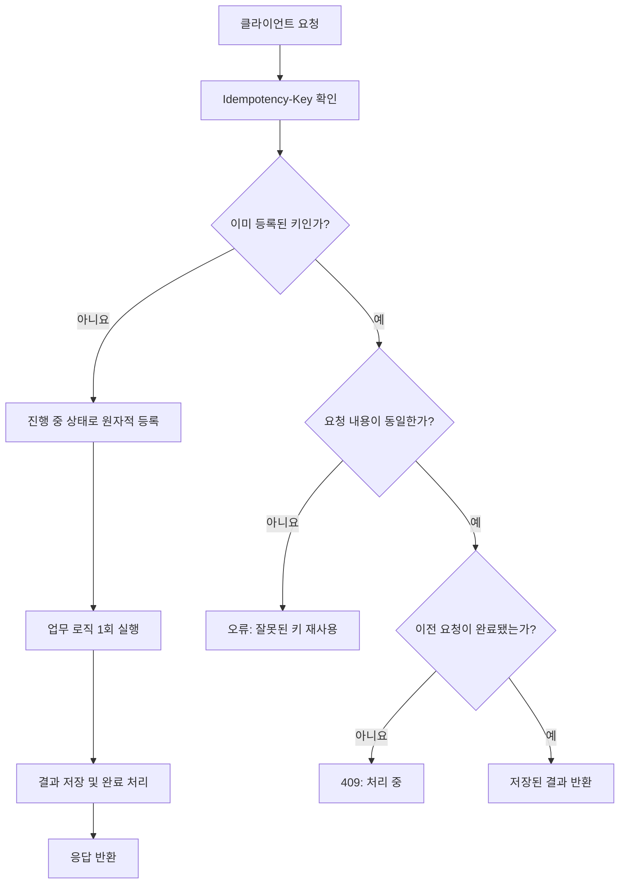
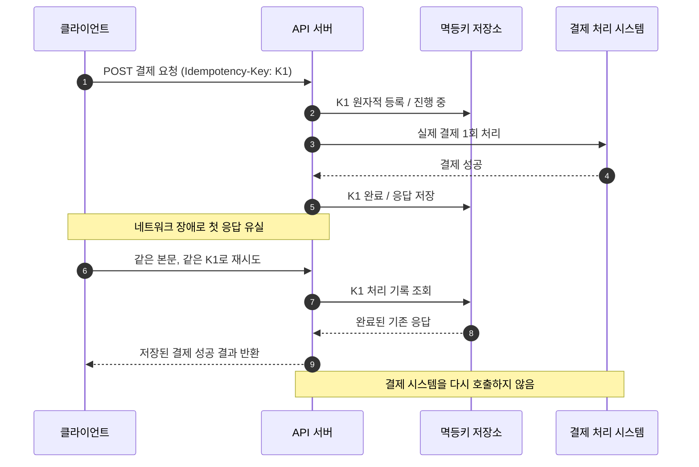

# 멱등성(Idempotency)과 API 중복 요청 처리

> **학습 목표:** 멱등성의 뜻을 이해하고, HTTP 메서드의 특성을 비교하며, `Idempotency-Key`를 사용하여 중복 결제·중복 등록을 방지하는 원리를 설명할 수 있다.
>
> **참고 자료:** [토스페이먼츠 개발자센터 — 멱등성이 뭔가요?](https://docs.tosspayments.com/blog/what-is-idempotency) (2023-01-11 게시) 및 [인증 및 기타 헤더 설정](https://docs.tosspayments.com/reference/using-api/authorization)  
> **문서 정리:** 2026-10-24  
> 이 문서는 원문의 내용을 학습용으로 **요약·재구성**하고, 자체 예제 및 실습 코드를 추가한 자료입니다.

---

## 목차

1. [멱등성이란?](#1-멱등성이란)
2. [서버 요청에 멱등성이 필요한 이유](#2-서버-요청에-멱등성이-필요한-이유)
3. [HTTP 메서드와 멱등성](#3-http-메서드와-멱등성)
4. [멱등성과 안전성의 차이](#4-멱등성과-안전성의-차이)
5. [멱등키(Idempotency-Key)의 원리](#5-멱등키idempotency-key의-원리)
6. [멱등키를 이용한 결제 API 흐름](#6-멱등키를-이용한-결제-api-흐름)
7. [토스페이먼츠 멱등키 사용 규칙](#7-토스페이먼츠-멱등키-사용-규칙)
8. [오류 및 예외 시나리오](#8-오류-및-예외-시나리오)
9. [FastAPI 학습용 구현 예제](#9-fastapi-학습용-구현-예제)
10. [실습과 확인 문제](#10-실습과-확인-문제)
11. [실무 점검 목록과 핵심 요약](#11-실무-점검-목록과-핵심-요약)
12. [참고 링크](#12-참고-링크)

---

## 1. 멱등성이란?

**멱등성**은 **같은 연산을 한 번 수행한 경우와 여러 번 수행한 경우의 최종 효과가 같은 성질**입니다.

예를 들어 전등을 '켜짐 상태로 설정'하는 작업은 여러 번 수행해도 전등이 켜진 상태로 유지됩니다. 반면 '전등 상태를 반대로 바꾸기'는 호출할 때마다 결과가 달라지므로 멱등하지 않습니다.

| 작업 | 한 번 수행 | 같은 작업을 두 번 수행 | 멱등성 |
|---|---|---|---|
| 값을 `10`으로 설정 | `10` | `10` | O |
| 숫자에 `1` 곱하기 | 원래 값 | 원래 값 | O |
| 숫자를 절대값으로 변경 | 양수 또는 0 | 동일한 값 | O |
| 현재 값에 `10` 더하기 | `+10` | `+20` | X |
| 조회수 `1` 증가 | `+1` | `+2` | X |

**핵심:** 멱등성은 일반적으로 *서버에 미치는 의도된 효과*의 동일성에 관한 성질이지, 모든 요청의 HTTP 상태 코드나 응답 본문이 반드시 같은 문자열이라는 뜻은 아닙니다. 멱등키를 적용한 일부 API는 재요청에 대해 최초 응답을 저장하여 다시 반환하는 기능도 제공합니다.

## 2. 서버 요청에 멱등성이 필요한 이유

### 2.1 결제 버튼을 두 번 누르는 경우

사용자가 30,000원 결제 버튼을 연속으로 누르거나, 네트워크 지연으로 응답을 받지 못한 뒤 다시 요청한다고 가정해 봅시다.

**멱등성이 없는 경우**

```text
[브라우저] -- 결제 요청 #1 --> [서버] -- 30,000원 결제 성공
[브라우저] -- 결제 요청 #2 --> [서버] -- 30,000원 또 결제 성공

결과: 의도하지 않은 중복 결제 가능
```

**멱등키가 적용된 경우**

```text
[브라우저] -- 결제 요청 #1 (키: ABC) --> [서버] -- 결제 1회 처리
[브라우저] -- 결제 요청 #2 (키: ABC) --> [서버] -- 처리 기록 확인
                                                  └─ 추가 결제 없이 기존 처리 결과 반환

결과: 동일한 논리적 결제 작업은 1회만 실행
```

### 2.2 네트워크 타임아웃이 특히 위험한 이유

서버는 이미 결제에 성공했지만 **성공 응답만 클라이언트에 도착하지 않을 수 있습니다.** 클라이언트는 성공 여부를 모르므로 재시도를 하게 됩니다. 이때 요청마다 새로운 결제를 실행한다면 중복 결제가 발생할 수 있습니다.

멱등성은 이와 같은 **불확실한 상황에서 안전하게 재시도**할 수 있도록 설계하는 데 중요합니다.

> **주의:** 멱등키는 중복 *실행*을 막는 장치입니다. 인증·인가, 요청 데이터 검증, 거래 정합성, 외부 결제사 처리 결과 확인까지 자동으로 해결하는 것은 아닙니다.

## 3. HTTP 메서드와 멱등성

| HTTP 메서드 | 주로 하는 일 | HTTP 의미상 멱등? | 설명 |
|---|---|:---:|---|
| `GET` | 리소스 조회 | O | 조회를 반복해도 그 요청 자체가 리소스를 변경하도록 의도되지 않음 |
| `HEAD` | 응답 헤더 조회 | O | 조회 목적 |
| `OPTIONS` | 사용 가능한 통신 옵션 확인 | O | 기능 확인 목적 |
| `PUT` | 지정한 리소스를 대체 | O | 같은 내용으로 여러 번 대체해도 의도된 최종 상태가 같음 |
| `DELETE` | 리소스 삭제 | O | 한 번 삭제한 뒤 다시 삭제해도 최종 상태는 '없음' |
| `POST` | 생성·명령 실행 | X (기본) | 반복 호출 시 신규 데이터·결제가 여러 번 생길 수 있음 |
| `PATCH` | 부분 수정 | X (일반 원칙) | 수정 방식에 따라 멱등하게 설계할 수 있음 |
| `TRACE` | 진단용 요청 반사 | O | 진단 목적 |
| `CONNECT` | 터널 설정 | X | 반복 요청의 동일 효과를 보장하지 않음 |

`GET` 요청을 두 번 했을 때 다른 사용자가 데이터를 수정했다면 **조회 결과는 달라질 수 있습니다.** 그럼에도 `GET`을 멱등 메서드로 분류하는 이유는 조회 요청이 의도적으로 해당 리소스를 변경하지 않기 때문입니다.

`DELETE /items/5`의 첫 응답은 `204 No Content`이고 다음 응답은 `404 Not Found`일 수 있습니다. **응답 코드가 달라도 최종 삭제 상태는 같습니다.**

반대로 다음과 같은 `POST`는 별도 장치가 없다면 멱등하지 않습니다.

```http
POST /api/orders
Content-Type: application/json

{"productId": 100, "quantity": 1}
```

요청할 때마다 신규 주문을 생성하도록 구현하면 동일 요청 2회에 주문 2건이 생길 수 있습니다.

## 4. 멱등성과 안전성의 차이

HTTP에서 **안전성(Safety)**은 요청 메서드가 서버 리소스의 상태 변경을 의도하지 않는다는 성질입니다.

| 구분 | 의미 | 예시 |
|---|---|---|
| 안전한(Safe) 메서드 | 데이터 변경을 요청하지 않음 | `GET`, `HEAD`, `OPTIONS` |
| 멱등한(Idempotent) 메서드 | 같은 요청을 반복해도 의도된 최종 효과가 같음 | `GET`, `PUT`, `DELETE` |
| 둘 다 아닌 메서드 | 반복 호출 시 추가 효과가 발생할 수 있음 | 일반적인 `POST` |

**안전한 메서드는 멱등하지만, 멱등한 메서드가 모두 안전한 것은 아닙니다.** `DELETE`는 데이터를 삭제하므로 안전하지 않지만 멱등합니다.

## 5. 멱등키(Idempotency-Key)의 원리

멱등키는 **하나의 논리적 작업을 식별하는 고유 문자열**입니다. 보통 HTTP 요청 헤더에 담아 전송합니다.

```http
POST /api/payments
Idempotency-Key: 7d31b2e8-4b2c-47d3-9e3d-5e95c0170c21
Content-Type: application/json

{"orderId": "ORDER-1001", "amount": 30000}
```

위의 `/api/payments`는 **작동 원리 설명을 위한 가상 API**이며 토스페이먼츠의 실제 엔드포인트가 아닙니다.

### 5.1 서버의 판단 순서

1. `Idempotency-Key`를 읽습니다.
2. 기존 작업 기록에서 동일한 키가 있는지 찾습니다.
3. **처음 보는 키**라면 작업을 예약하고 한 번만 실행합니다.
4. **이미 완료된 같은 작업**이라면 저장된 결과를 반환합니다.
5. **아직 진행 중인 같은 작업**이라면 중복 처리를 막고 적절한 충돌 응답을 줍니다.
6. **같은 키이지만 작업 내용이 달라졌다면** 잘못된 키 재사용으로 처리합니다.

### 5.2 요청마다 키를 언제 새로 만들까?

- **새 주문·새 결제**: 새 멱등키를 발급합니다.
- **동일한 주문·결제를 다시 시도**: **원래 멱등키를 그대로 재사용**합니다.
- **처음 요청이 성공했는지 불분명한 상황**: 새 키로 다시 보내지 말고 기존 키 또는 거래 조회 API를 활용합니다.

실무에서는 키와 함께 요청의 **메서드·경로·요청자 범위·요청 본문 해시(fingerprint)** 등을 확인하면 서로 다른 작업을 혼동할 위험이 줄어듭니다.

### 5.3 처리 흐름도



## 6. 멱등키를 이용한 결제 API 흐름

아래 시퀀스 다이어그램은 **첫 결제는 처리됐지만 응답이 유실된 경우**를 보여 줍니다.



### 6.1 요청 재시도 예제(cURL)

```bash
# 최초 요청: UUID는 예시입니다.
curl -X POST 'https://api.example.com/api/payments' \
  -H 'Content-Type: application/json' \
  -H 'Idempotency-Key: 7d31b2e8-4b2c-47d3-9e3d-5e95c0170c21' \
  -d '{"orderId":"ORDER-1001","amount":30000}'

# 타임아웃 후 재시도: 반드시 동일 키 + 동일 논리적 요청을 사용
curl -X POST 'https://api.example.com/api/payments' \
  -H 'Content-Type: application/json' \
  -H 'Idempotency-Key: 7d31b2e8-4b2c-47d3-9e3d-5e95c0170c21' \
  -d '{"orderId":"ORDER-1001","amount":30000}'
```

실제 재시도 시에는 시간 제한, 지수 백오프, 최대 재시도 횟수도 함께 관리해야 합니다.

## 7. 토스페이먼츠 멱등키 사용 규칙

다음은 토스페이먼츠 **공식 API 헤더 문서**에 명시된 제공 기능입니다. 직접 만드는 일반 API의 규칙과는 구분해서 이해하세요.

| 항목 | 토스페이먼츠 문서상의 동작 |
|---|---|
| 헤더 이름 | `Idempotency-Key` |
| 키 형식 | UUID 등 충분히 무작위적인 고유 값 권장 |
| 최대 길이 | **300자** |
| 유효기간 | **처음 요청한 날부터 15일** |
| 지원 범위 | 토스페이먼츠가 제공하는 **모든 POST API**에 사용 가능 |
| 중복 요청 구분 범위 | **멱등키 + API 키 + API 주소 + HTTP 메서드** 조합 |
| `GET`에 키 추가 | 무시됨 |

동일한 조합의 처리가 완료되었다면 다시 수행하지 않고 최초 처리 결과를 재사용합니다. 반면 API 키, API 주소 또는 HTTP 메서드가 다르면 같은 멱등키도 다른 요청으로 취급될 수 있습니다.

> **중요:** 오류가 발생했다는 이유만으로 멱등키를 변경하여 재시도하면 **중복 처리 위험**이 있습니다. 특히 실제 결제 성공 여부가 불분명하다면 원인과 처리 상태를 먼저 확인해야 합니다.

### 7.1 토스페이먼츠 인증키와 멱등키는 다릅니다

- **API 시크릿 키**: *누가 API를 호출할 권한이 있는가?*를 확인합니다.
- **멱등키**: *이 요청이 이미 수행한 같은 작업인가?*를 확인합니다.

멱등키 자체는 로그인 토큰이나 보안 인증키를 대신하지 않습니다. 결제 시크릿 키는 백엔드에서만 안전하게 보관해야 합니다.

## 8. 오류 및 예외 시나리오

### 8.1 일반적인 멱등키 설계에서 고려할 응답

| 상황 | HTTP 상태 코드 예시 | 처리 의미 |
|---|:---:|---|
| 멱등키 누락 또는 형식 오류 | `400 Bad Request` | 필수 헤더가 없거나 올바르지 않음 |
| 동일 키의 첫 요청이 아직 처리 중 | `409 Conflict` | 중복 실행을 막고 이후 재시도 유도 |
| 동일 키를 **서로 다른 요청 본문**에 사용 | `422 Unprocessable Content` | 같은 작업의 재시도가 아닌 것으로 판단 |
| 같은 키·같은 내용으로 완료 후 재요청 | 성공 응답(구현에 따름) | 기존 결과를 반환하고 추가 실행하지 않음 |

위 표는 **일반적인 API 구현 설계 예시**입니다. 이 중 `422`는 일반적인 멱등키 설계에서 고려할 수 있는 응답이며, 토스페이먼츠가 해당 상황에서 반드시 `422`를 반환한다는 뜻은 아닙니다.

### 8.2 토스페이먼츠가 공식 문서에서 안내하는 오류

| 상태 코드 | 토스페이먼츠 오류 코드 | 상황 |
|---|---|---|
| `400` | `INVALID_IDEMPOTENCY_KEY` | 멱등키가 300자를 초과함 |
| `409` | `IDEMPOTENT_REQUEST_PROCESSING` | 동일한 멱등 요청이 아직 처리 중임 |

출처: [토스페이먼츠 — 멱등키 헤더 및 에러 처리](https://docs.tosspayments.com/reference/using-api/authorization).

## 9. FastAPI 학습용 구현 예제

아래 코드는 **외부 결제 없이 가상 결제 결과를 만드는 교육용 예제**입니다. 단일 Python 프로세스의 메모리에 멱등키를 저장하므로, 서버 재시작 시 기록이 삭제되고 다중 프로세스·다중 서버 환경에서는 멱등성을 보장하지 않습니다.

### 9.1 설치 및 실행

```bash
pip install fastapi uvicorn
uvicorn app:app --reload
```

### 9.2 `app.py`

```python
from fastapi import FastAPI, Header, HTTPException
from pydantic import BaseModel, Field
from threading import Lock
from uuid import uuid4
import hashlib
import json

app = FastAPI(title="멱등키 실습 API")

# 단일 프로세스 학습용 저장소: 실서비스에서는 DB/Redis 등으로 교체
records = {}
lock = Lock()


class PaymentRequest(BaseModel):
    order_id: str
    amount: int = Field(gt=0)


def fingerprint(data: PaymentRequest) -> str:
    # 요청 본문이 다르면 다른 해시가 나오도록 정규화
    payload = json.dumps(
        data.model_dump(), sort_keys=True, ensure_ascii=False,
        separators=(",", ":")
    )
    return hashlib.sha256(payload.encode("utf-8")).hexdigest()


@app.post("/demo/payments")
def create_payment(
    data: PaymentRequest,
    idempotency_key: str = Header(..., alias="Idempotency-Key"),
):
    fp = fingerprint(data)

    # 한 프로세스 내 경쟁 요청을 보호하는 구간
    with lock:
        saved = records.get(idempotency_key)
        if saved is not None:
            if saved["fingerprint"] != fp:
                raise HTTPException(
                    status_code=422,
                    detail="동일 멱등키에 다른 요청 내용 사용 불가",
                )
            if saved["state"] == "PROCESSING":
                raise HTTPException(
                    status_code=409,
                    detail="해당 요청을 처리 중입니다",
                )
            # 완료된 요청: 기존 결과를 그대로 재사용
            return saved["response"]

        # 다른 요청이 동시에 시작하지 못하도록 먼저 예약
        records[idempotency_key] = {
            "fingerprint": fp,
            "state": "PROCESSING",
            "response": None,
        }

    try:
        # 실제 결제 연동 대신 가상의 성공 데이터를 생성
        result = {
            "payment_id": str(uuid4()),
            "order_id": data.order_id,
            "amount": data.amount,
            "status": "APPROVED",
        }

        with lock:
            records[idempotency_key]["state"] = "COMPLETED"
            records[idempotency_key]["response"] = result
        return result
    except Exception:
        # 학습용 단순화: 실제 결제에서는 결과가 불확실한 요청을
        # 무조건 제거하면 안 되며, 거래 조회/정합성 확인이 우선
        with lock:
            records.pop(idempotency_key, None)
        raise
```

### 9.3 직접 확인하기

1. `http://127.0.0.1:8000/docs`에 접속합니다.
2. `POST /demo/payments`를 펼칩니다.
3. `Idempotency-Key`에 `test-key-001`을 입력합니다.
4. 본문에 `{"order_id":"O-1","amount":30000}`을 입력하고 실행합니다.
5. **같은 키와 같은 본문**으로 다시 실행합니다.
6. 반환된 `payment_id`가 이전과 **동일한지** 확인합니다.
7. 같은 키를 유지한 채 금액을 `50000`으로 변경하면 `422`가 반환되는지 확인합니다.
8. 새로운 키 `test-key-002`로 요청하면 **새로운 가상 결제**가 생성되는지 확인합니다.

### 9.4 실서비스에서 꼭 보완할 사항

- 저장소를 DB나 Redis로 바꾸고 **키의 유일성**을 원자적으로 확보합니다(`UNIQUE` 제약 또는 원자적 예약 연산).
- 사용자/상점 식별자, HTTP 메서드, API 경로, 요청 본문 지문을 멱등키 기록과 연결합니다.
- 만료 시간(TTL), 기록 정리, 장기 처리 중 상태 복구 정책을 정합니다.
- **DB 기록과 실제 업무 처리의 일관성**을 설계합니다. 외부 결제 시스템 호출 직후 장애가 발생한 경우에는 결제 상태 조회·대사를 통해 결과를 확인해야 합니다.
- 장애 후 멱등키 기록만 지운 채 다시 결제하면 중복 결제가 발생할 수 있습니다.
- 멱등키를 쓴다고 모든 환경에서 자동으로 '정확히 한 번 실행(Exactly once)'이 보장되는 것은 아닙니다.

## 10. 실습과 확인 문제

### 실습 A — 주문 중복 등록 관찰

`POST /api/orders` 요청을 두 번 보내면 주문 데이터가 두 개 생기는 일반적인 API를 가정합니다. `Idempotency-Key`에 따라 두 번째 요청을 재사용 결과로 반환하도록 설계를 변경해 보세요.

### 실습 B — 타임아웃 상황 설명

서버가 결제를 완료했으나 클라이언트가 타임아웃을 받은 상황에서, **같은 멱등키로 재시도해야 하는 이유**를 설명해 보세요.

### 실습 C — 오류 코드 선택

| 문제 | 기대하는 처리 |
|---|---|
| 최초 요청 처리 중 동일 키로 재요청 | 중복 실행 방지, `409` 예시 |
| 완료 후 같은 키·같은 데이터로 재요청 | 저장된 처리 결과 반환 |
| 같은 키·다른 금액으로 재요청 | 데이터 충돌 감지, `422` 예시 |
| 키 없이 요청 | 해당 API가 키를 필수로 정했다면 `400` 등 오류 |

### 확인 문제

1. `DELETE`는 왜 멱등하지만 안전한 메서드는 아닐까요?
2. `POST`를 멱등하게 만들려면 서버에 어떤 저장·검증 로직이 필요할까요?
3. 같은 멱등키를 사용해 다른 금액의 결제를 요청하면 어떤 문제가 생길까요?
4. 여러 서버 인스턴스에서 메모리 `dict`로 멱등키를 관리하면 왜 문제가 될까요?
5. 멱등키를 사용하더라도 외부 결제 상태 조회가 필요한 경우는 언제일까요?

## 11. 실무 점검 목록과 핵심 요약

- [ ] 중복 실행이 위험한 API를 선정했다(결제·취소·송금·주문 생성 등).
- [ ] **한 논리적 요청에는 한 개의 고유 멱등키**를 사용한다.
- [ ] 실패 응답이나 타임아웃이 발생해도 재시도에는 **같은 키**를 사용한다.
- [ ] 서버는 처리 중/완료 상태를 구분한다.
- [ ] 같은 키로 다른 내용의 요청이 들어오는 경우를 감지한다.
- [ ] 동시 요청을 막는 원자적 저장·잠금 전략이 있다.
- [ ] 실제 결제 성공 여부가 불확실할 때 상태 조회·정합성 확인 절차가 있다.
- [ ] 유효기간, 로그, 개인정보 및 인증정보 노출 방지 정책이 있다.

**한 문장 요약:** 멱등성은 네트워크 장애나 중복 클릭으로 **같은 요청이 반복되어도 의도하지 않은 추가 처리가 일어나지 않도록 하는 API 설계 원칙**입니다.

> **기억할 공식:** 새 작업 → 새 멱등키 / 같은 작업의 재시도 → 같은 멱등키

---

## 12. 참고 링크

1. [토스페이먼츠 개발자센터 — 멱등성이 뭔가요?](https://docs.tosspayments.com/blog/what-is-idempotency)
2. [토스페이먼츠 — 인증 및 기타 헤더 설정(멱등키 포함)](https://docs.tosspayments.com/reference/using-api/authorization)
3. [RFC 9110 — HTTP Semantics](https://www.rfc-editor.org/rfc/rfc9110.html)
4. [IETF — The Idempotency-Key HTTP Header Field (명세 초안 검색)](https://datatracker.ietf.org/doc/draft-ietf-httpapi-idempotency-key-header/)

*참고: 토스페이먼츠의 키 길이·유효기간·지원 API 범위 등은 서비스 운영 정책에 따라 달라질 수 있으므로 실제 연동 시 공식 문서를 다시 확인하세요.*
