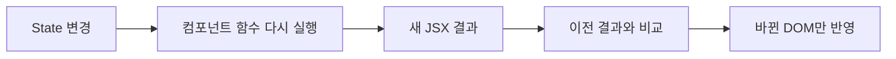
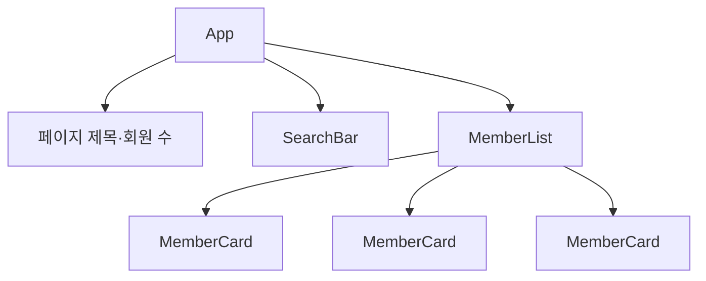
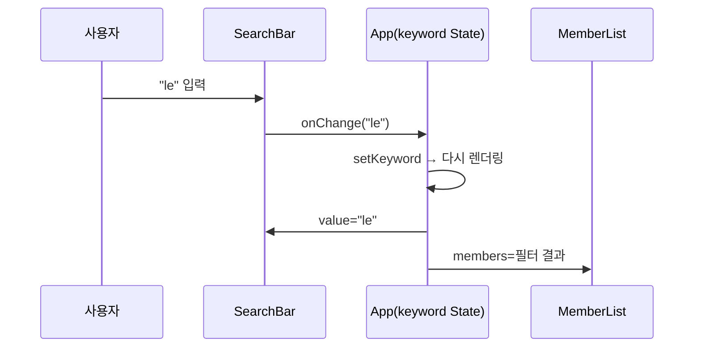

# 5-1. React 컴포넌트 설계 기초 — 8H

[전체 목차](00-index.md) · [다음: AI 활용 컴포넌트](05-02-ai-component.md)

## 단원 목차

- [1. 목표와 시간표](#s1)
- [2. 왜 React인가: 선언형 UI](#s2)
- [3. 프로젝트 시작과 JSX](#s3)
- [4. 화면을 컴포넌트로 나누기](#s4)
- [5. Props: 위에서 아래로](#s5)
- [6. State와 이벤트](#s6)
- [7. 리스트·조건부 렌더링](#s7)
- [8. 상태 끌어올리기](#s8)
- [9. 실습과 확인 문제](#s9)
- [10. 강사 노트](#s10)

<a id="s1"></a>
## 1. 목표와 시간표

화면 시안을 보고 컴포넌트 트리를 그릴 수 있다. Props와 State를 구분하고, 상태를 어느 컴포넌트에 둘지 근거를 들어 설명한다. 정적 데이터로 회원 목록·검색 화면을 만든다.

| 교시 | 내용 | 활동 |
|---|---|---|
| 1 | DOM 직접 조작 vs 선언형 UI, React 개요 | 1차 프로젝트의 바닐라 JS 코드와 비교 |
| 2 | Vite 프로젝트 생성, JSX 규칙 | 라이브 코딩: 프로젝트 생성·구조 탐색 |
| 3 | 컴포넌트·Props·State, 단방향 데이터 흐름 | 시안 보고 박스 치기 |
| 4 | 컴포넌트 트리 설계 | 페어: 회원관리 화면 트리 그리기 |
| 5 | MemberCard·MemberList 구현 | Props로 데이터 전달 |
| 6 | SearchBar와 State | 입력값을 State로 관리 |
| 7 | 상태 끌어올리기, 필터링 | 검색어로 목록 걸러내기 |
| 8 | 검토·평가 | 트리 발표, 확인 문제, 배움일기 |

<a id="s2"></a>
## 2. 왜 React인가: 선언형 UI

1차 프로젝트에서 바닐라 JS로 목록을 그릴 때는 "데이터가 바뀌면 어떤 DOM을 지우고 어떤 DOM을 추가할지"를 직접 썼다. React는 **"이 데이터일 때 화면은 이렇게 생겼다"**만 쓰면 바뀐 부분을 React가 찾아 반영한다.

| 구분 | 명령형(바닐라 JS) | 선언형(React) |
|---|---|---|
| 작성 내용 | DOM을 어떻게 바꿀지 순서대로 | 상태별 화면 모양 |
| 상태 변경 시 | `innerHTML`, `appendChild` 직접 호출 | `setState` 호출 → 다시 렌더링 |
| 버그 원인 | 화면과 데이터 불일치 | 상태 위치·흐름 설계 오류 |
| 재사용 | 함수·템플릿 문자열 | 컴포넌트 |



핵심 공식: **UI = f(state)**. 컴포넌트는 State와 Props를 받아 JSX를 돌려주는 함수다.

<a id="s3"></a>
## 3. 프로젝트 시작과 JSX

```powershell
npm create vite@latest member-admin -- --template react
cd member-admin
npm install
npm run dev
```

| 파일 | 역할 |
|---|---|
| `index.html` | `<div id="root">` 하나만 있는 빈 페이지 |
| `src/main.jsx` | React를 `#root`에 연결 |
| `src/App.jsx` | 최상위 컴포넌트 |
| `vite.config.js` | 개발 서버·빌드 설정 |

### JSX 규칙

| 규칙 | 예 | 자주 하는 실수 |
|---|---|---|
| 하나의 부모로 감싸기 | `<>...</>` (Fragment) | 형제 태그 두 개를 바로 반환 |
| `class` → `className` | `<div className="card">` | `class` 사용 |
| 중괄호 안은 JS 식 | `{member.name}` | 중괄호 안에 `if` 문 |
| 태그는 반드시 닫기 | `<input />`, `` | `<input>` |
| 이벤트는 camelCase + 함수 | `onClick={handleClick}` | `onClick={handleClick()}` (즉시 실행) |
| 컴포넌트 이름은 대문자 | `<MemberCard />` | `<memberCard />` (HTML 태그로 인식) |

<a id="s4"></a>
## 4. 화면을 컴포넌트로 나누기

시안을 출력하거나 화면 캡처에 **박스를 치는 활동**부터 한다. 기준은 세 가지다.

1. **한 가지 일만 한다** — 카드 하나, 검색창 하나.
2. **반복된다** — 회원 카드처럼 여러 번 나오는 것.
3. **바뀌는 이유가 다르다** — 검색창은 입력 때문에, 목록은 데이터 때문에 바뀐다.



| 컴포넌트 | 받는 Props | 가진 State | 책임 |
|---|---|---|---|
| App | - | `keyword` | 데이터 보관, 필터링 |
| SearchBar | `value`, `onChange` | 없음 | 입력 표시, 변경 알림 |
| MemberList | `members` | 없음 | 목록 반복·빈 상태 |
| MemberCard | `member` | 없음 | 회원 한 명 표시 |

> 설계 질문: "검색어 State는 SearchBar에 두면 안 되는가?" → MemberList도 검색어가 필요하므로 둘의 **공통 부모(App)**에 둔다.

<a id="s5"></a>
## 5. Props: 위에서 아래로

Props는 부모가 자식에게 주는 **읽기 전용** 값이다. 자식은 Props를 바꾸지 않는다.

`src/data/members.js` — 4단원 BasicAPI v2와 같은 모양의 정적 데이터를 쓴다. 5일차에 서버 데이터로 바꿀 때 컴포넌트를 고치지 않기 위해서다.

```js
export const initialMembers = [
  { id: 1, name: "Leanne Graham", username: "Bret", email: "sincere@example.com", address: { city: "서울" } },
  { id: 2, name: "Ervin Howell", username: "Antonette", email: "shanna@example.com", address: { city: "부산" } },
  { id: 3, name: "Clementine Bauch", username: "Samantha", email: "nathan@example.com", address: { city: "대전" } },
];
```

`src/components/MemberCard.jsx`

```jsx
export default function MemberCard({ member }) {
  return (
    <article className="card">
      <h3>{member.name}</h3>
      <p>@{member.username}</p>
      <p>{member.email} · {member.address.city}</p>
    </article>
  );
}
```

`src/components/MemberList.jsx`

```jsx
import MemberCard from "./MemberCard.jsx";

export default function MemberList({ members }) {
  if (members.length === 0) return <p>검색 결과가 없습니다.</p>;
  return (
    <ul className="member-list">
      {members.map((member) => (
        <li key={member.id}>
          <MemberCard member={member} />
        </li>
      ))}
    </ul>
  );
}
```

<a id="s6"></a>
## 6. State와 이벤트

State는 **시간에 따라 바뀌고, 바뀌면 화면도 바뀌어야 하는 값**이다.

| 질문 | 예 → State | 아니오 → State 아님 |
|---|---|---|
| 시간이 지나며 바뀌는가? | 검색어 | 페이지 제목 |
| 부모가 Props로 주는가? | - | 회원 객체(카드 입장) |
| 다른 State·Props로 계산되는가? | - | 필터링된 목록, 회원 수 |

```jsx
import { useState } from "react";

function Counter() {
  const [count, setCount] = useState(0);
  return <button onClick={() => setCount(count + 1)}>클릭 {count}</button>;
}
```

- `setCount`를 호출하면 컴포넌트 함수가 **다시 실행**되고 새 `count`로 화면을 그린다.
- 일반 변수(`let count = 0`)는 다시 실행될 때마다 0으로 돌아가므로 화면이 바뀌지 않는다. 직접 보여 주고 비교한다.

<a id="s7"></a>
## 7. 리스트·조건부 렌더링

| 패턴 | 코드 | 언제 |
|---|---|---|
| 리스트 | `items.map((item) => <Row key={item.id} ... />)` | 배열 표시 |
| 둘 중 하나 | `{loading ? <Spinner /> : <List />}` | 상태별 다른 화면 |
| 있을 때만 | `{error && <p>{error}</p>}` | 선택 표시 |
| 일찍 반환 | `if (!items.length) return <Empty />` | 빈 상태 |

**`key`는 형제 사이에서 고유하고 바뀌지 않는 값**(DB id)을 쓴다. 배열 인덱스를 key로 쓰면 삭제·정렬 시 입력값이 엉뚱한 행에 남는 버그를 시연한다.

> 주의: `{count && <p>...</p>}`에서 `count`가 0이면 화면에 "0"이 찍힌다. `{count > 0 && ...}`로 쓴다.

<a id="s8"></a>
## 8. 상태 끌어올리기

`src/components/SearchBar.jsx` — 상태를 갖지 않는 **제어 컴포넌트**. 값은 Props로 받고 변경은 콜백으로 알린다.

```jsx
export default function SearchBar({ value, onChange }) {
  return (
    <label>
      회원 검색
      <input
        type="search"
        placeholder="이름 또는 이메일"
        value={value}
        onChange={(event) => onChange(event.target.value)}
      />
    </label>
  );
}
```

`src/App.jsx`

```jsx
import { useState } from "react";
import MemberList from "./components/MemberList.jsx";
import SearchBar from "./components/SearchBar.jsx";
import { initialMembers } from "./data/members.js";

export default function App() {
  const [members] = useState(initialMembers);
  const [keyword, setKeyword] = useState("");

  // 파생 값: State로 만들지 않고 렌더링 중에 계산한다.
  const q = keyword.trim().toLowerCase();
  const filtered = members.filter(
    (member) => member.name.toLowerCase().includes(q) || member.email.toLowerCase().includes(q),
  );

  return (
    <main>
      <h1>회원 관리</h1>
      <p>전체 {filtered.length}명</p>
      <SearchBar value={keyword} onChange={setKeyword} />
      <MemberList members={filtered} />
    </main>
  );
}
```



**데이터는 아래로(Props), 이벤트는 위로(콜백)**. 이것이 React의 단방향 데이터 흐름이다.

<a id="s9"></a>
## 9. 실습과 확인 문제

### 실습 (4~7교시)

| 단계 | 할 일 | 완료 기준 |
|---|---|---|
| 1 | 회원관리 시안에 박스를 치고 컴포넌트 트리를 그린다 | 컴포넌트마다 Props·State 표 작성 |
| 2 | `data/members.js`, `MemberCard`, `MemberList` 작성 | 3명의 카드가 보임 |
| 3 | `SearchBar` 작성, App에 `keyword` State 추가 | 입력값이 화면에 반영 |
| 4 | 필터링 연결 | 이름·이메일로 걸러짐, 0명이면 빈 메시지 |
| 5 | React DevTools로 Props·State 확인 | 입력 시 App의 State가 바뀌는 것 확인 |
| 도전 | 도시별 필터 `<select>` 추가 | 검색어와 도시 조건이 함께 적용 |

AI 사용 규칙(1일차): **코드 생성 금지**, 오류 메시지 설명·개념 질문만 허용. 예: "이 오류가 왜 나는지 초보자에게 설명해 줘. 고친 코드는 주지 마."

### 확인 문제

1. Props와 State의 차이를 "누가 바꿀 수 있는가"로 설명하라.
2. 필터링된 목록을 `useState`로 따로 만들면 어떤 문제가 생기는가?
3. `onClick={remove(id)}`가 잘못된 이유와 고친 코드를 쓰라.
4. key로 인덱스를 쓰면 안 되는 상황 한 가지를 들라.
5. 검색어 State를 SearchBar 안에 두면 무엇이 불가능해지는가?

### 과제

- 오늘 만든 트리 그림 + 컴포넌트별 Props·State 표를 README에 추가하고 커밋한다.
- 배움일기: "상태를 App에 둔 이유"를 세 문장으로.

<a id="s10"></a>
## 10. 강사 노트

| 자주 막히는 지점 | 대응 |
|---|---|
| `npm create` 후 바로 `npm run dev` → 모듈 없음 오류 | `npm install` 순서 강조 |
| 화면이 안 바뀜 | 일반 변수를 쓰고 있는지, `setState`를 호출했는지 확인 |
| `Each child in a list should have a unique "key"` 경고 | `map` 바로 안쪽 요소에 key가 있는지 |
| 대문자 없는 컴포넌트 | 소문자면 HTML 태그로 해석됨을 DevTools로 보여 주기 |
| 1차 프로젝트 방식대로 `document.querySelector` 사용 | "React가 DOM을 관리한다"를 다시 설명 |

- 실력 차가 큰 반이면, 빠른 수강생에게 도전 과제와 함께 **옆자리 설명 역할**을 맡긴다.
- 5일차 연동을 위해 데이터 모양(`id`, `name`, `username`, `email`, `address.city`)을 서버와 같게 유지시키는 것이 중요하다.
