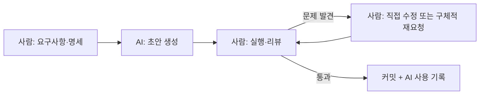

# 5-2. AI 활용 컴포넌트 생성 및 검토 — 8H

[전체 목차](00-index.md) · [이전: 컴포넌트 설계](05-01-component.md) · [다음: 상태 관리](05-03-state.md)

## 단원 목차

- [1. 목표와 시간표](#s1)
- [2. AI 코딩 도구와 역할 분담](#s2)
- [3. 좋은 컴포넌트 요청 프롬프트](#s3)
- [4. 프로젝트 규칙 파일](#s4)
- [5. 리뷰 체크리스트](#s5)
- [6. 사례: AI가 만든 MemberForm 검토](#s6)
- [7. 수정 요청과 반복](#s7)
- [8. 실습과 확인 문제](#s8)
- [9. 강사 노트](#s9)

<a id="s1"></a>
## 1. 목표와 시간표

AI 도구에 컴포넌트를 명세로 요청하고, 결과 코드를 체크리스트로 검토해 직접 고친다. "AI가 짠 코드를 설명하지 못하면 제출하지 않는다"를 원칙으로 삼는다.

| 교시 | 내용 | 활동 |
|---|---|---|
| 1 | AI 코딩 도구 유형, 사람과 AI의 역할 | 같은 요청을 2개 도구에 보내 비교 |
| 2 | 프롬프트 구성: 맥락·명세·제약·출력 | 나쁜 프롬프트 → 좋은 프롬프트 고쳐 쓰기 |
| 3 | 리뷰 체크리스트, 규칙 파일 | 강사 시연: 생성 → 실행 → 리뷰 |
| 4 | 제어 폼 개념, MemberForm 명세 작성 | 페어: 명세서 작성 |
| 5 | AI로 MemberForm 생성 | 실행·동작 확인 |
| 6 | 체크리스트로 리뷰, 직접 수정 | 리뷰 기록표 작성 |
| 7 | 수정 프롬프트 반복, 비교 정리 | 직접 작성본과 AI본 비교 |
| 8 | 검토·평가 | 리뷰 기록표 발표, 배움일기 |

<a id="s2"></a>
## 2. AI 코딩 도구와 역할 분담

| 유형 | 예 | 잘하는 일 | 주의 |
|---|---|---|---|
| 채팅형 | Claude, ChatGPT | 설명, 설계 대안, 코드 조각 | 프로젝트 파일을 모름 |
| 에디터 자동완성 | GitHub Copilot | 반복 코드, 짧은 함수 | 맥락 없이 그럴듯한 코드 |
| 에이전트형 | Claude Code, Cursor Agent | 여러 파일 수정, 명령 실행 | 변경 범위가 큼 → diff 리뷰 필수 |
| UI 생성 | v0 등 | 시안 → 마크업 초안 | 프로젝트 구조·상태 설계와 불일치 |



**사람이 책임지는 것**: 무엇을 만들지(명세), 맞게 동작하는지(검증), 프로젝트에 맞는지(일관성), 안전한지(보안). AI는 타이핑을 줄여 줄 뿐 이 네 가지를 대신하지 않는다.

<a id="s3"></a>
## 3. 좋은 컴포넌트 요청 프롬프트

나쁜 예: `회원 가입 폼 만들어줘`

→ 결과가 매번 다르고, 설치되지 않은 라이브러리(react-hook-form, MUI)를 쓰거나 우리 데이터 모양과 다른 필드를 만든다.

좋은 프롬프트는 네 부분으로 쓴다.

| 구성 | 내용 |
|---|---|
| 맥락 | 기술 스택, 폴더 구조, 이미 있는 컴포넌트 |
| 명세 | Props(이름·타입·역할), 내부 State, 동작, 검증 규칙 |
| 제약 | 쓰면 안 되는 것, 스타일 규칙, 접근성 |
| 출력 | 파일 단위, 설명 분량, 테스트 여부 |

```text
[맥락]
React 19 + Vite, JavaScript(JSX), 함수형 컴포넌트만 사용한다.
외부 폼·UI 라이브러리는 설치되어 있지 않다.
회원 데이터 모양:
{ name, username, email, phone, website,
  address: { street, suite, city, zipcode },
  company: { name, catch_phrase } }

[명세] src/features/members/MemberForm.jsx
- Props: initialValue(회원 객체, 기본값 빈 회원), onSubmit(form), onCancel(), submitting(boolean)
- 입력: 이름, 아이디, 이메일, 전화번호, 도시(address.city), 회사(company.name)
- 제어 컴포넌트로 만들고 State는 form, errors 두 개만 둔다.
- 저장 시 검증: 이름 필수·50자 이하, 아이디 필수·30자 이하, 이메일 형식.
  오류가 있으면 각 입력 아래에 메시지를 보이고 onSubmit을 호출하지 않는다.
- 검증 함수 validateMember(member)는 memberModel.js로 분리해 export한다.

[제약]
- 모든 input에 label을 htmlFor로 연결한다. 오류 시 aria-invalid, aria-describedby를 넣는다.
- dangerouslySetInnerHTML, 인라인 style을 쓰지 않는다.
- 중첩 객체(address, company)를 바꿀 때 원본을 변경하지 않는다.

[출력]
memberModel.js, MemberForm.jsx 두 파일 전체 코드. 설명은 5줄 이내.
```

> 팁: 명세를 쓰다 보면 설계가 정리된다. **명세를 못 쓰면 아직 AI에게 맡길 단계가 아니다.**

<a id="s4"></a>
## 4. 프로젝트 규칙 파일

매번 같은 맥락을 붙여 넣는 대신 저장소에 규칙 파일을 둔다. 에이전트형 도구는 이 파일을 자동으로 읽는다(Claude Code는 `CLAUDE.md`, Copilot은 `.github/copilot-instructions.md`, Cursor는 `.cursor/rules/`).

```markdown
# member-admin 규칙
- React 19 + Vite, JSX. 함수형 컴포넌트와 Hooks만 사용한다.
- 폴더: components/ui(공통), features/<도메인>(화면), api(서버 호출), hooks, stores.
- 새 라이브러리를 추가하기 전에 먼저 묻는다.
- 서버 데이터 필드 이름(snake_case: catch_phrase, total_pages)을 바꾸지 않는다.
- 모든 입력 요소는 label과 연결한다. 버튼에는 type을 명시한다.
- 변경 후 npm run lint와 npm run build가 통과해야 한다.
```

<a id="s5"></a>
## 5. 리뷰 체크리스트

AI 결과물뿐 아니라 동료 코드 리뷰에도 같은 표를 쓴다.

| 영역 | 확인 질문 |
|---|---|
| 실행 | 에러·콘솔 경고 없이 실행되는가? 명세의 모든 동작을 직접 눌러 봤는가? |
| 의존성 | 설치되지 않은 패키지를 import하지 않는가? (AI의 흔한 환각) |
| Props | 명세와 이름·기본값이 같은가? 쓰지 않는 Props가 있는가? |
| State | 파생 값을 State로 만들지 않았는가? State 개수가 최소인가? |
| 불변성 | 객체·배열을 직접 수정(`form.address.city = ...`)하지 않는가? |
| 이벤트 | `onClick={fn()}` 같은 즉시 실행이 없는가? 폼에서 `preventDefault` 했는가? |
| 리스트 | key가 고유하고 안정적인가? |
| 접근성 | label 연결, 버튼 `type`, 오류 메시지 연결, 키보드로 조작 가능한가? |
| 보안 | `dangerouslySetInnerHTML`, `eval`, 하드코딩된 키·비밀번호가 없는가? |
| 일관성 | 폴더·이름·스타일 규칙을 따르는가? 같은 일을 하는 코드가 이미 있는가? |
| 설명 가능성 | 모든 줄을 내가 설명할 수 있는가? |

<a id="s6"></a>
## 6. 사례: AI가 만든 MemberForm 검토

아래는 짧은 프롬프트로 받은 코드의 **전형적인 문제를 모아 만든 교육용 예시**다. 수강생에게 먼저 문제를 찾게 한 뒤 정답을 공개한다.

```jsx
import { useState } from "react";
import { useForm } from "react-hook-form"; // ①

export default function MemberForm(props) {
  const [name, setName] = useState(props.member.name); // ②
  const [email, setEmail] = useState(props.member.email);
  const [city, setCity] = useState(props.member.address.city);
  const [isValid, setIsValid] = useState(false); // ③

  function handleSubmit() { // ④
    props.member.address.city = city; // ⑤
    if (email.includes("@")) props.onSave({ ...props.member, name, email });
  }

  return (
    <div>
      <input placeholder="이름" value={name} onChange={(e) => setName(e.target.value)} /> {/* ⑥ */}
      <input placeholder="이메일" value={email} onChange={(e) => setEmail(e.target.value)} />
      <input placeholder="도시" value={city} onChange={(e) => setCity(e.target.value)} />
      <button onClick={handleSubmit()}>저장</button> {/* ⑦ */}
    </div>
  );
}
```

| 번호 | 문제 | 체크리스트 영역 | 수정 |
|---|---|---|---|
| ① | 설치되지 않은, 쓰지도 않는 import | 의존성 | 삭제 |
| ② | 새 회원 추가 시 `props.member`가 없어 오류, 명세와 Props 이름 다름 | Props | `initialValue = emptyMember` 기본값 |
| ③ | 파생 값 State, 실제로 사용 안 함 | State | 삭제, 검증 함수로 계산 |
| ④ | `<form>`이 아니어서 Enter 제출 불가 | 이벤트·접근성 | `<form onSubmit>` + `preventDefault` |
| ⑤ | Props 객체를 직접 수정 | 불변성 | 스프레드로 새 객체 생성 |
| ⑥ | placeholder만 있고 label 없음 | 접근성 | `<label htmlFor>` 연결 |
| ⑦ | 렌더링 때마다 즉시 실행 | 이벤트 | `type="submit"` 버튼 |
| - | 아이디·전화·회사 필드 누락, 오류 메시지 없음 | 실행(명세) | 명세대로 추가 |

### 리뷰 후 코드

`src/features/members/memberModel.js` (완성 예제와 같음)

```js
export const emptyMember = {
  name: "",
  username: "",
  email: "",
  phone: "",
  website: "",
  address: { street: "", suite: "", city: "", zipcode: "" },
  company: { name: "", catch_phrase: "" },
};

const EMAIL_PATTERN = /^[^\s@]+@[^\s@]+\.[^\s@]+$/;

export function validateMember(member) {
  const errors = {};
  if (!member.name.trim()) errors.name = "이름을 입력하세요.";
  else if (member.name.length > 50) errors.name = "이름은 50자 이하로 입력하세요.";
  if (!member.username.trim()) errors.username = "아이디를 입력하세요.";
  else if (member.username.length > 30) errors.username = "아이디는 30자 이하로 입력하세요.";
  if (!EMAIL_PATTERN.test(member.email)) errors.email = "이메일 형식이 올바르지 않습니다.";
  return errors;
}
```

`src/features/members/MemberForm.jsx` (스타일 전 단계. 4일차에 공통 `Input`·`Button`으로 교체한다)

```jsx
import { useState } from "react";
import { emptyMember, validateMember } from "./memberModel.js";

function Field({ id, label, error, ...props }) {
  return (
    <div>
      <label htmlFor={id}>{label}</label>
      <input id={id} aria-invalid={Boolean(error)} aria-describedby={error ? `${id}-error` : undefined} {...props} />
      {error && <p id={`${id}-error`}>{error}</p>}
    </div>
  );
}

export default function MemberForm({ initialValue = emptyMember, onSubmit, onCancel, submitting = false }) {
  const [form, setForm] = useState(initialValue);
  const [errors, setErrors] = useState({});

  function change(event) {
    const { name, value } = event.target;
    if (name === "city") setForm((prev) => ({ ...prev, address: { ...prev.address, city: value } }));
    else if (name === "companyName") setForm((prev) => ({ ...prev, company: { ...prev.company, name: value } }));
    else setForm((prev) => ({ ...prev, [name]: value }));
  }

  function submit(event) {
    event.preventDefault();
    const nextErrors = validateMember(form);
    setErrors(nextErrors);
    if (Object.keys(nextErrors).length === 0) onSubmit(form);
  }

  return (
    <form onSubmit={submit} noValidate>
      <Field id="name" label="이름" name="name" value={form.name} onChange={change} error={errors.name} />
      <Field id="username" label="아이디" name="username" value={form.username} onChange={change} error={errors.username} />
      <Field id="email" label="이메일" name="email" type="email" value={form.email} onChange={change} error={errors.email} />
      <Field id="phone" label="전화번호" name="phone" type="tel" value={form.phone} onChange={change} />
      <Field id="city" label="도시" name="city" value={form.address.city} onChange={change} />
      <Field id="companyName" label="회사" name="companyName" value={form.company.name} onChange={change} />
      <button type="button" onClick={onCancel}>취소</button>
      <button type="submit" disabled={submitting}>{submitting ? "저장 중..." : "저장"}</button>
    </form>
  );
}
```

> 왜 `noValidate`인가: 브라우저 기본 검증 말풍선 대신 우리 메시지를 일관되게 보여 주기 위해서다. 서버(FastAPI의 Pydantic)도 다시 검증하므로 **프론트 검증은 사용자 편의, 서버 검증은 보안**임을 짚는다.

<a id="s7"></a>
## 7. 수정 요청과 반복

리뷰에서 찾은 문제를 다시 AI에게 맡길 때는 **무엇이 왜 틀렸는지** 구체적으로 쓴다.

| 나쁜 재요청 | 좋은 재요청 |
|---|---|
| 다시 해줘 / 버그 고쳐줘 | `handleSubmit`에서 `props.member.address.city`를 직접 수정한다. 원본을 바꾸지 말고 `setForm`의 함수형 업데이트로 address를 새 객체로 만들어라. 다른 부분은 바꾸지 마라. |
| 접근성 좋게 | 각 input에 id를 주고 label의 htmlFor로 연결하라. 오류가 있으면 aria-invalid="true"와 오류 문단 id를 aria-describedby로 연결하라. |

- 한 번에 하나씩 요청하고, 요청할 때마다 실행해 확인한다.
- 같은 문제를 세 번 이상 못 고치면 **직접 고친다**. 그 과정이 가장 큰 학습이다.

### AI 사용 기록표 (제출용)

| 항목 | 기록 |
|---|---|
| 사용 도구 | |
| 최초 프롬프트 | |
| 받은 코드의 문제(체크리스트 영역) | |
| 내가 직접 고친 부분 | |
| 재요청 프롬프트 | |
| 최종 코드에서 설명하기 어려운 줄 | 없음이 될 때까지 질문·학습 |

<a id="s8"></a>
## 8. 실습과 확인 문제

### 실습 (4~7교시)

| 단계 | 할 일 | 완료 기준 |
|---|---|---|
| 1 | 페어로 MemberForm 명세서 작성(3절 형식) | Props·State·검증·제약이 모두 있음 |
| 2 | 한 명은 직접 작성, 한 명은 AI로 생성 (30분) | 둘 다 실행됨 |
| 3 | 두 코드를 체크리스트로 교차 리뷰 | 리뷰 기록표에 문제 3개 이상 |
| 4 | 수정 → 최종본 하나로 합치기 | 체크리스트 전 항목 통과 |
| 5 | App에서 "회원 추가" 버튼 → 폼 표시 → 저장 시 `console.log` | 오류 메시지·Enter 제출 동작 |
| 도전 | 규칙 파일(4절)을 만들고 같은 프롬프트로 재생성해 차이 비교 | 비교 결과 3줄 |

### 확인 문제

1. AI가 설치되지 않은 라이브러리를 import했다. 어떻게 알아채고 어떻게 대응하는가?
2. 6절 ⑤번이 화면에 어떤 버그를 만드는지 설명하라.
3. 프론트엔드 검증만 있고 서버 검증이 없으면 어떤 문제가 생기는가?
4. 좋은 프롬프트의 네 구성 요소를 쓰라.
5. AI가 만든 코드 중 설명하지 못하는 줄이 있을 때 해야 할 일은?

### 과제

- AI 사용 기록표를 `docs/ai-log-day2.md`로 커밋한다.
- 배움일기: "AI가 틀린 부분 중 내가 스스로 찾은 것"을 한 가지 쓴다.

<a id="s9"></a>
## 9. 강사 노트

- 시작 전에 **AI 사용 정책**을 칠판에 적는다: 개인정보·회사 코드 입력 금지, 생성 코드는 리뷰 후 커밋, 기록 남기기.
- 같은 프롬프트라도 결과가 매번 다르다. 강사 시연 결과가 수강생과 다를 수 있음을 미리 알린다.
- 무료 도구 한도가 다른 수강생이 있으면 채팅형 도구 하나로 통일한다.
- AI 결과를 그대로 붙여 넣고 "동작합니다"로 끝내는 수강생에게는 **임의의 줄을 짚어 설명을 요청**한다.
- 6절 예시는 실제 도구 출력을 그대로 옮긴 것이 아니라 흔한 실수를 모은 교육용 코드임을 수강생에게 밝힌다.
