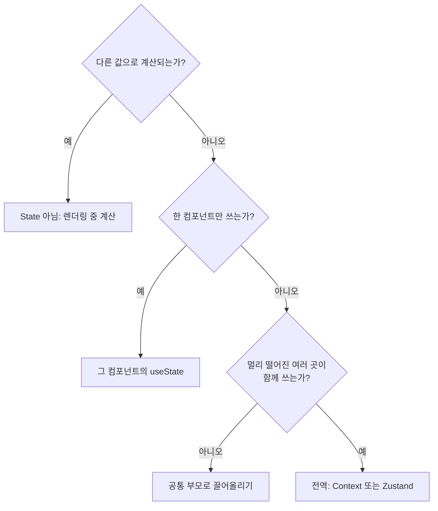

# 5-3. 상태 관리 구현 — 8H

[전체 목차](00-index.md) · [이전: AI 활용 컴포넌트](05-02-ai-component.md) · [다음: 스타일링](05-04-styling.md)

## 단원 목차

- [1. 목표와 시간표](#s1)
- [2. 상태를 어디에 둘 것인가](#s2)
- [3. 불변성과 함수형 업데이트](#s3)
- [4. useReducer로 CRUD 정리](#s4)
- [5. useEffect: 바깥 세계와 동기화](#s5)
- [6. 커스텀 훅](#s6)
- [7. 전역 상태 ① Context — 알림(Toast)](#s7)
- [8. 전역 상태 ② Zustand — 인증](#s8)
- [9. 실습과 확인 문제](#s9)
- [10. 강사 노트](#s10)

<a id="s1"></a>
## 1. 목표와 시간표

상태의 종류와 위치를 근거를 들어 정한다. 불변성을 지키며 배열·객체를 갱신하고, CRUD 로직을 reducer로 모은다. Context와 Zustand로 전역 상태를 만든다.

| 교시 | 내용 | 활동 |
|---|---|---|
| 1 | 상태 분류(지역·공유·전역·서버), 위치 결정 | 회원관리 화면 상태 목록 만들기 |
| 2 | 불변성, 함수형 업데이트, useReducer | 라이브 코딩: memberReducer |
| 3 | useEffect·cleanup, 커스텀 훅, Context·Zustand | 시연: 잘못된 Effect 고치기 |
| 4 | reducer로 추가·수정·삭제 | 2일차 MemberForm과 연결 |
| 5 | 모달 상태, key로 폼 초기화 | 수정 모달 구현 |
| 6 | useDebounce 훅, ToastContext | 저장 후 알림 표시 |
| 7 | Zustand authStore, 가짜 로그인 | 새로고침 후 로그인 유지 확인 |
| 8 | 검토·평가 | 상태 위치 설명, 배움일기 |

<a id="s2"></a>
## 2. 상태를 어디에 둘 것인가

| 종류 | 예(회원관리) | 두는 곳 | 도구 |
|---|---|---|---|
| 지역 UI 상태 | 입력값, 메뉴 열림 | 그 컴포넌트 | useState |
| 공유 상태 | 검색어, 열린 모달 | 가장 가까운 공통 부모 | useState·useReducer |
| 전역 앱 상태 | 로그인 토큰, 알림 | 앱 전체 | Context, Zustand |
| 서버 상태 | 회원 목록 | 서버가 원본, 화면은 복사본 | fetch + 훅 (5일차), TanStack Query(심화) |
| 파생 값 | 필터 결과, 회원 수 | 렌더링 중 계산 | 변수 (State 아님) |



> 원칙: **전역 상태는 마지막 수단**이다. 처음부터 모든 것을 전역에 두면 어디서 바뀌었는지 추적하기 어렵다.

<a id="s3"></a>
## 3. 불변성과 함수형 업데이트

React는 **참조가 바뀌었는지**로 변경을 판단한다. 원본을 직접 바꾸면 화면이 갱신되지 않거나 이전 화면과 섞인다.

| 작업 | 잘못된 코드 | 올바른 코드 |
|---|---|---|
| 배열 추가 | `list.push(m)` | `[...list, m]` |
| 배열 삭제 | `list.splice(i, 1)` | `list.filter((x) => x.id !== id)` |
| 배열 수정 | `list[i].name = n` | `list.map((x) => (x.id === id ? { ...x, name: n } : x))` |
| 객체 수정 | `form.email = v` | `{ ...form, email: v }` |
| 중첩 객체 | `form.address.city = v` | `{ ...form, address: { ...form.address, city: v } }` |

이전 값을 기준으로 바꿀 때는 **함수형 업데이트**를 쓴다.

```jsx
setCount(count + 1);
setCount(count + 1);          // 결과: +1 (같은 count를 두 번 읽음)

setCount((prev) => prev + 1);
setCount((prev) => prev + 1); // 결과: +2
```

<a id="s4"></a>
## 4. useReducer로 CRUD 정리

추가·수정·삭제 로직이 여러 핸들러에 흩어지면 버그가 숨는다. reducer는 **"무슨 일이 일어났는가(action) → 다음 상태"**를 한 곳에 모은다.

`src/features/members/memberReducer.js`

```js
export function memberReducer(members, action) {
  switch (action.type) {
    case "added": {
      const nextId = Math.max(0, ...members.map((m) => m.id)) + 1;
      return [...members, { ...action.member, id: nextId }];
    }
    case "updated":
      return members.map((m) => (m.id === action.member.id ? action.member : m));
    case "deleted":
      return members.filter((m) => m.id !== action.id);
    default:
      throw new Error(`알 수 없는 action: ${action.type}`);
  }
}
```

`src/App.jsx` (정적 데이터 단계)

```jsx
import { useReducer, useState } from "react";
import { initialMembers } from "./data/members.js";
import { memberReducer } from "./features/members/memberReducer.js";
import MemberForm from "./features/members/MemberForm.jsx";
import MemberList from "./components/MemberList.jsx";
import SearchBar from "./components/SearchBar.jsx";

export default function App() {
  const [members, dispatch] = useReducer(memberReducer, initialMembers);
  const [keyword, setKeyword] = useState("");
  const [modal, setModal] = useState(null); // null | { mode: "create" } | { mode: "edit", member }

  const q = keyword.trim().toLowerCase();
  const filtered = members.filter(
    (m) => m.name.toLowerCase().includes(q) || m.email.toLowerCase().includes(q),
  );

  function save(form) {
    if (modal.mode === "edit") dispatch({ type: "updated", member: { ...form, id: modal.member.id } });
    else dispatch({ type: "added", member: form });
    setModal(null);
  }

  return (
    <main>
      <h1>회원 관리 ({filtered.length}명)</h1>
      <SearchBar value={keyword} onChange={setKeyword} />
      <button type="button" onClick={() => setModal({ mode: "create" })}>회원 추가</button>
      <MemberList
        members={filtered}
        onEdit={(member) => setModal({ mode: "edit", member })}
        onDelete={(member) => dispatch({ type: "deleted", id: member.id })}
      />
      {modal && (
        <MemberForm
          key={modal.member?.id ?? "new"}
          initialValue={modal.member}
          onSubmit={save}
          onCancel={() => setModal(null)}
        />
      )}
    </main>
  );
}
```

- `MemberList`·`MemberCard`에 `onEdit`, `onDelete` Props를 추가해 버튼과 연결한다.
- 정적 데이터에는 `phone`, `company`가 없으므로 `initialMembers` 각 항목을 `{ ...emptyMember, ...}` 형태로 채워 두거나, 완성 예제처럼 서버 데이터 모양을 그대로 쓴다.

### key로 폼 초기화하기

`MemberForm`은 `initialValue`를 **처음 한 번만** State로 복사한다. A 회원 수정 후 B 회원 수정을 열면 A 값이 남는다. `key`를 회원 id로 주면 React가 다른 컴포넌트로 보고 새로 만든다. Effect로 Props를 State에 복사하는 것보다 단순하고 안전하다.

<a id="s5"></a>
## 5. useEffect: 바깥 세계와 동기화

Effect는 **React 바깥(타이머, 이벤트 리스너, 네트워크, 브라우저 API)과 동기화**할 때만 쓴다.

| 상황 | Effect 필요? | 대신 |
|---|---|---|
| Props로 계산한 값 | 아니오 | 렌더링 중 계산 |
| 버튼 클릭 후 저장 | 아니오 | 이벤트 핸들러 안에서 |
| Esc 키로 모달 닫기 | 예 | `keydown` 리스너 + cleanup |
| 서버에서 목록 가져오기 | 예 | Effect + 취소 처리 (5일차) |
| 입력 멈춘 뒤 300ms 후 검색 | 예 | 타이머 + cleanup |

```jsx
useEffect(() => {
  // 1) 동기화 시작
  const onKeyDown = (event) => { if (event.key === "Escape") onClose(); };
  window.addEventListener("keydown", onKeyDown);
  // 2) cleanup: 다음 실행 전·화면에서 사라질 때
  return () => window.removeEventListener("keydown", onKeyDown);
}, [onClose]); // 3) 의존성: Effect 안에서 쓰는 반응형 값 전부
```

| 의존성 배열 | 실행 시점 |
|---|---|
| 없음 | 렌더링마다 |
| `[]` | 처음 한 번 |
| `[a, b]` | 처음 + a나 b가 바뀔 때 |

> 개발 모드의 `StrictMode`는 Effect를 **일부러 두 번** 실행해 cleanup 누락을 드러낸다. "콘솔이 두 번 찍혀요"는 버그가 아니라 검사 기능이다.

<a id="s6"></a>
## 6. 커스텀 훅

Hook을 조합한 로직을 `use`로 시작하는 함수로 빼면 여러 컴포넌트가 재사용한다. **상태 자체가 아니라 상태 로직을 공유**한다.

`src/hooks/useDebounce.js` (완성 예제와 같음)

```js
import { useEffect, useState } from "react";

export function useDebounce(value, delay = 300) {
  const [debounced, setDebounced] = useState(value);

  useEffect(() => {
    const timer = setTimeout(() => setDebounced(value), delay);
    return () => clearTimeout(timer);
  }, [value, delay]);

  return debounced;
}
```

```jsx
const q = useDebounce(keyword.trim()); // 입력이 300ms 멈추면 바뀜
```

지금은 정적 필터라 체감이 적지만, 5일차에 **글자마다 서버를 호출하지 않도록** 하는 핵심 장치가 된다.

<a id="s7"></a>
## 7. 전역 상태 ① Context — 알림(Toast)

Context는 Props를 여러 단계 내려보내는 **Props drilling**을 없앤다. 값이 자주 바뀌지 않는 것(테마, 알림 함수, 언어)에 알맞다.

`src/context/ToastContext.js`

```js
import { createContext, useContext } from "react";

export const ToastContext = createContext(null);

export function useToast() {
  const showToast = useContext(ToastContext);
  if (!showToast) throw new Error("useToast는 ToastProvider 안에서만 사용할 수 있습니다.");
  return showToast;
}
```

`src/context/ToastProvider.jsx` (스타일은 4일차에 추가)

```jsx
import { useCallback, useState } from "react";
import { ToastContext } from "./ToastContext.js";

export default function ToastProvider({ children }) {
  const [toasts, setToasts] = useState([]);

  const showToast = useCallback((message, type = "info") => {
    const id = crypto.randomUUID();
    setToasts((list) => [...list, { id, message, type }]);
    setTimeout(() => setToasts((list) => list.filter((toast) => toast.id !== id)), 3000);
  }, []);

  return (
    <ToastContext.Provider value={showToast}>
      {children}
      <div aria-live="polite">
        {toasts.map((toast) => <p key={toast.id}>{toast.message}</p>)}
      </div>
    </ToastContext.Provider>
  );
}
```

`main.jsx`에서 `<ToastProvider><App /></ToastProvider>`로 감싸고, 저장·삭제 후 `showToast("회원을 추가했습니다.", "success")`를 호출한다.

- 파일을 둘로 나눈 이유: 컴포넌트 파일에서 훅까지 export하면 Vite의 Fast Refresh가 동작하지 않는다(린트 경고 `only-export-components`).
- `useCallback`으로 함수 참조를 고정해, Context를 쓰는 컴포넌트가 불필요하게 다시 렌더링되지 않게 한다.
- `aria-live="polite"`: 스크린리더가 새 알림을 읽어 준다.

<a id="s8"></a>
## 8. 전역 상태 ② Zustand — 인증

로그인 정보처럼 **여러 곳에서 읽고, 컴포넌트 밖(API 함수)에서도 읽어야 하는** 상태는 외부 스토어가 편하다.

```powershell
npm install zustand
```

`src/stores/authStore.js` (완성 예제와 같음)

```js
import { create } from "zustand";
import { createJSONStorage, persist } from "zustand/middleware";

export const useAuthStore = create(
  persist(
    (set) => ({
      token: null,
      adminName: "",
      login: (token, adminName) => set({ token, adminName }),
      logoutLocal: () => set({ token: null, adminName: "" }),
    }),
    { name: "member-admin-auth", storage: createJSONStorage(() => sessionStorage) },
  ),
);
```

```jsx
// 컴포넌트 안: 필요한 값만 골라 구독
const token = useAuthStore((state) => state.token);

// 컴포넌트 밖(5일차 API 클라이언트): getState()로 읽기
const { token } = useAuthStore.getState();
```

| 비교 | Context | Zustand |
|---|---|---|
| 설치 | 불필요 | 패키지 1개 |
| 리렌더링 | Provider 값이 바뀌면 사용하는 모든 컴포넌트 | 고른 값이 바뀐 컴포넌트만 |
| 컴포넌트 밖에서 읽기 | 불가 | `getState()` |
| 알맞은 곳 | 테마, 알림 함수, 의존성 주입 | 인증, 장바구니, 자주 바뀌는 전역 값 |

오늘은 **가짜 로그인 버튼**(`login("demo-token", "관리자")`)으로 화면 분기만 만든다. 실제 서버 로그인은 5일차에 연결한다.

> 저장 위치: `sessionStorage`는 탭을 닫으면 사라지고, XSS 공격 시 스크립트가 읽을 수 있다. 4단원 4-3의 "브라우저 저장 선택" 표를 다시 보며 교육용 선택임을 확인한다.

<a id="s9"></a>
## 9. 실습과 확인 문제

### 실습 (4~7교시)

| 단계 | 할 일 | 완료 기준 |
|---|---|---|
| 1 | 화면의 모든 상태를 2절 표로 분류 | 종류·위치·도구가 채워짐 |
| 2 | memberReducer 작성, App을 useReducer로 전환 | 추가·수정·삭제 동작 |
| 3 | 수정 모달에 `key` 적용 | 회원을 바꿔 열어도 값이 섞이지 않음 |
| 4 | useDebounce로 검색 지연 적용 | 입력을 멈춘 뒤 목록이 바뀜 |
| 5 | ToastContext 작성, 저장·삭제 시 알림 | 3초 후 사라짐 |
| 6 | authStore + 가짜 로그인 화면 분기 | 새로고침해도 로그인 유지, 탭 닫으면 해제 |
| 도전 | reducer에 `"reset"` action과 단위 테스트 | 7일차 테스트 방식 미리 보기 |

AI 활용: reducer 초안을 AI로 생성해도 좋다. 단, **각 case가 원본 배열을 바꾸지 않는지** 2일차 체크리스트의 "불변성" 항목으로 반드시 검사한다.

### 확인 문제

1. 회원 수를 `useState`로 따로 두면 생기는 문제는?
2. `list.push(m); setList(list);`가 화면을 바꾸지 못하는 이유는?
3. 모달 폼에 `key`를 주는 이유를 설명하라.
4. Effect 안에서 `addEventListener`만 하고 cleanup을 안 하면 어떤 일이 생기는가?
5. 인증 상태를 Context 대신 Zustand에 둔 이유 두 가지를 쓰라.

### 과제

- 상태 분류표를 README에 추가하고 커밋한다.
- 배움일기: "오늘 State가 아니라고 판단한 값"과 그 이유.

<a id="s10"></a>
## 10. 강사 노트

| 증상 | 원인 | 확인 방법 |
|---|---|---|
| 수정했는데 화면이 그대로 | 원본 직접 변경 | DevTools에서 State 참조 비교 |
| 무한 렌더링 | Effect 안에서 의존성 값을 다시 set | 의존성 배열과 set 호출 확인 |
| 콘솔 두 번 출력 | StrictMode 개발 검사 | 정상임을 설명 |
| `useToast는 ToastProvider 안에서만...` 오류 | main.jsx에서 감싸지 않음 | 트리 구조 그리기 |
| 수정 모달에 이전 회원 값 | key 누락 | key 추가 전후 비교 시연 |

- useMemo·useCallback 최적화는 측정 없이 남발하지 않도록 지도한다. 오늘은 Context 값 고정 용도만 다룬다.
- 서버 상태 전용 라이브러리(TanStack Query)는 빠른 수강생의 심화 과제로 소개만 한다.
