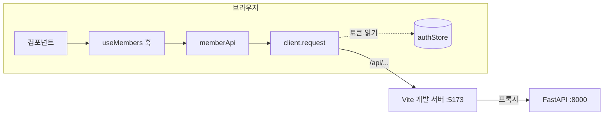
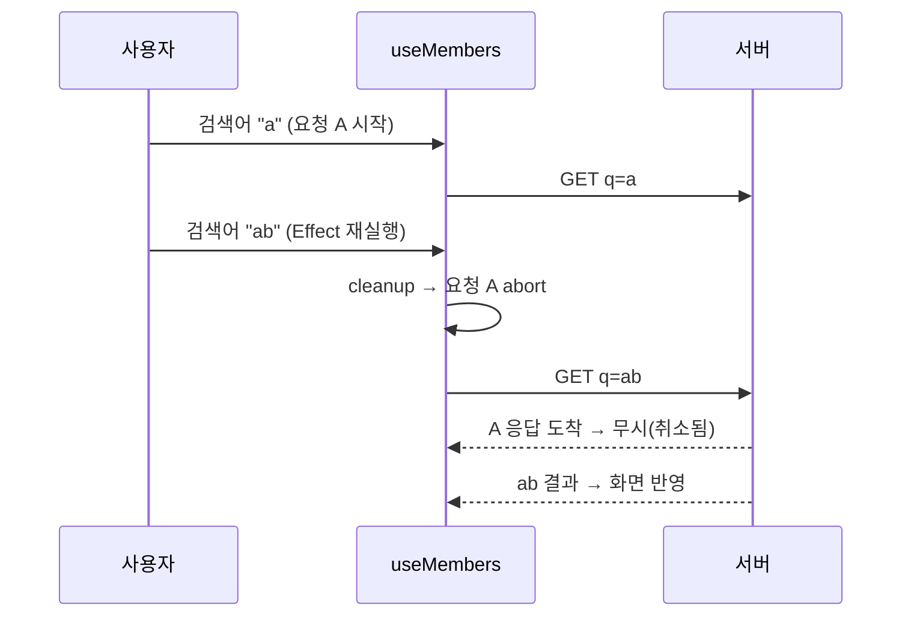

# 5-5. API 연동 구현 — 8H

[전체 목차](00-index.md) · [이전: 스타일링](05-04-styling.md) · [다음: 반응형](05-06-responsive.md)

## 단원 목차

- [1. 목표와 시간표](#s1)
- [2. 연동 구조와 서버 준비](#s2)
- [3. 프록시와 CORS](#s3)
- [4. 공통 API 클라이언트](#s4)
- [5. 로그인 연동](#s5)
- [6. 목록 조회: 로딩·빈 상태·오류·취소](#s6)
- [7. 검색·페이징·추가·수정·삭제](#s7)
- [8. 디버깅 방법](#s8)
- [9. 실습과 확인 문제](#s9)
- [10. 강사 노트](#s10)

<a id="s1"></a>
## 1. 목표와 시간표

4단원에서 만든 FastAPI 회원 API(BasicAPI v2)에 React 화면을 연결한다. 정적 데이터와 reducer를 서버 요청으로 바꾸고, 비동기 요청의 로딩·성공·실패·취소를 화면에 정확히 반영한다.

| 교시 | 내용 | 활동 |
|---|---|---|
| 1 | 연동 구조, 서버 실행, Swagger로 계약 확인 | `/docs`에서 응답 모양 기록 |
| 2 | fetch·async/await 복습, 프록시와 CORS | 프록시 없이 호출해 CORS 오류 관찰 |
| 3 | 공통 클라이언트, 토큰 헤더, 오류 변환 | 라이브 코딩: client.js |
| 4 | 로그인 연동, 401 처리 | 틀린 비밀번호·서버 꺼짐 확인 |
| 5 | 목록 조회 훅, 상태별 화면 | 느린 네트워크로 로딩 확인 |
| 6 | 검색·페이징 | 디바운스·페이지 초기화 |
| 7 | 추가·수정·삭제 + 알림 | 422 오류 메시지 표시 |
| 8 | 검토·평가 | 연동 시나리오 시연, 배움일기 |

<a id="s2"></a>
## 2. 연동 구조와 서버 준비



| 계층 | 파일 | 책임 |
|---|---|---|
| 화면 | `MembersPage.jsx` | 사용자 동작 → 요청 호출, 결과 표시 |
| 훅 | `useMembers.js` | 목록 상태(로딩·데이터·오류), 취소 |
| 엔드포인트 | `memberApi.js` | URL·메서드 목록 (서버 계약 한 곳) |
| 클라이언트 | `client.js` | 공통 헤더, JSON 변환, 오류 변환, 401 처리 |

서버 실행 (`BasicAPI\BasicAPI_ver2\server` README와 같음)

```powershell
cd D:\AX_FullStack_Builder\BasicAPI\BasicAPI_ver2\server
python -m venv .venv
.\.venv\Scripts\Activate.ps1
pip install -r requirements.txt
uvicorn main:app --reload
```

| 메서드 | 경로 | 요청 | 응답 |
|---|---|---|---|
| POST | `/api/login` | `{ username, password }` | `{ access_token, token_type, admin_name }` |
| POST | `/api/logout` | - | 204 |
| GET | `/api/members?page&size&q` | - | `{ items, total, page, size, total_pages }` |
| POST | `/api/members` | 회원 객체 | 201 + 회원 |
| PUT | `/api/members/{id}` | 회원 객체 전체 | 회원 |
| DELETE | `/api/members/{id}` | - | 204 |

로그인 외 모든 요청에 `Authorization: Bearer <token>`이 필요하다. 관리자 계정은 서버 README에 있다.

<a id="s3"></a>
## 3. 프록시와 CORS

React(5173)와 FastAPI(8000)는 **포트가 달라 다른 출처(origin)**다. 브라우저는 다른 출처 요청을 서버가 허용(CORS 헤더)해야만 응답을 읽게 한다.

| 방법 | 설정 | 특징 |
|---|---|---|
| 서버 CORS 허용 | FastAPI `CORSMiddleware`에 `http://localhost:5173` | BasicAPI v2에 이미 있음 |
| Vite 프록시 | `server.proxy` | 브라우저는 같은 출처(5173)로만 요청 → CORS 문제 없음, 코드에 서버 주소가 없음 |

이번 과정은 **프록시**를 쓴다. 배포 시에는 웹 서버(Nginx 등)가 같은 역할을 하므로 코드가 바뀌지 않는다.

`vite.config.js`

```js
export default defineConfig({
  plugins: [react(), tailwindcss()],
  server: {
    port: 5173,
    proxy: { "/api": "http://127.0.0.1:8000" },
  },
});
```

> 시연: 프록시 없이 `fetch("http://127.0.0.1:8000/api/health")`를 CORS 허용이 없는 서버에 보내 콘솔의 CORS 오류를 보여 준다. **CORS는 브라우저의 보호 장치이고 서버 설정으로 푼다**는 점, Postman에서는 같은 요청이 성공하는 이유를 설명한다.

<a id="s4"></a>
## 4. 공통 API 클라이언트

1차 프로젝트의 `api.js`를 발전시킨다. 모든 요청이 지나는 한 곳에서 **토큰, JSON, 오류, 401**을 처리한다.

`src/api/client.js` (완성 예제와 같음)

```js
import { useAuthStore } from "../stores/authStore.js";

const API_BASE = import.meta.env.VITE_API_BASE ?? "/api";

export class ApiError extends Error {
  constructor(message, status) {
    super(message);
    this.status = status;
  }
}

function toMessage(detail, status) {
  if (typeof detail === "string") return detail;
  if (Array.isArray(detail)) return detail.map((item) => item.msg).join(", ");
  return `요청에 실패했습니다. (${status})`;
}

export async function request(path, { method = "GET", body, signal } = {}) {
  const { token, logoutLocal } = useAuthStore.getState();
  const response = await fetch(`${API_BASE}${path}`, {
    method,
    signal,
    headers: {
      ...(body ? { "Content-Type": "application/json" } : {}),
      ...(token ? { Authorization: `Bearer ${token}` } : {}),
    },
    body: body ? JSON.stringify(body) : undefined,
  });

  if (response.status === 401 && token) logoutLocal();
  if (!response.ok) {
    const data = await response.json().catch(() => ({}));
    throw new ApiError(toMessage(data.detail, response.status), response.status);
  }
  return response.status === 204 ? null : response.json();
}
```

| 코드 | 이유 |
|---|---|
| `useAuthStore.getState()` | 훅이 아닌 일반 함수에서 Zustand 값 읽기 (3일차) |
| `!response.ok` 검사 | fetch는 404·500에서도 **reject하지 않는다**. 직접 확인해야 한다 |
| `toMessage` | FastAPI는 일반 오류 `detail: "문자열"`, 검증 오류(422) `detail: [{ msg, loc }]` |
| 401 + 토큰 있음 → `logoutLocal()` | 서버 재시작으로 토큰이 무효가 되면 로그인 화면으로 |
| 204 → `null` | 본문이 없는 응답에 `json()`을 부르면 오류 |
| `VITE_API_BASE` | `.env`로 서버 주소 교체 가능 (`VITE_` 접두사만 브라우저에 노출됨) |

`src/api/memberApi.js`

```js
import { request } from "./client.js";

export const memberApi = {
  login: (credentials) => request("/login", { method: "POST", body: credentials }),
  logout: () => request("/logout", { method: "POST" }),
  list: ({ page, size, q }, signal) =>
    request(`/members?${new URLSearchParams({ page, size, q })}`, { signal }),
  create: (member) => request("/members", { method: "POST", body: member }),
  update: (id, member) => request(`/members/${id}`, { method: "PUT", body: member }),
  remove: (id) => request(`/members/${id}`, { method: "DELETE" }),
};
```

> 보안: `.env`의 `VITE_` 값은 빌드 결과 JS에 그대로 들어간다. **API 키·비밀번호를 프론트엔드 환경변수에 넣지 않는다.**

<a id="s5"></a>
## 5. 로그인 연동

3일차의 가짜 로그인 버튼을 실제 요청으로 바꾼다.

`src/features/auth/LoginPage.jsx` (핵심 부분)

```jsx
const login = useAuthStore((state) => state.login);
const [form, setForm] = useState({ username: "", password: "" });
const [error, setError] = useState("");
const [pending, setPending] = useState(false);

async function submit(event) {
  event.preventDefault();
  setPending(true);
  setError("");
  try {
    const result = await memberApi.login(form);
    login(result.access_token, result.admin_name);
  } catch (err) {
    setError(err.message);
  } finally {
    setPending(false);
  }
}
```

```jsx
<Input label="아이디" name="username" autoComplete="username" value={form.username} onChange={change} required />
<Input label="비밀번호" name="password" type="password" autoComplete="current-password" value={form.password} onChange={change} required />
{error && <p role="alert" className="text-sm text-red-600">{error}</p>}
<Button type="submit" className="w-full" disabled={pending}>{pending ? "로그인 중..." : "로그인"}</Button>
```

`App.jsx`는 3일차와 같다: `token`이 없으면 `LoginPage`, 있으면 `AppLayout` + `MembersPage`.

| 확인 시나리오 | 기대 결과 |
|---|---|
| 올바른 계정 | 목록 화면으로 전환 |
| 틀린 비밀번호 | "아이디 또는 비밀번호가 올바르지 않습니다." (서버 메시지) |
| 서버 꺼짐 | 프록시 오류 → "요청에 실패했습니다. (500)" 등 메시지, 화면은 멈추지 않음 |
| 로그인 후 서버 재시작 → 목록 새로고침 | 401 → 자동으로 로그인 화면 |
| 버튼 연타 | `pending` 동안 비활성 → 요청 1번 |

<a id="s6"></a>
## 6. 목록 조회: 로딩·빈 상태·오류·취소

`src/hooks/useMembers.js` (완성 예제와 같음)

```js
import { useCallback, useEffect, useState } from "react";
import { memberApi } from "../api/memberApi.js";

const emptyPage = { items: [], total: 0, total_pages: 0 };

export function useMembers({ page, size, q }) {
  const [data, setData] = useState(emptyPage);
  const [status, setStatus] = useState("loading");
  const [error, setError] = useState(null);
  const [reloadKey, setReloadKey] = useState(0);

  useEffect(() => {
    const controller = new AbortController();
    memberApi
      .list({ page, size, q }, controller.signal)
      .then((result) => {
        setData(result);
        setStatus("success");
      })
      .catch((err) => {
        if (err.name === "AbortError") return;
        setError(err);
        setStatus("error");
      });
    return () => controller.abort();
  }, [page, size, q, reloadKey]);

  const reload = useCallback(() => {
    setStatus("loading");
    setReloadKey((key) => key + 1);
  }, []);

  return { ...data, status, error, reload };
}
```



**왜 취소가 필요한가 (경쟁 상태)**: 늦게 보낸 요청이 먼저 도착하면, 먼저 보낸 요청의 응답이 나중에 화면을 덮어써 검색어와 결과가 어긋난다. cleanup의 `abort()`가 이를 막는다.

화면은 상태별로 **하나만** 보여 준다.

```jsx
{status === "loading" && <StatusMessage title="불러오는 중..." />}
{status === "error" && (
  <StatusMessage title="목록을 불러오지 못했습니다." description={error.message}
    action={<Button onClick={reload}>다시 시도</Button>} />
)}
{status === "success" && items.length === 0 && (
  <StatusMessage title={q ? `'${q}' 검색 결과가 없습니다.` : "등록된 회원이 없습니다."} />
)}
{status === "success" && items.length > 0 && <MemberList members={items} ... />}
```

> 심화: 캐시·재요청·중복 제거까지 필요한 실무에서는 TanStack Query 같은 서버 상태 라이브러리를 쓴다. 오늘 직접 만든 훅이 그 라이브러리가 대신해 주는 일이다.

<a id="s7"></a>
## 7. 검색·페이징·추가·수정·삭제

`src/features/members/MembersPage.jsx` (완성 예제와 같음, 반환 JSX는 6절 + 아래)

```jsx
const PAGE_SIZE = 5;

export default function MembersPage() {
  const [page, setPage] = useState(1);
  const [keyword, setKeyword] = useState("");
  const q = useDebounce(keyword.trim());
  const { items, total, total_pages, status, error, reload } = useMembers({ page, size: PAGE_SIZE, q });
  const [modal, setModal] = useState(null);
  const [submitting, setSubmitting] = useState(false);
  const showToast = useToast();

  function search(value) {
    setKeyword(value);
    setPage(1); // 검색어가 바뀌면 1페이지부터
  }

  async function save(form) {
    setSubmitting(true);
    try {
      if (modal.mode === "edit") {
        await memberApi.update(modal.member.id, form);
        showToast("회원 정보를 수정했습니다.", "success");
      } else {
        await memberApi.create(form);
        showToast("회원을 추가했습니다.", "success");
      }
      setModal(null);
      reload();
    } catch (err) {
      showToast(err.message, "error");
    } finally {
      setSubmitting(false);
    }
  }

  async function remove(member) {
    if (!window.confirm(`${member.name} 회원을 삭제할까요?`)) return;
    try {
      await memberApi.remove(member.id);
      showToast("회원을 삭제했습니다.", "success");
      if (items.length === 1 && page > 1) setPage((prev) => prev - 1);
      else reload();
    } catch (err) {
      showToast(err.message, "error");
    }
  }
  // ...
}
```

`src/features/members/Pagination.jsx`

```jsx
export default function Pagination({ page, totalPages, onChange }) {
  if (totalPages <= 1) return null;
  return (
    <nav aria-label="페이지 이동" className="flex items-center justify-center gap-3">
      <Button variant="secondary" onClick={() => onChange(page - 1)} disabled={page <= 1}>이전</Button>
      <span className="text-sm text-slate-600">{page} / {totalPages}</span>
      <Button variant="secondary" onClick={() => onChange(page + 1)} disabled={page >= totalPages}>다음</Button>
    </nav>
  );
}
```

| 설계 포인트 | 이유 |
|---|---|
| 저장 성공 후 `reload()` | 서버가 원본. 화면 배열을 직접 고치지 않고 다시 받아 일치시킨다 |
| 수정은 `PUT` + 회원 객체 전체 | 서버가 전체 교체 방식. 폼이 편집하지 않는 필드(`website`, `address.street` 등)도 `initialValue`에서 그대로 보낸다 |
| 마지막 1명 삭제 시 이전 페이지 | 빈 페이지가 보이지 않게 |
| `submitting` 동안 저장 버튼 비활성 | 중복 생성 방지 |
| 실패 시 모달 유지 | 사용자가 입력을 잃지 않게 |

> 3일차 reducer는 어떻게 되나: 서버가 원본이 되면서 목록 State는 `useMembers`로 옮겨졌다. reducer는 "화면이 원본일 때"의 도구였다는 점을 비교해 설명한다.

<a id="s8"></a>
## 8. 디버깅 방법

| 도구 | 확인할 것 |
|---|---|
| DevTools Network 탭 | 요청 URL·메서드·상태 코드·요청 헤더(Authorization)·응답 본문 |
| Network → Throttling "Slow 4G" | 로딩 화면, 버튼 비활성 확인 |
| Network → Offline | 오류 화면과 "다시 시도" |
| FastAPI `/docs` | 같은 요청을 서버에서 직접 실행해 프론트·백 중 어디 문제인지 분리 |
| 4단원 Postman Collection | 인증·실패 시나리오 재사용 |
| React DevTools | `useMembers`의 status·items 값 |

문제 분리 순서: **① Swagger에서 성공하는가 → ② Network 탭에 요청이 나갔는가 → ③ 상태 코드와 응답은 무엇인가 → ④ State에 들어갔는가 → ⑤ 화면 조건이 맞는가.**

<a id="s9"></a>
## 9. 실습과 확인 문제

### 실습 (4~7교시)

| 단계 | 할 일 | 완료 기준 |
|---|---|---|
| 1 | 서버 실행, Swagger로 6개 API 응답 모양 기록 | 표 작성 |
| 2 | 프록시 설정, client.js·memberApi.js 작성 | `/api/health` 호출 성공 |
| 3 | 로그인 연동 | 5절 시나리오 5개 통과 |
| 4 | useMembers로 목록 연동, 상태별 화면 | Slow 4G·Offline에서 확인 |
| 5 | 검색·페이징 | 검색 시 1페이지로, 요청 수가 글자 수보다 적음 |
| 6 | 추가·수정·삭제 + Toast | 잘못된 이메일 → 서버 422 메시지 표시(프론트 검증을 잠시 꺼서 확인) |
| 도전 | 회원 상세 조회(`GET /api/members/{id}`) 모달 | 404 처리 포함 |

AI 활용: "Network 탭 캡처 + 오류 메시지 + 관련 코드"를 함께 주고 원인 후보를 묻는다. 고치는 것은 직접 한다.

### 확인 문제

1. fetch가 404 응답에서 reject하지 않는다는 것이 코드에 어떤 영향을 주는가?
2. 프록시를 쓰면 CORS 오류가 나지 않는 이유는?
3. 검색 요청에 AbortController가 없으면 어떤 버그가 생길 수 있는가?
4. 저장 후 화면 배열을 직접 고치지 않고 `reload()`하는 이유는?
5. `VITE_API_KEY`에 비밀 키를 넣으면 안 되는 이유는?

### 과제

- 연동 시나리오(로그인 → 검색 → 추가 → 수정 → 삭제 → 로그아웃)를 화면 녹화하거나 캡처해 README에 첨부한다.
- 배움일기: 오늘 겪은 오류 하나를 "증상 → 원인 → 확인 방법 → 해결" 순서로.

<a id="s10"></a>
## 10. 강사 노트

| 증상 | 원인 |
|---|---|
| `No Python at '...python.exe'` | 다른 PC에서 만든 `.venv` 재사용 → `.venv` 삭제 후 재생성 |
| `ECONNREFUSED` (Vite 터미널) | FastAPI 미실행, 포트 다름 |
| 모든 요청 401 | 토큰 헤더 누락, 서버 재시작으로 토큰 소멸(메모리 저장) |
| `Unexpected end of JSON input` | 204 응답에 `json()` 호출 |
| 목록이 두 번 요청됨 | StrictMode 개발 검사. abort 덕분에 첫 요청은 취소됨을 Network 탭에서 확인 |
| 422 `[object Object]` 표시 | `detail` 배열을 문자열로 바꾸지 않음 |

- BasicAPI v2는 데이터를 메모리에 둔다. 서버를 재시작하면 회원 3명·로그인이 초기화되므로 시연 전에 알린다.
- 1차 프로젝트에서 백엔드를 FastAPI가 아닌 다른 스택으로 만든 팀은 `memberApi.js`만 바꾸면 되도록 계층을 나눴음을 강조한다.
