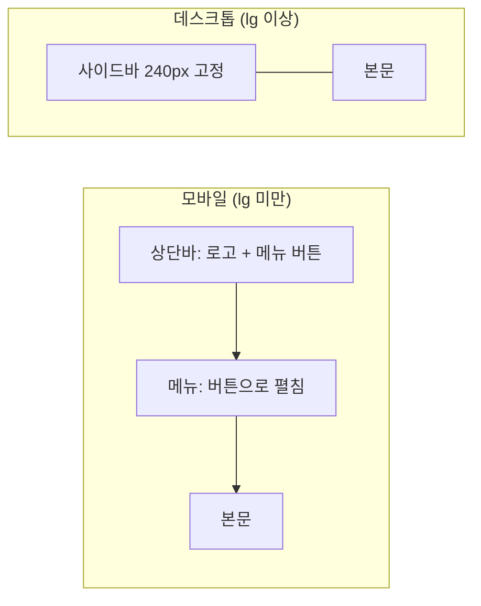

# 5-6. 반응형 레이아웃 구현 — 8H

[전체 목차](00-index.md) · [이전: API 연동](05-05-api.md) · [다음: 화면 QA](05-07-qa.md)

## 단원 목차

- [1. 목표와 시간표](#s1)
- [2. 반응형의 기본: 뷰포트와 모바일 퍼스트](#s2)
- [3. 미디어 쿼리와 Tailwind 브레이크포인트](#s3)
- [4. Flex와 Grid 설계](#s4)
- [5. 패턴 ① 앱 레이아웃과 사이드바](#s5)
- [6. 패턴 ② 표 ↔ 카드 전환](#s6)
- [7. 패턴 ③ 폼·모달·버튼 그룹](#s7)
- [8. 점검 방법](#s8)
- [9. 실습과 확인 문제](#s9)
- [10. 강사 노트](#s10)

<a id="s1"></a>
## 1. 목표와 시간표

375px 휴대폰부터 1280px 이상 데스크톱까지 가로 스크롤 없이 쓸 수 있는 화면을 만든다. 미디어 쿼리의 원리를 이해하고 Tailwind 브레이크포인트로 구현한다. Flex와 Grid를 상황에 맞게 고른다.

| 교시 | 내용 | 활동 |
|---|---|---|
| 1 | 뷰포트, 모바일 퍼스트, 브레이크포인트 | 현재 화면을 375px로 열어 문제 목록 만들기 |
| 2 | 미디어 쿼리 ↔ Tailwind 접두사 | 같은 레이아웃을 CSS·Tailwind로 작성 |
| 3 | Flex vs Grid, 반응형 패턴 4가지 | 실제 서비스 화면 분석 |
| 4 | 앱 레이아웃: 상단바 + 접히는 사이드바 | AppLayout 구현 |
| 5 | 표 ↔ 카드 전환 | MemberList 구현 |
| 6 | 폼·모달·버튼 그룹, 긴 글자 처리 | MemberForm·Modal 다듬기 |
| 7 | 3개 해상도 점검·수정 | 페어 교차 점검 |
| 8 | 검토·평가 | 해상도별 캡처 리뷰, 배움일기 |

<a id="s2"></a>
## 2. 반응형의 기본: 뷰포트와 모바일 퍼스트

`index.html`에 아래 메타 태그가 있어야 휴대폰이 화면을 축소하지 않고 실제 너비로 그린다(Vite 템플릿에 기본 포함).

```html
<meta name="viewport" content="width=device-width, initial-scale=1.0" />
```

**모바일 퍼스트**: 작은 화면 스타일을 기본으로 쓰고, 넓어질 때 덧붙인다.

| 방식 | 기본 스타일 | 조건 | 결과 |
|---|---|---|---|
| 모바일 퍼스트 | 1열 | `min-width` 이상이면 2열 | 작은 화면 CSS가 가장 단순, Tailwind 방식 |
| 데스크톱 퍼스트 | 3열 | `max-width` 이하면 1열 | 덮어쓰기가 많아짐 |

<a id="s3"></a>
## 3. 미디어 쿼리와 Tailwind 브레이크포인트

```css
/* 순수 CSS: 모바일 퍼스트 */
.form-grid { display: grid; gap: 1rem; }
@media (min-width: 640px) {
  .form-grid { grid-template-columns: repeat(2, 1fr); }
}
```

```jsx
{/* Tailwind: 같은 의미 */}
<div className="grid gap-4 sm:grid-cols-2">
```

| 접두사 | 최소 너비 | 대표 기기 | 회원관리에서 바뀌는 것 |
|---|---|---|---|
| (없음) | 0 | 휴대폰 | 1열, 카드 목록, 메뉴 버튼 |
| `sm:` | 640px | 큰 휴대폰 가로 | 폼 2열, 버튼 가로 정렬, 모달 가운데 |
| `md:` | 768px | 태블릿 | 카드 → 표 |
| `lg:` | 1024px | 노트북 | 사이드바 고정, 표에 도시 열 추가 |
| `xl:` | 1280px | 데스크톱 | 본문 최대 너비 유지 |

- `md:hidden` = 768px 이상에서 숨김, `hidden md:block` = 768px 이상에서만 보임.
- 브레이크포인트는 기기가 아니라 **콘텐츠가 깨지는 지점**에서 정한다. 표가 좁아 글자가 줄바꿈되기 시작하는 너비가 `md`였다.

<a id="s4"></a>
## 4. Flex와 Grid 설계

| 질문 | Flex | Grid |
|---|---|---|
| 방향 | 한 방향(행 또는 열) | 두 방향(행과 열) |
| 크기 결정 | 내용이 크기를 정함 | 틀(열 정의)이 크기를 정함 |
| 알맞은 곳 | 버튼 그룹, 상단바, 아이콘+글자 | 페이지 골격, 폼, 카드 갤러리 |

자주 쓰는 반응형 조합

```jsx
{/* 1. 세로로 쌓다가 넓어지면 양쪽 정렬 */}
<div className="flex flex-col gap-4 sm:flex-row sm:items-end sm:justify-between">

{/* 2. 개수를 정하지 않는 카드 갤러리: 칸 너비 최소 16rem, 남는 공간 자동 배분 */}
<ul className="grid grid-cols-[repeat(auto-fill,minmax(16rem,1fr))] gap-4">

{/* 3. 고정 사이드바 + 유동 본문 */}
<div className="lg:grid lg:grid-cols-[240px_1fr]">

{/* 4. 본문 최대 너비 + 가운데 + 화면별 여백 */}
<main className="mx-auto w-full max-w-6xl p-4 sm:p-6 lg:p-8">
```

<a id="s5"></a>
## 5. 패턴 ① 앱 레이아웃과 사이드바



`src/components/layout/AppLayout.jsx` (완성 예제와 같음)

```jsx
export default function AppLayout({ children }) {
  const [menuOpen, setMenuOpen] = useState(false);
  const adminName = useAuthStore((state) => state.adminName);
  const logoutLocal = useAuthStore((state) => state.logoutLocal);

  async function logout() {
    try {
      await memberApi.logout();
    } catch {
      // 서버가 꺼져 있어도 화면에서는 로그아웃한다.
    }
    logoutLocal();
  }

  return (
    <div className="min-h-dvh bg-slate-50 lg:grid lg:grid-cols-[240px_1fr]">
      <header className="flex items-center justify-between border-b border-slate-200 bg-white px-4 py-3 lg:hidden">
        <span className="font-semibold">Member Admin</span>
        <Button variant="secondary" aria-expanded={menuOpen} aria-controls="side-menu"
          onClick={() => setMenuOpen((open) => !open)}>
          메뉴
        </Button>
      </header>

      <aside id="side-menu"
        className={`${menuOpen ? "block" : "hidden"} border-b border-slate-200 bg-white p-4 lg:block lg:border-r lg:border-b-0`}>
        <p className="mb-6 hidden text-lg font-semibold lg:block">Member Admin</p>
        <nav aria-label="주 메뉴">
          <a href="#members" aria-current="page"
            className="block rounded-lg bg-brand-50 px-3 py-2 text-sm font-medium text-brand-700">회원 관리</a>
        </nav>
        <div className="mt-6 space-y-2 border-t border-slate-200 pt-4 text-sm text-slate-600">
          <p>{adminName}님</p>
          <Button variant="secondary" className="w-full" onClick={logout}>로그아웃</Button>
        </div>
      </aside>

      <main id="members" className="mx-auto w-full max-w-6xl p-4 sm:p-6 lg:p-8">{children}</main>
    </div>
  );
}
```

| 포인트 | 설명 |
|---|---|
| `menuOpen ? "block" : "hidden"` + `lg:block` | 모바일에서는 State로, 데스크톱에서는 항상 보임 |
| `aria-expanded`, `aria-controls` | 스크린리더가 메뉴 열림 여부를 알 수 있음 |
| `min-h-dvh` | 모바일 브라우저 주소창 높이 변화에도 화면을 정확히 채움 (`vh`의 문제 보완) |

<a id="s6"></a>
## 6. 패턴 ② 표 ↔ 카드 전환

표는 데스크톱에서 비교하기 좋지만 375px에서는 열이 찌그러진다. **같은 데이터를 두 가지 모양으로** 그리고 CSS로 하나만 보인다.

`src/features/members/MemberList.jsx` (완성 예제와 같음)

```jsx
export default function MemberList({ members, onEdit, onDelete }) {
  return (
    <>
      <ul className="space-y-3 md:hidden">
        {members.map((member) => (
          <li key={member.id}>
            <MemberCard member={member} onEdit={onEdit} onDelete={onDelete} />
          </li>
        ))}
      </ul>

      <div className="hidden overflow-x-auto rounded-xl border border-slate-200 bg-white md:block">
        <table className="w-full text-left text-sm">
          <thead className="bg-slate-50 text-slate-500">
            <tr>
              <th scope="col" className="px-4 py-3 font-medium">이름</th>
              <th scope="col" className="px-4 py-3 font-medium">아이디</th>
              <th scope="col" className="px-4 py-3 font-medium">이메일</th>
              <th scope="col" className="hidden px-4 py-3 font-medium lg:table-cell">도시</th>
              <th scope="col" className="px-4 py-3 text-right font-medium">관리</th>
            </tr>
          </thead>
          <tbody className="divide-y divide-slate-100">
            {members.map((member) => (
              <tr key={member.id}>
                <td className="px-4 py-3 font-medium text-slate-900">{member.name}</td>
                <td className="px-4 py-3">{member.username}</td>
                <td className="px-4 py-3">{member.email}</td>
                <td className="hidden px-4 py-3 lg:table-cell">{member.address.city || "-"}</td>
                <td className="space-x-2 px-4 py-3 text-right whitespace-nowrap">
                  <Button variant="secondary" onClick={() => onEdit(member)}>수정</Button>
                  <Button variant="danger" onClick={() => onDelete(member)}>삭제</Button>
                </td>
              </tr>
            ))}
          </tbody>
        </table>
      </div>
    </>
  );
}
```

| 기법 | 역할 |
|---|---|
| `md:hidden` / `hidden md:block` | 너비에 따라 둘 중 하나만 표시 (`display: none`이라 스크린리더도 하나만 읽음) |
| `lg:table-cell` | 덜 중요한 열(도시)은 넓은 화면에서만 |
| `overflow-x-auto` | 예상보다 좁을 때 **페이지 전체가 아니라 표만** 가로 스크롤 |
| `whitespace-nowrap` | 버튼 두 개가 줄바꿈되지 않게 |
| 카드의 `truncate` | 긴 이메일이 카드 밖으로 넘치지 않게 말줄임 |
| 카드 버튼 `grid grid-cols-2` | 손가락으로 누르기 쉬운 큰 터치 영역 |

> 대안 비교: JS로 `window.innerWidth`를 읽어 분기하면 리사이즈 이벤트·서버 렌더링 문제가 생긴다. **레이아웃 분기는 가능하면 CSS로** 한다.

<a id="s7"></a>
## 7. 패턴 ③ 폼·모달·버튼 그룹

| 요소 | 모바일 | `sm` 이상 | 클래스 |
|---|---|---|---|
| 폼 입력 | 1열 | 2열 | `grid gap-4 sm:grid-cols-2` |
| 저장·취소 | 세로, 저장이 위 | 가로, 오른쪽 정렬 | `flex flex-col-reverse gap-2 sm:flex-row sm:justify-end` |
| 모달 위치 | 아래에서 올라오는 시트 | 화면 가운데 | `items-end sm:items-center`, `rounded-t-2xl sm:rounded-2xl` |
| 모달 높이 | 화면 90% 넘으면 내부 스크롤 | 같음 | `max-h-[90dvh] overflow-y-auto` |
| 목록 상단 | 제목 → 검색 → 추가 세로 | 제목 왼쪽, 도구 오른쪽 | `flex flex-col sm:flex-row sm:justify-between` |
| 알림(Toast) | 화면 아래 가득 | 오른쪽 아래 320px | `inset-x-4 bottom-4 sm:left-auto sm:w-80` |

- `flex-col-reverse`: 모바일에서 엄지가 닿는 위치에 주 버튼(저장)을 두기 위해 순서를 뒤집는다. DOM 순서는 그대로라 키보드 Tab 순서는 바뀌지 않는다.
- 터치 대상은 최소 24×24px(WCAG 2.2), 권장 44px 안팎. `py-2` 버튼 + `text-sm`이면 약 36px이므로 모바일 주요 버튼은 `w-full`로 넓힌다.

<a id="s8"></a>
## 8. 점검 방법

| 도구 | 방법 |
|---|---|
| Chrome DevTools 기기 모드 | `Ctrl+Shift+M` → 375 × 812, 768 × 1024, 1280 × 800 |
| 반응형 드래그 | 너비를 천천히 줄이며 깨지는 지점 찾기 |
| 가로 스크롤 검사 | 콘솔에서 `document.documentElement.scrollWidth > innerWidth` → `false`여야 함 |
| 넘치는 요소 찾기 | 콘솔에서 `[...document.querySelectorAll("*")].filter((el) => el.scrollWidth > el.clientWidth && getComputedStyle(el).overflowX === "visible")` |
| 실제 휴대폰 | 같은 와이파이에서 `npm run dev -- --host` 후 표시되는 Network 주소로 접속 |

### 해상도별 점검표

| 항목 | 375px | 768px | 1280px |
|---|---|---|---|
| 페이지 가로 스크롤 없음 | | | |
| 메뉴 열고 닫기 / 사이드바 고정 | | | |
| 목록: 카드 / 표 / 표 + 도시 열 | | | |
| 긴 이메일 넘침 없음 | | | |
| 모달이 화면 안에 있고 스크롤 가능 | | | |
| 버튼 터치·클릭 영역 충분 | | | |
| 글자 크기 16px 미만 입력창 없음(iOS 자동 확대) | | | |

> 마지막 항목: iOS Safari는 글자 크기 16px 미만 입력창에 포커스하면 화면을 확대한다. 이번 예제의 `text-sm`(14px) 입력창은 실제 아이폰에서 확대되는지 확인하고, 필요하면 `text-base sm:text-sm`으로 바꾼다. 수업에서 확인할 과제로 남겨 둔다.

<a id="s9"></a>
## 9. 실습과 확인 문제

### 실습 (4~7교시)

| 단계 | 할 일 | 완료 기준 |
|---|---|---|
| 1 | 375px에서 현재 화면 문제 목록 작성 | 최소 5개 |
| 2 | AppLayout 반응형 구현 | 메뉴 버튼 동작, lg에서 사이드바 고정 |
| 3 | MemberList 표·카드 전환 | 768px 경계에서 전환 |
| 4 | 폼·모달·버튼 그룹·Toast 조정 | 7절 표대로 동작 |
| 5 | 페어와 기기 교환, 해상도별 점검표 작성 | 모든 칸 통과 또는 버그 등록 |
| 도전 | Tailwind `@container`로 카드 내부를 부모 너비 기준 배치 | 사이드바 유무와 관계없이 카드 정렬 |

AI 활용: 375px 캡처를 첨부하고 "가로 스크롤 원인 후보와 확인 방법"을 묻는다. 받은 클래스는 Tailwind v4에 존재하는지 IntelliSense로 확인한다.

### 확인 문제

1. 모바일 퍼스트에서 `sm:grid-cols-2`는 어떤 너비에서 2열이 되는가?
2. 표를 모바일에서 카드로 바꾸는 방법과, 대신 `overflow-x-auto`만 쓰는 방법의 장단점은?
3. Flex와 Grid 중 회원 폼 입력 배치에 알맞은 것과 이유는?
4. `100vh` 대신 `100dvh`(`min-h-dvh`)를 쓰는 이유는?
5. `flex-col-reverse`가 키보드 사용자에게 주는 영향은?

### 과제

- 375·768·1280px 캡처 3장과 점검표를 README에 추가한다.
- 배움일기: 가장 오래 걸린 반응형 문제와 찾은 방법.

<a id="s10"></a>
## 10. 강사 노트

| 증상 | 원인 |
|---|---|
| 모바일에서 전체가 축소되어 보임 | viewport 메타 태그 삭제 |
| 페이지가 옆으로 밀림 | 고정 너비(`w-[600px]`), 긴 단어·URL, 표에 `overflow-x-auto` 없음 |
| `md:flex`가 안 먹음 | 기본에 `hidden`이 없거나 클래스 순서가 아니라 조건 이해 부족 |
| 사이드바가 lg에서 안 보임 | `lg:block` 누락 |

- "데스크톱에서 완성 → 마지막에 모바일"로 하면 대부분 다시 짠다. 오늘은 **375px 창을 기본으로 띄워 두고 작업**하게 한다.
- 실제 기기 점검을 위해 학원 와이파이에서 `--host` 접속이 막혀 있는지 미리 확인한다.
