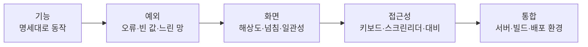

# 5-7. 화면 QA 및 통합 실습 — 8H

[전체 목차](00-index.md) · [이전: 반응형](05-06-responsive.md)

## 단원 목차

- [1. 목표와 시간표](#s1)
- [2. 화면 QA란 무엇을 보는가](#s2)
- [3. QA 체크리스트](#s3)
- [4. 버그 리포트 작성](#s4)
- [5. 접근성·성능 점검 도구](#s5)
- [6. 컴포넌트 테스트: Vitest + Testing Library](#s6)
- [7. 통합: 빌드와 최종 점검](#s7)
- [8. 최종 시연과 평가](#s8)
- [9. 강사 노트](#s9)

<a id="s1"></a>
## 1. 목표와 시간표

완성한 화면을 기준에 따라 검증하고, 발견한 버그를 재현 가능한 리포트로 남겨 고친다. 핵심 컴포넌트에 자동 테스트를 붙이고 프로덕션 빌드까지 통과시켜 5단원을 마무리한다.

| 교시 | 내용 | 활동 |
|---|---|---|
| 1 | QA 관점, 체크리스트, 버그 심각도 | 예시 버그 3개 분류 |
| 2 | 버그 리포트, 접근성·Lighthouse 점검 | 시연: 키보드만으로 전체 흐름 |
| 3 | Vitest·Testing Library 기초 | 라이브 코딩: MemberForm 테스트 |
| 4 | 교차 QA ① 다른 팀 화면 점검 | 버그 리포트 작성 |
| 5 | 버그 수정 ① 높음 심각도부터 | 수정 커밋에 리포트 번호 |
| 6 | 테스트 작성, 버그 수정 ② | 테스트 2개 이상 통과 |
| 7 | 빌드·최종 점검, 시연 준비 | `npm run build` + `preview` |
| 8 | 최종 시연·평가 | 팀별 5분 시연, 회고, 배움일기 |

<a id="s2"></a>
## 2. 화면 QA란 무엇을 보는가

"내 컴퓨터에서 잘 된다"는 QA가 아니다. **다른 사람이, 다른 환경에서, 예상하지 못한 순서로** 써도 되는지를 본다.



| 심각도 | 기준 | 예 |
|---|---|---|
| 높음 | 핵심 기능 불가, 데이터 손실, 보안 | 저장 버튼 연타 시 회원 중복 생성 |
| 중간 | 기능은 되지만 우회가 필요 | 수정 후 목록이 갱신되지 않아 새로고침 필요 |
| 낮음 | 보기 불편, 문구 | 버튼 간격이 화면마다 다름 |

<a id="s3"></a>
## 3. QA 체크리스트

교차 QA 때 이 표를 복사해 쓴다. 각 항목은 **직접 해 보고** 표시한다.

### 기능

| 번호 | 시나리오 | 기대 결과 | 결과 |
|---|---|---|---|
| F1 | 올바른 계정으로 로그인 | 목록 표시, 관리자 이름 표시 | |
| F2 | 틀린 비밀번호 | 서버 오류 메시지, 화면 유지 | |
| F3 | 이름 검색 / 이메일 검색 | 일치하는 회원만, 1페이지부터 | |
| F4 | 없는 검색어 | "검색 결과가 없습니다" | |
| F5 | 다음·이전 페이지 | 첫·마지막 페이지에서 버튼 비활성 | |
| F6 | 회원 추가 | 알림 + 목록 반영 + 전체 수 증가 | |
| F7 | 회원 수정 후 다른 회원 수정 열기 | 이전 값이 섞이지 않음 | |
| F8 | 마지막 페이지의 유일한 회원 삭제 | 이전 페이지로 이동 | |
| F9 | 로그아웃 → 뒤로 가기·새로고침 | 로그인 화면 유지 | |

### 예외

| 번호 | 시나리오 | 기대 결과 | 결과 |
|---|---|---|---|
| E1 | 필수 값 비우고 저장 | 입력 아래 오류, 요청 안 나감(Network 탭) | |
| E2 | 저장 버튼 빠르게 3번 | 요청 1번 | |
| E3 | 서버 끄고 목록 새로고침 | 오류 화면 + 다시 시도 | |
| E4 | 로그인 상태에서 서버 재시작 후 조작 | 로그인 화면으로 | |
| E5 | Slow 4G에서 검색 연속 입력 | 마지막 검색어 결과만 표시 | |
| E6 | 50자 넘는 이름, 아주 긴 이메일 | 검증 메시지 / 화면 넘침 없음 | |

### 화면·접근성

| 번호 | 항목 | 결과 |
|---|---|---|
| U1 | 375·768·1280px 점검표(6일차) 통과 | |
| U2 | 마우스 없이 Tab·Enter·Esc만으로 로그인 → 추가 → 저장 → 모달 닫기 | |
| U3 | 포커스 위치가 항상 보임 | |
| U4 | 모든 입력에 보이는 label, 오류가 입력과 연결 | |
| U5 | 색만으로 정보를 구분하지 않음(오류는 글자로도 표시) | |
| U6 | 콘솔에 오류·경고 없음 | |

<a id="s4"></a>
## 4. 버그 리포트 작성

좋은 리포트는 **다른 사람이 읽고 그대로 재현**할 수 있다. GitHub Issue 템플릿으로 저장해 쓴다.

```markdown
## [BUG-03] 저장 버튼 연타 시 회원이 중복 생성됨

- 심각도: 높음
- 환경: Chrome 141 / Windows 11 / 1280px / 서버 BasicAPI v2
- 관련 체크리스트: E2

### 재현 순서
1. 로그인 후 "회원 추가" 클릭
2. 이름 "테스트", 아이디 "t1", 이메일 "t1@example.com" 입력
3. "저장"을 빠르게 3번 클릭

### 기대 결과
회원 1명 추가, 요청 1번

### 실제 결과
같은 회원 3명 추가. Network 탭에 POST /api/members 3건(201)

### 첨부
- 화면 녹화 / Network 탭 캡처

### 원인 추정 (선택)
요청 중에도 저장 버튼이 활성 상태
```

| 나쁜 리포트 | 문제 |
|---|---|
| "저장이 이상해요" | 무엇을, 어떻게, 어떤 결과인지 없음 |
| "가끔 안 돼요" | 재현 조건 없음 → 조건을 찾을 때까지 반복 |
| 원인만 적음 "useState 문제" | 현상이 없어 검증 불가 |

수정 커밋 메시지에 번호를 남긴다: `fix: 저장 중 버튼 비활성화 (BUG-03)`.

> AI 활용: 리포트의 재현 순서·실제 결과·관련 코드를 함께 주면 원인 후보를 잘 짚는다. 반대로 "버그 고쳐줘"만 주면 관련 없는 곳을 고친다. **리포트를 잘 쓰는 능력이 곧 AI에게 잘 묻는 능력**이다.

<a id="s5"></a>
## 5. 접근성·성능 점검 도구

| 도구 | 사용법 | 볼 것 |
|---|---|---|
| 키보드 | 마우스를 치우고 Tab·Shift+Tab·Enter·Space·Esc | 순서, 포커스 표시, 갇힘 없음 |
| Chrome Lighthouse | DevTools → Lighthouse → 접근성·성능 | 점수보다 **지적 항목** 하나씩 확인 |
| DevTools 접근성 트리 | Elements → Accessibility 패널 | 버튼·입력의 이름(accessible name) |
| 대비 검사 | Elements에서 색 클릭 → Contrast ratio | 4.5:1 이상 |
| 스크린리더 | Windows 내레이터(`Ctrl+Win+Enter`) | 오류·알림이 읽히는지 |

Lighthouse는 개발 서버가 아니라 **`npm run build && npm run preview`로 띄운 빌드 결과**에서 측정한다. 개발 서버는 최적화 전 코드라 점수가 낮게 나온다.

<a id="s6"></a>
## 6. 컴포넌트 테스트: Vitest + Testing Library

손으로 하는 QA를 매번 반복할 수 없으므로 **깨지면 안 되는 동작**을 자동 테스트로 고정한다.

```powershell
npm install -D vitest jsdom @testing-library/react @testing-library/user-event @testing-library/jest-dom
```

`package.json`의 `scripts`에 `"test": "vitest"`를 추가한다.

`vite.config.js`에 테스트 설정 추가

```js
export default defineConfig({
  plugins: [react(), tailwindcss()],
  server: { port: 5173, proxy: { "/api": "http://127.0.0.1:8000" } },
  test: {
    environment: "jsdom",
    setupFiles: "./src/test/setup.js",
  },
});
```

`src/test/setup.js`

```js
import "@testing-library/jest-dom/vitest";
import { cleanup } from "@testing-library/react";
import { afterEach } from "vitest";

afterEach(() => cleanup());
```

> `cleanup`이 없으면 이전 테스트의 화면이 남아 "Found multiple elements" 오류가 난다. 교안 검증 중 실제로 확인한 문제다(Vitest의 `globals` 옵션을 켜지 않은 경우).

`src/features/members/MemberForm.test.jsx` (완성 예제와 같음)

```jsx
import { render, screen } from "@testing-library/react";
import userEvent from "@testing-library/user-event";
import { describe, expect, it, vi } from "vitest";
import MemberForm from "./MemberForm.jsx";
import { emptyMember, validateMember } from "./memberModel.js";

describe("validateMember", () => {
  it("필수 값이 비면 오류를 돌려준다", () => {
    expect(validateMember(emptyMember)).toEqual({
      name: "이름을 입력하세요.",
      username: "아이디를 입력하세요.",
      email: "이메일 형식이 올바르지 않습니다.",
    });
  });
});

describe("MemberForm", () => {
  it("잘못된 입력이면 오류를 보여주고 제출하지 않는다", async () => {
    const onSubmit = vi.fn();
    render(<MemberForm onSubmit={onSubmit} onCancel={() => {}} />);

    await userEvent.click(screen.getByRole("button", { name: "저장" }));

    expect(screen.getByText("이름을 입력하세요.")).toBeInTheDocument();
    expect(screen.getByLabelText("이름")).toHaveAttribute("aria-invalid", "true");
    expect(onSubmit).not.toHaveBeenCalled();
  });

  it("올바른 입력이면 폼 값을 넘긴다", async () => {
    const onSubmit = vi.fn();
    render(<MemberForm onSubmit={onSubmit} onCancel={() => {}} />);

    await userEvent.type(screen.getByLabelText("이름"), "홍길동");
    await userEvent.type(screen.getByLabelText("아이디"), "hong");
    await userEvent.type(screen.getByLabelText("이메일"), "hong@example.com");
    await userEvent.type(screen.getByLabelText("도시"), "서울");
    await userEvent.click(screen.getByRole("button", { name: "저장" }));

    expect(onSubmit).toHaveBeenCalledWith(
      expect.objectContaining({
        name: "홍길동",
        email: "hong@example.com",
        address: expect.objectContaining({ city: "서울" }),
      }),
    );
  });
});
```

`src/features/members/Pagination.test.jsx`

```jsx
import { render, screen } from "@testing-library/react";
import userEvent from "@testing-library/user-event";
import { expect, it, vi } from "vitest";
import Pagination from "./Pagination.jsx";

it("첫 페이지에서는 이전 버튼이 비활성화되고, 다음을 누르면 2를 전달한다", async () => {
  const onChange = vi.fn();
  render(<Pagination page={1} totalPages={3} onChange={onChange} />);

  expect(screen.getByRole("button", { name: "이전" })).toBeDisabled();
  await userEvent.click(screen.getByRole("button", { name: "다음" }));
  expect(onChange).toHaveBeenCalledWith(2);
});
```

```powershell
npx vitest run
```

| Testing Library 원칙 | 설명 |
|---|---|
| 사용자가 보는 방식으로 찾기 | `getByRole("button", { name: "저장" })`, `getByLabelText("이름")` 우선. `querySelector(".btn")` 지양 |
| 구현이 아니라 결과를 검증 | State 값이 아니라 화면 글자·콜백 호출을 확인 |
| 접근성과 함께 좋아짐 | label이 연결되지 않으면 `getByLabelText`가 실패 → 테스트가 접근성 검사 역할 |

> 2일차 리뷰에서 label을 연결한 덕분에 이 테스트가 쓸 수 있다는 점을 짚는다. **테스트하기 쉬운 컴포넌트 = 접근성이 좋은 컴포넌트**.

<a id="s7"></a>
## 7. 통합: 빌드와 최종 점검

```powershell
npm run lint
npx vitest run
npm run build
npm run preview
```

| 명령 | 통과 기준 |
|---|---|
| `npm run lint` | 오류 0 |
| `npx vitest run` | 전부 통과 |
| `npm run build` | `dist/` 생성, 오류 없음 |
| `npm run preview` | 빌드 결과(기본 4173 포트)로 F1~F9 재확인. `preview.proxy`를 따로 정하지 않으면 `server.proxy` 설정을 그대로 쓰므로 FastAPI 서버를 켠 상태에서 확인한다 |

### 최종 제출물

| 항목 | 내용 |
|---|---|
| 저장소 | `member-admin` 전체 (node_modules 제외), 일차별 커밋 |
| README | 실행 방법, 컴포넌트 트리, 상태 분류표, 해상도별 캡처 |
| docs/ | AI 사용 기록(2일차~), QA 체크리스트 결과, 버그 리포트 |
| 시연 | 로그인 → 검색 → 추가 → 수정 → 삭제 → 모바일 화면 → 테스트 실행 |

<a id="s8"></a>
## 8. 최종 시연과 평가

팀(또는 개인)별 5분 시연 + 3분 질의. 평가 기준은 [전체 목차의 평가표](00-index.md#종합-과제-회원관리-대시보드)를 쓴다.

| 질의 예 | 확인하려는 것 |
|---|---|
| 검색어 State는 어디 있고 왜 거기 있나요? | 상태 위치 설계 |
| AI가 만든 코드에서 직접 고친 부분은? | AI 검토 능력 |
| 서버가 꺼지면 화면은 어떻게 되나요? 지금 보여 주세요 | 예외 처리 |
| 이 버튼을 키보드로 누를 수 있나요? | 접근성 |
| 테스트가 실패하도록 코드를 한 줄 바꿔 볼까요? | 테스트 이해 |

### 5단원 회고 (8교시 후반)

| 질문 | |
|---|---|
| 1차 프로젝트(바닐라 JS)와 비교해 가장 크게 달라진 점 | |
| AI가 가장 도움이 된 순간 / 가장 방해가 된 순간 | |
| 다음 프로젝트에서 처음부터 다르게 할 것 하나 | |

<a id="s9"></a>
## 9. 강사 노트

- 교차 QA는 **다른 팀 화면**으로 한다. 자기 화면은 무의식적으로 정상 경로만 누른다.
- 버그를 많이 찾은 팀을 칭찬한다. QA의 목표는 "버그 0개 보고"가 아니라 "출시 전 버그 발견"이다.
- 시간이 부족하면 테스트는 MemberForm 1개만 필수, Pagination은 선택으로 조정한다.
- 수업 전 점검: Node 버전, 프로젝트 경로 길이(260자 제한), 서버 `.venv` 재생성 여부.
- 6일차에서 남긴 "iOS 입력창 확대" 항목은 실제 아이폰이 있는 수강생과 함께 확인해 좋은 QA 사례로 쓴다.
