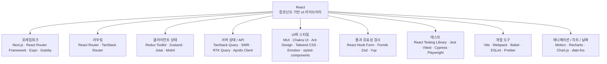
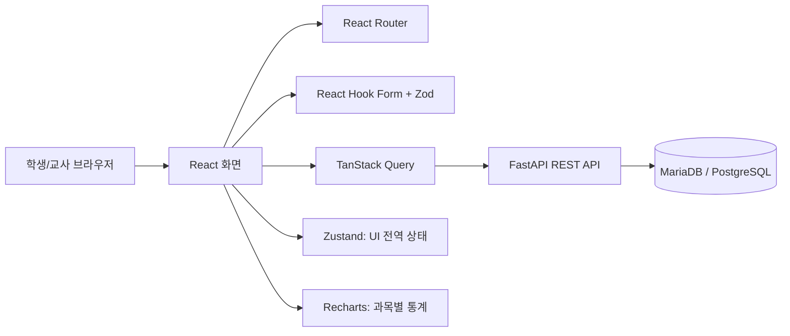

# React 생태계: 라이브러리와 프레임워크 체계적 정리

> 기준일: 2026-10-21  
> 대상: React 입문자, 비전공자 중심 풀스택 웹 개발 학습자  
> 목적: React 생태계의 도구를 **역할별로 구분**하고 프로젝트의 요구사항에 맞게 선택한다.

## 목차

- [0. 전체 구조 한눈에 보기](#0-전체-구조-한눈에-보기)
- [1. 메타 프레임워크와 앱 프레임워크](#1-메타-프레임워크와-앱-프레임워크)
- [2. 라우팅: URL과 페이지 이동](#2-라우팅-url과-페이지-이동)
- [3. 클라이언트 상태 관리](#3-클라이언트-상태-관리)
- [4. 서버 상태 및 데이터 패칭](#4-서버-상태-및-데이터-패칭)
- [5. UI 컴포넌트 및 스타일링](#5-ui-컴포넌트-및-스타일링)
- [6. 폼 처리와 유효성 검증](#6-폼-처리와-유효성-검증)
- [7. 테스트와 품질 관리](#7-테스트와-품질-관리)
- [8. 개발 도구](#8-개발-도구)
- [9. 애니메이션·차트·유틸리티](#9-애니메이션차트유틸리티)
- [10. 어떤 도구를 선택할까? — 실무 의사결정표](#10-어떤-도구를-선택할까--실무-의사결정표)
- [11. 권장 학습 순서](#11-권장-학습-순서)
- [12. 교육용 프로젝트 예시: 성적 관리 웹 서비스](#12-교육용-프로젝트-예시-성적-관리-웹-서비스)
- [13. 선택 시 주의사항](#13-선택-시-주의사항)
- [14. 공식 참고 자료](#14-공식-참고-자료)

---

## 0. 전체 구조 한눈에 보기



**기본 개념**
- **React**: UI를 컴포넌트 단위로 개발하는 라이브러리. 자체적으로 데이터베이스나 백엔드 API를 제공하지 않는다.
- **프레임워크**: 라우팅·렌더링·빌드 등 앱 전체 구조와 실행 방식을 함께 제공한다.
- **라이브러리**: 특정 문제(상태 관리, 입력 폼, 데이터 캐싱 등)를 해결하며 필요한 것만 조합해 사용한다.
- **개발 도구**: 코드 작성·빌드·검사·테스트를 지원하며 대부분 사용자 화면에는 직접 드러나지 않는다.

---

## 1. 메타 프레임워크와 앱 프레임워크

| 기술 | 핵심 역할 | 적합한 상황 | 참고 |
|---|---|---|---|
| **Next.js** | React 기반 웹 앱 프레임워크; App Router, 서버 렌더링, 정적 생성 등 | SEO, 콘텐츠 사이트, 풀스택 React 앱 | [공식](https://nextjs.org/docs) |
| **React Router (Framework Mode)** | 라우팅을 넘어 데이터 로딩·렌더링 등 앱 구조 지원 | 웹 표준 중심의 풀스택 React 개발 | [공식](https://reactrouter.com/) |
| **Remix (기존 React 기반 계보)** | 웹 표준 중심의 라우팅·데이터 로딩·액션 접근 | 기존 Remix 프로젝트 유지보수, 개념 학습 | 최신 React 기반 프레임워크 기능은 React Router v7 문서를 우선 참고 |
| **Gatsby** | 정적 콘텐츠 사이트 생성 중심 | 정적 사이트·콘텐츠 중심 프로젝트 | [공식](https://www.gatsbyjs.com/) |
| **Expo** | React Native 기반 앱 개발 및 배포 도구 체계 | Android/iOS 앱, 웹 동시 고려 | [공식](https://expo.dev/) |

> **현행화:** React 공식 문서는 신규 앱 시작 시 프레임워크 사용을 권장하며 Next.js App Router, React Router v7, Expo 등을 소개한다. React Router v7은 단순 라우팅 라이브러리뿐 아니라 **Framework Mode**도 제공한다. 기존 Remix 문서는 최신 프레임워크 기능에 React Router 문서 사용을 안내한다. Expo는 모바일 중심으로 별도 구분하는 것이 정확하다.

## 2. 라우팅: URL과 페이지 이동

| 기술 | 주요 기능 | 선택 기준 |
|---|---|---|
| **React Router** | URL 경로와 페이지 컴포넌트 매핑, 중첩 라우팅 | 범용적인 React 라우팅; 프레임워크 모드도 가능 |
| **TanStack Router** | 강한 타입 지원, 검색 파라미터 관리 | TypeScript와 복잡한 라우팅을 중시할 때 |

**예시:** `/products`는 목록 화면, `/products/10`은 상품 상세 화면을 보여준다.

> Next.js의 App Router와 React Router를 동시에 필수로 설치할 필요는 없다. 프레임워크가 제공하는 라우팅을 우선 사용한다.

## 3. 클라이언트 상태 관리

상태는 메뉴 열림 여부, 장바구니 항목, 선택된 탭, 로그인 UI 표시처럼 **브라우저 앱 내부에서 관리하는 데이터**를 말한다.

| 기술 | 특징 | 추천 상황 |
|---|---|---|
| **React 내장 useState / useReducer / Context** | 추가 의존성 없이 기본 상태 관리 | 처음 배우는 단계와 소규모 앱 |
| **Redux Toolkit** | 예측 가능한 상태 전이, 개발 도구, 체계적인 패턴 | 복잡한 전역 상태·대규모 팀 |
| **Zustand** | 간단한 Store API, 적은 설정 | 간결한 전역 상태 관리 |
| **Jotai** | 원자(atom) 단위 상태 조합 | 독립적이고 조합 가능한 상태가 많을 때 |
| **MobX** | 관찰 가능한 반응형 객체 기반 | 반응형 도메인 모델을 선호할 때 |
| **Recoil** | atom/selector 기반 상태 모델 | 기존 사용 프로젝트 이해 목적 |

> **중요:** Recoil 공식 GitHub 저장소는 **2025-01-01 보관(archived)** 처리되었다. 신규 프로젝트에서 우선 추천하지 않는다.

## 4. 서버 상태 및 데이터 패칭

서버 상태는 FastAPI나 데이터베이스를 통해 조회한 상품 목록, 학생 목록 같은 **서버 원본 데이터의 클라이언트 측 캐시**를 뜻한다.

| 기술 | 주요 기능 | 적합한 환경 |
|---|---|---|
| **TanStack Query** | 요청 상태, 캐싱, 무효화, 재요청, 동기화 | REST API 기반 일반 웹 서비스 |
| **SWR** | 가벼운 데이터 조회와 재검증 | 상대적으로 단순한 데이터 조회 |
| **RTK Query** | Redux Toolkit과 통합된 API 캐시 | Redux Toolkit 기반 프로젝트 |
| **Apollo Client** | GraphQL 쿼리 및 캐싱 | GraphQL API 사용 시 |

**혼동 방지:** Zustand·Redux Toolkit은 주로 *클라이언트 상태*, TanStack Query는 주로 *서버 상태*에 사용한다. 두 범주는 일부 겹치지만 목적이 다르다.

## 5. UI 컴포넌트 및 스타일링

| 기술 | 유형 | 특징 | 용도 |
|---|---|---|---|
| **MUI** | 컴포넌트 라이브러리 | Material Design 기반 | 일반 웹·업무 화면 |
| **Chakra UI** | 컴포넌트 라이브러리 | 접근성과 조합성 중시 | 신속한 UI 구성 |
| **Ant Design** | 컴포넌트 라이브러리 | 표·폼 등 업무용 컴포넌트 풍부 | 관리자 화면 |
| **Tailwind CSS** | CSS 유틸리티 프레임워크 | 유틸리티 클래스 중심 | 맞춤 디자인 |
| **styled-components** | CSS-in-JS | 컴포넌트와 스타일 결합 | 기존 CSS-in-JS 프로젝트 |
| **Emotion** | CSS-in-JS | 유연한 스타일 작성 방식 | CSS-in-JS가 필요한 경우 |

> UI 컴포넌트 라이브러리와 Tailwind CSS는 같은 범주의 도구가 아니다. 전자는 **미리 설계된 UI 요소**, 후자는 **스타일 작성 방법**을 제공한다.

## 6. 폼 처리와 유효성 검증

| 기술 | 역할 | 주요 사용 예 |
|---|---|---|
| **React Hook Form** | 입력값·폼 상태·오류 관리 | 회원가입, 로그인, 상품 등록 |
| **Formik** | 입력 폼 상태 관리 | 기존 Formik 기반 프로젝트 |
| **Zod** | 스키마 정의 및 데이터 검증 | TypeScript 친화적 입력 검증 |
| **Yup** | 스키마 기반 검증 | 폼 검증 규칙 작성 |

**예시 흐름:** 사용자가 회원가입 폼 입력 → React Hook Form으로 입력 상태 관리 → Zod로 형식 검증 → FastAPI에 POST 요청 → **서버에서 반드시 재검증**.

## 7. 테스트와 품질 관리

| 기술 | 분류 | 검사 대상 |
|---|---|---|
| **React Testing Library** | 컴포넌트 테스트 도구 | 화면에 표시되는 내용, 버튼·입력 상호작용 |
| **Jest** | 테스트 러너·도구 | 함수 단위·컴포넌트 테스트 |
| **Vitest** | 테스트 러너 | Vite 환경 중심의 빠른 테스트 |
| **Cypress** | E2E 테스트 | 실제 브라우저에서 사용자 시나리오 |
| **Playwright** | E2E/브라우저 자동화 | 여러 브라우저에서 사용자 흐름 검증 |

**추천 조합:** React Testing Library + Vitest로 컴포넌트 테스트, Playwright로 로그인·주문 등 핵심 사용자 흐름 테스트.

## 8. 개발 도구

| 기술 | 유형 | 하는 일 |
|---|---|---|
| **Vite** | 개발 서버·빌드 도구 | 빠른 로컬 개발과 배포용 빌드 |
| **Webpack** | 번들러 | JavaScript 등 자산을 배포 단위로 묶음 |
| **Babel** | 컴파일·변환 도구 | JavaScript 문법 변환 |
| **ESLint** | 정적 검사 도구 | 코드 문제·규칙 위반 탐지 |
| **Prettier** | 포매터 | 코드 서식을 일관되게 정리 |

> Vite를 쓴다고 항상 Webpack 또는 Babel을 별도로 설치해야 하는 것은 아니다. 선택한 프레임워크와 프로젝트 설정의 기본 도구를 먼저 확인한다.

## 9. 애니메이션·차트·유틸리티

| 기술 | 역할 | 사용 예 |
|---|---|---|
| **Motion (기존 Framer Motion 계열)** | UI 애니메이션 | 화면 전환, 카드 등장 효과 |
| **Recharts** | React 친화적 차트 컴포넌트 | 대시보드의 막대·선·원형 차트 |
| **Chart.js** | 범용 차트 라이브러리 | 통계 시각화; React 통합 래퍼 활용 가능 |
| **date-fns** | 날짜 계산·표시 | 날짜 형식, 기간 계산 |

## 10. 어떤 도구를 선택할까? — 실무 의사결정표

| 프로젝트 요구 | 우선 고려할 기술 | 선택 이유 |
|---|---|---|
| React 입문, SPA | React + Vite | 개념 학습과 개발 시작이 단순 |
| 여러 페이지로 이동 | React Router | URL 기반 화면 구성 |
| FastAPI REST API 연결 | fetch + TanStack Query(필요 시) | 서버 데이터 조회와 캐시 관리 |
| 장바구니 등 전역 상태 | Context → Zustand | 학습 단계에 따라 점진적 도입 |
| 복잡한 기업용 상태 | Redux Toolkit | 명확한 구조와 도구 생태계 |
| 입력 화면 다수 | React Hook Form + Zod | 입력 관리와 검증의 역할 분리 |
| 업무용 관리자 대시보드 | MUI 또는 Ant Design + Recharts | 표·폼·차트 구현 효율 |
| 브랜드 맞춤형 웹 UI | Tailwind CSS | 세밀한 스타일 구성 |
| SEO/SSR이 중요한 웹 서비스 | Next.js | 통합 렌더링 및 라우팅 기능 |
| Android/iOS 앱 | Expo + React Native | 모바일 앱 개발 체계 |

## 11. 권장 학습 순서

1. **React 기본:** JSX → 컴포넌트 → Props → State → 이벤트 → Hooks
2. **페이지 구성:** React Router로 목록·상세·로그인 페이지 연결
3. **입력 처리:** React Hook Form + Zod로 등록/수정 폼 작성
4. **API 연결:** fetch로 FastAPI 호출 → TanStack Query로 캐싱 개선
5. **상태 관리:** Context/useReducer를 익힌 후 Zustand 또는 Redux Toolkit 선택
6. **UI·테스트:** MUI/Tailwind CSS, React Testing Library, Vitest, Playwright
7. **프레임워크 확장:** 필요할 때 Next.js 또는 React Router Framework Mode 검토

> 추천 순서는 필수 설치 순서가 아니다. 작은 앱이라면 React 기본 + Router + fetch만으로도 충분하다.

## 12. 교육용 프로젝트 예시: 성적 관리 웹 서비스



**권장 기능 구분**
- React 컴포넌트: 학생 목록, 상세 화면, 성적 입력, 결과 표시
- React Router: `/students`, `/students/:id`, `/statistics` 등의 페이지 이동
- React Hook Form + Zod: 점수 0~100 범위 등 클라이언트 입력 검증
- TanStack Query: 학생 조회·추가·수정·삭제 요청 후 캐시 갱신
- Zustand: 필요할 때만 필터 조건·사이드바 등 클라이언트 공통 상태 관리
- FastAPI: 권한 확인, 입력 재검증, 총점·평균·학점 계산, CRUD
- MariaDB/PostgreSQL: 학생·성적 영속 저장
- Recharts: 과목별 평균과 분포 시각화
- Vitest/Playwright: 계산 결과 표시와 등록·수정·삭제 시나리오 검증

### 최소 설치 예시 (Vite 기반 JavaScript 학습용)

```bash
npm create vite@latest grade-app -- --template react
cd grade-app
npm install
npm install react-router @tanstack/react-query react-hook-form zod @hookform/resolvers
npm run dev
```

상태 관리, UI 키트, 차트, 테스트 도구는 **실제 필요할 때 추가**한다. 실습 과정에서는 백엔드(FastAPI)가 따로 실행될 때 API URL과 CORS 설정을 확인한다.

## 13. 선택 시 주의사항

- **모든 기술을 설치하지 않는다.** 표의 도구는 대부분 서로 다른 선택지 또는 대체재다.
- **React는 프론트엔드 UI 라이브러리**이며 FastAPI 같은 서버 프레임워크와 함께 사용할 수 있다.
- **프레임워크와 라우팅 라이브러리의 경계가 일부 겹친다.** React Router는 라이브러리 모드와 프레임워크 모드가 있다.
- **React 상태와 서버 상태를 구분**한다. 서버 데이터 동기화를 전역 상태 관리 하나로 모두 해결하려고 하지 않는다.
- **클라이언트 검증은 보안 경계가 아니다.** 인증·권한·입력 검증은 서버에서도 반드시 실행한다.
- **유지보수 상태를 확인**한다. 예: Recoil 저장소는 보관되었으므로 신규 학습의 기본 선택지로 삼지 않는다.

## 14. 공식 참고 자료

- [React 공식 문서 — React 앱 생성과 프레임워크](https://react.dev/learn/creating-a-react-app)
- [Next.js 공식 문서](https://nextjs.org/docs)
- [React Router 공식 문서](https://reactrouter.com/)
- [Remix 공식 문서 — React Router v7 안내](https://remix.run/docs/en/main)
- [Expo 공식 문서](https://docs.expo.dev/)
- [Redux Toolkit](https://redux-toolkit.js.org/)
- [Zustand](https://zustand.docs.pmnd.rs/)
- [TanStack Query](https://tanstack.com/query/latest)
- [React Hook Form](https://react-hook-form.com/)
- [Zod](https://zod.dev/)
- [Vite](https://vite.dev/)
- [Vitest](https://vitest.dev/)
- [Playwright](https://playwright.dev/)
- [Recoil GitHub — 보관 저장소](https://github.com/facebookexperimental/Recoil)

---

**요약:** React를 먼저 이해한 다음, 라우팅·폼·서버 데이터·상태 관리·UI·테스트 순서로 **문제가 생길 때 적절한 도구를 추가**하는 것이 가장 효율적인 접근이다.
