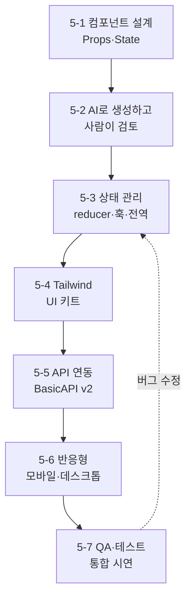

# AX UI 구현 & 프론트엔드 통합 — 56시간 강의교안

> 공통 사례: 관리자가 로그인해 회원을 조회·검색·추가·수정·삭제하는 **회원관리 대시보드(member-admin)**. 4단원에서 만든 FastAPI 백엔드(BasicAPI v2)에 React 화면을 붙인다. React 19, Vite, Tailwind CSS v4, Zustand 기준. 7일 동안 같은 프로젝트를 키워 가며 마지막 날 통합·QA까지 끝낸다.

## 전체 목차

| 단원 | 교안 링크 | 시간 | 핵심 산출물 |
|---|---|---:|---|
| 5-1 | [React 컴포넌트 설계 기초](05-01-component.md) | 8H | 컴포넌트 트리, 정적 회원 목록(Props·State) |
| 5-2 | [AI 활용 컴포넌트 생성 및 검토](05-02-ai-component.md) | 8H | AI 생성 MemberForm, 코드 리뷰 기록표 |
| 5-3 | [상태 관리 구현](05-03-state.md) | 8H | useReducer CRUD, 커스텀 훅, Context·Zustand 전역 상태 |
| 5-4 | [CSS 프레임워크 기반 스타일링](05-04-styling.md) | 8H | Tailwind 디자인 토큰, Button·Input·Modal UI 키트 |
| 5-5 | [API 연동 구현](05-05-api.md) | 8H | API 클라이언트, 로그인·CRUD·검색·페이징 연동 |
| 5-6 | [반응형 레이아웃 구현](05-06-responsive.md) | 8H | 모바일 카드·데스크톱 표, 반응형 사이드바 |
| 5-7 | [화면 QA 및 통합 실습](05-07-qa.md) | 8H | QA 체크리스트, 버그 리포트, 컴포넌트 테스트, 최종 시연 |
| 합계 | 이론·시연 21H + 실습 28H + 검토·평가 7H | **56H** | 백엔드와 연동된 반응형 회원관리 화면 |

## React 관련 기술 집합

[React 관련기술 보기](./React 관련기술.md)
---

## 학습 경로



## 7일 운영표

1교시 = 1시간. 휴게·점심 시간은 기관 시간표에 따른다. 매일 3H 이론·시연, 4H 실습, 1H 검토·평가(EXP 배움일기 포함)를 기본으로 한다.

| 일차 | 1~3교시 (이론·시연) | 4~7교시 (실습) | 8교시 (검토·평가) |
|---|---|---|---|
| 1일 | React 사고방식, JSX, 컴포넌트·Props·State | 화면 → 컴포넌트 트리, 정적 회원 목록·검색 | 컴포넌트 트리 발표, 배움일기 |
| 2일 | AI 코딩 도구, 프롬프트 설계, 리뷰 기준 | MemberForm 생성 → 리뷰 → 수정 반복 | AI 리뷰 기록표 공유 |
| 3일 | 불변성, useReducer, useEffect, 커스텀 훅, Context | CRUD reducer, Toast Context, Zustand 인증 스토어 | 상태 위치 설명 평가 |
| 4일 | Tailwind v4, 디자인 토큰, 컴포넌트 변형 | UI 키트 제작, 회원 화면 스타일링 | 디자인 리뷰 |
| 5일 | fetch·비동기, 프록시·CORS, 인증 헤더, 오류 처리 | 로그인·목록·검색·페이징·CUD 연동 | 연동 시나리오 시연 |
| 6일 | 모바일 퍼스트, 미디어 쿼리, Flex·Grid | 표↔카드 전환, 사이드바, 모달 반응형 | 3개 해상도 점검 |
| 7일 | QA 관점, 접근성, Vitest·Testing Library | 교차 QA, 버그 수정, 테스트, 빌드 | 최종 시연·평가 |

## 완성 프로젝트 구조

```text
member-admin/
├─ vite.config.js            # React·Tailwind 플러그인, /api 프록시, 테스트 환경
├─ src/
│  ├─ main.jsx               # ToastProvider로 App 감싸기
│  ├─ App.jsx                # 로그인 여부로 화면 분기
│  ├─ index.css              # @import "tailwindcss" + @theme 토큰
│  ├─ api/                   # client.js(공통 fetch), memberApi.js(엔드포인트)
│  ├─ stores/authStore.js    # Zustand 인증 상태
│  ├─ context/               # ToastContext.js, ToastProvider.jsx
│  ├─ hooks/                 # useDebounce.js, useMembers.js
│  ├─ components/ui/         # Button, Input, Modal, StatusMessage
│  ├─ components/layout/     # AppLayout (반응형 사이드바)
│  ├─ features/auth/         # LoginPage
│  └─ features/members/      # MembersPage, MemberList, MemberCard, MemberForm,
│                            # SearchBar, Pagination, memberModel.js, *.test.jsx
```

```mermaid
flowchart TD
 App --> Login[LoginPage]
 App --> Layout[AppLayout]
 Layout --> Page[MembersPage]
 Page --> Search[SearchBar]
 Page --> List[MemberList]
 List --> Card[MemberCard<br/>모바일]
 List --> Table[표 행<br/>데스크톱]
 Page --> Pager[Pagination]
 Page --> Modal --> Form[MemberForm]
 Page -.useMembers.-> API[(BasicAPI v2)]
 Login -.memberApi.login.-> API
```

## 실습 준비

Windows 11 PowerShell 기준. Node.js 20.19 이상(권장: 22 LTS 또는 24)을 사용한다.

```powershell
node -v
npm create vite@latest member-admin -- --template react
cd member-admin
npm install
npm install tailwindcss @tailwindcss/vite zustand
npm install -D vitest jsdom @testing-library/react @testing-library/user-event @testing-library/jest-dom
npm run dev
```

- **작업 폴더 경로를 짧게 둔다** (예: `D:\work\member-admin`). Windows의 260자 경로 제한 때문에 깊은 폴더에서 `vite build`가 `ERR_PACKAGE_IMPORT_NOT_DEFINED`로 실패하는 사례를 교안 검증 중 확인했다.
- 백엔드는 `BasicAPI\BasicAPI_ver2\server`를 그대로 쓴다. 5일차 전까지는 정적 데이터로 진행하므로 서버 없이도 실습할 수 있다.
- 서버 `.venv`가 다른 PC에서 만든 것이면 `No Python at ...` 오류가 난다. `.venv`를 지우고 다시 만든다(README 서버 실행 절차).
- 최신 `create-vite` 템플릿은 ESLint 대신 **oxlint**(`npm run lint`)를 포함한다. 수업 PC의 템플릿 구성이 다르면 `package.json`의 `lint` 스크립트를 기준으로 안내한다.
- 브라우저 확장 **React Developer Tools**를 설치한다.
- AI 코딩 도구(Claude Code, GitHub Copilot, Cursor 등)는 기관 정책에 맞는 것 하나를 정해 모두 같은 도구로 실습한다.

## 매일 반복하는 수업 리듬

| 순서 | 활동 | 목적 |
|---|---|---|
| 1 | 전날 코드 3분 리뷰(무작위 2명) | 복습과 실수 공유 |
| 2 | 개념 → 강사 라이브 코딩 | 손으로 따라 치며 구조 이해 |
| 3 | **직접 작성 → AI 결과와 비교 → 차이 설명** | AI 의존 대신 판단력 훈련 |
| 4 | 페어 실습(드라이버·내비게이터 30분 교대) | 설명하면서 이해 확인 |
| 5 | 커밋 + EXP 배움일기 | 하루 산출물 고정 |

AI 사용은 단계적으로 연다. 1일차는 설명 요청만, 2일차부터 생성 허용, 매번 **AI 사용 기록**(요청 프롬프트, 받은 코드에서 고친 점)을 커밋 메시지나 배움일기에 남긴다.

## 종합 과제: 회원관리 대시보드

1. 화면을 컴포넌트로 나누고 Props·State 위치를 설명한다.
2. 폼 컴포넌트 하나 이상을 AI로 생성하고 리뷰 기록표로 수정 근거를 남긴다.
3. 전역 상태(인증·알림)와 지역 상태(폼·모달)를 구분해 구현한다.
4. Tailwind 토큰과 공통 UI 컴포넌트로 일관된 화면을 만든다.
5. BasicAPI v2와 로그인·목록·검색·페이징·추가·수정·삭제를 연동하고 로딩·빈 상태·오류를 표시한다.
6. 375px·768px·1280px에서 가로 스크롤 없이 동작한다.
7. QA 체크리스트로 점검하고 테스트 2개 이상을 통과시킨 뒤 `npm run build`로 빌드한다.

| 평가 항목 | 배점 | 통과 근거 |
|---|---:|---|
| 컴포넌트 설계 | 15 | 책임 분리, Props 이름·흐름이 명확함 |
| AI 활용과 검토 | 15 | 프롬프트·리뷰 기록·수정 근거가 있음 |
| 상태 관리 | 15 | 상태 위치가 적절하고 불변성 유지 |
| 스타일·일관성 | 10 | 토큰·공통 컴포넌트 사용, 포커스 표시 |
| API 연동 | 20 | CRUD·인증·오류·로딩 처리, 401 대응 |
| 반응형 | 10 | 3개 해상도에서 레이아웃 유지 |
| QA·테스트 | 15 | 체크리스트, 버그 리포트, 테스트 통과, 빌드 성공 |

## 참고 문서

검토 기준일: 2026-10-15. 특정 패키지의 최신 버전을 전제하지 않는다. 설치 후 `package-lock.json`으로 버전을 고정한다.

- [React 공식 문서 — Thinking in React](https://react.dev/learn/thinking-in-react)
- [React — 상태 관리](https://react.dev/learn/managing-state), [Effect가 필요 없을 수도 있다](https://react.dev/learn/you-might-not-need-an-effect)
- [Vite 시작하기](https://vite.dev/guide/), [서버 프록시](https://vite.dev/config/server-options#server-proxy)
- [Tailwind CSS — Vite 설치](https://tailwindcss.com/docs/installation/using-vite), [테마 변수](https://tailwindcss.com/docs/theme), [반응형 디자인](https://tailwindcss.com/docs/responsive-design)
- [Zustand](https://zustand.docs.pmnd.rs/)
- [MDN — Fetch API](https://developer.mozilla.org/ko/docs/Web/API/Fetch_API), [AbortController](https://developer.mozilla.org/ko/docs/Web/API/AbortController)
- [Testing Library — 쿼리 우선순위](https://testing-library.com/docs/queries/about#priority), [Vitest](https://vitest.dev/)
- [WCAG 2.2 요약(W3C)](https://www.w3.org/WAI/standards-guidelines/wcag/)

## 예제 검증 범위

교안 작성 시 Node 24.14, React 19.2, Vite 8.3, Tailwind CSS 4.3, Zustand 5.0, Vitest 5.0, FastAPI 0.116 환경에서 완성 예제를 확인했다. 이 버전은 검증 기록이며 필수 고정 버전이 아니다. 완성 코드는 [member-admin-final](../member-admin-final/) 폴더에 있다.

| 검증 | 결과 |
|---|---|
| `npm run build` (프로덕션 빌드) | 통과 |
| `npx vitest run` (MemberForm·validateMember·Pagination 4개) | 통과 |
| `npm run lint` (oxlint) | 경고·오류 없음 |
| BasicAPI v2 서버와 로그인 → 목록 → 회원 추가 → 검색 | 통과 |
| 375px 화면: 카드 목록 표시, 표 숨김, 가로 스크롤 없음, 메뉴 버튼 표시 | 통과 |
| 일차별 중간 단계 코드(1~4일차 정적 데이터 버전) | 교안 코드로 제공, 개별 빌드는 수업 중 수행 |
| 실제 모바일 기기·스크린리더 점검 | 수업 환경에서 수행할 실습으로 제공 |
