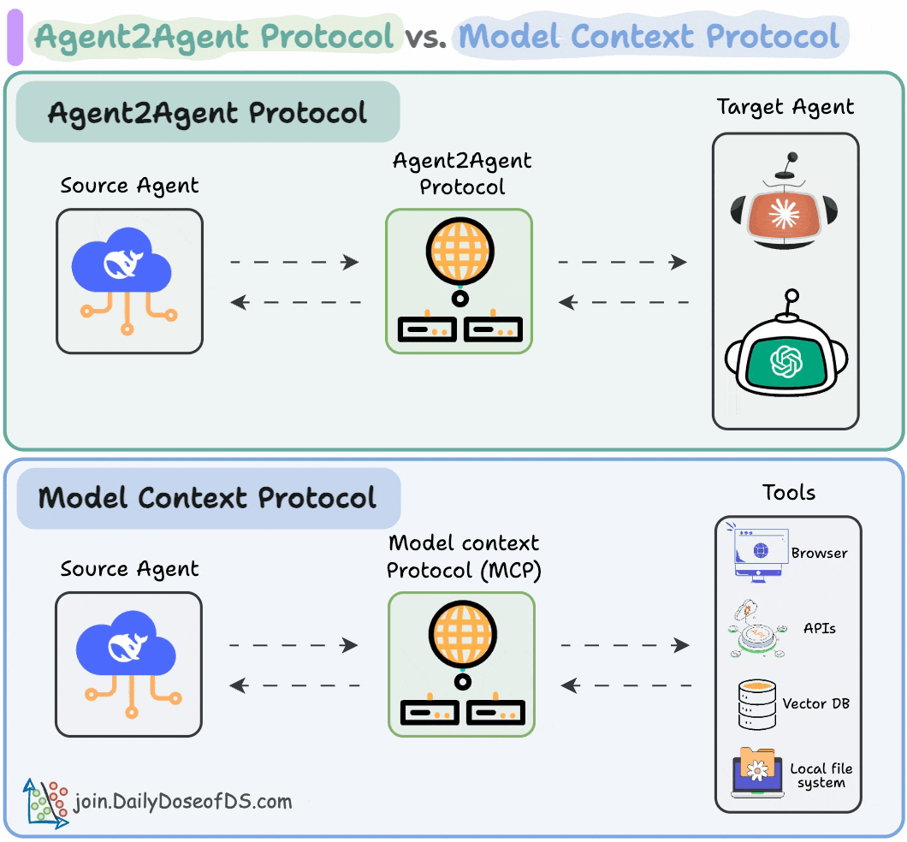

# Agent 구조  




# Agent Card  


# Agent Card 구성요소
| 항목 | 설명 | 예시 |
| :--- | :--- | :--- |
| 에이전트 정체성 | 이름, 설명, 버전 정보 | `"name": "Travel Booking Agent"`,<br>`"description": "항공권 및 호텔 예약 전문 에이전트"` |
| 서비스 엔드포인트 | 에이전트와 통신할 수 있는 URL | `"url": "https://api.travel-agent.com/a2a"` |
| 능력(Capabilities) | 스트리밍, 푸시 알림 지원 여부 등 | `"streaming": true, "pushNotifications": true` |
| 스킬(Skills) | 수행 가능한 구체적인 작업 목록 | `"id": "flight-search", "id": "hotel-booking"` |
| 인증 요구사항 | 지원하는 보안 방식 | `"type": "oauth2", "type": "apiKey"` |
| 지원 모달리티 | 처리 가능한 데이터 타입 | `"inputModes": ["text", "file"]`,<br>`"outputModes": ["text", "file"]` |

# Agent Card Json format
```json
{
  "name": "Travel Booking Agent",
  "description": "항공권 및 호텔 예약 전문 에이전트",
  "version": "1.0.0",
  "url": "https://api.travel-agent.com/a2a",
  "capabilities": {
    "streaming": true,
    "pushNotifications": true
  },
  "defaultInputModes": ["text", "file"],
  "defaultOutputModes": ["text", "file"],
  "authentication": {
    "schemes": ["oauth2", "apiKey"]
  },
  "skills": [
    {
      "id": "flight-search",
      "name": "항공권 검색",
      "description": "출발지, 도착지, 일정에 맞는 항공편을 조회합니다.",
      "inputModes": ["text", "file"],
      "outputModes": ["text", "file"]
    },
    {
      "id": "hotel-booking",
      "name": "호텔 예약",
      "description": "조건에 맞는 숙소를 검색하고 예약을 진행합니다.",
      "inputModes": ["text", "file"],
      "outputModes": ["text", "file"]
    }
  ]
}
```
