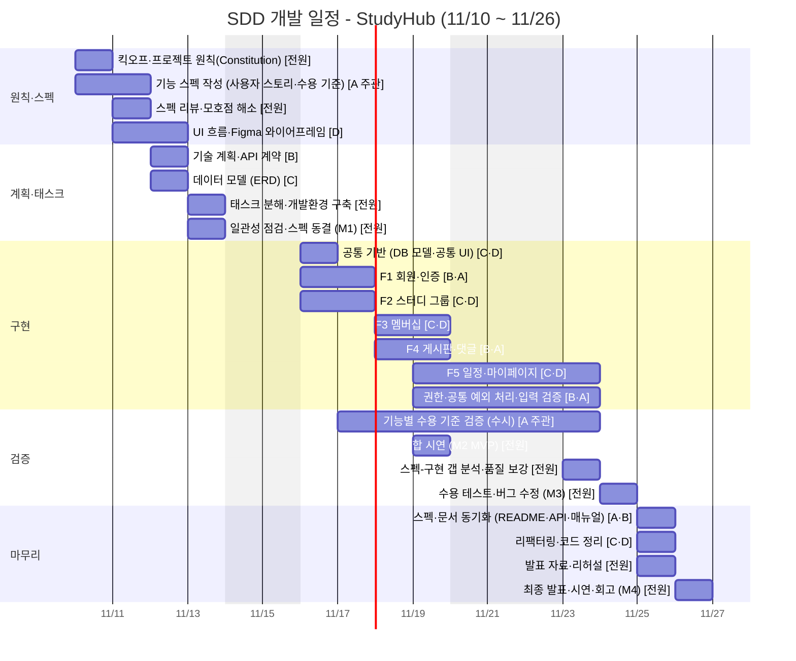

# 2차 프로젝트 SDD 개발 일정 B — StudyHub(주제 선정형) 초안

- 기간: 2026-11-10(화) ~ 2026-11-26(목), 훈련일 12일 · 92시간 (11/20 훈련 없음, 11/26은 오전 4시간)
- 팀 구성: 4명, AI 코딩 도구와 함께 개발
- 개발 방법론: SDD(Spec-Driven Development, 스펙 주도 개발)
- 기술스택: React · Tailwind CSS / FastAPI · SQLAlchemy · PostgreSQL · JWT/OAuth2 · Postman · Figma
- 범위 제외: LangChain·LLM·RAG(12/8~), CI/CD·E2E 테스트 자동화(11/30~) — 이후 과목

## 1. 프로젝트 주제: StudyHub — 스터디 그룹 모집·운영 서비스

스터디 그룹을 만들고, 가입 신청을 받고, 게시판과 일정으로 운영하는 웹 서비스입니다. 인증·CRUD·권한·N:M 관계가 모두 들어 있어 스펙 단위로 나누기 쉽고, 스타터킷으로 재사용하기 좋습니다.

주요 기능

- 회원가입·로그인 (JWT, OAuth2 Password Flow)
- 스터디 그룹 생성·조회·수정·삭제, 검색·페이지네이션
- 멤버십: 가입 신청·승인·거절·탈퇴, 그룹장 권한
- 그룹 게시판: 게시글·댓글
- 그룹 일정, 마이페이지(내 그룹·내 글)

주요 테이블: USERS, STUDY_GROUPS, MEMBERSHIPS, POSTS, COMMENTS, SCHEDULES

### 기능 단위(스펙 단위)

| 코드 | 기능 | 담당(백·프론트) | 사용자 스토리 | 수용 기준 예시 |
|---|---|---|---|---|
| F1 | 회원·인증 | B·A | 사용자는 가입·로그인하여 자신의 스터디 활동에 접근한다 | 잘못된 비밀번호로 로그인하면 401과 오류 메시지를 받는다 |
| F2 | 스터디 그룹 | C·D | 사용자는 스터디 그룹을 만들고 목록에서 검색해 찾는다 | 그룹장이 아닌 사용자가 그룹을 수정하면 403을 받는다 |
| F3 | 멤버십 | C·D | 사용자는 그룹에 가입을 신청하고, 그룹장은 승인하거나 거절한다 | 이미 신청한 그룹에 다시 신청하면 409를 받는다 |
| F4 | 게시판·댓글 | B·A | 그룹 멤버는 게시글과 댓글을 작성한다 | 멤버가 아닌 사용자가 글을 쓰면 403을 받는다 |
| F5 | 일정·마이페이지 | C·D | 멤버는 그룹 일정을 확인하고, 내 그룹과 내 글을 모아 본다 | 종료 시각이 시작 시각보다 빠른 일정은 422로 거부된다 |

## 2. SDD 진행 방식

| 단계 | 영문 | 하는 일 | 산출물 |
|---|---|---|---|
| 1. 원칙 | Constitution | 코드 품질·보안·테스트·AI 활용 기준 합의 | constitution.md |
| 2. 스펙 | Specify | 무엇을·왜 만드는지 정의. 사용자 스토리와 수용 기준 작성(기술 결정 제외) | spec.md (기능별) |
| 3. 계획 | Plan | 어떻게 만들지 결정. 아키텍처, 데이터 모델, API 계약 | plan.md, data-model.md, api-contract.md |
| 4. 태스크 | Tasks | 계획을 작은 작업으로 분해. ID·담당·선후관계·완료 조건 | tasks.md (기능별) |
| 5. 구현 | Implement | 태스크 단위로 AI와 구현, 사람이 리뷰 | 소스 코드, PR, 개발 로그 |
| 6. 검증 | Verify | 스펙의 수용 기준으로 완료 여부 판정 | verify.md (수용 기준 검증표) |

### 문서 구조

```
docs/
├─ constitution.md        # 프로젝트 원칙
├─ plan.md                # 아키텍처·기술 계획
├─ data-model.md          # ERD·테이블 정의
├─ api-contract.md        # API 계약(엔드포인트·요청/응답·오류)
└─ specs/
   ├─ F1-auth/            # 기능 단위 폴더
   │  ├─ spec.md          # 사용자 스토리·수용 기준
   │  ├─ tasks.md         # 태스크 목록(체크박스)
   │  └─ verify.md        # 수용 기준 검증표
   ├─ F2-.../
   └─ CHANGELOG.md        # 스펙 변경 이력
```

### SDD·AI 협업 규칙

- 스펙이 기준이다. 요구가 바뀌면 코드보다 스펙을 먼저 고치고 변경 이력을 남긴다
- AI에게 구현을 맡길 때는 해당 기능의 spec·plan·tasks를 컨텍스트로 준다
- 모든 PR에는 태스크 ID를 적고, AI가 만든 코드는 작성자가 설명할 수 있어야 병합한다
- '완료'의 정의는 수용 기준 통과다. 화면이 보인다고 완료가 아니다
- 비밀번호·토큰·개인정보는 프롬프트에 넣지 않는다
- 매일 09:00 스탠드업(15분), 17:30 병합·tasks.md 갱신·일일 로그 정리

## 3. 팀원 역할 분담

| 팀원 | 역할 | 담당 업무 | AI 활용 방식 |
|---|---|---|---|
| A | 스펙 오너 · PM/QA (프론트 보조) | 스펙 총괄·변경 이력 관리, 수용 기준 검증 주관, 일정·이슈 관리, F1·F4 화면 | 스펙 초안·모호점 질문·테스트 케이스 생성 → 팀 검토 후 확정 |
| B | 백엔드 리드 (계획·인증) | 기술 계획(plan)·API 계약 책임, F1·F4 API, 권한·예외 처리 | 스펙을 입력으로 계획·라우터 초안 생성, 보안 리뷰 → 직접 읽고 검증 |
| C | 백엔드 · 데이터 | 데이터 모델 책임, SQLAlchemy 모델, F2·F3·F5 API, 쿼리 최적화 | 모델·CRUD 태스크 구현, 스펙-구현 불일치 점검 → 결과 검증 |
| D | 프론트엔드 리드 | UI 스펙·Figma, React·Tailwind 공통 구조, F2·F3·F5 화면, 반응형 | 컴포넌트 태스크 구현, 반응형·접근성 점검 → 코드 리뷰 후 병합 |

## 4. 간트차트



### 일정표 (표 형식)

| 단계 | 작업 | 담당 | 11/10 | 11/11 | 11/12 | 11/13 | 11/16 | 11/17 | 11/18 | 11/19 | 11/23 | 11/24 | 11/25 | 11/26 |
|---|---|---|:-:|:-:|:-:|:-:|:-:|:-:|:-:|:-:|:-:|:-:|:-:|:-:|
| 원칙·스펙 | 킥오프·프로젝트 원칙(Constitution) | 전원 | ■ |  |  |  |  |  |  |  |  |  |  |  |
| 원칙·스펙 | 기능 스펙 작성 (사용자 스토리·수용 기준) | A 주관 | ■ | ■ |  |  |  |  |  |  |  |  |  |  |
| 원칙·스펙 | 스펙 리뷰·모호점 해소 | 전원 |  | ■ |  |  |  |  |  |  |  |  |  |  |
| 원칙·스펙 | UI 흐름·Figma 와이어프레임 | D |  | ■ | ■ |  |  |  |  |  |  |  |  |  |
| 계획·태스크 | 기술 계획·API 계약 | B |  |  | ■ |  |  |  |  |  |  |  |  |  |
| 계획·태스크 | 데이터 모델 (ERD) | C |  |  | ■ |  |  |  |  |  |  |  |  |  |
| 계획·태스크 | 태스크 분해·개발환경 구축 | 전원 |  |  |  | ■ |  |  |  |  |  |  |  |  |
| 계획·태스크 | 일관성 점검·스펙 동결 (M1) | 전원 |  |  |  | ■ |  |  |  |  |  |  |  |  |
| 구현 | 공통 기반 (DB 모델·공통 UI) | C·D |  |  |  |  | ■ |  |  |  |  |  |  |  |
| 구현 | F1 회원·인증 | B·A |  |  |  |  | ■ | ■ |  |  |  |  |  |  |
| 구현 | F2 스터디 그룹 | C·D |  |  |  |  | ■ | ■ |  |  |  |  |  |  |
| 구현 | F3 멤버십 | C·D |  |  |  |  |  |  | ■ | ■ |  |  |  |  |
| 구현 | F4 게시판·댓글 | B·A |  |  |  |  |  |  | ■ | ■ |  |  |  |  |
| 구현 | F5 일정·마이페이지 | C·D |  |  |  |  |  |  |  | ■ | ■ |  |  |  |
| 구현 | 권한·공통 예외 처리·입력 검증 | B·A |  |  |  |  |  |  |  | ■ | ■ |  |  |  |
| 검증 | 기능별 수용 기준 검증 (수시) | A 주관 |  |  |  |  |  | ■ | ■ | ■ | ■ |  |  |  |
| 검증 | 1차 통합 시연 (M2 MVP) | 전원 |  |  |  |  |  |  |  | ■ |  |  |  |  |
| 검증 | 스펙-구현 갭 분석·품질 보강 | 전원 |  |  |  |  |  |  |  |  | ■ |  |  |  |
| 검증 | 수용 테스트·버그 수정 (M3) | 전원 |  |  |  |  |  |  |  |  |  | ■ |  |  |
| 마무리 | 스펙·문서 동기화 (README·API·매뉴얼) | A·B |  |  |  |  |  |  |  |  |  |  | ■ |  |
| 마무리 | 리팩터링·코드 정리 | C·D |  |  |  |  |  |  |  |  |  |  | ■ |  |
| 마무리 | 발표 자료·리허설 | 전원 |  |  |  |  |  |  |  |  |  |  | ■ |  |
| 마무리 | 최종 발표·시연·회고 (M4) | 전원 |  |  |  |  |  |  |  |  |  |  |  | ■ |

### 마일스톤

| 마일스톤 | 일자 | 기준 |
|---|---|---|
| M1 스펙 기준선 | 11/13(금) | spec·plan·tasks 일관성 점검 통과, 스펙 v1.0 동결 |
| M2 MVP | 11/19(목) | F1~F4 수용 기준 통과, 1차 통합 시연 |
| M3 기능 동결 | 11/24(화) | 전체 수용 테스트 통과, 이후 버그 수정만 |
| M4 최종 발표 | 11/26(목) | 발표·시연·회고, v1.0 태그 |

## 5. 일별 계획

### Day 1 · 11/10(화) — 프로젝트 원칙·범위

- **목표**: SDD 진행 방식과 프로젝트 원칙을 합의하고 범위를 확정한다
- **수행 내용**
  - 전원: 킥오프, StudyHub 범위(MVP) 확정, SDD 워크플로 합의, 프로젝트 원칙(Constitution) 작성
  - A: 사용자·문제 정의, 사용자 스토리 목록 초안
  - B·C: 기술 제약 정리(스택, 범위 제외 항목)
  - D: 주요 화면 목록, 참고 UI 조사
- **AI 활용**: 원칙 문서 초안, 사용자 스토리 후보 도출
- **산출물**: constitution.md, 프로젝트 개요서, 사용자 스토리 목록, 역할 분담표

### Day 2 · 11/11(수) — 기능 스펙 작성 (Specify)

- **목표**: 무엇을·왜 만드는지 기능 스펙으로 확정한다. 기술 결정은 아직 하지 않는다
- **수행 내용**
  - A: 스펙 작성 총괄, 수용 기준(Given-When-Then) 형식 통일, 범위 밖 항목 명시
  - B: F1 회원·인증, F4 게시판·댓글 스펙 작성
  - C: F2 스터디 그룹, F3 멤버십, F5 일정·마이페이지 스펙 작성
  - D: 유저 플로우, Figma 와이어프레임 착수
  - 전원: 스펙 리뷰, 모호한 항목을 질문 목록으로 만들어 해소
- **AI 활용**: 스펙 초안 생성, 모호점·누락 시나리오 질문 생성
- **산출물**: spec.md (F1~F5), 수용 기준 목록, 모호점 해소 기록, 유저 플로우

### Day 3 · 11/12(목) — 기술 계획 (Plan)

- **목표**: 스펙을 어떻게 구현할지 기술 계획으로 옮긴다
- **수행 내용**
  - A: 스펙↔계획 추적표 작성(모든 수용 기준이 계획에 반영됐는지 확인)
  - B: 아키텍처, API 계약(엔드포인트·요청/응답·오류), 인증 방식
  - C: 데이터 모델(ERD, 테이블 정의, 제약조건)
  - D: 와이어프레임 완성, 컴포넌트 구조·라우팅 계획
- **AI 활용**: 스펙을 입력으로 계획 초안 생성, 계획이 스펙 범위를 벗어나는지 점검
- **산출물**: plan.md, data-model.md (ERD), api-contract.md, Figma 와이어프레임, 스펙↔계획 추적표

### Day 4 · 11/13(금) — 태스크 분해·스펙 동결 (Tasks)

- **목표**: 계획을 실행 가능한 태스크로 나누고 스펙 기준선을 확정한다 (M1)
- **수행 내용**
  - 전원: 기능별 tasks.md 작성(태스크 ID·담당·선후관계·완료 조건), spec-plan-tasks 일관성 점검, 스펙 v1.0 동결
  - A: 이슈 보드에 태스크 등록, Git·PR 규칙(PR에 태스크 ID 표기)
  - B: FastAPI 프로젝트 구조, 설정·환경변수
  - C: PostgreSQL 준비, SQLAlchemy 연결
  - D: React 프로젝트 생성, Tailwind CSS 설정
- **AI 활용**: 태스크 분해 초안, 스펙에는 있는데 태스크에 없는 항목 찾기
- **산출물**: tasks.md (F1~F5), 일관성 점검 결과, 스펙 v1.0 (기준선), Git·PR 규칙, 저장소 초기 세팅

### Day 5 · 11/16(월) — 구현 1 — 기반, F1·F2 착수

- **목표**: 태스크 단위 구현을 시작하고 공통 기반을 만든다
- **수행 내용**
  - A: F1 회원·인증 화면(폼 검증)
  - B: F1 회원·인증 API(회원가입·로그인·비밀번호 해시·JWT 발급)
  - C: SQLAlchemy 모델 전체, F2 스터디 그룹 API 착수
  - D: 공통 레이아웃·컴포넌트, F2 스터디 그룹 화면 착수
- **AI 활용**: spec·plan·tasks를 컨텍스트로 주고 태스크 단위 구현 → PR 리뷰
- **산출물**: tasks.md 진행 현황, DB 스키마 스크립트, 일일 개발 로그 (이하 매일)

### Day 6 · 11/17(화) — 구현 2 — F1·F2 완료·검증

- **목표**: 첫 두 기능을 수용 기준으로 검증해 '완료' 처리한다
- **수행 내용**
  - A: F1 회원·인증 연동(토큰 저장·보호 라우트), F1 수용 기준 검증
  - B: F1 회원·인증 완료(OAuth2 Password Flow, 토큰 검증 의존성)
  - C: F2 스터디 그룹 API 완료, Postman 검증
  - D: F2 스터디 그룹 화면·API 연동
- **AI 활용**: 수용 기준에서 테스트 케이스 도출, 인증 코드 보안 리뷰
- **산출물**: verify.md (F1·F2), Postman 컬렉션 (F1·F2), 스펙 변경 이력 (발생 시)

### Day 7 · 11/18(수) — 구현 3 — F3·F4

- **목표**: 다음 두 기능을 병렬로 구현한다
- **수행 내용**
  - A: F4 게시판·댓글 화면, F2 검증 결과 확인
  - B: F4 게시판·댓글 API
  - C: F3 멤버십 API
  - D: F3 멤버십 화면
- **AI 활용**: 반복 CRUD 태스크 구현, 엣지 케이스 도출
- **산출물**: tasks.md 진행 현황, Postman 컬렉션 (F3·F4), 스펙 변경 이력

### Day 8 · 11/19(목) — 구현 4 — MVP·1차 통합

- **목표**: F1~F4를 끝내고 사용자 스토리 순서대로 통합 시연한다 (M2)
- **수행 내용**
  - A: F4 게시판·댓글 연동·검증, 통합 시연 주관
  - B: F4 게시판·댓글 완료, 권한 검증·공통 예외 처리
  - C: F3 멤버십 완료·검증, F5 일정·마이페이지 API 착수
  - D: F3 멤버십 연동, F5 일정·마이페이지 화면 착수
  - 전원: 1차 통합 시연, 이슈 정리
- **AI 활용**: 에러 원인 분석 보조, 미충족 수용 기준 점검
- **산출물**: verify.md (F3·F4), 중간 점검 보고서, 통합 이슈 목록

### Day 9 · 11/23(월) — 갭 분석·품질 보강

- **목표**: 스펙과 구현의 차이를 찾아 메우고 사용성·성능을 다듬는다
- **수행 내용**
  - A: 스펙-구현 갭 분석(미충족 수용 기준 목록), 에러·로딩·빈 화면 처리
  - B: 통합 이슈 수정, 입력 검증 강화
  - C: F5 일정·마이페이지 완료·검증, 쿼리 최적화(N+1, 인덱스)
  - D: F5 일정·마이페이지 연동, 반응형(모바일) 적용
- **AI 활용**: 스펙과 코드를 비교해 미구현·불일치 항목 찾기
- **산출물**: 갭 분석 보고서, verify.md (F5), 쿼리 최적화 기록

### Day 10 · 11/24(화) — 수용 테스트·기능 동결

- **목표**: 스펙의 수용 기준을 전수 검증하고 기능을 동결한다 (M3)
- **수행 내용**
  - A: 전체 수용 기준 전수 검증 주관, 버그 등록·재검증
  - B: 보안 점검(인증·권한 우회, 입력값), 버그 수정
  - C: 데이터 정합성 점검, 버그 수정
  - D: 화면 버그 수정, 브라우저·해상도 점검
- **AI 활용**: 경계값·예외 시나리오 추가 생성
- **산출물**: 수용 테스트 결과서, 버그 리포트, 보안 점검 체크리스트

### Day 11 · 11/25(수) — 스펙-문서 동기화·발표 준비

- **목표**: 스펙과 구현이 일치하도록 문서를 마무리하고 발표를 준비한다
- **수행 내용**
  - A: 스펙 최종본(변경 이력 반영), 사용자 매뉴얼, 발표 자료
  - B: README(설치·실행 가이드), API 문서 최종(Swagger)
  - C: 리팩터링, data-model.md 최종화
  - D: 프론트 코드 정리, 시연 시나리오·화면 캡처
- **AI 활용**: README·매뉴얼 초안 생성, 프롬프트 로그를 회고 자료로 정리
- **산출물**: 스펙 최종본, README (설치·실행 가이드), API 문서 최종본, 사용자 매뉴얼, 발표 자료, SDD·AI 활용 회고서

### Day 12 · 11/26(목) — 최종 발표 (오전 4시간)

- **목표**: 결과물을 시연하고 SDD 적용 경험을 회고한다 (M4)
- **수행 내용**
  - 전원: 최종 발표·시연(스펙 → 구현 → 검증 흐름 중심), 질의응답
  - 전원: KPT 회고, 저장소 v1.0 태그
  - ※ 오후는 특강·세미나
- **AI 활용**: —
- **산출물**: 최종 보고서, 회고록 (KPT), 최종 소스 (v1.0 태그)

## 6. 산출물 목록

| SDD 단계 | 문서 | 주 담당 | 완료일 |
|---|---|---|---|
| 원칙 | constitution.md, 프로젝트 개요서, 역할 분담표 | 전원 | 11/10 |
| 스펙 | spec.md(F1~F5), 수용 기준 목록, 모호점 해소 기록, 유저 플로우 | A | 11/11 |
| 계획 | plan.md, data-model.md(ERD), api-contract.md, Figma 와이어프레임, 추적표 | B·C·D | 11/12 |
| 태스크 | tasks.md(F1~F5), 일관성 점검 결과, Git·PR 규칙 | 전원 | 11/13 |
| 구현 | 일일 개발 로그(프롬프트 기록), Postman 컬렉션, 스펙 변경 이력 | 전원 | 매일 |
| 검증 | verify.md(기능별), 갭 분석 보고서, 수용 테스트 결과서, 버그 리포트 | A | 11/24 |
| 마무리 | 스펙 최종본, README, API 문서, 사용자 매뉴얼, SDD·AI 활용 회고서 | A·B | 11/25 |
| 마무리 | 발표 자료, 최종 보고서, 회고록(KPT) | 전원 | 11/26 |

> 초안입니다. 팀 상황에 맞게 기능 범위와 담당을 조정하세요.
