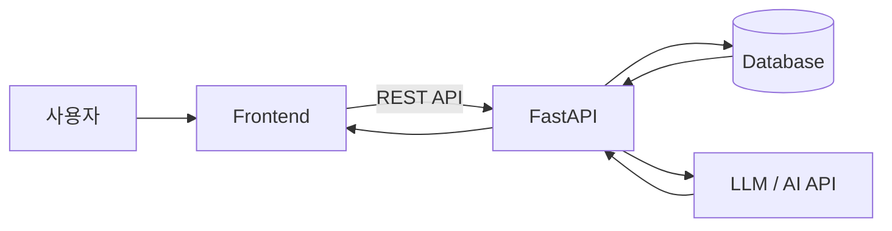

### 권장 슬라이드 구성

| 순서 | 슬라이드 | 핵심 내용 |
|---|---|---|
| 1 | 프로젝트 소개 | 프로젝트명, 팀명, 팀원, 한 줄 소개 |
| 2 | 프로젝트 배경 / 문제 정의 | 왜 이 프로젝트를 하는가, 해결하려는 문제 |
| 3 | 목표 및 핵심 기능 | 최종적으로 구현할 기능 3~5개 |
| 4 | 서비스 전체 구조 | 사용자 → Frontend → Backend → DB → AI/API 구조 |
| 5 | 화면 및 UX 설계 | 와이어프레임, 주요 화면, 사용자 흐름 |
| 6 | DB / API 설계 | ERD, 핵심 테이블, 주요 API |
| 7 | 현재까지 구현 결과 | 완료된 화면, API, DB, AI 기능 등 |
| 8 | 시연 또는 동작 화면 | 실제 실행 화면 중심 |
| 9 | 진행 상황 및 이슈 | 완료/진행/미완료, 발생한 문제와 해결 내용 |
| 10 | 향후 계획 | 남은 개발 일정, 추가 기능, 최종발표까지 목표 |

중간발표에서는 특히 **7~10번이 중요**합니다. 설계 설명만 길게 하는 것보다 실제 구현 상태를 보여줘야 합니다.

프로젝트가 예를 들어 **FastAPI + React/Vanilla JS + DB + AI** 구조라면 4번 슬라이드는 다음 정도로 표현하면 좋습니다.

그리고 진행 상황은 이런 식으로 표현하면 발표자가 설명하기 쉽습니다.

| 기능 | 상태 | 비고 |
|---|---|---|
| 화면 설계 | ✅ 완료 | 주요 페이지 완성 |
| 회원 기능 | ✅ 완료 | 로그인/회원가입 |
| DB 구축 | ✅ 완료 | 핵심 테이블 구축 |
| CRUD API | 🔄 진행 | 70% 완료 |
| AI 기능 | 🔄 진행 | 기본 테스트 완료 |
| 배포 | ⏳ 예정 | 최종 단계에서 진행 |
