# 도커로 miniShop 배포하기 — 입문 웹 개발자를 위한 강의안

> **대상** : 파이썬(FastAPI)과 React 로 miniShop 을 완성한 입문 웹 개발자
> **목표** : 내 PC 에서 도커로 miniShop 전체(DB · 백엔드 · 프론트)를 띄우고, 같은 이미지를 클라우드 서버에 그대로 배포한다
> **진행 방식** : 시간 제한 없이 **모듈 단위**로 진행한다. 각 모듈의 "확인 체크"를 모두 통과하면 다음 모듈로 넘어간다
> **기준 프로젝트** : `miniShop_ver1.0` (FastAPI 0.162 + MariaDB + React 19 / Vite 8)

> 📌 이 문서의 그림은 **Mermaid** 로 그렸습니다. GitHub, VS Code(“Markdown Preview Mermaid Support” 확장), Typora, Obsidian 에서 그림으로 보입니다.

---

## 목차

| 파트 | 모듈 | 주제 | 결과물 |
|---|---|---|---|
| **1. 이해** | M0 | 오리엔테이션 | 전체 로드맵 이해 |
| | M1 | 배포는 왜 어려운가 | "내 PC 에선 되는데" 문제 설명 |
| | M2 | 컨테이너와 도커의 역사 | 기술 발전 타임라인 |
| | M3 | 도커 핵심 개념과 내부 구조 | 이미지 · 컨테이너 · 레지스트리 그림 |
| **2. 기초** | M4 | 도커 설치 (Windows + WSL2) | `hello-world` 실행 |
| | M5 | 첫 컨테이너와 생명주기 | nginx 컨테이너 띄우기 |
| | M6 | 이미지와 레이어 | 내가 만든 첫 이미지 |
| | M7 | 포트 · 볼륨 · 환경변수 · 네트워크 | 데이터가 남는 컨테이너 |
| **3. miniShop 컨테이너화** | M8 | MariaDB 컨테이너 | 시드 데이터가 들어간 DB |
| | M9 | FastAPI 백엔드 Dockerfile | `minishop-backend` 이미지 |
| | M10 | React 프론트 + nginx Dockerfile | `minishop-web` 이미지 |
| | M11 | Docker Compose 로 한 번에 | `docker compose up` 한 줄로 실행 |
| | M12 | 설정과 비밀값 관리 | `.env` 분리, `.dockerignore` |
| **4. 배포** | M13 | 레지스트리 push / pull (짝 실습) | 친구 PC 에서 내 쇼핑몰 실행 |
| | M14 | 클라우드 서버(Oracle ARM)에 배포 | 공인 IP 로 접속 |
| | M15 | 도메인과 HTTPS | `https://도메인` 접속 |
| | M16 | 운영 기초 : 업데이트 · 롤백 · 백업 · 로그 | 운영 체크리스트 |
| | M17 | CI/CD (GitHub Actions) | push 하면 자동 배포 |
| **부록** | A~F | 트러블슈팅 · 치트시트 · 평가 · 강사 가이드 · 용어집 · 다음 단계 | |

---

# 파트 1. 이해

## M0. 오리엔테이션

### 이 강의에서 만드는 최종 모습

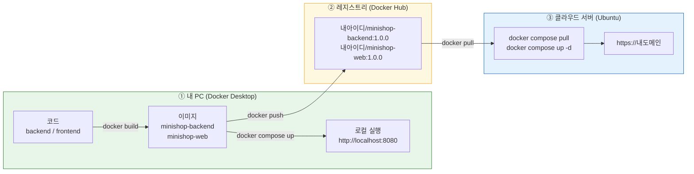

> 핵심 문장 : **"코드를 서버에 옮기는 게 아니라, 실행 환경째로 포장한 이미지를 옮긴다."**

### 기존 배포 방식과 무엇이 다른가?

이 프로젝트에는 이미 [Oracle Cloud 배포 가이드](docs/guide_deploy_oracle.md)가 있습니다. 그 가이드는 서버에 **MariaDB, Python, nginx 를 직접 설치**합니다. 이번 강의는 같은 구조를 **컨테이너**로 바꿉니다.

| 비교 | 직접 설치 (기존 가이드) | 도커 (이번 강의) |
|---|---|---|
| 서버 준비 | `apt install` 로 MariaDB · Python · nginx 설치 | 도커만 설치 |
| 백엔드 실행 | venv + systemd 서비스 등록 | 컨테이너 (`restart: unless-stopped`) |
| 화면 파일 | `npm run build` 결과를 `/var/www` 에 복사 | nginx 이미지 안에 포함 |
| 내 PC 와 서버 차이 | Windows ↔ Ubuntu, 버전이 다를 수 있음 | **같은 이미지**라 차이가 거의 없음 |
| 재배포 | 파일 묶기 → scp → 스크립트 | `docker compose pull && up -d` |
| 되돌리기(롤백) | 어렵다 | 이전 태그로 바꾸면 끝 |

---

## M1. 배포는 왜 어려운가

### 학습 목표
- "내 PC 에서는 되는데 서버에서는 안 돼요" 가 왜 생기는지 설명할 수 있다.

### 이론 : 프로그램은 혼자 돌지 않는다

miniShop 백엔드가 실행되려면 코드 말고도 많은 것이 필요합니다.

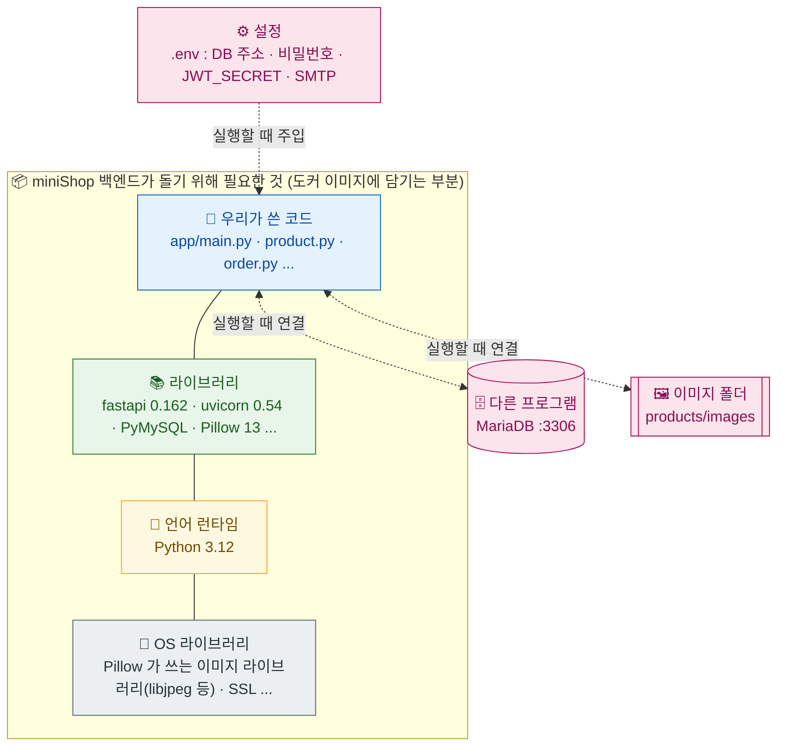

> 상자 **안**(코드 · 라이브러리 · 런타임 · OS 라이브러리)은 도커 **이미지**에 함께 담깁니다. 상자 **밖**(설정 · DB · 이미지 폴더)은 이미지에 넣지 않고, 실행할 때 **환경변수 · 다른 컨테이너 · 볼륨**으로 연결합니다. (M7, M11 에서 다시 나옵니다)

이 중 **하나라도** 내 PC 와 서버가 다르면 문제가 생깁니다.

| 실제로 자주 생기는 일 | 원인 |
|---|---|
| 서버에서 `ModuleNotFoundError` | 라이브러리를 설치하지 않았거나 버전이 다름 |
| 내 PC 는 Python 3.12, 서버는 3.10 | `str \| None` 같은 문법 차이로 오류 |
| 이미지 업로드만 실패 | OS 이미지 라이브러리 차이 |
| DB 접속 실패 | `.env` 의 `DB_HOST` 가 다름 |
| 팀원 PC 에서만 안 됨 | 각자 설치한 버전이 모두 다름 |

### 비유 : 이삿짐 vs 컨테이너

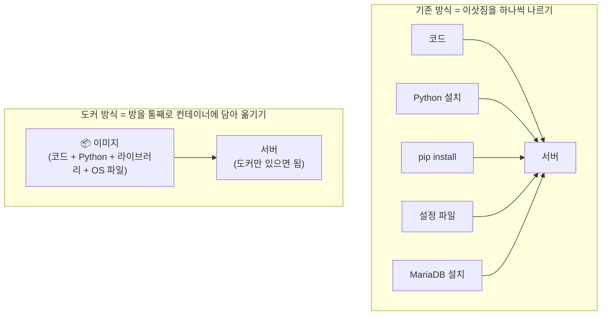

> 해운업의 **표준 컨테이너**가 생기면서 배에 무엇을 싣든 같은 크레인으로 옮기게 되었습니다. 도커 로고가 고래 위의 컨테이너인 이유입니다.

### 확인 체크
- [ ] miniShop 백엔드가 실행되는 데 필요한 것을 5가지 이상 말할 수 있다.
- [ ] "내 PC 에선 되는데" 문제의 원인을 한 가지 예로 설명할 수 있다.

---

## M2. 컨테이너와 도커의 역사

### 학습 목표
- 도커가 갑자기 나타난 기술이 아니라, **40년 넘게 쌓인 격리 기술을 쓰기 쉽게 묶은 것**임을 이해한다.
- 도커 · 쿠버네티스 · OCI 의 관계를 설명할 수 있다.

### 큰 흐름 : 물리 서버 → 가상 머신 → 컨테이너

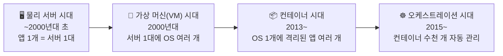

| 시대 | 장점 | 한계 |
|---|---|---|
| 물리 서버 | 단순하다 | 서버 자원을 10~20% 만 쓰고 낭비. 새 서버는 주문부터 몇 주 |
| 가상 머신 | 한 서버를 나눠 쓴다. 클라우드의 기반 | VM 마다 OS 전체를 실어 무겁다(GB 단위, 부팅 수십 초~분) |
| 컨테이너 | OS 커널을 공유해 가볍다(MB 단위, 시작 1초 내외) | 컨테이너가 많아지면 관리가 어렵다 |
| 오케스트레이션 | 수천 개 컨테이너를 자동 배치 · 복구 · 확장 | 배우기 어렵다 (쿠버네티스) |

### 연표 : 격리 기술의 역사

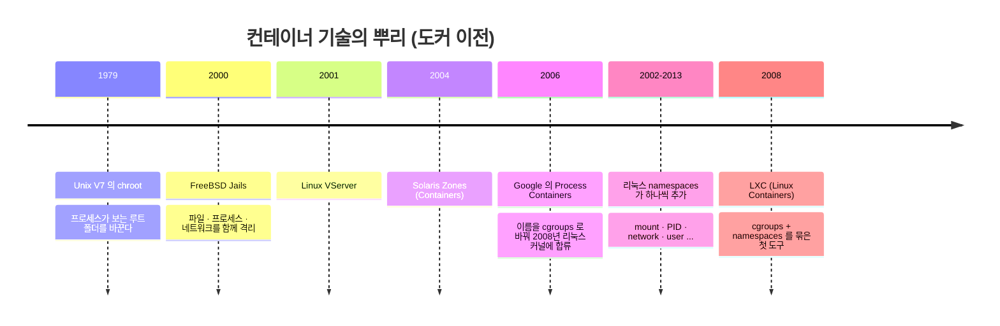

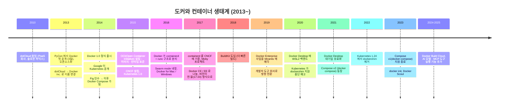

### 이야기로 정리하기

1. **격리의 시작 (1979~2008)** — 유닉스의 `chroot` 는 "이 프로그램에게는 이 폴더가 세상의 전부"라고 속이는 기능이었습니다. 이후 FreeBSD Jails, Solaris Zones 를 거쳐, 리눅스에 **namespaces(무엇이 보이는가)** 와 **cgroups(얼마나 쓸 수 있는가)** 가 들어오면서 재료가 모두 갖춰졌습니다.
2. **도커의 등장 (2013)** — 재료는 있었지만 쓰기가 너무 어려웠습니다. 도커는 여기에 **Dockerfile(만드는 법)**, **이미지(포장)**, **Docker Hub(공유)** 를 더해 "명령 한 줄"로 만들었습니다. 기술보다 **사용 경험**의 혁신이었습니다.
3. **표준화 (2015~2017)** — 도커가 너무 커지자 업계는 특정 회사에 묶이지 않도록 **OCI 표준**을 만들었습니다. 도커도 내부를 `containerd`, `runc` 로 나눠 기증했습니다. 그래서 지금은 도커로 만든 이미지를 Podman, Kubernetes 등 어디서나 실행할 수 있습니다.
4. **오케스트레이션 경쟁 (2014~2018)** — Docker Swarm, Mesos, Kubernetes 가 경쟁했고 **Kubernetes 가 사실상 표준**이 되었습니다.
5. **개발자 도구로 (2019~현재)** — 도커는 기업용 서버 사업을 팔고 **개발자의 PC** 에 집중합니다. Docker Desktop, Compose, 빌드 · 보안 도구가 그 결과입니다.

### 오해 바로잡기 : "쿠버네티스가 도커를 버렸다?"

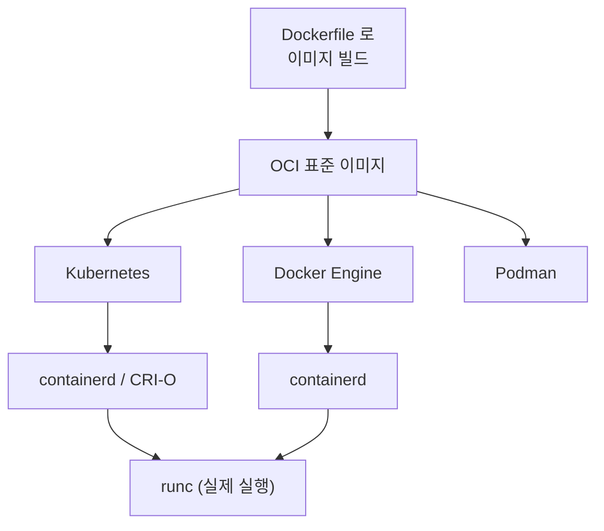

2022년 쿠버네티스가 제거한 것은 **도커 엔진을 연결하던 중간 부품(dockershim)** 입니다. 도커로 만든 **이미지는 표준(OCI)이라 그대로 쓸 수 있습니다.** 우리가 배우는 Dockerfile · 이미지 지식은 쿠버네티스에서도 그대로 통합니다.

### 토론 질문
- 도커 이전에도 격리 기술이 있었는데, 왜 도커가 폭발적으로 퍼졌을까?
- 표준(OCI)이 없었다면 개발자에게 어떤 불편이 있었을까?

---

## M3. 도커 핵심 개념과 내부 구조

### 학습 목표
- 이미지 · 컨테이너 · 레지스트리 · Dockerfile 의 관계를 그림으로 설명할 수 있다.
- VM 과 컨테이너의 차이를 설명할 수 있다.

### 4가지 핵심 용어

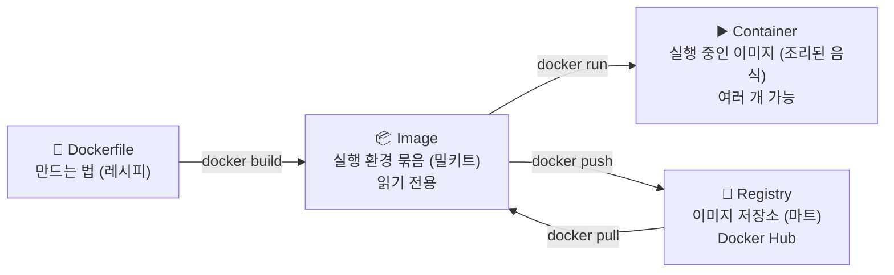

| 용어 | 비유 | 프로그래밍 비유 | miniShop 예 |
|---|---|---|---|
| Dockerfile | 레시피 | 소스 코드 | `backend/Dockerfile` |
| Image | 밀키트 | 클래스 | `minishop-backend:1.0.0` |
| Container | 조리된 음식 | 객체(인스턴스) | 실행 중인 백엔드 서버 |
| Registry | 마트 | 패키지 저장소(PyPI, npm) | Docker Hub |

### VM vs 컨테이너

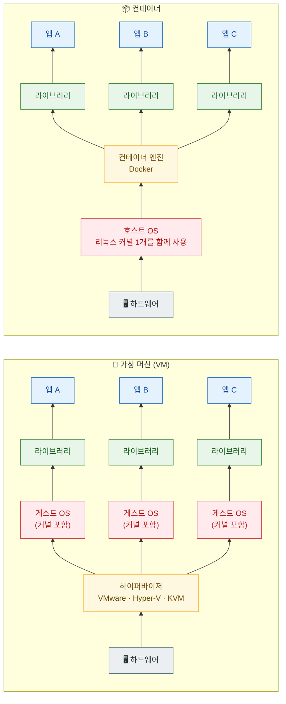

> 🔴 빨간 칸이 **OS 커널**입니다. VM 은 앱마다 커널을 따로 실어 **3개**가 되고, 컨테이너는 호스트의 커널 **1개**를 함께 씁니다. 이 차이 때문에 컨테이너가 가볍습니다.

| 비교 | 🧱 가상 머신 (VM) | 📦 컨테이너 |
|---|---|---|
| 격리 단위 | OS 전체 (커널 포함) | 프로세스 (커널은 공유) |
| 크기 | 무겁다 (GB 단위) | 가볍다 (MB 단위) |
| 시작 시간 | 수십 초 ~ 분 (OS 부팅) | 1초 내외 (프로그램 실행) |
| 한 서버에 띄울 수 있는 수 | 수 개 ~ 수십 개 | 수십 개 ~ 수백 개 |
| 다른 OS 실행 | 가능 (리눅스 위에 Windows 도) | 불가 (호스트와 같은 리눅스 커널) |
| 격리 강도 | 강하다 | VM 보다 약하다 |
| 대표 기술 | VMware, Hyper-V, KVM, VirtualBox | Docker, Podman, containerd |

> ❓ "Windows 에서는 리눅스 커널이 없는데 어떻게 돌아가요?"
> Docker Desktop 은 **WSL2 안에 작은 리눅스 VM** 을 띄우고 그 위에서 컨테이너를 실행합니다. 그래서 Windows 에서도 리눅스 컨테이너를 쓸 수 있습니다.

### 도커 구조 및 작업 흐름


### 컨테이너를 만드는 리눅스의 3가지 재료

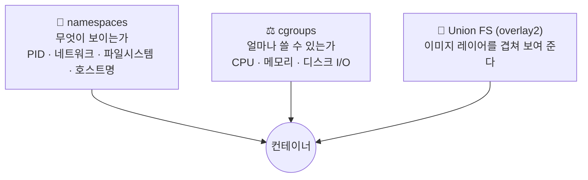

| 재료 | 컨테이너 안에서 보이는 모습 |
|---|---|
| PID namespace | 내 프로그램이 **1번 프로세스**처럼 보인다 |
| Network namespace | 나만의 IP · 포트를 가진다 (그래서 `localhost` 가 나 자신) |
| Mount namespace | 나만의 파일시스템(`/app`, `/etc`)을 본다 |
| cgroups | `--memory 512m` 처럼 자원을 제한할 수 있다 |

### 이미지 레이어 : 왜 두 번째 빌드는 빠를까?

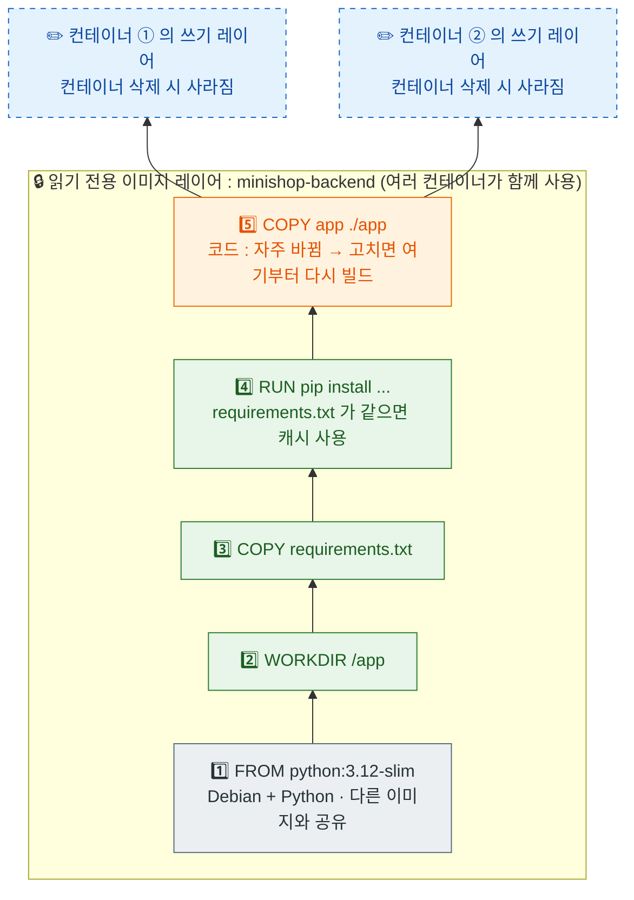

> 레이어는 **아래에서 위로** 쌓입니다. 컨테이너를 여러 개 띄워도 이미지 레이어는 **하나를 함께** 쓰고, 컨테이너마다 얇은 **쓰기 레이어**만 따로 생깁니다.

> 규칙 : **자주 바뀌는 것은 위(나중)에, 잘 안 바뀌는 것은 아래(먼저)에.** 이 순서 하나로 빌드 시간이 몇 분 → 몇 초가 됩니다.

### 확인 체크
- [ ] Dockerfile → Image → Container → Registry 흐름을 화살표로 그릴 수 있다.
- [ ] VM 과 컨테이너의 차이를 "커널" 이라는 단어를 써서 설명할 수 있다.
- [ ] 컨테이너를 지우면 그 안에서 만든 파일이 왜 사라지는지 설명할 수 있다.

---

# 파트 2. 기초

## M4. 도커 설치 (Windows + WSL2)

### 학습 목표
- Docker Desktop 을 설치하기 전에 내 PC 가 준비되었는지 스스로 점검한다.
- Docker Desktop 을 설치하고 `hello-world` 컨테이너를 실행한다.

### 설치 전 점검 (먼저 꼭 하기)

Docker Desktop 설치 파일부터 실행하면 아래와 같은 오류로 **설치가 중간에 멈추는 일이 많습니다.**

> **Installation failed. One prerequisite is not fulfilled.**
> Docker Desktop requires the "Virtual Machine Platform" Windows feature, which is not enabled on this machine.
> A per-user installation cannot enable it, because that requires administrator privileges.

원인은 두 가지가 겹친 것입니다.

| 원인 | 설명 |
|---|---|
| ① WSL2 · 가상 머신 플랫폼이 꺼져 있다 | 도커는 Windows 안의 작은 리눅스 VM(WSL2)에서 돈다. 그 VM 을 돌리는 Windows 기능이 "가상 머신 플랫폼(Virtual Machine Platform)" 이다 |
| ② 설치 파일을 관리자 권한 없이 실행했다 | 설치 프로그램이 "사용자별(per-user) 설치"로 실행되어, 관리자 권한이 필요한 Windows 기능을 스스로 켜지 못한다 |

그래서 **설치 전에 아래 점검을 먼저 하고, 문제가 있으면 고친 뒤** 설치합니다.

#### 점검 흐름

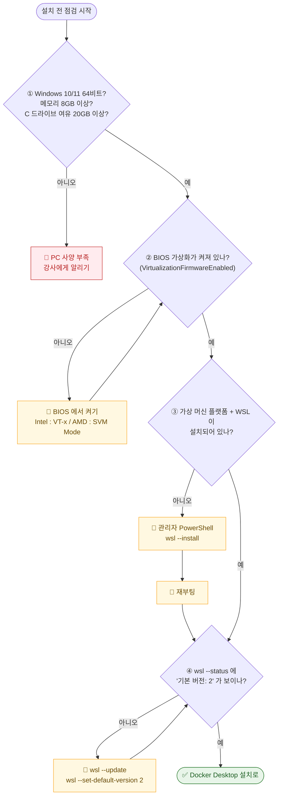

#### 점검 스크립트 (일반 PowerShell, 관리자 권한 필요 없음)

아래를 PowerShell 에 붙여 넣고 실행합니다. **아무것도 바꾸지 않고 확인만** 합니다.

```powershell
# ---- 도커 설치 전 점검 (확인만 하고 아무것도 바꾸지 않는다) ----
$os  = Get-CimInstance Win32_OperatingSystem
$cs  = Get-CimInstance Win32_ComputerSystem
$cpu = Get-CimInstance Win32_Processor | Select-Object -First 1
$vmp = (Get-CimInstance Win32_OptionalFeature -Filter "Name='VirtualMachinePlatform'").InstallState
$ram = [math]::Round($cs.TotalPhysicalMemory / 1GB, 1)
$free = [math]::Round((Get-PSDrive C).Free / 1GB, 1)
$wsl = (Get-Command wsl.exe -ErrorAction SilentlyContinue) -and (Test-Path "$env:ProgramFiles\WSL\wsl.exe")

"1. Windows       : $($os.Caption) (빌드 $($os.BuildNumber), $($os.OSArchitecture))"
"2. 메모리        : $ram GB        $(if ($ram -ge 8) {'OK'} else {'부족 (8GB 이상 권장)'})"
"3. C 여유 공간   : $free GB       $(if ($free -ge 20) {'OK'} else {'부족 (20GB 이상 권장)'})"
"4. BIOS 가상화   : $($cpu.VirtualizationFirmwareEnabled)   $(if ($cpu.VirtualizationFirmwareEnabled) {'OK'} else {'BIOS 에서 켜야 함'})"
"5. 가상머신플랫폼: $(if ($vmp -eq 1) {'켜짐 OK'} else {'꺼짐 → 관리자 PowerShell 에서 wsl --install'})"
"6. WSL 설치      : $(if ($wsl) {'설치됨 OK'} else {'없음 → 관리자 PowerShell 에서 wsl --install'})"
"7. 하이퍼바이저  : $(if ($cs.HypervisorPresent) {'동작 중 OK'} else {'동작 안 함 → 5·6 을 고친 뒤 재부팅'})"
```

#### 결과 읽는 법

| # | 항목 | 정상 | 문제일 때 해결 |
|---|---|---|---|
| 1 | Windows | Windows 10/11, **64비트** | Windows 10 은 최신 업데이트(22H2) 적용 |
| 2 | 메모리 | 8GB 이상 | 4GB 도 설치는 되지만 miniShop 3개 컨테이너는 버겁다 |
| 3 | C 여유 공간 | 20GB 이상 | 다운로드 폴더 · 휴지통 정리 (이미지 · 볼륨이 C 드라이브에 쌓인다) |
| 4 | BIOS 가상화 | `True` | 재부팅 → BIOS(보통 `Del` 또는 `F2`) → Intel 은 **VT-x**, AMD 는 **SVM Mode** 를 Enabled |
| 5 | 가상 머신 플랫폼 | 켜짐 | **관리자** PowerShell 에서 `wsl --install` → 재부팅 |
| 6 | WSL | 설치됨 | 5 와 같음 (`wsl --install` 한 번으로 둘 다 설치) |
| 7 | 하이퍼바이저 | 동작 중 | 5·6 이 켜짐인데 동작 안 함이면 **재부팅을 아직 안 한 것** |

> 💡 **5번은 "켜짐"인데 7번이 "동작 안 함"이에요!** → 기능은 켜졌지만 아직 재부팅하지 않은 상태입니다. 재부팅하면 해결됩니다.

#### 문제가 있을 때 고치기 (관리자 권한 필요)

시작 메뉴에서 **PowerShell → 마우스 오른쪽 → 관리자 권한으로 실행** 한 뒤:

```powershell
wsl --install          # 가상 머신 플랫폼 + WSL + Ubuntu 를 한 번에 설치
```

**재부팅** 후, Ubuntu 창이 뜨면 리눅스용 사용자 이름 · 비밀번호를 정합니다. (Windows 비밀번호와 달라도 된다) 그리고 일반 PowerShell 에서 확인합니다.

```powershell
wsl --status           # "기본 버전: 2" 확인
wsl -l -v              # Ubuntu 의 VERSION 이 2 인지 확인
```

> 💡 `wsl --status` 결과의 한글이 깨져 보이면, PowerShell 창에서 직접 실행했는지 확인하세요. (다른 프로그램으로 결과를 넘기면 글자가 깨질 수 있다)

> 🔀 **다른 방법** : Docker Desktop 설치 파일을 **관리자 권한으로 실행**하고 **All-users installation** 을 고르면 설치 프로그램이 가상 머신 플랫폼을 직접 켜 줍니다. 다만 WSL 을 따로 이해해 두면 나중에 서버(Ubuntu) 실습에도 도움이 되므로, 이 강의에서는 `wsl --install` 을 먼저 하는 방법을 권장합니다.

#### 점검 체크
- [ ] 점검 스크립트의 1~7번이 모두 OK 이다.
- [ ] `wsl -l -v` 에서 Ubuntu 가 VERSION **2** 로 보인다.

### 설치 순서

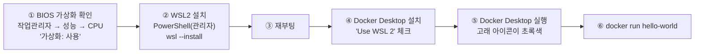

```powershell
# ② 관리자 PowerShell
wsl --install
wsl --status           # 기본 버전: 2 인지 확인
```

```powershell
# ⑥ 일반 PowerShell
docker version         # Client 와 Server 가 모두 나와야 한다
docker run hello-world
```

`Hello from Docker!` 가 나오면 성공입니다. 이 한 줄에서 일어난 일은 다음과 같습니다.

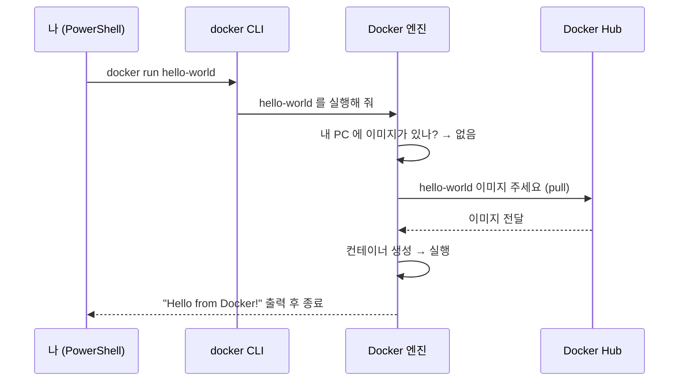

### 알아 둘 것

| 항목 | 내용 |
|---|---|
| 사양 | 메모리 8GB 이상 권장, 디스크 여유 20GB 이상 |
| Windows 버전 | Windows 10/11 64비트 (Home 도 WSL2 로 가능) |
| 라이선스 | 개인 · 교육 · 소규모 기업은 무료. **직원 250명 이상 또는 매출 1천만 달러 이상** 기업의 업무용은 유료 구독이 필요하다 (도입 전 공식 안내 확인) |
| Mac | Docker Desktop 설치 (Apple Silicon 은 ARM 이미지가 기본) |
| Linux | Docker Engine 을 직접 설치 (`docs.docker.com/engine/install`) |

### 확인 체크
- [ ] `docker version` 에 Client 와 Server 가 모두 보인다.
- [ ] `docker run hello-world` 가 성공한다.

---

## M5. 첫 컨테이너와 생명주기

### 학습 목표
- 컨테이너를 띄우고, 보고, 들어가고, 멈추고, 지울 수 있다.

### 실습 : nginx 웹 서버 띄우기

```powershell
docker run -d --name web1 -p 8081:80 nginx:1.27-alpine
```

| 옵션 | 뜻 |
|---|---|
| `-d` | 백그라운드에서 실행 (detached) |
| `--name web1` | 컨테이너 이름 |
| `-p 8081:80` | **내 PC 8081 번 → 컨테이너 80 번** 연결 |
| `nginx:1.27-alpine` | `이미지이름:태그` (alpine = 아주 작은 리눅스) |

브라우저에서 `http://localhost:8081` → "Welcome to nginx!" 가 보이면 성공입니다.

```powershell
docker ps                       # 실행 중인 컨테이너 목록
docker logs web1                # 로그 보기 (브라우저 접속 기록이 보인다)
docker logs -f web1             # 실시간 로그 (Ctrl+C 로 빠져나옴)
docker exec -it web1 sh         # 컨테이너 안으로 들어가기
#   / # ls /usr/share/nginx/html
#   / # cat /etc/os-release      ← 내 PC 는 Windows 인데 안은 Alpine Linux!
#   / # exit
docker stop web1                # 멈춤
docker ps -a                    # 멈춘 것까지 모두 보기
docker start web1               # 다시 시작
docker rm -f web1               # 삭제 (-f : 실행 중이어도 강제)
```

### 컨테이너 생명주기

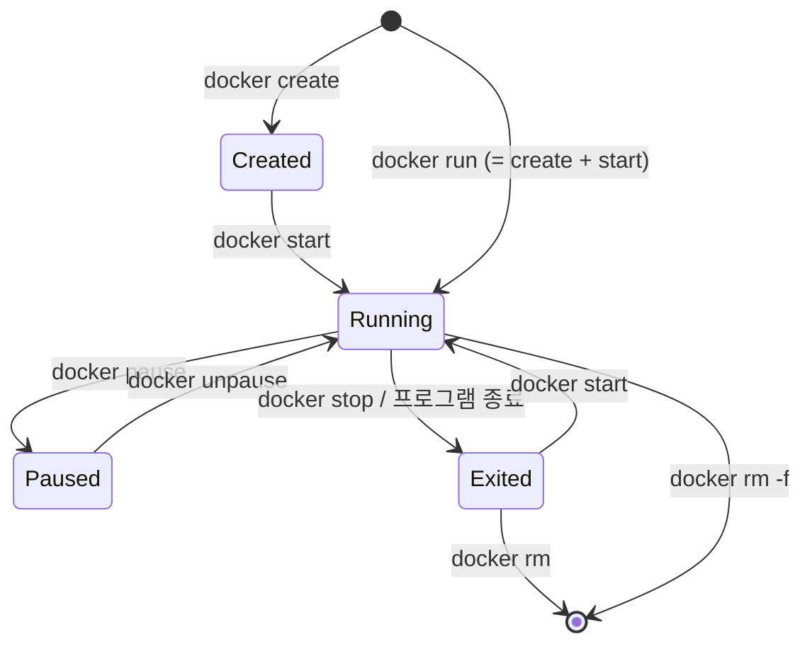

> 💡 **컨테이너는 안의 메인 프로그램이 끝나면 함께 종료됩니다.** `hello-world` 가 바로 끝난 이유입니다. 웹 서버처럼 계속 도는 프로그램이 있어야 컨테이너도 살아 있습니다.

### 실습 과제
1. `-p 8082:80` 으로 같은 이미지에서 컨테이너를 **하나 더** 띄워 두 주소에 모두 접속해 보기 (이미지 1개 → 컨테이너 여러 개)
2. `docker exec` 로 들어가 `index.html` 내용을 바꾸고 새로고침 → 컨테이너를 지웠다가 다시 만들면 어떻게 되는지 관찰하기

### 확인 체크
- [ ] `run`, `ps`, `logs`, `exec`, `stop`, `rm` 을 쓸 수 있다.
- [ ] 과제 2의 결과(바꾼 내용이 사라짐)를 레이어 그림으로 설명할 수 있다.

---

## M6. 이미지와 레이어

### 학습 목표
- Dockerfile 을 처음으로 작성하고 이미지를 빌드한다.
- 태그와 레이어 캐시를 이해한다.

### 이미지 명령

```powershell
docker images                       # 내 PC 의 이미지 목록
docker pull python:3.12-slim        # 이미지만 받기
docker history python:3.12-slim     # 레이어 보기
docker rmi nginx:1.27-alpine        # 이미지 삭제
```

### 이미지 이름 읽는 법

`docker.io/myid/minishop-backend:1.0.0` 을 나눠 읽으면 다음과 같습니다.

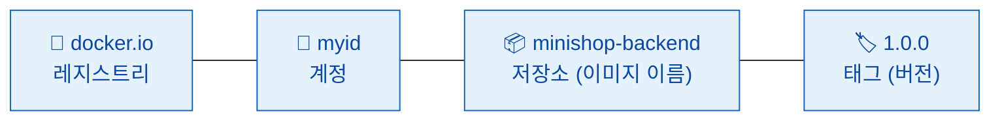

| 부분 | 예 | 뜻 | 생략하면 |
|---|---|---|---|
| 레지스트리 | `docker.io` | 이미지 저장소 주소 | Docker Hub (`docker.io`) |
| 계정 | `myid` | 저장소 주인 | 공식 이미지 (`library/`) — 예 : `python`, `nginx` |
| 저장소 | `minishop-backend` | 이미지 이름 | 생략 불가 |
| 태그 | `1.0.0` | 버전 이름 | `latest` |

> ⚠️ `latest` 는 "최신"이 아니라 **태그를 안 붙였을 때의 기본 이름**일 뿐입니다. 배포할 때는 `1.0.0` 처럼 **버전 태그**를 붙입니다.

### 실습 : 나의 첫 Dockerfile (연습용 폴더에서)

```text
hello-docker/
├─ Dockerfile
└─ hello.py
```

```python
# hello.py
import platform
print("안녕하세요, 컨테이너 안의 파이썬입니다!")
print("OS :", platform.platform())
```

```dockerfile
# Dockerfile
FROM python:3.12-slim
WORKDIR /app
COPY hello.py .
CMD ["python", "hello.py"]
```

```powershell
cd hello-docker
docker build -t hello-docker:1.0 .
docker run --rm hello-docker:1.0       # --rm : 끝나면 컨테이너 자동 삭제
```

### Dockerfile 명령어 한눈에 보기

| 명령 | 하는 일 | 예 |
|---|---|---|
| `FROM` | 기반 이미지 | `FROM python:3.12-slim` |
| `WORKDIR` | 작업 폴더 (없으면 만듦) | `WORKDIR /app` |
| `COPY` | 내 PC 파일 → 이미지 | `COPY requirements.txt .` |
| `RUN` | 빌드할 때 명령 실행 | `RUN pip install -r requirements.txt` |
| `ENV` | 환경변수 | `ENV PYTHONUNBUFFERED=1` |
| `EXPOSE` | 이 포트를 쓴다는 **안내** (실제로 열지는 않음) | `EXPOSE 8000` |
| `CMD` | 컨테이너가 **시작할 때** 실행할 명령 | `CMD ["uvicorn", ...]` |
| `USER` | 실행할 사용자 | `USER appuser` |

> `RUN` 은 **빌드할 때 한 번**, `CMD` 는 **컨테이너를 켤 때마다** 실행됩니다. 가장 많이 헷갈리는 부분입니다.

### 확인 체크
- [ ] Dockerfile 을 작성해 빌드하고 실행할 수 있다.
- [ ] `RUN` 과 `CMD` 의 차이를 설명할 수 있다.
- [ ] 코드만 바꾸고 다시 빌드했을 때 `CACHED` 로 표시되는 줄이 왜 생기는지 설명할 수 있다.

---

## M7. 포트 · 볼륨 · 환경변수 · 네트워크

### 학습 목표
- 컨테이너 밖과 연결하는 4가지 통로를 이해한다.

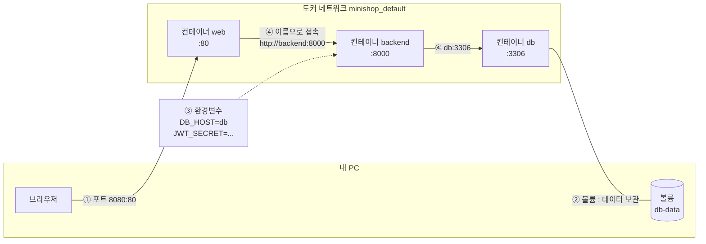

### ① 포트 (`-p 내PC포트:컨테이너포트`)

```powershell
docker run -d --name web2 -p 8083:80 nginx:1.27-alpine
```

> 컨테이너 포트는 컨테이너마다 따로라서, 컨테이너 3개가 모두 80 번을 써도 됩니다. 겹치면 안 되는 것은 **내 PC 쪽 포트**입니다.

### ② 볼륨 : 컨테이너가 사라져도 데이터는 남긴다

| 종류 | 쓰는 법 | 쓰임 |
|---|---|---|
| 이름 있는 볼륨 (named volume) | `-v db-data:/var/lib/mysql` | DB 데이터, 업로드 이미지 (**배포용**) |
| 바인드 마운트 (bind mount) | `-v ./backend/sql:/docker-entrypoint-initdb.d` | 내 PC 폴더를 그대로 연결 (**설정 파일, 개발용**) |

```powershell
docker volume create test-data
docker run --rm -v test-data:/data alpine sh -c "echo 남아있니? > /data/memo.txt"
docker run --rm -v test-data:/data alpine cat /data/memo.txt     # → 남아있니?
docker volume ls
docker volume rm test-data
```

### ③ 환경변수 (`-e 이름=값`)

miniShop 백엔드의 `database.py` 는 `os.getenv("DB_HOST")` 로 설정을 읽습니다. 그래서 **코드를 바꾸지 않고** 환경변수만으로 DB 주소를 바꿀 수 있습니다.

```python
# backend/app/database.py (이미 이렇게 되어 있다)
host=os.getenv("DB_HOST", "localhost"),
```

> 💡 `load_dotenv()` 는 **이미 있는 환경변수를 덮어쓰지 않습니다.** 그래서 컨테이너에 준 환경변수가 `.env` 파일보다 우선합니다.

### ④ 네트워크 : 컨테이너끼리는 "이름"으로 부른다

**가장 많이 틀리는 부분 : 컨테이너 안의 `localhost` 는 그 컨테이너 자신입니다.**

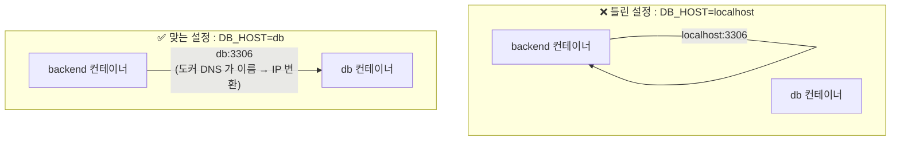

```powershell
docker network create practice-net
docker run -d --name web3 --network practice-net nginx:1.27-alpine
docker run --rm --network practice-net alpine wget -qO- http://web3   # 이름으로 접속 성공
docker rm -f web3 && docker network rm practice-net
```

### 확인 체크
- [ ] `-p 8080:80` 에서 앞뒤 숫자의 의미를 설명할 수 있다.
- [ ] 볼륨을 쓰면 컨테이너를 지워도 데이터가 남는 것을 확인했다.
- [ ] 백엔드 컨테이너에서 `DB_HOST=localhost` 가 왜 안 되는지 설명할 수 있다.

---

# 파트 3. miniShop 컨테이너화

### 목표 구조

개발할 때의 구조([2장 아키텍처](docs/02_architecture.md))를 컨테이너 3개로 바꿉니다.

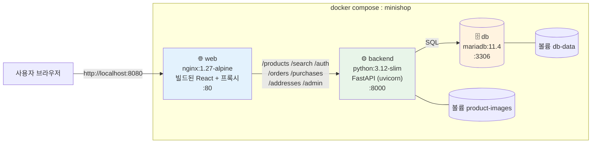

| 개발 (지금까지) | 도커 (이번 파트) |
|---|---|
| `npm run dev` (5173) + Vite 프록시 | **web** 컨테이너 : nginx 가 빌드 결과 + 프록시 |
| `uvicorn app.main:app --port 8000` | **backend** 컨테이너 |
| 내 PC 에 설치한 MariaDB | **db** 컨테이너 (`backend/sql/*.sql` 로 자동 초기화) |
| `backend/products/images` 폴더 | **product-images** 볼륨 |

### 최종 파일 배치

> ✅ 아래 파일은 프로젝트에 **이미 만들어 두었습니다** (`.env` 만 각자 만든다). 수업에서는 빈 파일부터 직접 작성해 보고, 막히면 완성 파일과 비교합니다.

```text
miniShop_ver1.0/
├─ compose.yml                ← M11 (로컬 실행)
├─ .env.docker.example        ← M12 (깃에 올림)
├─ .env                       ← M12 (각자 만듦, 깃에 올리지 않음 / .gitignore 에 이미 등록)
├─ deploy/docker/
│  ├─ compose.prod.yml        ← M14 (서버, HTTP)
│  ├─ compose.https.yml       ← M15 (서버, HTTPS + Caddy)
│  └─ Caddyfile               ← M15
├─ .github/workflows/deploy.yml ← M17 (CI/CD)
├─ backend/
│  ├─ Dockerfile              ← M9
│  ├─ .dockerignore           ← M9
│  ├─ app/  sql/  products/  requirements.txt   (기존 그대로, 코드 수정 없음)
└─ frontend/
   ├─ Dockerfile              ← M10
   ├─ .dockerignore           ← M10
   ├─ nginx.conf              ← M10
   └─ src/ ...                (기존 그대로)
```

> ✅ 이 파트에서는 **기존 코드를 한 줄도 바꾸지 않습니다.** 새 파일만 추가합니다. 설정을 환경변수로 뺀 설계 덕분입니다.

---

## M8. MariaDB 컨테이너

### 학습 목표
- 공식 MariaDB 이미지로 DB 를 띄우고, 프로젝트의 SQL 로 자동 초기화한다.

### 공식 이미지의 초기화 기능

MariaDB 공식 이미지는 **데이터 폴더가 비어 있을 때 딱 한 번**, `/docker-entrypoint-initdb.d/` 안의 `.sql` 파일을 **이름 순서대로** 실행합니다.

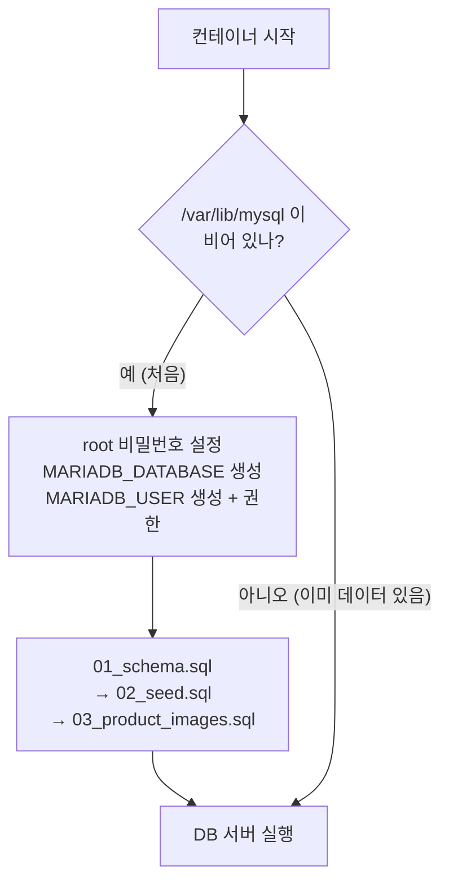

> 우리 SQL 파일은 `test_vmshop` 이라는 DB 이름을 직접 쓰고 있습니다(`USE test_vmshop;`). 그래서 `MARIADB_DATABASE=test_vmshop` 으로 맞춥니다.

### 실습 : 단독으로 띄워 보기 (프로젝트 폴더에서)

```powershell
docker run -d --name minishop-db `
  -e MARIADB_ROOT_PASSWORD=rootpass123 `
  -e MARIADB_DATABASE=test_vmshop `
  -e MARIADB_USER=vmshop_user `
  -e MARIADB_PASSWORD=userpass123 `
  -v minishop-db-data:/var/lib/mysql `
  -v ${PWD}/backend/sql:/docker-entrypoint-initdb.d:ro `
  -p 3307:3306 `
  mariadb:11.4 --character-set-server=utf8mb4 --collation-server=utf8mb4_unicode_ci

docker logs -f minishop-db      # "ready for connections" 가 나올 때까지 기다린다
```

> ⚠️ 내 PC 에 MariaDB 가 이미 설치되어 3306 을 쓰고 있으므로, 연습할 때는 **3307** 로 연결합니다.

```powershell
# 컨테이너 안의 mariadb 클라이언트로 확인
docker exec -it minishop-db mariadb -u vmshop_user -puserpass123 test_vmshop -e "SELECT id, name, price FROM products LIMIT 5;"
```

HeidiSQL · DBeaver 로 `localhost:3307` 에 접속해 봐도 됩니다.

### 실습 과제 : 데이터는 어디에 남는가?

```powershell
docker rm -f minishop-db                          # 컨테이너 삭제
# ... 위 docker run 을 다시 실행 ...
# → 상품 데이터가 그대로 있다 (볼륨이 남아 있으므로). 초기화 SQL 도 다시 실행되지 않는다.

docker rm -f minishop-db
docker volume rm minishop-db-data                 # 볼륨까지 삭제하면 완전히 처음부터
```

> 💡 **SQL 을 고쳤는데 반영이 안 돼요!** → 초기화는 "볼륨이 비어 있을 때 한 번"만 합니다. 볼륨을 지우고 다시 시작해야 합니다.

### 확인 체크
- [ ] 컨테이너 DB 에서 상품 목록을 조회했다.
- [ ] 컨테이너를 지웠다 다시 만들어도 데이터가 남는 이유를 설명할 수 있다.
- [ ] 초기화 SQL 을 다시 실행시키는 방법을 안다.

---

## M9. FastAPI 백엔드 Dockerfile

### 학습 목표
- miniShop 백엔드를 이미지로 만든다.
- 레이어 캐시를 고려해 Dockerfile 순서를 정한다.

### `backend/Dockerfile`

```dockerfile
# ---------------------------------------------------------------
# miniShop 백엔드 (FastAPI + uvicorn)
# ---------------------------------------------------------------
FROM python:3.12-slim

# 파이썬이 .pyc 를 만들지 않고, 로그를 바로바로 출력하게 한다 (docker logs 에 즉시 보임)
ENV PYTHONDONTWRITEBYTECODE=1 \
    PYTHONUNBUFFERED=1

WORKDIR /app

# ① 라이브러리 먼저 : requirements.txt 가 바뀌지 않으면 이 레이어는 캐시를 쓴다
COPY requirements.txt .
RUN pip install --no-cache-dir -r requirements.txt

# ② 코드와 기본 상품 이미지 : 자주 바뀌는 것은 나중에
COPY app ./app
COPY products ./products

# ③ root 가 아닌 사용자로 실행 (보안)
RUN useradd --create-home appuser && chown -R appuser /app
USER appuser

EXPOSE 8000

# 컨테이너 밖에서 접속하려면 반드시 0.0.0.0 으로 연다 (127.0.0.1 이면 컨테이너 안에서만 접속됨)
CMD ["uvicorn", "app.main:app", "--host", "0.0.0.0", "--port", "8000"]
```

### `backend/.dockerignore`

```gitignore
# 비밀값은 절대 이미지에 넣지 않는다 (환경변수로 준다)
.env
# 가상환경 · 캐시
.venv*/
venv/
__pycache__/
*.pyc
# DB 초기화 스크립트는 db 컨테이너가 쓴다
sql/
```

> ⚠️ `.dockerignore` 가 없으면 `.env`(DB 비밀번호, JWT 비밀키)가 이미지에 들어갑니다. 이미지를 Docker Hub 에 공개로 올리면 **누구나 비밀번호를 꺼내 볼 수 있습니다.**

### 빌드와 실행

```powershell
cd backend
docker build -t minishop-backend:dev .
docker images minishop-backend           # 크기 확인

# 네트워크를 만들어 M8 의 DB 컨테이너와 연결
docker network create minishop-net
docker network connect minishop-net minishop-db

docker run -d --name minishop-backend --network minishop-net -p 8000:8000 `
  -e DB_HOST=minishop-db -e DB_PORT=3306 `
  -e DB_USER=vmshop_user -e DB_PASSWORD=userpass123 -e DB_NAME=test_vmshop `
  -e JWT_SECRET=practice-only-secret `
  minishop-backend:dev

docker logs minishop-backend
```

브라우저에서 확인합니다.

| 주소 | 기대 결과 |
|---|---|
| `http://localhost:8000/` | `{"message": "서버가 실행중입니다"}` |
| `http://localhost:8000/docs` | FastAPI 자동 문서 |
| `http://localhost:8000/search/products` | 상품 목록 JSON |
| `http://localhost:8000/products/images/cola.jpg` | 콜라 이미지 |

### 빌드 캐시 체험

```mermaid
flowchart LR
    A["app/product.py 수정"] --> B["docker build"]
    B --> C1["FROM ✅ CACHED"]
    C1 --> C2["COPY requirements.txt ✅ CACHED"]
    C2 --> C3["RUN pip install ✅ CACHED"]
    C3 --> C4["COPY app 🔨 다시 실행"]
    C4 --> C5["이후 단계 🔨 다시 실행"]
```

**과제** : Dockerfile 에서 `COPY app ./app` 을 `pip install` **위로** 올리고, 코드 한 줄을 고친 뒤 다시 빌드해 시간을 비교해 보세요.

### 확인 체크
- [ ] `/docs` 와 상품 이미지가 컨테이너에서 열린다.
- [ ] `--host 0.0.0.0` 이 왜 필요한지 설명할 수 있다.
- [ ] `docker run --rm minishop-backend:dev ls -a /app` 으로 `.env` 가 이미지에 없음을 확인했다.

---

## M10. React 프론트 + nginx Dockerfile

### 학습 목표
- **멀티 스테이지 빌드**로 작은 프론트 이미지를 만든다.
- 개발용 Vite 프록시를 운영용 nginx 프록시로 바꾸는 이유를 이해한다.

### 왜 nginx 인가?

`npm run dev` 는 **개발용** 서버입니다. 배포할 때는 `npm run build` 로 만든 정적 파일(`dist/`)을 nginx 가 내려 주고, API 요청은 nginx 가 백엔드로 넘깁니다. ([Oracle 배포 가이드 0-1](docs/guide_deploy_oracle.md)과 같은 구조)

### 멀티 스테이지 빌드

```mermaid
flowchart LR
    subgraph S1["1단계 : build (node:22-alpine, 약 1GB 이상)"]
        a["package.json<br/>npm ci"] --> b["src/<br/>npm run build"] --> c["dist/<br/>(HTML · JS · CSS)"]
    end
    subgraph S2["2단계 : 최종 이미지 (nginx:1.27-alpine, 수십 MB)"]
        d["nginx.conf"]
        e["/usr/share/nginx/html<br/>← dist/ 만 복사"]
    end
    c -->|"COPY --from=build"| e
    S1 -.->|"node_modules, 소스는<br/>최종 이미지에 들어가지 않음"| X["🗑️ 버림"]
```

### `frontend/Dockerfile`

```dockerfile
# ---------- 1단계 : React 빌드 ----------
FROM node:22-alpine AS build
WORKDIR /src

# 의존성 먼저 (package*.json 이 같으면 npm ci 캐시 사용)
COPY package.json package-lock.json ./
RUN npm ci

COPY . .
RUN npm run build

# ---------- 2단계 : nginx 로 서빙 ----------
FROM nginx:1.27-alpine
COPY nginx.conf /etc/nginx/conf.d/default.conf
COPY --from=build /src/dist /usr/share/nginx/html
EXPOSE 80
```

### `frontend/nginx.conf`

[Oracle 배포 가이드 9장](docs/guide_deploy_oracle.md)의 설정과 같습니다. 다른 점은 `proxy_pass` 주소가 `127.0.0.1` 이 아니라 **컨테이너 이름 `backend`** 라는 것뿐입니다.

```nginx
server {
    listen 80;
    server_name _;

    root /usr/share/nginx/html;
    index index.html;

    # 관리자 이미지 업로드 : 여러 장(장당 2MB 이하)을 한 번에 보내므로 넉넉하게
    client_max_body_size 30m;

    # API 와 상품 이미지 → backend 컨테이너 (vite.config.js 의 proxy 목록과 같다)
    location ~ ^/(products|search|auth|orders|purchases|addresses|admin)(/|$) {
        proxy_pass http://backend:8000;
        proxy_set_header Host $host;
        proxy_set_header X-Real-IP $remote_addr;
        proxy_set_header X-Forwarded-For $proxy_add_x_forwarded_for;
        proxy_set_header X-Forwarded-Proto $scheme;
    }

    # 빌드 파일 (이름에 해시가 있어 오래 저장해도 된다)
    location /assets/ {
        expires 30d;
        add_header Cache-Control "public, immutable";
        try_files $uri =404;
    }

    # 그 밖의 주소(/product/3, /manage/orders ...)는 React Router 가 처리 → index.html
    location / {
        try_files $uri $uri/ /index.html;
    }
}
```

### `frontend/.dockerignore`

```gitignore
node_modules/
dist/
*.zip
```

> `node_modules` 를 빼지 않으면 Windows 용으로 설치된 수백 MB 파일이 빌드에 들어가 느려지고, 리눅스에서 맞지 않는 파일 때문에 오류가 날 수 있습니다.

### 요청이 흐르는 길

```mermaid
sequenceDiagram
    participant B as 브라우저
    participant N as web (nginx)
    participant A as backend (FastAPI)
    participant D as db (MariaDB)
    B->>N: GET /product/3 (화면 주소)
    N-->>B: index.html (React 가 화면을 그림)
    B->>N: GET /products/3 (API)
    N->>A: proxy_pass http://backend:8000/products/3
    A->>D: SELECT ... FROM products WHERE id=3
    D-->>A: 상품 정보
    A-->>N: JSON
    N-->>B: JSON
    B->>N: GET /products/images/cola.jpg
    N->>A: 프록시
    A-->>B: 이미지
```

### 빌드 확인

```powershell
cd frontend
docker build -t minishop-web:dev .
docker images minishop-web        # node 이미지보다 훨씬 작은 것을 확인
```

> 이 이미지만 따로 실행하면 nginx 가 `backend` 라는 이름을 찾지 못해 바로 종료됩니다(`host not found in upstream "backend"`). 다음 모듈의 Compose 로 함께 띄웁니다.

### 확인 체크
- [ ] 멀티 스테이지 빌드에서 최종 이미지에 무엇이 남는지 설명할 수 있다.
- [ ] `try_files ... /index.html` 이 없으면 새로고침 시 왜 404 가 나는지 설명할 수 있다.

---

## M11. Docker Compose 로 한 번에

### 학습 목표
- 컨테이너 3개와 네트워크 · 볼륨을 **파일 하나**로 정의하고 한 줄로 실행한다.

### 왜 Compose 인가?

M8~M10 에서 `docker run` 을 할 때마다 옵션이 길었습니다. Compose 는 이것을 **YAML 파일 하나**로 적어 둡니다.

```mermaid
flowchart LR
    subgraph BEFORE["docker run 으로 하나씩"]
        r1["docker network create ..."]
        r2["docker run db -e ... -v ... -p ..."]
        r3["docker run backend -e ... -e ... -e ..."]
        r4["docker run web -p ..."]
    end
    subgraph AFTER["Compose"]
        y["compose.yml"] --> u["docker compose up -d"]
    end
    BEFORE ==>|"정리"| AFTER
```

### `compose.yml` (프로젝트 루트)

```yaml
# miniShop 로컬 실행 : docker compose up -d --build  →  http://localhost:8080
name: minishop

services:
  # ------------------------------------------------------------ DB
  db:
    image: mariadb:11.4
    restart: unless-stopped
    environment:
      MARIADB_ROOT_PASSWORD: ${DB_ROOT_PASSWORD}
      MARIADB_DATABASE: test_vmshop          # backend/sql/*.sql 안의 이름과 같아야 한다
      MARIADB_USER: ${DB_USER}
      MARIADB_PASSWORD: ${DB_PASSWORD}
    command: --character-set-server=utf8mb4 --collation-server=utf8mb4_unicode_ci
    volumes:
      - db-data:/var/lib/mysql
      - ./backend/sql:/docker-entrypoint-initdb.d:ro
    healthcheck:                             # "DB 가 준비되었는가" 검사 (이미지에 들어 있는 스크립트)
      test: ["CMD", "healthcheck.sh", "--connect", "--innodb_initialized"]
      interval: 10s
      timeout: 5s
      retries: 10
      start_period: 30s
    # ports: ["3307:3306"]                   # DB 도구로 접속해 보고 싶을 때만 (배포 서버에서는 절대 열지 않는다)

  # ------------------------------------------------------------ 백엔드
  backend:
    build: ./backend
    image: ${IMAGE_PREFIX:-minishop}/minishop-backend:${TAG:-dev}
    restart: unless-stopped
    environment:
      DB_HOST: db                            # 서비스 이름 = 접속 주소
      DB_PORT: 3306
      DB_USER: ${DB_USER}
      DB_PASSWORD: ${DB_PASSWORD}
      DB_NAME: test_vmshop
      JWT_SECRET: ${JWT_SECRET}
      SMTP_HOST: ${SMTP_HOST:-}              # 비워 두면 인증 코드를 로그에 출력 (개발 모드)
      SMTP_PORT: ${SMTP_PORT:-587}
      SMTP_USER: ${SMTP_USER:-}
      SMTP_PASSWORD: ${SMTP_PASSWORD:-}
      SMTP_FROM: ${SMTP_FROM:-}
    volumes:
      - product-images:/app/products/images  # 업로드한 상품 이미지를 보관
    depends_on:
      db:
        condition: service_healthy           # DB 가 준비된 뒤에 시작

  # ------------------------------------------------------------ 프론트 (nginx)
  web:
    build: ./frontend
    image: ${IMAGE_PREFIX:-minishop}/minishop-web:${TAG:-dev}
    restart: unless-stopped
    ports:
      - "${WEB_PORT:-8080}:80"               # 바깥에 여는 것은 web 하나뿐
    depends_on:
      - backend

volumes:
  db-data:
  product-images:
```

> 💡 **이름 있는 볼륨의 초기 복사** : `product-images` 볼륨이 비어 있으면, 도커가 이미지 안의 `/app/products/images`(시드 상품 사진)를 볼륨으로 **처음 한 번 복사**합니다. 그래서 기본 사진도 보이고, 관리자가 올린 사진도 컨테이너를 바꿔도 남습니다.

### 실행

M12 의 `.env` 를 먼저 만든 뒤 실행합니다. (먼저 M8~M9 연습 컨테이너는 정리 : `docker rm -f minishop-db minishop-backend`)

```powershell
docker compose up -d --build      # 빌드 + 백그라운드 실행
docker compose ps                 # 상태 (db 가 healthy 인지)
docker compose logs -f backend    # 백엔드 로그
```

브라우저에서 **`http://localhost:8080`** → miniShop 이 열리면 성공입니다. 🎉

### 시작 순서

```mermaid
sequenceDiagram
    participant C as docker compose
    participant D as db
    participant B as backend
    participant W as web
    C->>D: 시작
    D->>D: 첫 실행이면 SQL 초기화
    loop 10초마다 healthcheck
        C->>D: 준비됐니?
    end
    D-->>C: healthy
    C->>B: 시작 (depends_on: service_healthy)
    C->>W: 시작 (depends_on: backend)
    W-->>C: 80 번 대기
```

### 동작 확인 체크리스트 (README 기능 기준)

| # | 확인 | 기대 결과 |
|---|---|---|
| 1 | 메인 화면 | 상품 카드와 이미지가 보인다 |
| 2 | 상품 상세에서 **새로고침** | 404 없이 그대로 (nginx `try_files`) |
| 3 | 회원가입 → 인증 코드 | `docker compose logs backend` 에 6자리 코드 출력 (SMTP 미설정 시) |
| 4 | `user1@test.local` 로그인 → 구매 | 구매내역에 보인다 |
| 5 | `admin@test.local` 로그인 → 상품 이미지 업로드 | 업로드한 이미지가 보인다 |
| 6 | `docker compose down` → `up -d` | 구매내역 · 업로드 이미지가 그대로 남아 있다 (볼륨) |

### Compose 명령 정리

| 명령 | 하는 일 |
|---|---|
| `docker compose up -d --build` | 빌드하고 백그라운드 실행 |
| `docker compose ps` | 상태 |
| `docker compose logs -f 서비스` | 로그 |
| `docker compose exec backend sh` | 컨테이너 안으로 |
| `docker compose restart backend` | 재시작 |
| `docker compose down` | 컨테이너 · 네트워크 삭제 (**볼륨은 남음**) |
| `docker compose down -v` | **볼륨까지 삭제** (DB 초기화, 주의!) |

### 확인 체크
- [ ] 동작 확인 체크리스트 6개를 모두 통과했다.
- [ ] `down` 과 `down -v` 의 차이를 설명할 수 있다.

---

## M12. 설정과 비밀값 관리

### 학습 목표
- 비밀값을 코드 · 이미지 · 깃에서 분리한다.

### 설정이 흐르는 길

```mermaid
flowchart LR
    E[".env<br/>(루트, 깃 제외)<br/>DB_PASSWORD=...<br/>JWT_SECRET=..."] -->|"${DB_PASSWORD} 치환"| Y["compose.yml"]
    Y -->|"environment:"| B["backend 컨테이너<br/>os.getenv('DB_PASSWORD')"]
    Y -->|"environment:"| D["db 컨테이너<br/>MARIADB_PASSWORD"]
    EX[".env.docker.example<br/>(깃에 올림, 값은 비움)"] -.->|"복사해서 채운다"| E
```

### `.env.docker.example` (깃에 올리는 견본)

```dotenv
# 이 파일을 루트의 .env 로 복사해서 값을 채운다.   (PowerShell: Copy-Item .env.docker.example .env)
# .env 는 .gitignore 에 이미 등록되어 있어 깃에 올라가지 않는다.

# ---- DB ----
DB_ROOT_PASSWORD=
DB_USER=vmshop_user
DB_PASSWORD=

# ---- 로그인 토큰 서명 키 : python -c "import secrets; print(secrets.token_hex(32))"
JWT_SECRET=

# ---- 메일 (비워 두면 인증 코드를 백엔드 로그에 출력) ----
SMTP_HOST=
SMTP_PORT=587
SMTP_USER=
SMTP_PASSWORD=
SMTP_FROM=

# ---- 이미지 이름 / 포트 (M13 부터 사용) ----
IMAGE_PREFIX=minishop
TAG=dev
WEB_PORT=8080
```

```powershell
Copy-Item .env.docker.example .env
python -c "import secrets; print(secrets.token_hex(32))"   # 출력값을 JWT_SECRET 에 붙여 넣기
docker compose config                                       # 치환 결과 확인 (값이 비어 있으면 경고)
```

> ⚠️ `docker compose config` 는 비밀번호를 화면에 그대로 보여 줍니다. 화면 공유 중에는 실행하지 마세요.

### 비밀값 규칙 4가지

| 규칙 | 이유 |
|---|---|
| `.env` 는 깃에 올리지 않는다 | GitHub 에 올라간 비밀번호는 지워도 기록에 남는다 |
| `.env` 는 이미지에 넣지 않는다 (`.dockerignore`) | 공개 이미지는 누구나 열어 볼 수 있다 |
| 개발 · 배포의 비밀값은 **다르게** 만든다 | 개발용 `JWT_SECRET` 이 새면 관리자 토큰 위조가 가능 |
| 시드 테스트 계정(`test1234!`)은 배포 전에 바꾸거나 막는다 | 비밀번호가 README 에 공개되어 있다 |

### 확인 체크
- [ ] `.env` 가 깃 · 이미지 어디에도 들어가지 않음을 확인했다.
- [ ] 팀원이 `.env.docker.example` 만 보고 실행 환경을 만들 수 있다.

---

# 파트 4. 배포

## M13. 레지스트리 push / pull (짝 실습)

### 학습 목표
- 이미지를 Docker Hub 에 올리고, **다른 PC 에서 코드 없이** 내려받아 실행한다.
- "배포 단위 = 이미지" 를 체감한다.

### 흐름

```mermaid
flowchart LR
    subgraph A["학생 A 의 PC"]
        a1["docker compose build"] --> a2["docker compose push"]
    end
    subgraph H["Docker Hub"]
        h1["a-id/minishop-backend:1.0.0"]
        h2["a-id/minishop-web:1.0.0"]
    end
    subgraph B["학생 B 의 PC (코드 없음!)"]
        b1["compose.yml + .env 만 받음"] --> b2["docker compose pull"] --> b3["docker compose up -d"]
    end
    a2 --> h1 & h2
    h1 & h2 --> b2
```

### 1) Docker Hub 준비

1. https://hub.docker.com 가입 (무료)
2. **Account settings → Personal access tokens** 에서 토큰 생성 (비밀번호 대신 사용)
3. 로그인

```powershell
docker login -u 내아이디        # Password 자리에 토큰 붙여 넣기
```

### 2) 태그 붙이고 올리기

`.env` 의 이미지 이름을 바꿉니다.

```dotenv
IMAGE_PREFIX=내아이디
TAG=1.0.0
```

```powershell
docker compose build
docker compose push             # backend, web 이미지가 올라간다 (db 는 공식 이미지라 올리지 않음)
```

### 3) 짝의 PC 에서 실행하기

학생 B 는 **코드 없이** 다음 세 가지만 준비합니다.

- `compose.yml` 에서 `build:` 줄 두 개를 지운 파일 (이미지만 사용)
- 자기가 새로 만든 `.env` (`IMAGE_PREFIX=a의아이디`, `TAG=1.0.0`)
- `backend/sql/` 폴더 (DB 초기화용)

```powershell
docker compose pull
docker compose up -d
```

> 🎯 **토론** : B 의 PC 에는 Python 도, Node 도, MariaDB 도 설치하지 않았습니다. 그런데 어떻게 쇼핑몰이 돌아갈까요?

### 태그 전략

| 태그 | 쓰임 |
|---|---|
| `1.0.0`, `1.0.1` | 배포용. **한 번 올린 태그는 다시 덮어쓰지 않는다** |
| `latest` | 가장 최근 안정 버전 표시용 (배포 파일에는 버전 태그를 쓴다) |
| `dev` | 내 PC 개발용 |
| 커밋 해시 `a1b2c3d` | CI/CD 에서 자동 빌드할 때 (M17) |

> 📌 Docker Hub 의 무료 공개 저장소는 **누구나** 받을 수 있습니다. 비공개(Private) 저장소 개수는 요금제마다 다르니 확인하세요. 이미지 안에 비밀값이 없어야 하는 이유가 여기 있습니다.

### 확인 체크
- [ ] 내 이미지가 Docker Hub 페이지에 보인다.
- [ ] 짝의 PC 에서 내 쇼핑몰이 실행되었다.

---

## M14. 클라우드 서버(Oracle ARM)에 배포

### 학습 목표
- 클라우드 VM 에 도커를 설치하고, 레지스트리의 이미지로 miniShop 을 실행한다.
- **CPU 아키텍처(amd64 / arm64)** 차이를 이해한다.

> 서버 만들기, SSH 접속, 방화벽(Security List + iptables)은 [Oracle 배포 가이드](docs/guide_deploy_oracle.md) 1~3장과 [cloud_basic.md](cloud_basic.md)를 그대로 따릅니다. 이 모듈은 그 **다음**부터입니다.

### ⚠️ 먼저 : 내 PC 와 서버의 CPU 가 다르다

```mermaid
flowchart LR
    PC["내 PC<br/>Intel / AMD<br/>linux/amd64"] -->|"그냥 빌드한 이미지"| X["❌ ARM 서버에서<br/>exec format error"]
    PC -->|"buildx 로 두 종류 빌드<br/>--platform linux/amd64,linux/arm64"| M["📦 멀티 아키텍처 이미지"]
    M --> S1["✅ Oracle A1 (arm64)"]
    M --> S2["✅ 일반 x86 서버 (amd64)"]
```

Oracle Always Free 의 Ampere A1 은 **ARM(arm64)** 입니다. 내 PC(Intel/AMD)에서 그냥 빌드한 이미지는 실행되지 않습니다. 두 종류를 함께 빌드해 올립니다.

```powershell
# 내 PC : buildx 로 멀티 아키텍처 빌드 + push (Docker Desktop 에 기본 포함)
docker buildx create --name multi --use        # 처음 한 번
docker buildx build --platform linux/amd64,linux/arm64 -t 내아이디/minishop-backend:1.0.0 --push ./backend
docker buildx build --platform linux/amd64,linux/arm64 -t 내아이디/minishop-web:1.0.0 --push ./frontend
```

> ARM 용 빌드는 에뮬레이션으로 하므로 몇 배 느립니다. (특히 `npm ci`) 느리면 **서버에서 직접 빌드**하는 방법도 있습니다(코드를 서버로 옮긴 뒤 `docker compose build`).

### 서버 작업 순서

```mermaid
flowchart TB
    A["① SSH 접속<br/>ssh -i minishop.key ubuntu@서버IP"] --> B["② 도커 설치"]
    B --> C["③ 배포 폴더 만들기<br/>~/minishop-docker"]
    C --> D["④ compose.prod.yml, .env, sql/ 올리기"]
    D --> E["⑤ docker compose pull && up -d"]
    E --> F["⑥ 방화벽 80/443 확인 → 브라우저 접속"]
```

#### ② 도커 설치 (서버에서)

```bash
# 공식 설치 스크립트 (실습용으로 간편함. 운영에서는 공식 문서의 apt 저장소 방식 권장)
curl -fsSL https://get.docker.com | sudo sh
sudo usermod -aG docker $USER      # sudo 없이 docker 쓰기
exit                               # 다시 접속해야 적용된다
```

```bash
docker version
docker compose version
```

#### ③~④ 배포 파일 (내 PC → 서버)

서버용 Compose 는 **빌드하지 않고 이미지만 받으며**, 80 번을 엽니다. 프로젝트의 [deploy/docker/compose.prod.yml](deploy/docker/compose.prod.yml) 에 있습니다. (아래는 핵심만 줄인 모습이고, 실제 파일에는 로그 크기 제한도 들어 있습니다)

```yaml
# deploy/docker/compose.prod.yml
name: minishop

services:
  db:
    image: mariadb:11.4
    restart: unless-stopped
    environment:
      MARIADB_ROOT_PASSWORD: ${DB_ROOT_PASSWORD}
      MARIADB_DATABASE: test_vmshop
      MARIADB_USER: ${DB_USER}
      MARIADB_PASSWORD: ${DB_PASSWORD}
    command: --character-set-server=utf8mb4 --collation-server=utf8mb4_unicode_ci
    volumes:
      - db-data:/var/lib/mysql
      - ./sql:/docker-entrypoint-initdb.d:ro
    healthcheck:
      test: ["CMD", "healthcheck.sh", "--connect", "--innodb_initialized"]
      interval: 10s
      timeout: 5s
      retries: 10
      start_period: 30s
    # ports 없음 : DB 는 절대 바깥에 열지 않는다

  backend:
    image: ${IMAGE_PREFIX}/minishop-backend:${TAG}
    restart: unless-stopped
    env_file: .env                           # DB_USER, DB_PASSWORD, JWT_SECRET, SMTP_* ...
    environment:
      DB_HOST: db
      DB_PORT: 3306
      DB_NAME: test_vmshop
    volumes:
      - product-images:/app/products/images
    depends_on:
      db:
        condition: service_healthy

  web:
    image: ${IMAGE_PREFIX}/minishop-web:${TAG}
    restart: unless-stopped
    ports:
      - "80:80"
    depends_on:
      - backend

volumes:
  db-data:
  product-images:
```

```powershell
# 내 PC : 파일 보내기
ssh -i $HOME\.ssh\minishop.key ubuntu@서버IP "mkdir -p ~/minishop-docker"
scp -i $HOME\.ssh\minishop.key deploy\docker\compose.prod.yml ubuntu@서버IP:~/minishop-docker/compose.yml
scp -i $HOME\.ssh\minishop.key -r backend\sql ubuntu@서버IP:~/minishop-docker/sql
```

```bash
# 서버 : .env 는 서버에서 새로 만든다 (내 PC 의 .env 를 복사하지 않는다!)
cd ~/minishop-docker
nano .env
```

```dotenv
IMAGE_PREFIX=내아이디
TAG=1.0.0
DB_ROOT_PASSWORD=<새로 만든 긴 값>
DB_USER=vmshop_user
DB_PASSWORD=<새로 만든 긴 값>
JWT_SECRET=<python3 -c "import secrets; print(secrets.token_hex(32))" 결과>
SMTP_HOST=
SMTP_PORT=587
SMTP_USER=
SMTP_PASSWORD=
SMTP_FROM=
```

```bash
chmod 600 .env                     # 나만 읽기
```

#### ⑤ 실행

```bash
docker compose pull
docker compose up -d
docker compose ps
docker compose logs -f backend
```

#### ⑥ 접속

브라우저에서 `http://서버공인IP` → miniShop 이 열리면 성공입니다.

> 안 열리면 [Oracle 가이드 3장](docs/guide_deploy_oracle.md)의 **두 겹 방화벽**(① 콘솔 Security List, ② 서버 iptables)을 확인합니다.

### ⚠️ 배포 직후 보안 작업

시드의 테스트 계정 비밀번호 `test1234!` 는 README 에 공개되어 있습니다. 서버에 올렸다면 **즉시** 관리자 비밀번호를 바꾸거나 테스트 계정을 막아야 합니다. 방법은 [Oracle 가이드 5-4](docs/guide_deploy_oracle.md)를 참고하고, SQL 은 컨테이너 안에서 실행합니다.

```bash
docker compose exec db mariadb -u root -p test_vmshop
```

> 🔥 **도커와 방화벽 주의** : 도커는 `ports:` 로 연 포트를 iptables 에 직접 등록합니다. 그래서 `ufw` 로 막아도 **열려 버릴 수 있습니다.** DB 처럼 숨겨야 할 서비스에는 아예 `ports:` 를 쓰지 않는 것이 가장 안전합니다.

### 확인 체크
- [ ] `http://서버IP` 로 쇼핑몰에 접속된다.
- [ ] `exec format error` 가 왜 생기는지 설명할 수 있다.
- [ ] 서버의 `.env` 는 서버에서 새로 만들었다.
- [ ] 테스트 계정 비밀번호를 바꿨다.

---

## M15. 도메인과 HTTPS

### 학습 목표
- 무료 도메인을 연결하고, 자동 인증서로 HTTPS 를 적용한다.

### 구조 : 맨 앞에 Caddy 를 하나 더 둔다

**Caddy** 는 도메인만 적으면 Let's Encrypt 인증서를 **자동으로 받고 갱신**하는 웹 서버입니다. 입문 과정에서 HTTPS 를 붙이기 가장 쉬운 방법입니다.

```mermaid
flowchart LR
    U["브라우저"] -->|"https :443"| C["🔒 caddy<br/>인증서 자동 발급 · 갱신<br/>:80 → :443 자동 이동"]
    subgraph S["서버 (docker compose)"]
        C -->|"http"| W["web (nginx) :80"]
        W --> B["backend :8000"]
        B --> D[("db")]
    end
    LE["Let's Encrypt"] -.->|"인증서"| C
```

### 1) 도메인 준비

[Oracle 가이드 10-1](docs/guide_deploy_oracle.md)처럼 **DuckDNS**(무료)에서 `myminishop.duckdns.org` 를 만들고 서버 공인 IP 를 연결합니다.

> 📁 이 모듈의 완성 파일 : [deploy/docker/compose.https.yml](deploy/docker/compose.https.yml) , [deploy/docker/Caddyfile](deploy/docker/Caddyfile)
>
> ```powershell
> scp -i $HOME\.ssh\minishop.key deploy\docker\compose.https.yml ubuntu@서버IP:~/minishop-docker/compose.yml
> scp -i $HOME\.ssh\minishop.key deploy\docker\Caddyfile ubuntu@서버IP:~/minishop-docker/Caddyfile
> ```

### 2) `Caddyfile` (서버의 `~/minishop-docker/`)

```caddyfile
{$DOMAIN} {
    encode gzip
    reverse_proxy web:80
}
```

### 3) `compose.yml` 수정 (서버)

```yaml
services:
  # ... db, backend 는 그대로 ...

  web:
    image: ${IMAGE_PREFIX}/minishop-web:${TAG}
    restart: unless-stopped
    # ports 를 지운다 : 이제 바깥에서는 caddy 만 받는다
    depends_on:
      - backend

  caddy:
    image: caddy:2.10-alpine
    restart: unless-stopped
    ports:
      - "80:80"
      - "443:443"
    environment:
      DOMAIN: ${DOMAIN}
    volumes:
      - ./Caddyfile:/etc/caddy/Caddyfile:ro
      - caddy-data:/data                     # 인증서 보관 (지우면 다시 발급받아야 함)
      - caddy-config:/config
    depends_on:
      - web

volumes:
  db-data:
  product-images:
  caddy-data:
  caddy-config:
```

```bash
echo "DOMAIN=myminishop.duckdns.org" >> .env
docker compose up -d
docker compose logs -f caddy       # "certificate obtained successfully" 확인
```

`https://myminishop.duckdns.org` 에 자물쇠 🔒 가 보이면 완료입니다.

> 💡 인증서 발급에는 **80 · 443 포트가 바깥에서 열려 있어야** 합니다. 실패하면 방화벽부터 확인하세요. Let's Encrypt 는 실패를 반복하면 일정 시간 발급을 제한하므로, 로그를 보고 원인을 고친 뒤 다시 시도합니다.

### 확인 체크
- [ ] `https://도메인` 으로 접속되고, `http://` 로 들어가면 자동으로 `https://` 로 바뀐다.

---

## M16. 운영 기초 : 업데이트 · 롤백 · 백업 · 로그

### 학습 목표
- 새 버전 배포, 되돌리기, 데이터 백업을 할 수 있다.

### 새 버전 배포와 롤백

```mermaid
flowchart LR
    A["코드 수정"] --> B["buildx build --push<br/>TAG=1.0.1"]
    B --> C["서버 .env<br/>TAG=1.0.1"]
    C --> D["docker compose pull<br/>docker compose up -d"]
    D --> E{"정상?"}
    E -->|"예"| F["✅ 완료"]
    E -->|"아니오"| G["TAG=1.0.0 으로 되돌리고<br/>docker compose up -d"]
    G --> H["⏪ 롤백 완료 (1분 이내)"]
```

```bash
# 서버
cd ~/minishop-docker
sed -i 's/^TAG=.*/TAG=1.0.1/' .env
docker compose pull
docker compose up -d                # 바뀐 서비스만 새 컨테이너로 교체
docker image prune -f               # 쓰지 않는 옛 이미지 정리
```

> ⚠️ **롤백의 한계** : 이미지는 되돌릴 수 있지만 **DB 구조 변경(ALTER TABLE)** 은 자동으로 되돌아가지 않습니다. DB 를 바꾸는 배포 전에는 반드시 백업합니다.

### 백업

```bash
# DB 백업 (날짜가 붙은 파일로)
docker compose exec -T db sh -c 'mariadb-dump -u root -p"$MARIADB_ROOT_PASSWORD" test_vmshop' > backup_$(date +%F).sql

# 업로드 이미지 볼륨 백업
docker run --rm -v minishop_product-images:/data -v "$PWD":/backup alpine \
  tar czf /backup/images_$(date +%F).tgz -C /data .
```

```bash
# DB 복원
docker compose exec -T db sh -c 'mariadb -u root -p"$MARIADB_ROOT_PASSWORD" test_vmshop' < backup_2026-11-16.sql
```

> 볼륨 이름은 `프로젝트이름_볼륨이름` (예 : `minishop_product-images`) 입니다. `docker volume ls` 로 확인하세요.

### 로그와 상태 보기

| 명령 | 용도 |
|---|---|
| `docker compose ps` | 컨테이너 상태, healthy 여부 |
| `docker compose logs --tail 100 backend` | 최근 로그 100줄 |
| `docker stats` | CPU · 메모리 사용량 실시간 |
| `docker system df` | 이미지 · 볼륨이 차지한 디스크 |

로그가 끝없이 쌓여 디스크를 채우지 않도록 크기를 제한합니다. (각 서비스에 추가)

```yaml
    logging:
      driver: json-file
      options:
        max-size: "10m"
        max-file: "3"
```

### 운영 체크리스트

- [ ] `restart: unless-stopped` 로 서버 재부팅 후에도 자동 실행된다 (`sudo reboot` 후 확인)
- [ ] DB · 이미지 백업 방법을 알고, 한 번 복원해 봤다
- [ ] 배포에 쓴 태그를 기록해 두었다 (롤백용)
- [ ] DB 포트(3306), 백엔드 포트(8000)가 바깥에 열려 있지 않다
- [ ] 로그 크기 제한을 걸었다

---

## M17. CI/CD (GitHub Actions)

### 학습 목표
- 코드를 `main` 에 push 하면 이미지 빌드 → 레지스트리 업로드 → 서버 배포가 **자동**으로 되게 한다.

### 전체 흐름

```mermaid
flowchart LR
    D["👩‍💻 개발자<br/>git push main"] --> G["GitHub"]
    G --> A["⚙️ GitHub Actions"]
    subgraph CI["CI : 빌드"]
        A --> B1["backend 이미지<br/>amd64 + arm64"]
        A --> B2["web 이미지<br/>amd64 + arm64"]
    end
    B1 & B2 -->|"push<br/>태그 = 커밋 해시"| H["Docker Hub"]
    subgraph CD["CD : 배포"]
        H --> S["SSH 로 서버 접속<br/>TAG 변경 → pull → up -d"]
    end
    S --> W["🌐 https://도메인"]
```

### GitHub 저장소 Secrets 등록

**Settings → Secrets and variables → Actions → New repository secret**

| 이름 | 값 |
|---|---|
| `DOCKERHUB_USERNAME` | Docker Hub 아이디 |
| `DOCKERHUB_TOKEN` | M13 에서 만든 액세스 토큰 |
| `SSH_HOST` | 서버 공인 IP |
| `SSH_USER` | `ubuntu` |
| `SSH_KEY` | 서버 개인 키 파일(`minishop.key`)의 **내용 전체** |

### `.github/workflows/deploy.yml`

```yaml
name: build-and-deploy

on:
  push:
    branches: [main]

jobs:
  build:
    runs-on: ubuntu-latest
    steps:
      - uses: actions/checkout@v4

      - uses: docker/setup-qemu-action@v3      # arm64 빌드용 에뮬레이터
      - uses: docker/setup-buildx-action@v3

      - uses: docker/login-action@v3
        with:
          username: ${{ secrets.DOCKERHUB_USERNAME }}
          password: ${{ secrets.DOCKERHUB_TOKEN }}

      - name: backend 이미지
        uses: docker/build-push-action@v6
        with:
          context: ./backend
          platforms: linux/amd64,linux/arm64
          push: true
          tags: ${{ secrets.DOCKERHUB_USERNAME }}/minishop-backend:${{ github.sha }}

      - name: web 이미지
        uses: docker/build-push-action@v6
        with:
          context: ./frontend
          platforms: linux/amd64,linux/arm64
          push: true
          tags: ${{ secrets.DOCKERHUB_USERNAME }}/minishop-web:${{ github.sha }}

  deploy:
    needs: build
    runs-on: ubuntu-latest
    steps:
      - name: 서버에 배포
        uses: appleboy/ssh-action@v1
        with:
          host: ${{ secrets.SSH_HOST }}
          username: ${{ secrets.SSH_USER }}
          key: ${{ secrets.SSH_KEY }}
          script: |
            cd ~/minishop-docker
            sed -i "s/^TAG=.*/TAG=${{ github.sha }}/" .env
            docker compose pull
            docker compose up -d
            docker image prune -f
```

> 💡 처음에는 `build` 잡만 만들어 "push 하면 이미지가 올라간다"를 확인하고, 익숙해지면 `deploy` 잡을 추가하는 순서를 권장합니다.
> ⚠️ 이 실습에는 깃 저장소가 필요합니다. 현재 프로젝트 폴더는 깃 저장소가 아니므로 `git init` 후 GitHub 에 올리는 과정부터 시작합니다. `.env` 가 `.gitignore` 에 있는지 **push 전에** 반드시 확인하세요.

### 확인 체크
- [ ] 코드 한 줄을 고쳐 push 하면 몇 분 뒤 서버에 반영된다.
- [ ] Actions 화면에서 실패한 단계를 찾아 로그를 읽을 수 있다.

---

# 부록

## A. 트러블슈팅

```mermaid
flowchart TB
    S["😵 안 돼요"] --> Q1{"docker compose ps<br/>컨테이너가 Up 인가?"}
    Q1 -->|"Exited / Restarting"| L["docker compose logs 서비스<br/>마지막 에러 줄 읽기"]
    Q1 -->|"Up"| Q2{"브라우저에서<br/>화면이 열리나?"}
    Q2 -->|"아니오"| P["포트 · 방화벽 확인<br/>ports: 설정, 다른 프로그램이 포트 사용 중?"]
    Q2 -->|"화면은 되는데 데이터가 없음"| N["브라우저 F12 → Network<br/>API 응답 코드 확인<br/>→ backend 로그"]
    L --> T["아래 표에서 에러 메시지 찾기"]
```

| 증상 / 메시지 | 원인 | 해결 |
|---|---|---|
| `docker: command not found` / `Cannot connect to the Docker daemon` | Docker Desktop 이 꺼져 있음 | Docker Desktop 실행, 고래 아이콘 초록색 확인 |
| `WSL 2 installation is incomplete` | WSL2 미설치 | 관리자 PowerShell 에서 `wsl --install` 후 재부팅 |
| 설치 중 `requires the "Virtual Machine Platform" Windows feature` | WSL2 를 설치하지 않고 Docker Desktop 을 **사용자별(per-user)** 로 설치함 (관리자 권한이 없어 기능을 켤 수 없음) | 관리자 PowerShell 에서 `wsl --install` → 재부팅 → 설치 파일 다시 실행. 또는 설치 시 **All-users installation** 선택 |
| `Virtualization support not detected` | BIOS 가상화 꺼짐 | BIOS 에서 Intel VT-x / AMD-V(SVM) 켜기 |
| `port is already allocated` / `bind: address already in use` | 내 PC 의 포트를 다른 프로그램이 사용 | 로컬 MariaDB(3306), IIS(80) 등 확인 → `WEB_PORT=8081` 등으로 변경 |
| `toomanyrequests: You have reached your pull rate limit` | Docker Hub 다운로드 횟수 제한 (강의실은 IP 를 공유) | 각자 `docker login`, 또는 강사가 미리 받은 이미지 배포(부록 D) |
| 백엔드 로그 `Can't connect to MySQL server on 'localhost'` | `DB_HOST=localhost` | `DB_HOST=db` (서비스 이름) |
| 백엔드 로그 `Access denied for user` | 비밀번호 불일치, 또는 **볼륨이 예전 비밀번호로 이미 초기화됨** | `.env` 확인. 연습 환경이면 `docker compose down -v` 후 다시 `up` |
| SQL 을 고쳤는데 DB 에 반영 안 됨 | 초기화 SQL 은 볼륨이 비어 있을 때만 실행 | `docker compose down -v` (데이터 삭제 주의) |
| web 이 바로 종료, `host not found in upstream "backend"` | backend 컨테이너가 없거나 이름이 다름 | Compose 로 함께 실행, 서비스 이름이 `backend` 인지 확인 |
| 화면은 열리는데 상품이 안 나옴 (502 Bad Gateway) | backend 가 죽었거나 아직 시작 중 | `docker compose logs backend` |
| 새로고침하면 404 | nginx 에 `try_files ... /index.html` 없음 | `nginx.conf` 의 `location /` 확인 |
| 이미지 업로드 시 `413 Request Entity Too Large` | nginx 업로드 크기 제한 | `client_max_body_size 30m;` |
| 업로드한 이미지가 재배포 후 사라짐 | 볼륨을 안 썼음 | `product-images:/app/products/images` 볼륨 확인 |
| 업로드 시 `Permission denied` | 볼륨 폴더 소유자와 `appuser` 불일치 | 볼륨을 새로 만들거나(이미지 내용이 복사됨) `USER` 줄을 잠시 빼고 원인 확인 |
| ARM 서버에서 `exec format error` | amd64 로만 빌드한 이미지 | `buildx --platform linux/amd64,linux/arm64` |
| 한글이 `???` 로 깨짐 | DB 문자셋 | `--character-set-server=utf8mb4` 확인 (SQL 파일 자체도 UTF-8) |
| 셸 스크립트가 `/bin/sh^M: bad interpreter` | Windows 줄바꿈(CRLF) | VS Code 오른쪽 아래 `CRLF` → `LF` 로 바꿔 저장 |
| 주문 시각이 9시간 차이 | 컨테이너 시간대가 UTC | 화면에서 변환하거나, 컨테이너에 `TZ=Asia/Seoul` 지정(이미지에 tzdata 가 있어야 적용됨) |
| 디스크가 가득 참 | 옛 이미지 · 빌드 캐시 | `docker system df` → `docker system prune` (볼륨은 지우지 않음) |
| HTTPS 인증서 발급 실패 | 80/443 이 막힘, 도메인 IP 불일치 | 방화벽 2겹 확인, `nslookup 도메인` 으로 IP 확인 |

---

## B. 명령어 치트시트

| 분류 | 명령 | 하는 일 |
|---|---|---|
| 🖼️ 이미지 | `docker build -t 이름:태그 .` | Dockerfile 로 이미지 만들기 |
| | `docker images` | 내 PC 의 이미지 목록 |
| | `docker pull 이름:태그` / `docker push 이름:태그` | 레지스트리에서 받기 / 올리기 |
| | `docker tag 원본 새이름:태그` | 이미지에 새 이름(태그) 붙이기 |
| | `docker rmi 이름:태그` | 이미지 삭제 |
| | `docker history 이름` | 레이어 보기 |
| ▶️ 컨테이너 | `docker run -d --name n -p 8080:80 이미지` | 컨테이너 만들고 실행 |
| | `docker ps` / `docker ps -a` | 실행 중 / 전체 목록 |
| | `docker logs -f n` | 실시간 로그 |
| | `docker exec -it n sh` | 컨테이너 안으로 들어가기 |
| | `docker stop n` / `docker start n` / `docker rm -f n` | 멈춤 / 시작 / 삭제 |
| | `docker stats` | CPU · 메모리 사용량 |
| 🧩 Compose | `docker compose up -d --build` | 빌드하고 백그라운드 실행 |
| | `docker compose ps` | 상태 |
| | `docker compose logs -f 서비스` | 서비스 로그 |
| | `docker compose exec 서비스 sh` | 서비스 컨테이너 안으로 |
| | `docker compose pull` | 새 이미지 받기 |
| | `docker compose down` | 컨테이너 · 네트워크 삭제 (**볼륨 유지**) |
| | `docker compose down -v` | ⚠️ **볼륨까지 삭제** (DB 초기화) |
| 💾 볼륨 · 네트워크 | `docker volume ls` / `docker volume rm 이름` | 볼륨 목록 / 삭제 |
| | `docker network ls` | 네트워크 목록 |
| 🧹 정리 | `docker system df` | 디스크 사용량 |
| | `docker image prune -f` | 쓰지 않는 이미지 정리 |
| | `docker system prune` | 멈춘 컨테이너 · 이미지 · 캐시 정리 (볼륨은 유지) |
| | `docker system prune -a --volumes` | ⚠️ **모두 삭제** (볼륨 포함, 되돌릴 수 없음) |

---

## C. 평가와 과제

### 모듈별 실습 결과물 체크

| 파트 | 제출물 |
|---|---|
| 1. 이해 | 이미지 · 컨테이너 · 레지스트리 관계도 (손그림 가능), 도커 역사에서 인상 깊은 사건 1개와 이유 |
| 2. 기초 | `hello-docker` 의 Dockerfile 과 실행 화면 |
| 3. 컨테이너화 | `compose.yml`, `Dockerfile` 2개, `nginx.conf`, M11 동작 확인 체크리스트 6개 화면 |
| 4. 배포 | Docker Hub 저장소 주소, 배포된 서버 URL, 롤백해 본 기록, (선택) Actions 성공 화면 |

### 최종 프로젝트 평가 기준

| 항목 | 기준 | 배점 |
|---|---|---|
| 동작 | `docker compose up` 한 줄로 전체가 실행된다 | 25 |
| 이미지 품질 | 레이어 순서, 멀티 스테이지, `.dockerignore`, non-root 실행 | 20 |
| 보안 | 비밀값 분리, DB 포트 비공개, 테스트 계정 처리 | 20 |
| 배포 | 외부에서 HTTPS 로 접속 가능 | 20 |
| 설명 | 요청이 브라우저 → nginx → FastAPI → MariaDB 로 흐르는 과정을 그림으로 설명 | 15 |

### 도전 과제 (선택)

1. 백엔드 이미지 크기를 줄여 보기 (`docker images` 로 비교)
2. 백엔드에 `/health` 엔드포인트를 만들고 Compose `healthcheck` 에 연결하기
3. `compose.override.yml` 로 개발 모드(코드 바인드 마운트 + `uvicorn --reload`) 만들기
4. Docker Scout(`docker scout quickview`)로 이미지 취약점 확인하기
5. 백업을 매일 자동으로 하는 cron 작업 만들기

---

## D. 강사 가이드

### 수업 전 준비

| 할 일 | 이유 |
|---|---|
| 사전 과제로 **M4 설치까지** 완료시키기 | 설치 문제(BIOS, WSL)가 수업 시간을 가장 많이 잡아먹는다 |
| 수강생 Docker Hub 계정 미리 만들게 하기 | 강의실 공유 IP 의 다운로드 제한 회피 |
| 필요한 이미지를 파일로 준비 | 네트워크가 느리거나 제한에 걸릴 때 대비 |
| 단계별 완성본 준비 (`step-M9`, `step-M10`, `step-M11` 폴더 또는 깃 태그) | 뒤처진 수강생이 바로 따라잡게 |
| Oracle 서버는 강사 시연용 1대를 미리 만들어 두기 | ARM 자원 부족(Out of capacity)으로 개별 생성이 실패할 수 있다 |

```powershell
# 강사 PC : 이미지를 파일로 저장해 USB · 공유 폴더로 배포
docker pull python:3.12-slim; docker pull node:22-alpine; docker pull nginx:1.27-alpine; docker pull mariadb:11.4
docker save -o minishop-base-images.tar python:3.12-slim node:22-alpine nginx:1.27-alpine mariadb:11.4

# 수강생 PC
docker load -i minishop-base-images.tar
```

### 진행 팁

- 명령을 실행할 때마다 **"어느 컴퓨터에서(내 PC / 컨테이너 안 / 서버) → 무엇을 예상 → 실제 결과"** 를 말하게 합니다. ([cloud_basic.md](cloud_basic.md)의 방식과 같음)
- 에러가 나면 바로 고쳐 주지 말고 **`docker compose ps` → `logs` 순서**로 스스로 찾게 합니다. (부록 A 의 흐름도)
- M2(역사)는 강의보다 **토론**으로 진행하면 집중도가 높습니다.
- M13 짝 실습은 이 강의의 하이라이트입니다. "코드 없이 실행되는 순간"을 꼭 경험하게 하세요.
- 일부러 틀린 설정(`DB_HOST=localhost`, `.dockerignore` 없음)을 시연해 **실패를 먼저 보여 주는 것**도 효과적입니다.

### 진도 예시 (참고용, 시간 제한 없음)

```mermaid
flowchart LR
    A["1회차<br/>M0~M3<br/>이해 · 역사"] --> B["2회차<br/>M4~M7<br/>기초 실습"] --> C["3회차<br/>M8~M10<br/>이미지 만들기"] --> D["4회차<br/>M11~M13<br/>Compose · 짝 배포"] --> E["5회차<br/>M14~M16<br/>클라우드 · HTTPS · 운영"] --> F["6회차<br/>M17 + 발표<br/>CI/CD"]
```

---

## E. 용어집

| 용어 | 뜻 |
|---|---|
| 컨테이너 (Container) | 격리된 공간에서 실행되는 프로그램. 이미지의 실행 상태 |
| 이미지 (Image) | 컨테이너를 만들기 위한 읽기 전용 묶음 (코드 + 런타임 + 라이브러리 + OS 파일) |
| Dockerfile | 이미지를 만드는 순서를 적은 파일 |
| 레이어 (Layer) | 이미지를 이루는 층. Dockerfile 명령 하나가 대체로 한 층 |
| 레지스트리 (Registry) | 이미지 저장소. Docker Hub, GitHub Container Registry 등 |
| 태그 (Tag) | 이미지의 버전 이름 (`1.0.0`, `latest`) |
| 볼륨 (Volume) | 컨테이너가 사라져도 남는 데이터 저장 공간 |
| 바인드 마운트 | 내 PC 폴더를 컨테이너에 그대로 연결 |
| 포트 매핑 | 내 PC 포트 → 컨테이너 포트 연결 (`-p 8080:80`) |
| Docker Compose | 여러 컨테이너를 YAML 파일 하나로 정의 · 실행하는 도구 |
| 멀티 스테이지 빌드 | 빌드용 이미지와 실행용 이미지를 나눠 최종 이미지를 작게 만드는 방법 |
| 리버스 프록시 | 바깥 요청을 받아 안쪽 서버로 전달하는 서버 (nginx, Caddy) |
| namespaces | 프로세스가 볼 수 있는 범위를 나누는 리눅스 기능 |
| cgroups | 프로세스가 쓸 수 있는 자원 양을 제한하는 리눅스 기능 |
| OCI | 컨테이너 이미지 · 런타임 표준을 정하는 단체 |
| containerd / runc | 도커 엔진 안에서 컨테이너를 실제로 관리 · 실행하는 부품 |
| WSL2 | Windows 안에서 진짜 리눅스 커널을 실행하는 기능 |
| amd64 / arm64 | CPU 종류. Intel·AMD PC 는 amd64, Oracle A1·Apple Silicon 은 arm64 |
| CI/CD | 코드 변경 시 빌드 · 테스트(CI)와 배포(CD)를 자동으로 하는 것 |
| 오케스트레이션 | 많은 컨테이너의 배치 · 복구 · 확장을 자동으로 관리하는 것 (Kubernetes) |

---

## F. 다음 단계

```mermaid
mindmap
  root((도커 다음))
    오케스트레이션
      Kubernetes 기초
      k3s 로 가벼운 클러스터
      Helm 차트
    클라우드 서비스
      AWS ECS / Fargate
      Google Cloud Run
      Azure Container Apps
    운영
      모니터링 Prometheus + Grafana
      로그 수집 Loki
      무중단 배포
    보안
      이미지 취약점 스캔
      비밀값 관리 서비스
      최소 권한 이미지
    개발 환경
      Dev Containers
      compose watch
```

| 다음에 배울 것 | 왜 |
|---|---|
| Kubernetes | 서버 여러 대, 컨테이너 수백 개를 운영하는 표준 |
| 관리형 컨테이너 서비스 (Cloud Run 등) | 서버 관리 없이 이미지만 올려 배포 |
| 관리형 DB (RDS 등) | DB 백업 · 복제를 클라우드에 맡기기 |
| 모니터링 | "서버가 느려요"를 숫자로 확인하기 |

> 🎓 **마무리 문장** : 오늘 만든 `compose.yml` 과 이미지는 내 PC, 친구 PC, 클라우드 서버에서 **똑같이** 동작했습니다. 이것이 도커가 해결한 문제이고, 앞으로 배울 쿠버네티스와 클라우드 서비스도 모두 이 **이미지**에서 출발합니다.

---

### 참고 자료

- Docker 공식 문서 : https://docs.docker.com
- Docker Hub 공식 이미지 : [python](https://hub.docker.com/_/python) · [node](https://hub.docker.com/_/node) · [nginx](https://hub.docker.com/_/nginx) · [mariadb](https://hub.docker.com/_/mariadb) · [caddy](https://hub.docker.com/_/caddy)
- Compose 파일 문법 : https://docs.docker.com/reference/compose-file/
- OCI : https://opencontainers.org
- 프로젝트 내부 문서 : [README](README.md) · [아키텍처](docs/02_architecture.md) · [Oracle 배포 가이드](docs/guide_deploy_oracle.md) · [클라우드 기초](cloud_basic.md)
