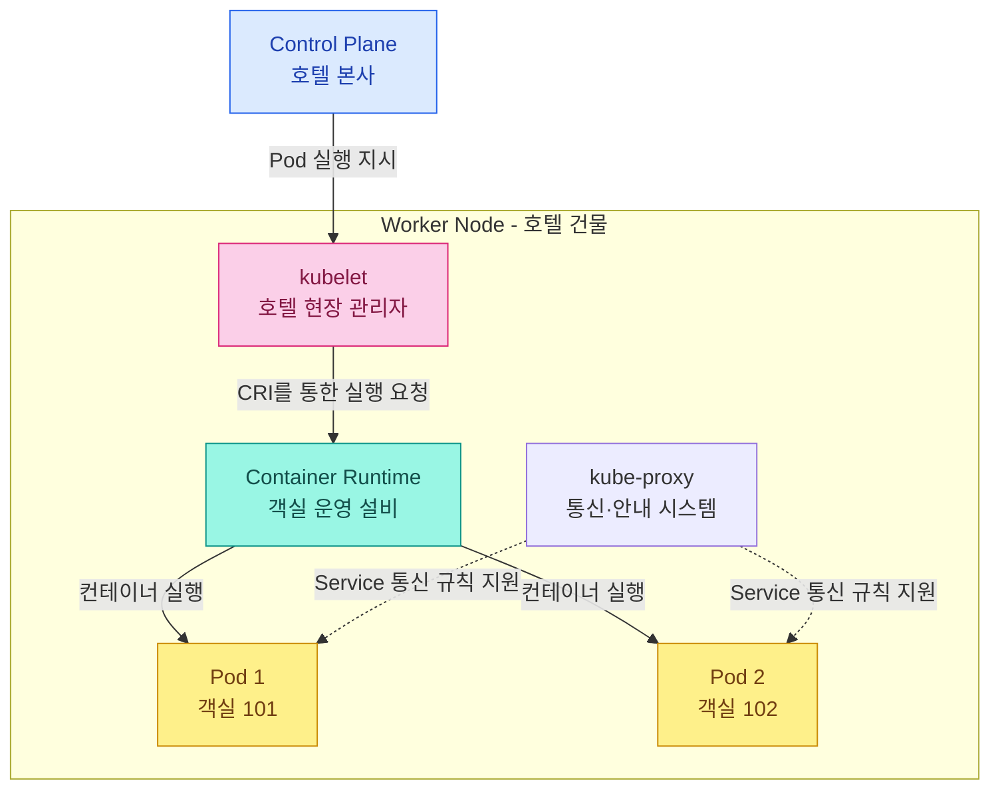

# Kubernetes

---

### 1. How Developers See Kubernetes? (개발자 관점에서 본 쿠버네티스)

개발자가 애플리케이션 구성을 정의하면 쿠버네티스가 이를 워커 노드들에 배치·운영하는 추상화 흐름을 보여줍니다.

* **Developer & Creates App Configurations:** 개발자가 애플리케이션 설정을 작성합니다.

* **Application Descriptions:** 배포할 구성 요소와 수량(`2X`, `4X`, `3X` 등 서로 다른 도형/컴포넌트)을 선언합니다.

* **Kubernetes Master:** `Applies the App Configurations`를 통해 선언된 구성을 클러스터에 적용하고 조율합니다.

* **Cluster of Worker Nodes (`Worker Node 1`, `Worker Node 2`):** 실제 워크로드가 분산 배치되어 실행되는 워커 노드들입니다.

---

### 2. Kubernetes Resources (쿠버네티스 주요 리소스)

대표적인 핵심 리소스 세 가지의 개념과 역할을 나타냅니다.

* **Pods:** 쿠버네티스에서 생성하고 관리할 수 있는 가장 작은 배포/실행 단위입니다. 그림에서는 **Worker Node** 안에서 단일 컨테이너(`C1`)로 구성된 Pod나 여러 컨테이너(`C1`, `C2`, `C3`)가 함께 묶인 Pod 형태를 보여줍니다.

* **Deployment:** 원하는 파드 상태를 선언적으로 관리하는 상위 리소스로, **Replica Set**을 통해 지정된 수의 파드(`Pod 1`, `Pod 2`, `Pod 3`)를 프로비저닝(`Provisions`)하고 유지합니다.

* **Service:** 외부 사용자나 클라이언트 요청이 여러 파드(`Pod 1`, `Pod 2`, `Pod 3`)로 안정적으로 라우팅·연결될 수 있도록 단일 진입점(네트워크 추상화)을 제공합니다.

---

### 3. Kubernetes Architecture (쿠버네티스 아키텍처)

컨트롤 플레인(Master Node)과 데이터 플레인(Worker Node)의 주요 구성 요소를 보여줍니다.

* **진입 도구 (`User Interface`, `Kubectl CLI`):** 사용자나 운영자가 클러스터에 명령을 내리고 상태를 조회하는 인터페이스입니다.

* **Master Node (컨트롤 플레인):**
* **API Server:** 클러스터의 중앙 관문으로, 모든 요청과 상태 변경을 처리합니다.

* **Key Value Store - etcd:** 클러스터의 상태와 구성 데이터를 저장하는 키-값 저장소입니다.

* **Controller-Manager:** 각종 컨트롤러를 실행해 실제 상태가 원하는 상태와 일치하도록 유지합니다.

* **Scheduler:** 새로 생성된 파드를 실행할 적절한 **Worker Node**를 선택해 할당합니다.

* **Worker Node (복수 노드 구성):** 각 노드에는 노드 에이전트인 **Kubelet**, 컨테이너를 실행하는 **Container Runtime**, 네트워크 규칙·라우팅을 담당하는 Network Proxy (kube-proxy)가 동작하며, 그 위에서 실제 **Pod**들이 실행됩니다.

---

### 4. Request Flow In Kubernetes (쿠버네티스 요청 처리 흐름)

파드 생성 요청이 들어온 뒤 실제로 실행되기까지의 5단계를 순서대로 보여줍니다.

1. **Developer Submits a Request:** 개발자가 리소스 생성/배포 요청을 제출합니다.

2. **API Server Processes the Request:** **API Server**가 요청을 검증·처리하고 상태를 기록합니다.

3. **Scheduler Assigns a Node:** **Scheduler**가 파드를 배치할 워커 노드를 결정해 할당합니다.

4. **Kubelet Starts the Pod on the Node:** 할당된 노드의 **Kubelet**이 컨테이너 런타임 등을 통해 파드 구동을 시작합니다.

5. **The Pod Runs:** 파드가 정상적으로 실행 상태에 들어갑니다.

---

# **Kubernetes Worker Node의 구성요소와 역할**

제시하신 그림은 **Kubernetes의 Worker Node(워커 노드) 내부 구조**를 나타냅니다.

Worker Node는 실제 애플리케이션이 실행되는 서버입니다. 물리 서버일 수도 있고, 가상머신(VM)일 수도 있습니다.

그림에는 다음과 같은 구성요소가 있습니다.

- **Pod:** 컨테이너를 실행하고 관리하는 가장 작은 배포 단위
- **Container:** 실제 애플리케이션이 실행되는 공간
- **Container Runtime:** 컨테이너를 실제로 실행하는 소프트웨어
- **kubelet:** Kubernetes의 지시에 따라 Pod를 관리하는 에이전트
- **kube-proxy:** Service 네트워크 트래픽 전달을 지원하는 구성요소

이 구성요소를 **호텔 운영 시스템**에 비유하면 이해하기 쉽습니다.

## **1. Worker Node = 호텔 건물**

[Connectivité Indoor Mobile - Cellnex](https://images.openai.com/static-rsc-4/yhbCVlz350niwQap_xDcxv2wVH4dt4WX9zw8BEY5GjV-wbNBeNnGoGLhG-xSwWUn82sHSJ6d1gsVemdWBM-qfborHT8c6f3HUagD_lFAYItBhuNaTVqd1EhATMwlGFU57TLbbWDdK5FFnl_TjOoUfUUzP6Uqz9RXMSKxWy66Tx4?purpose=inline)

[cellnex.com](https://www.cellnex.com/fr-fr/connectivite-indoor-mobile/?utm_source=chatgpt.com)

하나의 호텔 건물에 여러 객실이 존재하고, 각 객실에는 투숙객이 있습니다.

Kubernetes에서도 하나의 Worker Node에 여러 Pod가 존재하고, 각 Pod 안에는 하나 이상의 컨테이너가 실행됩니다.

| Kubernetes 구성요소   | 호텔에 비유       | 실제 역할                     |
| ----------------- | ------------ | ------------------------- |
| Worker Node       | 호텔 건물        | Pod가 실행되는 서버              |
| Pod               | 객실           | 컨테이너를 함께 배치하는 단위          |
| Container         | 객실의 투숙객      | 실제 애플리케이션 실행              |
| Container Runtime | 객실 운영 설비     | 컨테이너 생성·시작·종료             |
| kubelet           | 호텔 현장 관리자    | Pod 실행 상태 관리              |
| kube-proxy        | 호텔 안내·통신 시스템 | Service 통신을 위한 네트워크 규칙 관리 |

## **2. 각 구성요소 상세 설명**

### **① Pod — 호텔의 객실**

그림에는 두 개의 Pod가 존재합니다.

**Pod 1**

Container 1

Container 2

**Pod 2**

Container 1

- Pod 1에는 컨테이너 2개
- Pod 2에는 컨테이너 1개

**왜 컨테이너를 Pod로 묶을까요?**

호텔의 같은 객실에 머무는 투숙객들이 객실 시설을 공유하는 것처럼, 같은 Pod의 컨테이너는 네트워크 공간과 일부 저장소를 공유할 수 있습니다.

특히 같은 Pod의 컨테이너는 `localhost`로 서로 통신할 수 있습니다.

예를 들어 Pod 1에 FastAPI 컨테이너와 로그 수집 컨테이너를 함께 실행할 수 있습니다.

### **② Container Runtime — 호텔의 객실 운영 설비**

컨테이너 런타임은 컨테이너를 실제로 생성하고 실행합니다.

호텔 관리자가 객실 운영을 지시하더라도 전기, 냉난방, 출입 장치 등이 작동해야 손님이 객실을 사용할 수 있습니다.

이와 비슷하게 kubelet이 Pod 실행을 요청하면 컨테이너 런타임이 실제 컨테이너 실행을 담당합니다.

대표적인 런타임은 `containerd`와 `CRI-O`입니다.

**그림에서 Docker라고 표시된 부분은 개념상 컨테이너 런타임에 해당하지만, 현재 Kubernetes에서는 Docker Engine 대신 containerd 등의 CRI 호환 런타임을 직접 사용하는 것이 일반적입니다.**

### **③ kubelet — 호텔 현장 관리자**

kubelet은 Worker Node에서 실행되는 Kubernetes 에이전트입니다.

호텔 본사가 객실을 준비하라고 지시하면, 호텔 현장 관리자는 객실 준비 상태를 확인하고 필요한 조치를 취합니다.

마찬가지로 kubelet은 Control Plane에서 전달받은 Pod 명세를 바탕으로 컨테이너 런타임을 통해 Pod를 실행하고 상태를 보고합니다.

주요 역할은 다음과 같습니다.

- Pod 명세를 전달받아 실행을 조정
- 컨테이너 런타임에 컨테이너 실행 요청
- Pod 및 컨테이너 상태 감시
- 노드와 Pod 상태를 Control Plane에 보고

### **④ kube-proxy — 호텔의 통신·안내 시스템**

호텔에 여러 객실이 있을 때 전화나 안내 시스템을 이용하면 원하는 서비스에 연결할 수 있습니다.

Kubernetes에서는 여러 Pod가 같은 서비스를 제공할 수 있습니다.

kube-proxy는 Kubernetes Service가 해당 Pod들로 트래픽을 전달할 수 있도록 노드의 네트워크 규칙을 관리합니다.

단, kube-proxy가 모든 네트워크 트래픽을 직접 중계하는 것은 아닙니다. 일반적으로 운영체제의 네트워크 규칙을 설정하며, 일부 Kubernetes 네트워크 구현에서는 kube-proxy를 대체하기도 합니다.

## **3. 실제로 Pod가 실행되는 과정**

호텔 비유를 실제 Kubernetes 실행 흐름과 연결하면 다음과 같습니다.

이 과정에서 Control Plane의 Scheduler는 어느 Worker Node에서 Pod를 실행할지 결정하고, 해당 Node의 kubelet이 실제 실행을 조정합니다.

## **4. 그림에서 수정하면 좋은 부분**

현재 그림의 `docker` 부분을 `Container Runtime (containerd / CRI-O)`으로 변경하면 현대 Kubernetes 구조를 더 정확하게 표현할 수 있습니다.

Kubernetes 1.24부터 내장 `dockershim`이 제거되어 Docker Engine과의 직접 연동이 기본적으로 제공되지 않기 때문입니다. Docker Engine을 별도 CRI 어댑터와 함께 사용하는 구성은 가능합니다.&#x20;

[image](https://www.google.com/s2/favicons?domain=https://kubernetes.io\&sz=32)

Kubernetes+1

또한 그림의 `kube-proxy`는 Service 구현 방식에 따라 생략될 수 있는 선택적 구성요소입니다.&#x20;

[image](https://www.google.com/s2/favicons?domain=https://kubernetes.io\&sz=32)

Kubernetes

## **5. 핵심 정리**

**Worker Node는 컨테이너를 실행하는 서버이며, kubelet은 실행을 관리하고, Container Runtime은 실제 실행을 담당하며, kube-proxy는 Service 통신을 지원합니다.**

입문자에게는 다음 문장으로 설명하면 좋습니다.

> Kubernetes의 Worker Node가 호텔 건물이라면, Pod는 객실, Container는 투숙객, kubelet은 현장 관리자, Container Runtime은 객실 운영 설비, kube-proxy는 통신 안내 시스템입니다. 본사(Control Plane)는 여러 호텔을 통합 관리합니다.

이 비유를 먼저 이해하면 다음 단계인 **Control Plane의 API Server, Scheduler, Controller Manager, etcd** 역할도 자연스럽게 연결할 수 있습니다.

