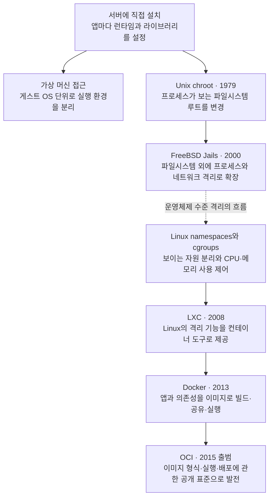
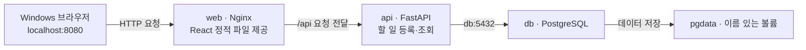

# Windows 11에서 시작하는 Docker 입문 강의안

**수업 목표는 Windows 11에 Docker를 설치하고, 웹 서버·API 서버·DB 서버를 연결해 간단한 풀스택 앱을 실행하면서 Docker의 동작 원리를 이해하는 것입니다.** 실습은 **React + Nginx + FastAPI + PostgreSQL**로 구성한 미니 Todo 앱을 기준으로 잡았습니다. 학생은 브라우저에서 할 일을 등록하고, 컨테이너를 내렸다가 다시 올린 뒤에도 데이터가 남는지 확인합니다.

**권장 시간은 4시간**입니다. React와 FastAPI 코드는 강사가 미리 제공하고, 학생은 Dockerfile 작성, 서버 연결, 데이터 저장 확인을 직접 합니다. 최종 배포 환경은 **수강생의 Windows 11 PC에 있는 Docker Desktop**으로 가정했습니다.

## 1. Docker가 나오기까지의 기술 변화

서버에 앱을 설치할 때는 코드 외에도 런타임, 라이브러리, 시스템 설정이 맞아야 합니다. 한 서버에 여러 앱을 올리면 서로 다른 버전의 의존성이 충돌할 수 있고, 다른 서버에서 같은 구성을 재현하려면 설치 절차도 맞춰야 합니다. 이 문제는 **실행 환경을 어디까지 격리하는가**와 **그 환경을 어떤 단위로 전달하는가**라는 두 가지 질문으로 살펴볼 수 있습니다.



- **가상 머신(VM)**은 게스트 OS와 커널을 포함한 실행 환경을 제공합니다. **Linux 컨테이너**는 같은 Linux 커널 위에서 실행됩니다. `namespaces`는 프로세스가 볼 수 있는 자원의 범위를 나누고, `cgroups`는 CPU·메모리 같은 자원 사용을 제어합니다. Windows 11 실습에서는 **WSL 2가 Linux 커널을 제공**하고, Docker Desktop이 그 환경에서 Linux 컨테이너를 실행합니다. [Linux Foundation의 컨테이너 역사](https://www.linuxfoundation.org/blog/blog/a-brief-look-at-the-roots-of-linux-containers) · [Docker Desktop WSL 2 문서](https://docs.docker.com/desktop/features/wsl/)
- **Docker가 개발자 작업에 가져온 변화**는 앱과 의존성을 이미지로 묶고, 그 이미지를 빌드·공유·실행하는 흐름을 제공한 것입니다. 수업에서는 학생이 소스 코드를 수정한 뒤 이미지를 다시 빌드하고, 새 컨테이너에서 바뀐 응답이 나타나는 것을 관찰합니다. OCI는 이후 업계가 이미지 형식과 실행 방식 등을 공통 규격으로 발전시키는 기반이 됐습니다. [Docker의 2013년 공개 기록](https://www.docker.com/blog/docker-nine-years-young/) · [OCI 표준 개요](https://opencontainers.org/about/overview/)

## 2. 실습 구성



브라우저는 `http://localhost:8080`에서 React 화면을 받고, 같은 주소의 `/api/todos`로 요청을 보냅니다. Nginx는 이 요청을 `api:8000`으로 전달하고, FastAPI는 `db:5432`로 PostgreSQL에 접속합니다. **Windows에 공개하는 포트는 Nginx의 `8080` 하나**입니다. `api`와 `db`는 Compose 네트워크 안에서 사용하는 서비스 이름입니다. [Compose 네트워크 문서](https://docs.docker.com/compose/how-tos/networking/) · [Nginx 프록시 설정](https://nginx.org/en/docs/http/ngx_http_proxy_module.html#proxy_pass)

학생이 직접 다루는 파일은 `api/Dockerfile`, `web/Dockerfile`, Nginx 설정 파일, `compose.yaml`입니다. FastAPI는 `/api/health`와 할 일 등록·조회 API를 제공하고, React는 입력창과 목록만 갖춥니다. 기능을 작게 유지하면 한 건의 등록 요청을 프론트엔드부터 PostgreSQL까지 따라갈 수 있습니다.

## 3. 4시간 실습 진행안

| 시간 | 단계 | 학생이 직접 확인할 결과 |
|---|---|---|
| 30분 | **격리와 패키징 이론** | VM과 컨테이너에서 커널이 어디에 있는지 설명한다. `Dockerfile → 이미지 → 컨테이너` 관계를 말할 수 있다. |
| 45분 | **Windows 11에 설치** | WSL 2를 준비하고 Docker Desktop을 시작한다. `hello-world`를 실행한 뒤 이미지 목록과 종료된 컨테이너 목록을 각각 확인한다. |
| 30분 | **Nginx와 PostgreSQL 실행** | 공식 이미지를 각각 실행한다. 브라우저로 Nginx 화면을 열고, `docker exec`와 `psql`로 DB 안에서 `SELECT 1;`을 실행한다. |
| 40분 | **FastAPI와 React를 이미지로 빌드** | FastAPI용 Dockerfile을 작성하고, React 빌드 결과물을 Nginx 이미지에 넣는다. `RUN`은 빌드 중에, `CMD`는 컨테이너 시작 시 사용되는 것을 확인한다. |
| 55분 | **Compose로 풀스택 앱 실행** | `web`, `api`, `db`를 구성한다. 브라우저에서 할 일을 등록하고 Postman 또는 PowerShell에서 API 응답을 확인한다. |
| 40분 | **장애 진단과 데이터 보존** | DB 주소를 `db`에서 `localhost`로 바꿔 오류를 재현하고 로그로 원인을 찾는다. 올바른 설정으로 복구한 뒤 컨테이너를 재생성해도 등록한 할 일이 남는지 확인한다. |

### Windows 11 설치와 확인

수업 전에 `winver`로 Windows 버전을 확인하고, 작업 관리자에서 하드웨어 가상화가 활성화되어 있는지 확인합니다. 기관 PC는 WSL 활성화와 재부팅 권한도 미리 확인합니다. 공식 설치 문서 기준으로 Docker Desktop의 WSL 백엔드에는 **WSL 2.1.5 이상**이 필요합니다. Windows 에디션과 빌드별 지원 조건은 실습실 PC 기준으로 확인합니다. [Docker Desktop Windows 설치 요건](https://docs.docker.com/desktop/setup/install/windows-install/) · [Microsoft WSL 설치 안내](https://learn.microsoft.com/ko-kr/windows/wsl/install)

WSL이 준비되지 않은 PC에서는 관리자 PowerShell에서 `wsl --install --no-distribution`을 실행하고 재부팅합니다. 이후 `wsl --update`, `wsl --version`으로 업데이트와 버전을 확인합니다. Docker Desktop 설치 후 **Use the WSL 2 based engine**을 확인하고, 앱을 시작한 상태에서 PowerShell로 다음을 실행합니다.

```powershell
docker version
docker compose version
docker info --format '{{.OSType}}'
docker run --rm hello-world
```

`docker version`에 **Server** 정보가 나오고, `docker info` 결과가 `linux`이며, `hello-world` 메시지가 출력되면 설치 확인이 끝납니다. 이미지와 컨테이너 목록을 비교하는 실습에서는 `docker run hello-world`로 다시 실행한 뒤 `docker image ls`와 `docker ps -a`를 확인합니다. `--rm`으로 실행한 컨테이너는 종료 시 자동으로 제거됩니다.

### Compose로 연결하고 검증하기

`compose.yaml`에서 `web`은 호스트의 `127.0.0.1:8080`을 컨테이너의 `80`에 연결합니다. `api`는 컨테이너 안에서 `0.0.0.0:8000`으로 요청을 받고 DB 주소로 `db`를 사용합니다. `db`에는 `postgres:18`을 사용하고, `pgdata` 볼륨을 `/var/lib/postgresql`에 연결합니다. DB에 `pg_isready` 헬스체크를 두고, API는 DB가 준비된 뒤 시작하도록 설정합니다. [Docker PostgreSQL 실습 문서](https://docs.docker.com/guides/postgresql/immediate-setup-and-data-persistence/) · [Compose 시작 순서](https://docs.docker.com/compose/how-tos/startup-order/)

```powershell
docker compose config --quiet
docker compose up -d --build
docker compose ps
Invoke-RestMethod http://localhost:8080/api/health
docker compose logs --tail=50 api db
```

브라우저에서 할 일을 한 건 등록한 뒤 `docker compose down`과 `docker compose up -d`를 실행합니다. 화면을 새로 열어 같은 할 일이 보이면 **컨테이너와 볼륨의 수명이 다르다**는 것을 확인한 것입니다. `docker compose down -v`는 이 실습의 이름 있는 볼륨까지 삭제하므로, 데이터 초기화 실험에서만 사용합니다.

## 4. 수업 완료 기준

수강생이 새로 받은 실습 프로젝트를 Compose로 실행하고, **브라우저에서 할 일을 등록·조회하며, 컨테이너를 재생성한 뒤에도 데이터를 확인**하면 실습을 완료한 것으로 봅니다. 마무리에서는 세 가지를 설명하게 합니다.

1. React 화면을 제공하는 서버와 할 일을 저장하는 서버는 각각 무엇인가?
2. 브라우저는 `localhost:8080`으로 접속하는데, FastAPI는 왜 DB에 `db:5432`로 접속하는가?
3. FastAPI 코드를 수정했을 때 무엇을 다시 빌드해야 하며, 컨테이너를 재생성했을 때 PostgreSQL 데이터는 어디에 남는가?

이 강의안은 강사가 제공하는 실습용 앱 코드를 전제로 합니다. 실습 파일 작성과 Windows 11에서의 전체 실행 검증은 별도 작업입니다.
