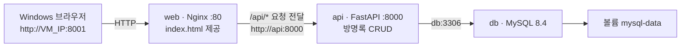
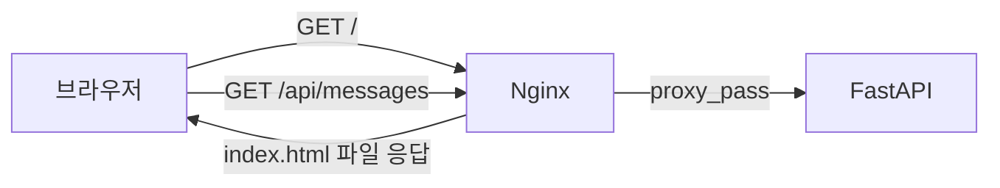

# Docker 실전 예제: MySQL + FastAPI + Nginx로 방명록 서비스 배포하기

**선수 과목:** [docker_ubuntu_기초강의.md](docker_ubuntu_기초강의.md) (run·포트·볼륨·Dockerfile·Compose 기초)
**목표:** MySQL을 공식 이미지로 띄우고, FastAPI로 API 서버를 만들고, Nginx로 화면을 제공해 **브라우저 → 웹 서버 → API 서버 → DB**까지 이어지는 서비스를 Docker로 배포한다.
**권장 시간:** 4시간
**환경:** 기초 강의와 같은 VirtualBox Ubuntu 공유 서버 (`$USER`, `$MYPORT` 규칙 그대로 사용)

---

## 0. 완성 모습

브라우저에서 이름과 메시지를 입력하면 방명록에 저장되고, 목록에 표시되며, 삭제할 수 있습니다. 컨테이너를 모두 지웠다 다시 올려도 글은 남아 있습니다.



| 서비스 | 이미지 | 역할 | VM 밖으로 공개? |
|---|---|---|---|
| `web` | 직접 빌드 (nginx 기반) | HTML 화면 제공, `/api` 요청을 api로 전달 | **예** (`$MYPORT`) |
| `api` | 직접 빌드 (python 기반) | 방명록 조회·등록·삭제 API | 아니오 |
| `db` | `mysql:8.4` 공식 이미지 | 데이터 저장 | 아니오 |

> **핵심 설계:** 외부에 여는 포트는 **web 하나뿐**입니다. DB와 API는 Docker 내부 네트워크에서만 통신합니다. 공유 서버에서 3306 포트 충돌이 생기지 않고, 보안상으로도 올바른 구조입니다.

### 최종 폴더 구조

```
~/docker-lab/guestbook/
├── .env                 # 포트, DB 비밀번호 등 설정값
├── compose.yaml         # 전체 서비스 구성
├── db/
│   └── init.sql         # DB 최초 생성 시 실행할 SQL
├── api/
│   ├── Dockerfile
│   ├── requirements.txt
│   └── main.py          # FastAPI 서버
└── web/
    ├── Dockerfile
    ├── nginx.conf       # /api 프록시 설정
    └── index.html       # 화면 (HTML + JavaScript)
```

---

## 1. [강사 사전 준비]

### 이미지 미리 받기

```bash
sudo docker pull mysql:8.4
sudo docker pull python:3.12-slim
sudo docker pull nginx:1.27-alpine
```

### ⚠️ VM 메모리 확인

MySQL 컨테이너 하나가 **약 400~500MB**의 메모리를 씁니다. 20명이 동시에 띄우면 10GB 가까이 필요합니다.

```bash
free -h          # available 값 확인
```

| VM 메모리 | 권장 운영 |
|---|---|
| 16GB 이상 | 전원 개별 실습 가능 |
| 8GB | 2인 1조로 운영 (한 사람 계정에서만 실행) |
| 4GB 이하 | 강사 시연 위주, 수강생은 번갈아 실행 |

VirtualBox 메모리는 VM을 끈 상태에서 **설정 → 시스템 → 기본 메모리**에서 늘릴 수 있습니다.

---

## 2. 시간 계획

| 시간 | 단계 | 확인할 결과 |
|---|---|---|
| 40분 | **1단계: MySQL 컨테이너** | 공식 이미지로 MySQL을 띄우고, 컨테이너 안에서 SQL로 테이블을 만든다. 컨테이너를 지워도 데이터가 남는다 |
| 60분 | **2단계: FastAPI 서버** | API 코드를 이미지로 빌드하고, 같은 네트워크의 MySQL에 연결한다. Swagger 화면에서 API를 테스트한다 |
| 30분 | **3단계: 프론트엔드** | Nginx가 HTML을 제공하고 `/api` 요청을 FastAPI로 넘긴다. 브라우저에서 글을 등록한다 |
| 50분 | **4단계: Compose로 배포** | 3개의 `docker run`을 `compose.yaml` 하나로 바꾸고, 명령 한 번으로 전체 서비스를 올린다 |
| 40분 | **5단계: 운영 실습** | 데이터 보존, 코드 수정 후 재배포, 장애 재현과 로그로 원인 찾기 |

---

## 3. 1단계 — MySQL을 이미지로 설치하기 (40분)

### 3-1. "설치"가 아니라 "실행"

기존 방식으로 MySQL을 쓰려면 `apt install mysql-server`, 설정 파일 수정, 사용자 생성을 해야 합니다. Docker에서는 **공식 이미지를 실행하면 끝**이고, 초기 설정은 **환경 변수**로 넘깁니다.

| 환경 변수 | 의미 |
|---|---|
| `MYSQL_ROOT_PASSWORD` | root 비밀번호 (필수) |
| `MYSQL_DATABASE` | 처음 시작할 때 만들 데이터베이스 이름 |
| `MYSQL_USER` / `MYSQL_PASSWORD` | 처음 시작할 때 만들 일반 사용자. 위 DB에 대한 모든 권한을 받음 |

### 3-2. 네트워크와 볼륨 만들기

컨테이너끼리 이름으로 찾아가려면 **사용자 정의 네트워크**가 필요합니다.

```bash
docker network create $USER-net
docker volume create $USER-mysql
```

### 3-3. MySQL 실행

```bash
docker run -d --name $USER-mysql \
  --network $USER-net \
  -e MYSQL_ROOT_PASSWORD=root1234 \
  -e MYSQL_DATABASE=guestbook \
  -e MYSQL_USER=app \
  -e MYSQL_PASSWORD=app1234 \
  -v $USER-mysql:/var/lib/mysql \
  mysql:8.4
```

- `-p` 옵션이 **없습니다.** 외부에 3306을 열지 않고, 같은 네트워크의 컨테이너만 접근하게 합니다.
- `/var/lib/mysql`은 MySQL이 데이터를 저장하는 폴더입니다. 여기에 볼륨을 연결해야 컨테이너를 지워도 데이터가 남습니다.

처음 실행할 때는 초기화에 20~30초가 걸립니다. 로그로 확인합니다.

```bash
docker logs -f $USER-mysql
# ... ready for connections ... port: 3306  ← 이 줄이 나오면 Ctrl+C
```

> 로그에 `ready for connections`가 **두 번** 나옵니다. 첫 번째는 초기화용 임시 서버(port: 0), 두 번째(port: 3306)가 진짜입니다.

### 3-4. 컨테이너 안에서 SQL 실행

```bash
docker exec -it $USER-mysql mysql -u app -papp1234 --default-character-set=utf8mb4 guestbook
```

`mysql>` 프롬프트에서:

```sql
SHOW DATABASES;

CREATE TABLE messages (
  id         INT AUTO_INCREMENT PRIMARY KEY,
  name       VARCHAR(50)  NOT NULL,
  content    VARCHAR(500) NOT NULL,
  created_at DATETIME     NOT NULL DEFAULT CURRENT_TIMESTAMP
) DEFAULT CHARSET=utf8mb4;

INSERT INTO messages (name, content) VALUES ('강사', '첫 번째 방명록입니다');
SELECT * FROM messages;
exit
```

### 3-5. 컨테이너를 지워도 데이터가 남는지 확인

```bash
docker rm -f $USER-mysql

# 같은 볼륨으로 다시 실행 (환경 변수는 이제 무시됨 - 이미 초기화된 볼륨이므로)
docker run -d --name $USER-mysql --network $USER-net \
  -e MYSQL_ROOT_PASSWORD=root1234 \
  -v $USER-mysql:/var/lib/mysql mysql:8.4

# 10초 정도 기다린 뒤
docker exec -it $USER-mysql mysql -u app -papp1234 --default-character-set=utf8mb4 guestbook -e "SELECT * FROM messages;"
```

방금 넣은 글이 그대로 보입니다.

> **중요한 함정:** `MYSQL_DATABASE`, `MYSQL_USER` 같은 환경 변수는 **볼륨이 비어 있을 때 딱 한 번만** 적용됩니다. 비밀번호를 바꾸고 싶어서 환경 변수만 바꿔도 반영되지 않습니다. 이 함정은 5단계에서 다시 다룹니다.

---

## 4. 2단계 — FastAPI로 API 서버 만들기 (60분)

### 4-1. API 설계

| 메서드 | 경로 | 설명 | 성공 응답 |
|---|---|---|---|
| GET | `/api/health` | 서버와 DB 연결 상태 | `200 {"status":"ok","db":"ok"}` |
| GET | `/api/messages` | 방명록 목록 (최신 50개) | `200 [...]` |
| POST | `/api/messages` | 방명록 등록 `{"name":..., "content":...}` | `201 {...}` |
| DELETE | `/api/messages/{id}` | 방명록 삭제 | `204` |

모든 경로를 `/api`로 시작하게 만들면, 나중에 Nginx가 `/api`로 시작하는 요청만 골라 FastAPI로 넘기기 쉽습니다.

### 4-2. 코드 작성

```bash
mkdir -p ~/docker-lab/guestbook/{api,web,db}
cd ~/docker-lab/guestbook/api
```

**api/requirements.txt**

```
fastapi
uvicorn[standard]
pymysql
cryptography
```

> `cryptography`는 MySQL 8의 기본 로그인 방식(`caching_sha2_password`)에 PyMySQL이 접속할 때 필요합니다. 빠뜨리면 접속 단계에서 오류가 납니다.

**api/main.py**

```python
import os

import pymysql
from fastapi import APIRouter, FastAPI, HTTPException
from pydantic import BaseModel, Field


# ── DB 연결 ─────────────────────────────────────────
# 접속 정보는 코드에 적지 않고 환경 변수로 받는다.
def get_conn():
    return pymysql.connect(
        host=os.getenv("DB_HOST", "db"),
        port=int(os.getenv("DB_PORT", "3306")),
        user=os.getenv("DB_USER", "app"),
        password=os.getenv("DB_PASSWORD", ""),
        database=os.getenv("DB_NAME", "guestbook"),
        charset="utf8mb4",
        cursorclass=pymysql.cursors.DictCursor,  # 결과를 dict로 받기
        autocommit=True,
    )


# ── 요청 데이터 형식 ────────────────────────────────
class MessageIn(BaseModel):
    name: str = Field(min_length=1, max_length=50)
    content: str = Field(min_length=1, max_length=500)


app = FastAPI(
    title="방명록 API",
    docs_url="/api/docs",            # Swagger 화면 주소
    openapi_url="/api/openapi.json",
)
router = APIRouter(prefix="/api")


@router.get("/health")
def health():
    try:
        with get_conn() as conn, conn.cursor() as cur:
            cur.execute("SELECT 1")
        return {"status": "ok", "db": "ok"}
    except pymysql.MySQLError as e:
        raise HTTPException(status_code=503, detail=f"DB 연결 실패: {e}")


@router.get("/messages")
def list_messages():
    with get_conn() as conn, conn.cursor() as cur:
        cur.execute(
            "SELECT id, name, content, created_at "
            "FROM messages ORDER BY id DESC LIMIT 50"
        )
        return cur.fetchall()


@router.post("/messages", status_code=201)
def create_message(msg: MessageIn):
    with get_conn() as conn, conn.cursor() as cur:
        # %s 자리표시자를 쓰면 PyMySQL이 값을 안전하게 처리한다 (SQL 인젝션 방지)
        cur.execute(
            "INSERT INTO messages (name, content) VALUES (%s, %s)",
            (msg.name, msg.content),
        )
        cur.execute(
            "SELECT id, name, content, created_at FROM messages WHERE id = %s",
            (cur.lastrowid,),
        )
        return cur.fetchone()


@router.delete("/messages/{message_id}", status_code=204)
def delete_message(message_id: int):
    with get_conn() as conn, conn.cursor() as cur:
        deleted = cur.execute("DELETE FROM messages WHERE id = %s", (message_id,))
        if deleted == 0:
            raise HTTPException(status_code=404, detail="없는 메시지입니다")


app.include_router(router)
```

> **수업 포인트 — SQL 인젝션:** `f"INSERT ... VALUES ('{msg.name}')"`처럼 문자열을 직접 이어 붙이면 안 됩니다. 사용자가 이름에 `'); DROP TABLE messages; --`를 넣으면 테이블이 지워질 수 있습니다. 반드시 `%s` 자리표시자와 값 튜플을 따로 넘깁니다.

**api/Dockerfile**

```dockerfile
FROM python:3.12-slim

WORKDIR /app

COPY requirements.txt .
RUN pip install --no-cache-dir -r requirements.txt

COPY main.py .

EXPOSE 8000

# 0.0.0.0: 컨테이너 밖(다른 컨테이너, 포트 포워딩)에서 오는 요청도 받는다
CMD ["uvicorn", "main:app", "--host", "0.0.0.0", "--port", "8000"]
```

### 4-3. 빌드하고 MySQL과 연결해서 실행

```bash
docker build -t $USER/guestbook-api:1.0 .

docker run -d --name $USER-api \
  --network $USER-net \
  --network-alias api \
  -p $MYPORT:8000 \
  -e DB_HOST=$USER-mysql \
  -e DB_USER=app \
  -e DB_PASSWORD=app1234 \
  -e DB_NAME=guestbook \
  $USER/guestbook-api:1.0
```

- `DB_HOST=$USER-mysql` — 같은 사용자 정의 네트워크 안에서는 **컨테이너 이름이 곧 주소**입니다.
- `--network-alias api` — 이 컨테이너를 네트워크 안에서 `api`라는 이름으로도 찾을 수 있게 합니다. 3단계의 Nginx 설정에서 사용합니다.
- `-p $MYPORT:8000` — 지금은 테스트를 위해 API를 잠깐 외부에 엽니다. 3단계에서 닫습니다.

### 4-4. API 테스트

**curl로 테스트 (VM 터미널):**

```bash
curl http://localhost:$MYPORT/api/health

curl http://localhost:$MYPORT/api/messages

curl -X POST http://localhost:$MYPORT/api/messages \
  -H "Content-Type: application/json" \
  -d '{"name":"홍길동","content":"API로 등록한 글"}'

curl -i -X DELETE http://localhost:$MYPORT/api/messages/1     # HTTP/1.1 204
curl -i -X DELETE http://localhost:$MYPORT/api/messages/999   # HTTP/1.1 404
```

**Swagger로 테스트 (Windows 브라우저):**

`http://<VM_IP>:<내 포트>/api/docs`에 접속합니다. FastAPI가 자동으로 만든 문서 화면에서 각 API의 **Try it out → Execute**로 바로 호출해 볼 수 있습니다.

**잘못된 요청도 보내 봅니다:**

```bash
curl -i -X POST http://localhost:$MYPORT/api/messages \
  -H "Content-Type: application/json" \
  -d '{"name":"","content":"이름 없음"}'
# HTTP/1.1 422 → Pydantic이 min_length=1 규칙으로 막아 줌
```

---

## 5. 3단계 — 프론트엔드: Nginx로 화면 제공하기 (30분)

### 5-1. 왜 Nginx를 앞에 두나



- 브라우저 입장에서는 **화면과 API가 같은 주소(`VM_IP:8001`)** 입니다. 그래서 CORS 설정이 필요 없습니다.
- FastAPI는 외부에 직접 노출되지 않습니다.
- 이런 구성을 **리버스 프록시**라고 합니다.

### 5-2. 코드 작성

```bash
cd ~/docker-lab/guestbook/web
```

**web/nginx.conf**

```nginx
server {
    listen 80;

    # 화면 파일
    location / {
        root  /usr/share/nginx/html;
        index index.html;
    }

    # /api 로 시작하는 요청은 FastAPI 컨테이너로 전달
    location /api/ {
        proxy_pass http://api:8000;          # 'api' = 네트워크 안에서의 이름
        proxy_set_header Host $host;
        proxy_set_header X-Real-IP $remote_addr;
    }
}
```

**web/index.html**

```html
<!doctype html>
<html lang="ko">
<head>
  <meta charset="utf-8">
  <meta name="viewport" content="width=device-width, initial-scale=1">
  <title>Docker 방명록</title>
  <style>
    body { font-family: sans-serif; max-width: 640px; margin: 40px auto; padding: 0 16px; }
    form { display: grid; gap: 8px; margin-bottom: 24px; }
    input, textarea, button { font-size: 16px; padding: 8px; }
    .msg { border-bottom: 1px solid #ddd; padding: 12px 0; }
    .meta { color: #888; font-size: 13px; }
    .del { float: right; }
    #status { font-size: 13px; }
  </style>
</head>
<body>
  <h1>🐳 Docker 방명록</h1>
  <p id="status">서버 상태 확인 중...</p>

  <form id="form">
    <input id="name" placeholder="이름" maxlength="50" required>
    <textarea id="content" placeholder="남길 말" maxlength="500" rows="3" required></textarea>
    <button>등록</button>
  </form>

  <div id="list"></div>

  <script>
    const list = document.getElementById("list");

    async function checkHealth() {
      const res = await fetch("/api/health");
      document.getElementById("status").textContent =
        res.ok ? "🟢 API·DB 정상" : "🔴 서버 오류 (" + res.status + ")";
    }

    async function load() {
      const res = await fetch("/api/messages");
      const messages = await res.json();
      list.innerHTML = "";
      for (const m of messages) {
        const div = document.createElement("div");
        div.className = "msg";

        const del = document.createElement("button");
        del.className = "del";
        del.textContent = "삭제";
        del.onclick = () => remove(m.id);

        const body = document.createElement("div");
        body.textContent = m.content;          // textContent: HTML로 해석하지 않음 (XSS 방지)

        const meta = document.createElement("div");
        meta.className = "meta";
        // DB 시간은 UTC이므로 'Z'를 붙여 브라우저의 현지 시간으로 표시
        meta.textContent = m.name + " · " + new Date(m.created_at + "Z").toLocaleString();

        div.append(del, body, meta);
        list.append(div);
      }
    }

    async function remove(id) {
      await fetch("/api/messages/" + id, { method: "DELETE" });
      load();
    }

    document.getElementById("form").onsubmit = async (e) => {
      e.preventDefault();
      const res = await fetch("/api/messages", {
        method: "POST",
        headers: { "Content-Type": "application/json" },
        body: JSON.stringify({
          name: document.getElementById("name").value,
          content: document.getElementById("content").value,
        }),
      });
      if (!res.ok) { alert("등록 실패: " + res.status); return; }
      document.getElementById("content").value = "";
      load();
    };

    checkHealth();
    load();
  </script>
</body>
</html>
```

**web/Dockerfile**

```dockerfile
FROM nginx:1.27-alpine
COPY nginx.conf /etc/nginx/conf.d/default.conf
COPY index.html /usr/share/nginx/html/index.html
```

### 5-3. 빌드하고 실행

API 컨테이너는 이제 외부 포트가 필요 없으므로 `-p` 없이 다시 띄웁니다. 그 포트는 Nginx가 사용합니다.

```bash
docker rm -f $USER-api
docker run -d --name $USER-api --network $USER-net --network-alias api \
  -e DB_HOST=$USER-mysql -e DB_USER=app -e DB_PASSWORD=app1234 -e DB_NAME=guestbook \
  $USER/guestbook-api:1.0

docker build -t $USER/guestbook-web:1.0 .
docker run -d --name $USER-web --network $USER-net -p $MYPORT:80 $USER/guestbook-web:1.0
```

Windows 브라우저에서 `http://<VM_IP>:<내 포트>`에 접속해 글을 등록하고 삭제해 봅니다. **프론트부터 DB까지 배포 완료!**

> **질문 던지기:** "방금 서비스를 띄우려고 `docker run`을 몇 번, 옵션을 몇 개 썼나요? 내일 다시 띄우라고 하면 기억할 수 있나요?" → 4단계 Compose로 넘어갑니다.

### 5-4. 수동으로 띄운 것 정리

```bash
docker rm -f $USER-web $USER-api $USER-mysql
docker network rm $USER-net
docker volume rm $USER-mysql
```

---

## 6. 4단계 — Docker Compose로 한 번에 배포하기 (50분)

### 6-1. DB 초기화 스크립트

1단계에서 손으로 만들었던 테이블을 파일로 만듭니다. MySQL 이미지는 `/docker-entrypoint-initdb.d/` 폴더의 `.sql` 파일을 **데이터 볼륨이 비어 있는 첫 실행 때** 자동으로 실행합니다.

**db/init.sql**

```sql
SET NAMES utf8mb4;

CREATE TABLE IF NOT EXISTS messages (
  id         INT AUTO_INCREMENT PRIMARY KEY,
  name       VARCHAR(50)  NOT NULL,
  content    VARCHAR(500) NOT NULL,
  created_at DATETIME     NOT NULL DEFAULT CURRENT_TIMESTAMP
) DEFAULT CHARSET=utf8mb4;

INSERT INTO messages (name, content) VALUES ('강사', 'Docker 방명록에 오신 것을 환영합니다!');
```

### 6-2. 설정값 파일 (.env)

비밀번호와 포트처럼 **환경마다 달라지는 값**은 `compose.yaml`에 직접 쓰지 않고 `.env`로 분리합니다.

```bash
cd ~/docker-lab/guestbook
cat > .env <<EOF
COMPOSE_PROJECT_NAME=$USER
MYPORT=$MYPORT
DB_ROOT_PASSWORD=root1234
DB_NAME=guestbook
DB_USER=app
DB_PASSWORD=app1234
EOF
cat .env
```

> ⚠️ `.env`에는 비밀번호가 들어 있으므로 **Git에 올리지 않습니다.** 실무에서는 `.gitignore`에 `.env`를 넣고, 값 없이 키만 적은 `.env.example`을 대신 공유합니다.

### 6-3. compose.yaml

```yaml
services:
  db:
    image: mysql:8.4
    environment:
      MYSQL_ROOT_PASSWORD: ${DB_ROOT_PASSWORD}
      MYSQL_DATABASE: ${DB_NAME}
      MYSQL_USER: ${DB_USER}
      MYSQL_PASSWORD: ${DB_PASSWORD}
    volumes:
      - mysql-data:/var/lib/mysql
      - ./db/init.sql:/docker-entrypoint-initdb.d/init.sql:ro
    healthcheck:
      # TCP(127.0.0.1)로 확인해야 초기화용 임시 서버가 아닌 진짜 서버가 떴을 때 healthy가 된다
      test: ["CMD-SHELL", "mysqladmin ping -h 127.0.0.1 -uroot -p$$MYSQL_ROOT_PASSWORD --silent"]
      interval: 5s
      timeout: 3s
      retries: 20
      start_period: 30s

  api:
    build: ./api
    environment:
      DB_HOST: db                 # 서비스 이름이 곧 주소
      DB_PORT: 3306
      DB_NAME: ${DB_NAME}
      DB_USER: ${DB_USER}
      DB_PASSWORD: ${DB_PASSWORD}
    depends_on:
      db:
        condition: service_healthy   # DB가 접속 가능해진 뒤에 시작

  web:
    build: ./web
    ports:
      - "${MYPORT}:80"            # 외부에 여는 포트는 여기 하나뿐
    depends_on:
      - api

volumes:
  mysql-data:
```

**수동 실행과 비교해 보기:**

| 수동 (`docker run`) | Compose |
|---|---|
| `docker network create $USER-net` | 자동 생성 (`student01_default`) |
| `--network-alias api`, `DB_HOST=$USER-mysql` | 서비스 이름 `api`, `db`가 자동으로 주소가 됨 |
| MySQL이 뜰 때까지 사람이 로그를 보며 기다림 | `healthcheck` + `condition: service_healthy` |
| 명령 3개 + 옵션 20여 개 | `docker compose up -d --build` 한 줄 |

> `$$MYSQL_ROOT_PASSWORD`처럼 `$`를 두 번 쓴 이유: `$` 하나는 Compose가 `.env`에서 값을 찾아 바꿉니다. `$$`는 "바꾸지 말고 `$` 그대로 컨테이너에 넘겨라"라는 뜻이라, 컨테이너 안의 환경 변수가 사용됩니다.

### 6-4. 배포

```bash
docker compose config              # 변수가 채워진 최종 설정 확인
docker compose up -d --build
docker compose ps                  # db가 (healthy)가 된 뒤 api, web이 Up
```

`docker compose ps`를 몇 번 반복해 보면 db가 `starting` → `healthy`로 바뀐 다음 api가 시작되는 순서를 볼 수 있습니다.

```bash
curl http://localhost:$MYPORT/api/health
curl http://localhost:$MYPORT/api/messages      # init.sql의 환영 글이 보임
docker compose logs -f                          # 브라우저에서 글을 등록하며 로그 관찰 (Ctrl+C)
```

Windows 브라우저에서 `http://<VM_IP>:<내 포트>` 접속 → 글 등록·삭제가 되면 배포 성공입니다.

---

## 7. 5단계 — 운영 실습 (40분)

### 7-1. 데이터가 남는지 확인

```bash
# 브라우저에서 글을 2~3개 등록한 뒤
docker compose down                # 컨테이너·네트워크 삭제, 볼륨은 유지
docker compose up -d
# 브라우저 새로고침 → 글이 그대로 남아 있음
```

DB에 직접 들어가 확인할 수도 있습니다.

```bash
docker compose exec db mysql -u app -papp1234 --default-character-set=utf8mb4 guestbook \
  -e "SELECT id, name, content FROM messages;"
```

> `docker compose exec`는 서비스 이름(`db`)으로 컨테이너를 지정하므로, 실제 컨테이너 이름(`student01-db-1`)을 몰라도 됩니다.

### 7-2. 코드 수정 후 재배포

**API만 수정하는 경우:** `api/main.py`의 목록 개수를 `LIMIT 50` → `LIMIT 5`로 바꿉니다.

```bash
docker compose up -d --build api   # api만 다시 빌드하고 교체
docker compose ps                  # db, web은 재시작되지 않음 (CREATED 시간 비교)
```

**화면만 수정하는 경우:** `web/index.html`의 제목을 바꿉니다.

```bash
docker compose up -d --build web
```

> 소스 코드는 **이미지 안에 복사**되어 있으므로, 파일만 고치고 다시 빌드하지 않으면 반영되지 않습니다. 기초 강의의 바인드 마운트(`-v`)와 비교해 설명합니다.

### 7-3. 함정: init.sql은 처음 한 번만 실행된다

`db/init.sql`의 환영 문구를 바꾸고 다시 올려 봅니다.

```bash
docker compose up -d --force-recreate db
curl http://localhost:$MYPORT/api/messages     # 문구가 바뀌지 않음!
```

**이유:** `mysql-data` 볼륨에 이미 데이터가 있으므로 MySQL이 초기화 단계를 건너뜁니다. `MYSQL_PASSWORD`를 바꿨을 때도 마찬가지입니다.

```bash
docker compose down -v             # 볼륨까지 삭제 → 모든 글이 지워짐 (되돌릴 수 없음)
docker compose up -d
curl http://localhost:$MYPORT/api/messages     # 바뀐 문구가 보임
```

> 실무에서는 운영 중인 DB의 테이블 구조를 바꿀 때 볼륨을 지우지 않고, 마이그레이션 도구(Alembic 등)로 변경 SQL을 순서대로 적용합니다.

### 7-4. 장애 재현과 원인 찾기

**장애 ① DB가 멈췄을 때**

```bash
docker compose stop db
curl -i http://localhost:$MYPORT/api/health    # 503, "DB 연결 실패"
# 브라우저 상단에 🔴 서버 오류 (503)
docker compose logs --tail=20 api
docker compose start db                        # 잠시 후 다시 정상
```

**장애 ② DB 주소를 잘못 설정했을 때**

`compose.yaml`의 `DB_HOST: db`를 `DB_HOST: localhost`로 바꾸고 적용합니다.

```bash
docker compose up -d
curl http://localhost:$MYPORT/api/health
# "DB 연결 실패: (2003, "Can't connect to MySQL server on 'localhost' ...")"
```

> **왜?** api 컨테이너의 `localhost`는 api 컨테이너 자신입니다. 그 안에는 MySQL이 없습니다. 다른 컨테이너는 **서비스 이름**으로 찾아가야 합니다. 원래대로 `db`로 되돌리고 `docker compose up -d`.

**장애 ③ 비밀번호가 틀렸을 때**

`.env`의 `DB_PASSWORD`만 `wrong`으로 바꾸고 `docker compose up -d` → `/api/health`에서 `Access denied for user 'app'` 확인 → 되돌립니다.

> 이때 MySQL 쪽 비밀번호는 바뀌지 않습니다(7-3의 함정). api가 보내는 비밀번호만 바뀌어 접속이 거부되는 것입니다.

### 7-5. 정리

```bash
cd ~/docker-lab/guestbook
docker compose down -v
docker image rm $USER/guestbook-api:1.0 $USER/guestbook-web:1.0
docker image ls | grep $USER       # Compose가 빌드한 student01-api, student01-web 이미지도 확인 후 삭제
```

---

## 8. 자주 나오는 오류

| 증상 | 원인 / 해결 |
|---|---|
| api 로그에 `Can't connect to MySQL server on 'db'` (시작 직후) | MySQL 초기화가 끝나기 전에 접속함 → `healthcheck`와 `condition: service_healthy` 설정 확인 |
| `RuntimeError: 'cryptography' package is required` | `requirements.txt`에 `cryptography` 누락 → 추가 후 `--build` |
| `Access denied for user 'app'` | 비밀번호 불일치, 또는 볼륨이 예전 비밀번호로 이미 초기화됨 → 7-3 참고 |
| `Table 'guestbook.messages' doesn't exist` | init.sql이 실행되지 않음 (볼륨이 이미 있었거나, 파일 경로·마운트 오타) → `docker compose down -v` 후 재실행 |
| web 컨테이너가 바로 종료, 로그에 `host not found in upstream "api"` | Nginx가 시작할 때 `api`를 찾지 못함 → api 서비스 이름·`depends_on` 확인, 수동 실행 시 `--network-alias api` 확인 |
| 브라우저에 `502 Bad Gateway` | Nginx는 떴지만 api가 죽어 있음 → `docker compose logs api` |
| 화면은 뜨는데 목록이 비어 있고 콘솔에 404 | `nginx.conf`의 `location /api/`나 FastAPI의 `/api` prefix 불일치 |
| 한글이 `???`로 저장됨 | 테이블·접속 문자셋 확인 (`utf8mb4`). mysql 클라이언트는 `--default-character-set=utf8mb4` |
| MySQL 컨테이너가 반복 재시작, 로그에 메모리 관련 오류 | VM 메모리 부족 → `free -h`, 1장의 메모리 운영 표 참고 |

---

## 9. 확인 문제

1. 이 서비스에서 VM 밖으로 공개된 포트는 몇 개이고, 왜 DB 포트는 공개하지 않았나요?
2. 수동 실행에서는 `DB_HOST=$USER-mysql`, Compose에서는 `DB_HOST=db`를 썼습니다. 각각 왜 그 이름으로 접속되나요?
3. `MYSQL_PASSWORD`를 바꾸고 `docker compose up -d`를 했는데 새 비밀번호로 로그인이 안 됩니다. 이유와 해결 방법은?
4. 브라우저가 `/api/messages`를 요청했을 때 그 요청이 거치는 컨테이너를 순서대로 쓰세요.
5. `depends_on`에 `condition: service_healthy`를 쓰지 않으면 어떤 문제가 생길 수 있나요?
6. `api/main.py`를 수정한 뒤 반영하려면 어떤 명령을 실행해야 하나요? 이때 db 컨테이너는 다시 만들어지나요?
7. SQL에서 `%s` 자리표시자를 쓰는 이유는 무엇인가요?

### 과제 (선택)

1. **수정 기능 추가:** `PUT /api/messages/{id}` API를 만들고, 화면에 "수정" 버튼을 추가해 재배포합니다.
2. **phpMyAdmin 추가:** `compose.yaml`에 `phpmyadmin` 서비스를 추가해 브라우저로 DB를 볼 수 있게 합니다. (힌트: `PMA_HOST: db`, 포트는 강사에게 추가 배정받기)
3. **비밀번호 분리 심화:** `.env.example`을 만들고, `.gitignore`에 `.env`를 추가한 Git 저장소로 정리해 제출합니다.

---

> React 빌드, PostgreSQL을 사용하는 비슷한 구성은 [docker.md](docker.md)를 참고하세요.
