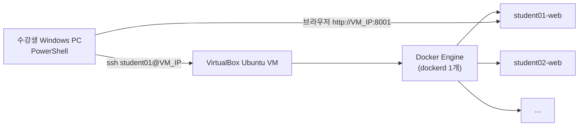
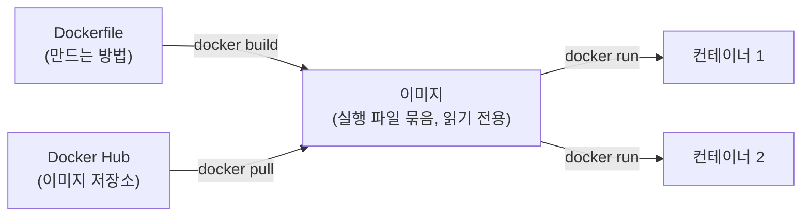
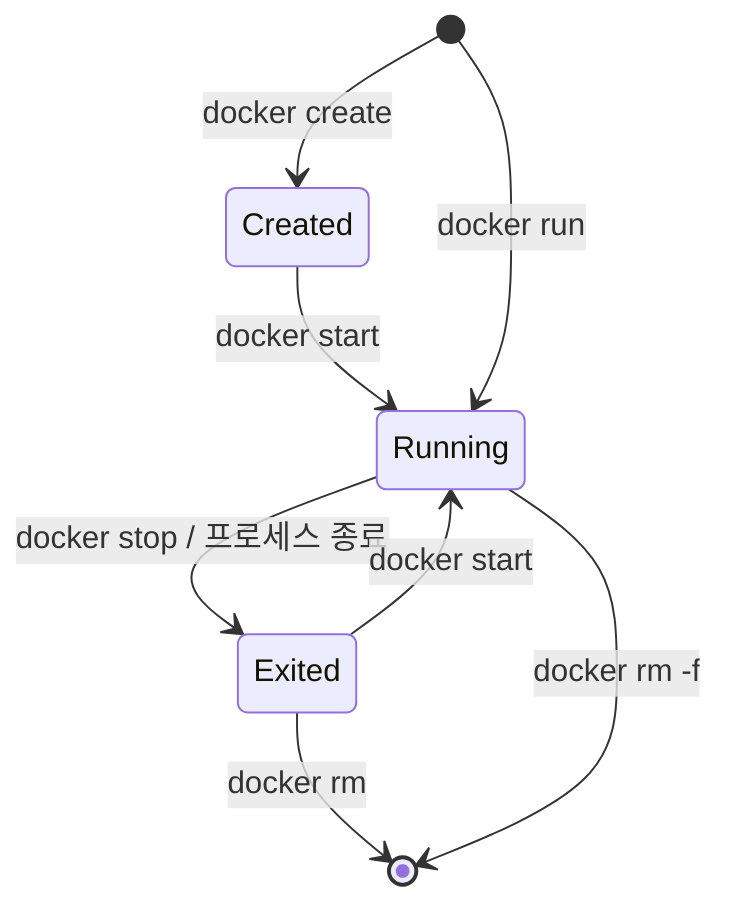
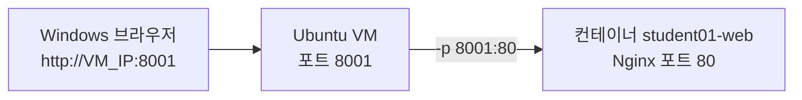
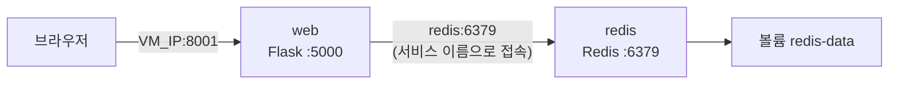

# VirtualBox Ubuntu에서 배우는 Docker 기초 강의 교안

**대상:** Linux 명령어(`cd`, `ls`, `cat`, `nano`)를 조금 써 본 입문 개발자
**목표:** 컨테이너를 실행·중지·삭제하고, 포트와 볼륨을 연결하고, Dockerfile로 이미지를 만들고, Docker Compose로 두 개의 컨테이너를 함께 실행한다.
**권장 시간:** 4시간 (50분 수업 + 10분 휴식 × 4교시)

---

## 0. 수업 환경



- 강사 PC의 VirtualBox에 Ubuntu가 한 대 있고, 수강생은 각자의 계정(`student01` …)으로 **SSH 접속**합니다. 접속 방법은 [powershell에서 현재 우분투로 접속.md](powershell에서%20현재%20우분투로%20접속.md), 계정 생성은 [user_mng.md](user_mng.md)를 참고합니다.
- VM 네트워크는 **브리지 어댑터**를 권장합니다. NAT를 쓰면 SSH(22)뿐 아니라 수업에서 쓰는 웹 포트(8001~8020)도 모두 포트 포워딩해야 합니다.

### ⚠️ 여러 명이 Docker 하나를 같이 쓸 때의 규칙

한 VM에 Docker Engine은 하나뿐입니다. `docker` 그룹에 속한 사용자는 **모두 같은 컨테이너·이미지·볼륨 목록을 봅니다.** 그래서 이름과 포트가 겹치면 서로의 실습을 망가뜨립니다. 수업 시작 전에 다음 세 가지 규칙을 칠판에 적어 둡니다.

| 규칙 | 예시 (student01) |
|---|---|
| 컨테이너·볼륨·이미지 이름 앞에 **내 계정 이름**을 붙인다 | `--name student01-web`, `-t student01/hello` |
| 호스트 포트는 **배정받은 번호만** 쓴다 (`8000 + 학번`) | student01 → `8001`, student12 → `8012` |
| `docker system prune`, `docker rm -f $(docker ps -aq)` 같은 **전체 삭제 명령은 쓰지 않는다** | 다른 사람 컨테이너까지 지워짐 |

수강생은 첫 접속 때 아래 두 줄을 실행해 두면, 이후 예제를 그대로 복사해서 쓸 수 있습니다.

```bash
echo 'export MYPORT=8001' >> ~/.bashrc     # 8001 자리에 본인 배정 포트
source ~/.bashrc
echo $USER $MYPORT                         # student01 8001 처럼 나오면 OK
```

> 수강생마다 VM을 따로 쓰는 환경이라면 이 규칙은 필요 없습니다. 예제의 `$USER-` 접두사와 `$MYPORT`를 그대로 두어도 동작합니다.

---

## 1. 시간 계획

| 교시 | 주제 | 끝났을 때 수강생이 할 수 있는 것 |
|---|---|---|
| 1교시 | Docker 개념, 설치 확인, 첫 컨테이너 | 이미지와 컨테이너의 차이를 말하고, `hello-world`를 실행한다 |
| 2교시 | 컨테이너 생명주기, 포트 연결 | Nginx를 백그라운드로 띄우고 브라우저로 접속한다. 로그를 보고 안으로 들어간다 |
| 3교시 | 볼륨, Dockerfile | 내 HTML을 Nginx로 서비스하고, Python 앱을 이미지로 만든다 |
| 4교시 | Docker Compose, 정리 | 웹 앱 + Redis를 `compose.yaml` 하나로 실행하고, 데이터가 남는 것을 확인한다 |

---

## 2. [강사 사전 준비] Ubuntu에 Docker Engine 설치

수업 전에 강사가 **관리자 계정(예: vboxuser)** 으로 한 번만 실행합니다. Docker 공식 apt 저장소를 사용합니다. ([공식 문서](https://docs.docker.com/engine/install/ubuntu/))

```bash
# 1) 혹시 있을 수 있는 예전 패키지 제거 (없으면 '없음' 메시지만 나옴)
for pkg in docker.io docker-doc docker-compose podman-docker containerd runc; do
  sudo apt-get remove -y $pkg
done

# 2) Docker 저장소 키 등록
sudo apt-get update
sudo apt-get install -y ca-certificates curl
sudo install -m 0755 -d /etc/apt/keyrings
sudo curl -fsSL https://download.docker.com/linux/ubuntu/gpg -o /etc/apt/keyrings/docker.asc
sudo chmod a+r /etc/apt/keyrings/docker.asc

# 3) 저장소 추가
sudo tee /etc/apt/sources.list.d/docker.sources <<EOF
Types: deb
URIs: https://download.docker.com/linux/ubuntu
Suites: $(. /etc/os-release && echo "${UBUNTU_CODENAME:-$VERSION_CODENAME}")
Components: stable
Signed-By: /etc/apt/keyrings/docker.asc
EOF

# 4) 설치
sudo apt-get update
sudo apt-get install -y docker-ce docker-ce-cli containerd.io docker-buildx-plugin docker-compose-plugin

# 5) 확인
sudo systemctl status docker --no-pager     # active (running)
sudo docker run --rm hello-world
```

### 수강생 계정에 docker 권한 주기

```bash
for i in $(seq -w 1 20); do sudo usermod -aG docker "student$i"; done
```

- 그룹 변경은 **다시 로그인해야** 적용됩니다. 이미 접속해 있던 수강생은 `exit` 후 다시 SSH 접속합니다.
- ⚠️ `docker` 그룹은 사실상 root 권한과 같습니다. 수업용 VM에서만 이렇게 운영하고, 수업 후에는 `sudo gpasswd -d student01 docker`로 회수합니다.

### 이미지 미리 받아 두기 (권장)

Docker Hub는 로그인하지 않은 다운로드 횟수를 IP별로 제한합니다. 20명이 같은 IP에서 동시에 받으면 막힐 수 있으므로, 수업에서 쓸 이미지를 미리 받아 둡니다. 한 번 받은 이미지는 모든 수강생이 공유합니다.

```bash
sudo docker pull hello-world
sudo docker pull nginx:1.27-alpine
sudo docker pull ubuntu:24.04
sudo docker pull python:3.12-slim
sudo docker pull redis:7-alpine
```

---

## 3. 1교시 — Docker 개념과 첫 컨테이너

### 3-1. 왜 Docker를 쓰는가 (10분)

"내 컴퓨터에서는 되는데요?" 문제로 시작합니다. 앱이 돌아가려면 코드뿐 아니라 **언어 버전, 라이브러리, 설정 파일**이 모두 맞아야 합니다. Docker는 이것들을 **이미지**라는 하나의 묶음으로 만들어, 어느 서버에서나 똑같이 실행하게 해 줍니다.



| 용어 | 비유 | 설명 |
|---|---|---|
| **이미지** | 붕어빵 틀 / 클래스 | 앱과 실행 환경을 묶은 읽기 전용 템플릿 |
| **컨테이너** | 붕어빵 / 객체 | 이미지를 실행한 것. 하나의 이미지로 여러 개를 만들 수 있다 |
| **레지스트리** | 앱 스토어 | 이미지를 올리고 받는 곳 (Docker Hub 등) |
| **Dockerfile** | 레시피 | 이미지를 만드는 순서를 적은 텍스트 파일 |

### 3-2. VM과 컨테이너 (10분)

지금 수업 환경 자체가 좋은 예시입니다. **VirtualBox VM은 Ubuntu 운영체제 전체(커널 포함)를 따로 띄운 것**이고, 그 안의 **컨테이너는 Ubuntu의 커널을 함께 쓰면서 프로세스만 격리한 것**입니다.

| | 가상 머신 (VirtualBox) | 컨테이너 (Docker) |
|---|---|---|
| 포함하는 것 | OS 전체 + 커널 | 앱 + 필요한 라이브러리 |
| 시작 시간 | 수십 초 ~ 분 | 1초 이내 |
| 크기 | 수 GB | 수 MB ~ 수백 MB |
| 격리 수준 | 강함 (커널 분리) | 프로세스 수준 (커널 공유) |

**확인 실습:** 컨테이너가 VM의 커널을 공유한다는 것을 눈으로 봅니다.

```bash
uname -r                                  # VM의 커널 버전
docker run --rm ubuntu:24.04 uname -r     # 컨테이너 안의 커널 버전 → 똑같다!
```

### 3-3. 설치 확인과 hello-world (20분)

```bash
docker version          # Client와 Server 둘 다 나오면 정상
docker run hello-world
```

`hello-world` 출력 메시지를 함께 읽으며 `docker run`이 한 일을 정리합니다.

1. 클라이언트(`docker` 명령)가 데몬(`dockerd`)에게 요청한다.
2. 이미지가 없으면 Docker Hub에서 **pull** 한다.
3. 이미지로 **컨테이너를 만들고 실행**한다.
4. 출력이 끝나면 컨테이너는 **종료(Exited)** 된다. 삭제되는 것은 아니다.

```bash
docker images           # 내려받은 이미지 목록
docker ps               # 실행 중인 컨테이너 → 아무것도 없음
docker ps -a            # 종료된 것까지 → hello-world 컨테이너가 남아 있음
```

> **질문 던지기:** "`docker ps -a`에 왜 hello-world가 남아 있을까요?" → 컨테이너는 종료되어도 직접 지우기 전까지 남는다. 다른 수강생의 컨테이너도 보인다는 점도 여기서 짚어 줍니다.

### 3-4. 컨테이너 안에 들어가 보기 (10분)

```bash
docker run -it --name $USER-ubuntu ubuntu:24.04 bash
```

컨테이너 안에서:

```bash
cat /etc/os-release     # Ubuntu 24.04
ps aux                  # 프로세스가 bash와 ps 뿐 → 격리되어 있다
touch /hello.txt        # 파일을 하나 만들어 둔다
exit                    # bash가 끝나면 컨테이너도 종료된다
```

| 옵션 | 뜻 |
|---|---|
| `-i` | 입력을 계속 받는다 (interactive) |
| `-t` | 터미널을 붙인다 (tty) |
| `--name` | 컨테이너 이름. 지정하지 않으면 무작위 이름이 붙는다 |

---

## 4. 2교시 — 컨테이너 생명주기와 포트

### 4-1. 생명주기 (20분)



앞에서 만든 `$USER-ubuntu` 컨테이너로 확인합니다.

```bash
docker ps -a --filter name=$USER          # 내 컨테이너만 보기 (STATUS: Exited)
docker start -ai $USER-ubuntu             # 다시 시작하고 접속
ls /hello.txt                             # 아까 만든 파일이 아직 있다!
exit

docker rm $USER-ubuntu                    # 삭제
docker run -it --rm ubuntu:24.04 ls /hello.txt   # 새 컨테이너에는 파일이 없다
```

> **핵심 메시지:** 컨테이너 안에서 만든 파일은 **그 컨테이너를 지우면 같이 사라집니다.** 이것이 3교시에서 볼륨을 배우는 이유입니다.
> `--rm`을 붙이면 컨테이너가 종료될 때 자동으로 삭제됩니다.

### 4-2. Nginx 웹 서버 띄우기와 포트 연결 (20분)

```bash
docker run -d --name $USER-web -p $MYPORT:80 nginx:1.27-alpine
docker ps --filter name=$USER
curl http://localhost:$MYPORT              # Welcome to nginx! HTML이 보이면 성공
```

| 옵션 | 뜻 |
|---|---|
| `-d` | 백그라운드(detached)로 실행 |
| `-p 8001:80` | **VM의 8001번 포트** → **컨테이너의 80번 포트**로 연결 (`호스트:컨테이너`) |



이제 **Windows 브라우저**에서 `http://<VM의 IP>:<내 포트>`로 접속해 봅니다. (`ip a`로 확인한 IP. NAT라면 해당 포트의 포트 포워딩이 필요합니다.)

**같은 포트를 두 번 쓰면?** 일부러 오류를 내 봅니다.

```bash
docker run -d --name $USER-web2 -p $MYPORT:80 nginx:1.27-alpine
# Error ... port is already allocated
docker rm $USER-web2         # 생성만 되고 실행되지 못한 컨테이너 정리
```

### 4-3. 로그 보기, 안에서 명령 실행하기 (10분)

```bash
docker logs $USER-web                 # 브라우저 접속 기록이 보인다
docker logs -f $USER-web              # 실시간으로 계속 보기 (Ctrl+C로 빠져나옴)

docker exec -it $USER-web sh          # 실행 중인 컨테이너 안으로 들어가기
cat /usr/share/nginx/html/index.html  # Nginx가 보여주는 파일
exit                                  # exec로 들어간 셸만 끝나고 컨테이너는 계속 실행

docker stop $USER-web
docker rm $USER-web
```

> `docker run`은 **새 컨테이너를 만들고**, `docker exec`는 **이미 실행 중인 컨테이너 안에서 명령을 실행**합니다. 입문자가 가장 많이 헷갈리는 부분입니다.

---

## 5. 3교시 — 볼륨과 Dockerfile

### 5-1. 바인드 마운트: 내 파일을 컨테이너에 연결 (15분)

```bash
mkdir -p ~/docker-lab/site && cd ~/docker-lab/site
echo "<h1>$USER 의 첫 Docker 웹페이지</h1>" > index.html

docker run -d --name $USER-site -p $MYPORT:80 \
  -v ~/docker-lab/site:/usr/share/nginx/html:ro \
  nginx:1.27-alpine
```

브라우저를 새로고침하면 내 페이지가 보입니다. 이제 **컨테이너를 건드리지 않고** VM의 파일만 수정합니다.

```bash
echo "<p>수정했습니다!</p>" >> index.html     # 브라우저 새로고침 → 바로 반영
docker rm -f $USER-site
```

`-v VM경로:컨테이너경로` 형태로 VM의 폴더를 컨테이너에 연결합니다. 끝의 `:ro`는 읽기 전용(read-only)입니다.

### 5-2. 이름 있는 볼륨: 컨테이너가 사라져도 남는 데이터 (10분)

```bash
docker volume create $USER-data

docker run --rm -v $USER-data:/data ubuntu:24.04 \
  bash -c 'echo "저장 시각: $(date)" >> /data/log.txt'

docker run --rm -v $USER-data:/data ubuntu:24.04 \
  bash -c 'echo "저장 시각: $(date)" >> /data/log.txt'

docker run --rm -v $USER-data:/data ubuntu:24.04 cat /data/log.txt   # 두 줄 모두 남아 있다
```

컨테이너는 `--rm`으로 매번 삭제됐지만, 데이터는 볼륨에 남았습니다.

| 방식 | 형태 | 언제 쓰나 |
|---|---|---|
| 바인드 마운트 | `-v /home/student01/site:/경로` | 소스 코드·설정 파일을 직접 편집할 때 |
| 이름 있는 볼륨 | `-v student01-data:/경로` | DB 데이터처럼 Docker가 관리하면 되는 데이터 |

### 5-3. Dockerfile로 내 이미지 만들기 (25분)

간단한 Python 웹 앱을 이미지로 만듭니다.

```bash
mkdir -p ~/docker-lab/hello && cd ~/docker-lab/hello
```

**app.py**

```python
import os
import socket
from flask import Flask

app = Flask(__name__)

@app.route("/")
def hello():
    owner = os.getenv("OWNER", "docker")
    return f"Hello, {owner}! (컨테이너 ID: {socket.gethostname()})\n"
```

**requirements.txt**

```
flask
```

**Dockerfile**

```dockerfile
# 1. 어떤 이미지에서 시작할지
FROM python:3.12-slim

# 2. 컨테이너 안의 작업 폴더
WORKDIR /app

# 3. 라이브러리 목록을 먼저 복사하고 설치 (캐시 활용)
COPY requirements.txt .
RUN pip install --no-cache-dir -r requirements.txt

# 4. 소스 코드 복사
COPY app.py .

# 5. 이 컨테이너가 사용하는 포트 (문서 역할)
EXPOSE 5000

# 6. 컨테이너가 시작될 때 실행할 명령
CMD ["flask", "--app", "app", "run", "--host=0.0.0.0", "--port=5000"]
```

빌드하고 실행합니다.

```bash
docker build -t $USER/hello:1.0 .
docker images $USER/hello

docker run -d --name $USER-hello -p $MYPORT:5000 -e OWNER=$USER $USER/hello:1.0
curl http://localhost:$MYPORT
```

| 명령 | 언제 실행되나 | 설명 |
|---|---|---|
| `FROM` | 빌드 | 기반 이미지 |
| `WORKDIR` | 빌드 | 이후 명령의 작업 폴더 |
| `COPY` | 빌드 | VM의 파일을 이미지 안으로 복사 |
| `RUN` | **빌드할 때** | 설치 같은 작업을 실행해 결과를 이미지에 저장 |
| `CMD` | **컨테이너가 시작될 때** | 기본 실행 명령 |
| `-e` (run 옵션) | 실행 | 환경 변수 전달 |

**확인 실습 — 레이어 캐시:**

1. `app.py`의 문구를 바꾸고 `docker build -t $USER/hello:1.1 .`을 다시 실행합니다.
2. `pip install` 단계에 `CACHED`가 표시되는 것을 확인합니다. → `requirements.txt`가 바뀌지 않았으므로 설치 단계를 재사용했습니다.
3. 기존 컨테이너를 지우고 `1.1`로 새로 실행해서 바뀐 문구를 확인합니다.

```bash
docker rm -f $USER-hello
docker run -d --name $USER-hello -p $MYPORT:5000 -e OWNER=$USER $USER/hello:1.1
curl http://localhost:$MYPORT
docker rm -f $USER-hello
```

> **`--host=0.0.0.0`을 빼면?** Flask가 컨테이너 안의 localhost에서만 요청을 받아서, `-p`로 포트를 연결해도 접속이 안 됩니다. 시간이 있으면 일부러 빼고 빌드해 `curl`이 실패하는 것을 보여 줍니다.

---

## 6. 4교시 — Docker Compose

### 6-1. 왜 Compose인가 (5분)

실제 서비스는 웹 서버, DB, 캐시처럼 컨테이너 여러 개로 이루어집니다. 매번 긴 `docker run` 명령을 여러 번 치는 대신, **`compose.yaml` 파일 하나에 구성을 적고 명령 한 번으로 실행**합니다.

### 6-2. 방문자 카운터 만들기 (30분)



```bash
mkdir -p ~/docker-lab/counter && cd ~/docker-lab/counter
```

**app.py**

```python
import os
from flask import Flask
from redis import Redis

app = Flask(__name__)
redis = Redis(host="redis", port=6379)   # 'redis' = compose.yaml의 서비스 이름

@app.route("/")
def hello():
    count = redis.incr("hits")
    return f"{os.getenv('OWNER', 'docker')} 님의 페이지 방문 횟수: {count}\n"
```

**requirements.txt**

```
flask
redis
```

**Dockerfile** — 5-3과 같은 내용에서 `COPY app.py .`만 그대로 두면 됩니다.

```dockerfile
FROM python:3.12-slim
WORKDIR /app
COPY requirements.txt .
RUN pip install --no-cache-dir -r requirements.txt
COPY app.py .
EXPOSE 5000
CMD ["flask", "--app", "app", "run", "--host=0.0.0.0", "--port=5000"]
```

**compose.yaml**

```yaml
services:
  web:
    build: .
    ports:
      - "${MYPORT}:5000"
    environment:
      OWNER: ${USER}
    depends_on:
      - redis

  redis:
    image: redis:7-alpine
    command: redis-server --appendonly yes   # 데이터를 파일에 계속 기록
    volumes:
      - redis-data:/data

volumes:
  redis-data:
```

**.env** — Compose 프로젝트 이름을 내 계정으로 지정합니다. (공유 서버 필수)

```bash
echo "COMPOSE_PROJECT_NAME=$USER" > .env
```

> 프로젝트 이름을 지정하지 않으면 **폴더 이름(`counter`)** 이 프로젝트 이름이 됩니다. 모든 수강생의 폴더 이름이 같으므로, 서로의 컨테이너를 덮어쓰게 됩니다.

실행합니다.

```bash
docker compose config            # 변수가 채워진 최종 설정 확인 (MYPORT, USER 확인)
docker compose up -d --build
docker compose ps
curl http://localhost:$MYPORT    # 여러 번 실행 → 숫자가 올라간다
docker compose logs web
```

### 6-3. 데이터가 남는지 확인 (10분)

```bash
docker compose down              # 컨테이너와 네트워크 삭제 (볼륨은 남음)
docker compose up -d
curl http://localhost:$MYPORT    # 숫자가 이어서 올라간다!

docker compose down -v           # 볼륨까지 삭제 (초기화할 때만)
docker compose up -d
curl http://localhost:$MYPORT    # 1부터 다시 시작
```

### 6-4. 일부러 고장 내고 고쳐 보기 (5분, 선택)

`app.py`의 `host="redis"`를 `host="localhost"`로 바꾸고 `docker compose up -d --build` 합니다.

```bash
curl http://localhost:$MYPORT        # 500 Internal Server Error
docker compose logs web | tail -20   # ConnectionError: ... localhost:6379 ... Connection refused
```

> **왜?** 컨테이너마다 자기만의 `localhost`가 있습니다. web 컨테이너의 localhost에는 Redis가 없습니다. 같은 Compose 안의 다른 컨테이너는 **서비스 이름(`redis`)** 으로 찾아갑니다.

원래대로 되돌리고 다시 빌드합니다.

### 6-5. 수업 마무리 정리 (자기 것만!)

```bash
cd ~/docker-lab/counter && docker compose down -v
docker ps -a --filter name=$USER                  # 남은 내 컨테이너 확인
docker volume ls --filter name=$USER              # 남은 내 볼륨 확인
docker volume rm $USER-data
docker image rm $USER/hello:1.0 $USER/hello:1.1
```

강사는 수업 후 관리자 계정으로 전체를 정리합니다.

```bash
sudo docker ps -a                  # 남은 컨테이너 확인 후
sudo docker system prune -a --volumes   # 사용하지 않는 컨테이너·이미지·볼륨·네트워크 전부 삭제 (되돌릴 수 없음)
```

---

## 7. 자주 나오는 오류

| 증상 | 원인 / 해결 |
|---|---|
| `permission denied while trying to connect to the Docker daemon socket` | docker 그룹에 없거나, 그룹 추가 후 다시 로그인하지 않음 → `exit` 후 재접속, `groups`로 `docker` 확인 |
| `Conflict. The container name "/student01-web" is already in use` | 같은 이름의 컨테이너가 남아 있음 → `docker rm -f student01-web` |
| `port is already allocated` | 그 포트를 다른 컨테이너가 사용 중 → `docker ps`로 확인. 남의 포트를 쓰지 않았는지 확인 |
| `toomanyrequests: You have reached your pull rate limit` | Docker Hub 다운로드 횟수 제한 → 강사가 미리 받아 둔 이미지 태그를 정확히 사용 |
| VM에서 `curl`은 되는데 Windows 브라우저에서 안 열림 | VM IP 확인(`ip a`), NAT라면 포트 포워딩 추가, `ufw`를 쓰면 `sudo ufw allow 8001:8020/tcp` |
| 컨테이너가 바로 `Exited` 됨 | `docker logs <이름>`으로 오류 메시지 확인. 실행할 프로세스가 끝나면 컨테이너도 끝난다 |
| 코드를 고쳤는데 반영이 안 됨 | 이미지를 다시 빌드해야 함 → `docker compose up -d --build` |

---

## 8. 명령어 요약 (치트시트)

| 분류 | 명령 | 설명 |
|---|---|---|
| 이미지 | `docker pull 이미지:태그` | 이미지 내려받기 |
| | `docker images` | 이미지 목록 |
| | `docker build -t 이름:태그 .` | 현재 폴더의 Dockerfile로 이미지 빌드 |
| | `docker image rm 이미지` | 이미지 삭제 |
| 컨테이너 | `docker run [옵션] 이미지` | 새 컨테이너 생성 + 실행 |
| | `docker ps` / `docker ps -a` | 실행 중 / 전체 컨테이너 목록 |
| | `docker stop` / `start` 이름 | 중지 / 다시 시작 |
| | `docker rm 이름` / `rm -f 이름` | 삭제 / 실행 중이어도 강제 삭제 |
| | `docker logs [-f] 이름` | 로그 보기 |
| | `docker exec -it 이름 sh` | 실행 중인 컨테이너 안에서 셸 실행 |
| run 옵션 | `-d` `-it` `--rm` `--name` | 백그라운드 / 대화형 / 종료 시 삭제 / 이름 지정 |
| | `-p 호스트:컨테이너` | 포트 연결 |
| | `-v 경로또는볼륨:컨테이너경로` | 볼륨·폴더 연결 |
| | `-e 키=값` | 환경 변수 |
| 볼륨 | `docker volume create / ls / rm` | 볼륨 생성 / 목록 / 삭제 |
| Compose | `docker compose up -d --build` | 빌드 후 백그라운드 실행 |
| | `docker compose ps` / `logs` | 상태 / 로그 |
| | `docker compose down [-v]` | 중지·삭제 (`-v`: 볼륨까지) |

---

## 9. 확인 문제

1. 이미지와 컨테이너의 관계를 비유를 들어 설명하세요.
2. `docker run -it ubuntu:24.04 bash`로 들어가 만든 파일은 `exit` 후 어떻게 되나요? `docker rm` 후에는요?
3. `-p 8001:80`에서 8001과 80은 각각 무엇의 포트인가요?
4. `docker run`과 `docker exec`의 차이는 무엇인가요?
5. Dockerfile의 `RUN`과 `CMD`는 각각 언제 실행되나요?
6. Compose에서 web 컨테이너가 Redis에 `localhost`가 아니라 `redis`로 접속해야 하는 이유는 무엇인가요?
7. `docker compose down`과 `docker compose down -v`의 차이는 무엇인가요?

### 과제 (선택)

5-3의 `hello` 앱에 `/time` 경로를 추가해 현재 시각을 돌려주도록 고치고, 이미지 태그를 `2.0`으로 빌드해 실행한 뒤 `curl` 결과를 캡처해 제출합니다.

---

> 다음 단계로는 [docker.md](docker.md)의 **React + Nginx + FastAPI + PostgreSQL 풀스택 실습**으로 이어갈 수 있습니다.
