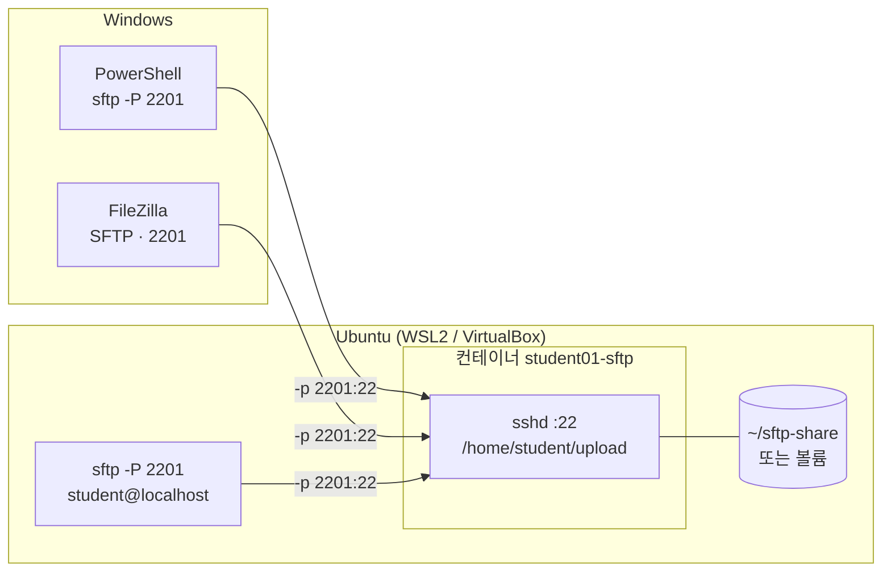

# Docker로 SFTP 서버 실습하기

**대상:** Docker 기초(이미지, 컨테이너, `-p`, `-v`)를 배운 수강생
**목표:** SFTP 서버를 컨테이너로 띄우고, Ubuntu·Windows에서 파일을 올리고 내려받는다. 볼륨과 호스트 폴더 연결로 파일이 어디에 저장되는지 확인하고, 여러 사용자를 서로 격리해서 운영한다.
**권장 시간:** 50분 (개념 10분 + 실습 35분 + 정리 5분)
**사용 이미지:** [`atmoz/sftp`](https://hub.docker.com/r/atmoz/sftp) (OpenSSH 기반)



---

## 1. 개념: FTP와 SFTP

| 항목 | FTP | SFTP |
|---|---|---|
| 기반 | FTP 프로토콜 | **SSH** 위에서 동작 |
| 포트 | 21(제어) + 데이터용 포트 범위(패시브 모드) | **22 하나** |
| 암호화 | 없음 (아이디·비밀번호·파일이 평문) | 전부 암호화 |
| Docker로 운영 | 포트 범위까지 연결해야 해서 번거로움 | `-p 2201:22` 하나면 끝 |

> 이름이 비슷하지만 SFTP는 FTP에 암호화를 붙인 것이 아니라 **SSH의 파일 전송 기능**입니다. 그래서 SSH 접속에 쓰던 `ssh-keygen`, 호스트 키 확인 같은 개념이 그대로 나옵니다.

---

## 2. 준비

### 포트 배정

여러 명이 같은 Docker를 쓰는 환경이라면 SFTP 포트도 학생마다 나눕니다. 웹 포트(`8000 + 학번`)와 같은 규칙으로 **`2200 + 학번`** 을 씁니다.

```bash
echo 'export MYSFTP=2201' >> ~/.bashrc     # 2201 자리에 본인 배정 포트 (student12 → 2212)
source ~/.bashrc
echo $USER $MYSFTP                         # student01 2201 처럼 나오면 OK
```

> 바깥 포트를 22로 쓰지 않는 이유: Ubuntu 자체의 SSH 서버(수강생이 접속할 때 쓰는 그 22번)와 충돌하기 때문입니다.

### 이미지 받기

```bash
docker pull atmoz/sftp
docker images atmoz/sftp
```

---

## 3. 실습 ① 가장 간단한 SFTP 서버

```bash
docker run -d --name $USER-sftp \
  -p $MYSFTP:22 \
  atmoz/sftp \
  student:pass1234:::upload
```

| 부분 | 의미 |
|---|---|
| `-p $MYSFTP:22` | Ubuntu의 2201번 → 컨테이너 안 SSH 서버 22번 |
| `atmoz/sftp` | 이미지 이름 |
| `student:pass1234:::upload` | **이미지 뒤에 붙는 인자 = 만들 사용자**. 형식 `사용자:비밀번호:UID:GID:폴더` |
| `:::upload` | UID·GID는 비워 두고(자동), 홈 아래에 `upload` 폴더를 만든다 |

```bash
docker ps                       # PORTS 0.0.0.0:2201->22/tcp
docker logs $USER-sftp          # Server listening on 0.0.0.0 port 22 … 가 보이면 준비 완료
```

> **왜 `upload` 폴더가 필요한가?** 보안을 위해 사용자는 자기 홈(`/home/student`)에 **갇혀(chroot)** 있고, 그 홈 바로 아래에는 파일을 쓸 수 없습니다. 그래서 파일을 올릴 하위 폴더를 따로 만들어 줍니다.

---

## 4. 실습 ② Ubuntu에서 접속하고 파일 주고받기

연습용 파일을 하나 만듭니다.

```bash
cd ~
echo "Docker SFTP 실습 파일입니다." > hello.txt
```

접속합니다. **`sftp`는 포트 옵션이 대문자 `-P`** 입니다. (`ssh`는 소문자 `-p`)

```bash
sftp -P $MYSFTP student@localhost
```

처음 접속하면 서버 확인 질문이 나옵니다. `yes`를 입력하고 비밀번호 `pass1234`를 입력하면 `sftp>` 프롬프트가 나옵니다.

```
sftp> pwd                  # Remote working directory: /
sftp> ls                   # upload
sftp> cd upload
sftp> put hello.txt        # 올리기 (로컬 → 서버)
sftp> ls -l
sftp> get hello.txt copy.txt   # 내려받기 (서버 → 로컬, 이름을 바꿔 저장)
sftp> exit
```

```bash
cat ~/copy.txt             # 내려받은 파일 확인
```

### sftp 명령 모음

| 명령 | 하는 일 | 짝이 되는 로컬 명령 |
|---|---|---|
| `pwd` / `ls` / `cd` | 서버 쪽 위치·목록·이동 | `lpwd` / `lls` / `lcd` (앞에 `l` = local) |
| `put 파일` | 올리기 | |
| `get 파일 [새이름]` | 내려받기 | |
| `mkdir 폴더` / `rmdir 폴더` | 서버에 폴더 만들기·지우기 | `lmkdir` |
| `rm 파일` | 서버 파일 삭제 | |
| `put -r 폴더` / `get -r 폴더` | 폴더째 올리기·내려받기 | |
| `exit` | 종료 | |

> `pwd`가 `/`로 나오는 것이 chroot입니다. 컨테이너 안에서는 실제로 `/home/student`인데, 사용자에게는 그곳이 맨 위(`/`)로 보입니다. `cd /etc`를 해 봐도 다른 폴더로 나갈 수 없습니다.

---

## 5. 실습 ③ Windows에서 접속하기

### PowerShell (Windows 기본 OpenSSH)

```powershell
sftp -P 2201 student@localhost       # 강사 WSL2
sftp -P 2201 student@VM_IP           # 학생 VirtualBox
```

`put`, `get` 명령은 Ubuntu와 똑같습니다. 이때 `lls`, `lcd`는 **Windows 폴더**를 가리킵니다.

### FileZilla

| 항목 | 값 |
|---|---|
| 프로토콜 | **SFTP - SSH File Transfer Protocol** |
| 호스트 | `localhost` (WSL2) 또는 `VM_IP` (VirtualBox) |
| 포트 | `2201` (본인 포트) |
| 사용자 / 비밀번호 | `student` / `pass1234` |

처음 연결할 때 "알 수 없는 호스트 키" 창이 나오면 확인을 누릅니다. 왼쪽(내 PC)에서 오른쪽 `upload` 폴더로 끌어다 놓으면 업로드됩니다.

> VirtualBox **NAT** 방식이라면 VM 설정 → 네트워크 → 포트 포워딩에 `호스트 2201 → 게스트 2201`을 추가해야 합니다. 브리지라면 그대로 됩니다.

---

## 6. 실습 ④ 파일은 어디에 저장되나

올린 파일은 **컨테이너 안**에 있습니다.

```bash
docker exec $USER-sftp ls -l /home/student/upload
```

컨테이너를 지우면 어떻게 될까요?

```bash
docker rm -f $USER-sftp
# 3단계 docker run 다시 실행
sftp -P $MYSFTP student@localhost      # ls upload → 비어 있다!
```

파일이 사라졌습니다. 그리고 다시 접속할 때 아래 경고가 나올 수 있습니다.

```
WARNING: REMOTE HOST IDENTIFICATION HAS CHANGED!
```

컨테이너를 새로 만들면서 **서버의 호스트 키도 새로 생성**되었기 때문입니다. 예전 키를 지우고 다시 접속합니다.

```bash
ssh-keygen -R "[localhost]:$MYSFTP"
```

> 두 가지 모두 "컨테이너 안에 만든 것은 컨테이너와 함께 사라진다"는 같은 원리입니다. 다음 실습에서 해결합니다.

---

## 7. 실습 ⑤ 호스트 폴더 연결 (bind mount)

Ubuntu의 폴더를 컨테이너의 `upload` 폴더에 직접 연결하면, 올린 파일이 **Ubuntu 폴더에 바로** 생깁니다.

```bash
docker rm -f $USER-sftp
mkdir -p ~/sftp-share
id -u                                  # 내 UID 확인 (보통 1000, 계정마다 다름)

docker run -d --name $USER-sftp \
  -p $MYSFTP:22 \
  -v ~/sftp-share:/home/student/upload \
  atmoz/sftp \
  student:pass1234:$(id -u)
```

| 바뀐 부분 | 의미 |
|---|---|
| `-v ~/sftp-share:/home/student/upload` | Ubuntu의 `~/sftp-share` = 컨테이너의 `upload` |
| `student:pass1234:$(id -u)` | SFTP 사용자의 UID를 **내 Ubuntu 계정 UID와 같게** 맞춘다 |

```bash
ssh-keygen -R "[localhost]:$MYSFTP"    # 컨테이너를 새로 만들었으니 예전 키 삭제
sftp -P $MYSFTP student@localhost
sftp> cd upload
sftp> put hello.txt
sftp> exit

ls -l ~/sftp-share                     # hello.txt 가 내 계정 소유로 보인다
echo "Ubuntu에서 만든 파일" > ~/sftp-share/from-host.txt
```

다시 접속해서 `ls upload`를 하면 Ubuntu에서 만든 `from-host.txt`도 보입니다. **같은 폴더를 양쪽에서 보고 있는 것**입니다.

> **왜 UID를 맞추나?** 리눅스는 파일 주인을 이름이 아니라 **숫자(UID)** 로 기억합니다. UID가 다르면 컨테이너가 쓴 파일을 Ubuntu 계정이 고칠 수 없거나, 반대로 컨테이너가 Ubuntu 폴더에 쓰지 못해 `Permission denied`가 납니다. 실험 삼아 `$(id -u)`를 빼고 실행해 보면 업로드가 실패합니다.

---

## 8. 실습 ⑥ 여러 사용자와 격리

사용자 목록을 파일로 만들어 컨테이너에 넣습니다. 형식은 `사용자:비밀번호:UID:GID:폴더`입니다.

```bash
mkdir -p ~/sftp-multi && cd ~/sftp-multi
cat > users.conf <<'EOF'
alice:alice123:1001:100:upload
bob:bob123:1002:100:upload,share
EOF
```

```bash
docker rm -f $USER-sftp
docker run -d --name $USER-sftp \
  -p $MYSFTP:22 \
  -v ~/sftp-multi/users.conf:/etc/sftp/users.conf:ro \
  -v $USER-sftp-home:/home \
  atmoz/sftp
```

| 옵션 | 의미 |
|---|---|
| `-v …/users.conf:/etc/sftp/users.conf:ro` | 사용자 목록 파일을 읽기 전용(`:ro`)으로 넣는다. 이번에는 이미지 뒤 인자가 없다 |
| `-v $USER-sftp-home:/home` | 모든 사용자의 홈을 **볼륨**에 저장 → 컨테이너를 다시 만들어도 파일 유지 |

확인합니다.

```bash
ssh-keygen -R "[localhost]:$MYSFTP"
sftp -P $MYSFTP alice@localhost      # alice123
sftp> put ~/hello.txt upload/
sftp> cd /                            # alice의 홈이 곧 / → bob의 폴더는 보이지 않는다
sftp> ls
sftp> exit

sftp -P $MYSFTP bob@localhost        # bob123
sftp> ls                              # share  upload  (alice의 파일은 보이지 않음)
sftp> exit
```

컨테이너 안에서 보면 둘 다 있습니다.

```bash
docker exec $USER-sftp ls -R /home
```

> 같은 컨테이너, 같은 볼륨인데도 각 사용자는 **자기 홈만** 봅니다. 컨테이너가 Ubuntu와 격리되는 것처럼, SFTP 서버 안에서는 chroot가 사용자끼리를 격리합니다.

### 볼륨 유지 확인

```bash
docker rm -f $USER-sftp
# 위 docker run 다시 실행
docker exec $USER-sftp ls /home/alice/upload      # hello.txt 그대로 있다
```

---

## 9. 실습 ⑦ Compose로 정리하기

지금까지의 `docker run` 옵션을 파일 하나로 옮깁니다.

```bash
cd ~/sftp-multi
cat > compose.yaml <<'EOF'
services:
  sftp:
    image: atmoz/sftp
    container_name: ${USER}-sftp
    ports:
      - "${MYSFTP}:22"
    volumes:
      - ./users.conf:/etc/sftp/users.conf:ro
      - sftp-home:/home
    restart: unless-stopped

volumes:
  sftp-home:
EOF
```

```bash
docker rm -f $USER-sftp            # docker run으로 띄운 것은 먼저 정리
docker compose up -d
docker compose ps
docker compose logs sftp | tail -5
```

> Compose는 `$USER`, `$MYSFTP` 같은 셸 변수를 `${...}` 자리에 그대로 넣어 줍니다. 볼륨 이름은 Compose가 `sftp-multi_sftp-home`처럼 **폴더 이름을 앞에 붙여** 새로 만들므로, 8단계 볼륨의 파일은 여기서 보이지 않습니다.

사용자를 추가하려면 `users.conf`에 한 줄을 넣고 다시 만듭니다.

```bash
echo "carol:carol123:1003:100:upload" >> users.conf
docker compose up -d --force-recreate
```

---

## 10. 일부러 오류 내 보기

| 실험 | 결과 | 배우는 것 |
|---|---|---|
| 비밀번호를 틀리게 입력 | `Permission denied, please try again.` | SSH 인증 실패 메시지 |
| `sftp -p $MYSFTP …` (소문자 p) | 2201이 아니라 22번으로 접속 시도 → 엉뚱한 서버나 `Connection refused` | sftp는 대문자 `-P` |
| 홈 바로 아래에 `put hello.txt` (cd upload 생략) | `Permission denied` | chroot 홈은 쓰기 불가, 하위 폴더 필요 |
| `-p 22:22`로 실행 | Ubuntu SSH가 22를 쓰고 있으면 `address already in use` | 호스트 포트 하나에는 하나만 |
| 7단계에서 `$(id -u)` 빼기 | 업로드 시 `Permission denied` | 파일 주인은 UID 숫자로 결정 |
| 컨테이너를 지우고 다시 만든 뒤 접속 | `REMOTE HOST IDENTIFICATION HAS CHANGED` | 호스트 키도 컨테이너와 함께 새로 생김 → `ssh-keygen -R` |

## 11. 문제 해결

| 증상 | 확인할 것 |
|---|---|
| `Connection refused` | `docker ps`로 컨테이너가 Up인지, 포트를 `-P $MYSFTP`로 줬는지 |
| 접속 직후 바로 끊김 | `docker logs $USER-sftp` — 사용자 형식(`:` 개수) 오류인 경우가 많다 |
| `Connection timed out` (Windows·FileZilla) | 호스트가 맞는지(WSL2 `localhost`, VirtualBox `VM_IP`), NAT라면 포트 포워딩 |
| 업로드는 되는데 Ubuntu에서 파일을 못 고침 | 7단계 UID가 내 계정(`id -u`)과 같은지 |
| `users.conf`를 고쳤는데 반영 안 됨 | 컨테이너를 다시 만들어야 한다 (`--force-recreate`) |

---

## 12. 확인 문제

1. SFTP가 FTP보다 Docker로 운영하기 쉬운 이유를 포트 관점에서 설명하세요.
2. `sftp>`에서 `pwd`가 `/`로 나오는데, 컨테이너 안에서 실제 위치는 어디인가요?
3. 컨테이너를 지우고 다시 만들었을 때 파일이 사라진 이유와, 이를 막는 두 가지 방법은?
4. bind mount에서 SFTP 사용자 UID를 `$(id -u)`로 맞춘 이유는?
5. `REMOTE HOST IDENTIFICATION HAS CHANGED` 경고는 왜 나오며 어떻게 해결하나요?

## 13. 정리

```bash
cd ~/sftp-multi && docker compose down -v       # Compose 컨테이너 + 볼륨 삭제
docker rm -f $USER-sftp 2>/dev/null
docker volume rm $USER-sftp-home 2>/dev/null
rm -rf ~/sftp-share ~/sftp-multi ~/copy.txt
ssh-keygen -R "[localhost]:$MYSFTP"
```

> 공용 VM에서는 `docker compose down -v`가 **내 Compose 프로젝트의 볼륨만** 지웁니다. `docker volume prune`처럼 전체를 지우는 명령은 쓰지 않습니다.
