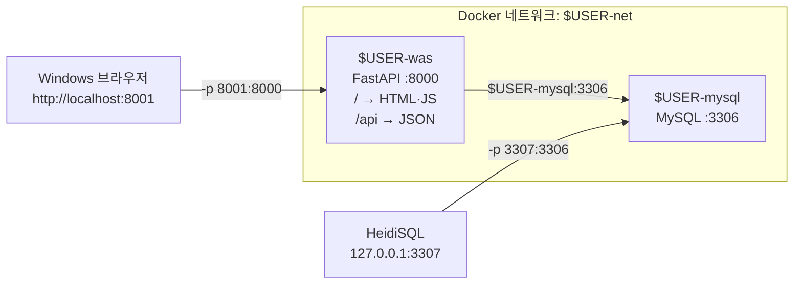

# 학생 조회 웹 프로그램 (HTML/JS + FastAPI + MySQL)

앞 실습에서 만든 `$USER-mysql` 컨테이너의 `classdb.students` 테이블을 웹 화면으로 조회합니다.
FastAPI(uvicorn)가 **WAS** 역할을 하며, API와 화면(HTML/JS)을 함께 서비스합니다.



## 폴더 구조

```
students-web/
├── README.md
└── app/
    ├── Dockerfile          # WAS 이미지 설계도
    ├── requirements.txt    # fastapi, uvicorn, pymysql, cryptography
    ├── main.py             # API (/api/health, /api/students) + 정적 파일 서비스
    └── static/
        ├── index.html      # 화면
        └── app.js          # fetch('/api/students') → 표 그리기
```

| 주소 | 응답 |
|---|---|
| `/` | 학생 목록 화면 (index.html) |
| `/api/health` | WAS·DB 상태 확인 (DB 연결 실패 시 503) |
| `/api/students` | 전체 학생 목록 (JSON) |
| `/api/students?major=AI` | 전공에 "AI"가 들어간 학생 |
| `/api/students/1` | 학생 한 명 (없으면 404) |
| `/api/docs` | FastAPI 자동 문서 (Swagger) |

---

## 0. 준비 확인

```bash
docker ps                 # $USER-mysql 이 Up 상태여야 한다
echo $USER $MYPORT        # 예: jongcheon 8001  (비어 있으면 source ~/.bashrc)
```

## 1. 프로젝트를 리눅스 홈으로 복사

```bash
cp -r /mnt/d/AX_FullStack_Builder/Docker/students-web ~/
cd ~/students-web
```

> `/mnt/d`에서 바로 빌드하면 느리고 권한 문제가 생길 수 있어 홈으로 복사해서 씁니다.

## 2. 컨테이너끼리 이름으로 찾을 수 있게 네트워크 만들기

```bash
docker network create $USER-net
docker network connect $USER-net $USER-mysql
```

`docker run`으로 따로 띄운 컨테이너는 기본 네트워크(`bridge`)에 있는데, 이 네트워크에서는 **컨테이너 이름으로 서로 찾을 수 없습니다.**
직접 만든 네트워크에 둘 다 연결하면 WAS가 `$USER-mysql`이라는 이름으로 DB를 찾아갈 수 있습니다. (Compose는 이 네트워크를 자동으로 만들어 줍니다.)

## 3. WAS 이미지 만들기

```bash
docker build -t $USER/students-web ./app
docker images | grep students-web
```

## 4. WAS 컨테이너 실행

```bash
docker run -d --name $USER-was \
  --network $USER-net \
  -e DB_HOST=$USER-mysql \
  -e DB_PORT=3306 \
  -e DB_USER=student \
  -e DB_PASSWORD=student1234 \
  -e DB_NAME=classdb \
  -p $MYPORT:8000 \
  $USER/students-web
```

| 옵션 | 의미 |
|---|---|
| `--network $USER-net` | DB와 같은 네트워크에 붙인다 |
| `-e DB_HOST=$USER-mysql` | DB 주소 = **컨테이너 이름** (`localhost` 아님!) |
| `-e DB_PORT=3306` | **컨테이너 안쪽 포트**. 3307은 Windows(HeidiSQL)용 바깥 문이다 |
| `-p $MYPORT:8000` | 브라우저 → Ubuntu 8001 → WAS 컨테이너 8000 |

> **왜 3307이 아니라 3306?** 3307은 `-p 3307:3306`으로 Ubuntu에 낸 "바깥 창구"입니다. 같은 네트워크 안의 컨테이너끼리는 창구를 거치지 않고 MySQL의 원래 포트 3306으로 직접 대화합니다.

## 5. 확인

```bash
docker ps                                   # $USER-was, $USER-mysql 모두 Up
curl http://localhost:$MYPORT/api/health    # {"status":"ok","db":"ok"}
curl http://localhost:$MYPORT/api/students  # 학생 목록 JSON
```

Windows 브라우저에서 확인합니다.

- 화면: `http://localhost:8001`
- API 문서: `http://localhost:8001/api/docs`

> 학생 VirtualBox 환경에서는 `localhost` 대신 **`http://VM_IP:내포트`** 로 접속합니다.

## 6. 데이터 변경이 화면에 반영되는지 보기

HeidiSQL(127.0.0.1:3307)에서 학생을 추가합니다.

```sql
INSERT INTO students (name, major) VALUES ('최지우', 'AI융합');
```

브라우저에서 **전체 보기** 또는 새로고침 → 바로 보입니다. 검색창에 `AI`를 입력하면 AI융합 학생만 남습니다.
**HeidiSQL과 웹 화면이 같은 DB 컨테이너를 보고 있다**는 것을 확인하는 장면입니다.

## 7. 코드를 고쳤을 때

이미지는 빌드한 순간의 코드를 담고 있으므로, 코드를 고치면 **다시 빌드하고 컨테이너를 새로 만들어야** 합니다.

```bash
docker build -t $USER/students-web ./app
docker rm -f $USER-was
# 4단계 docker run 다시 실행
```

`requirements.txt`가 그대로면 라이브러리 설치 단계는 캐시(`CACHED`)를 써서 빠르게 끝납니다.

---

## 일부러 오류 내 보기 (수업용)

| 실험 | 결과 | 배우는 것 |
|---|---|---|
| 4단계에서 `-e DB_HOST=localhost` | `/api/health` → 503 `Can't connect to MySQL server on 'localhost'` | 컨테이너마다 자기만의 localhost가 있다 |
| `--network $USER-net` 빼고 실행 | 503 `Unknown MySQL server host` | 이름으로 찾으려면 같은 네트워크여야 한다 |
| `-e DB_PORT=3307` | 503 연결 실패 | 컨테이너끼리는 안쪽 포트(3306)로 통신한다 |
| `docker stop $USER-mysql` 후 새로고침 | 화면에 빨간 오류 메시지 | WAS는 살아 있어도 DB가 죽으면 서비스 불가 |

실험 후 원래대로 돌리려면 `docker rm -f $USER-was` → 4단계를 다시 실행합니다. (`docker start $USER-mysql`도 잊지 마세요.)

## 문제 해결

| 증상 | 확인할 것 |
|---|---|
| 브라우저가 아예 안 열림 | `docker ps`에 `$USER-was`가 있는지, `-p $MYPORT:8000`의 `$MYPORT`가 비어 있지 않았는지 |
| 컨테이너가 바로 꺼짐 | `docker logs $USER-was` |
| `/api/health`가 503 | 메시지를 읽는다. `Unknown host` → 네트워크/이름, `Access denied` → 계정·비밀번호, `Can't connect` → DB 꺼짐·포트 |
| `Conflict. The container name ... is already in use` | `docker rm -f $USER-was` 후 다시 실행 |
| `network ... already exists` | 이미 만들어져 있는 것이므로 무시하고 진행 |

## 정리

```bash
docker rm -f $USER-was
docker rmi $USER/students-web
docker network disconnect $USER-net $USER-mysql
docker network rm $USER-net
```
