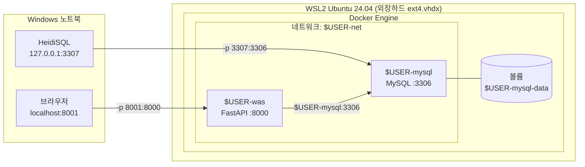

# WSL2 Ubuntu에서 Docker 웹 서비스까지 — 강의 사전 테스트 기록

**작성일:** 2026-11-21
**목적:** 학생들은 VirtualBox Ubuntu로 실습하므로, 강사 노트북에서 WSL2 Ubuntu로 같은 Docker 실습을 미리 검증한다.
**최종 결과:** 브라우저 → FastAPI(WAS) 컨테이너 → MySQL 컨테이너로 학생 목록을 조회하는 웹 서비스 동작 확인.



---

## 목차

1. [환경 선택: VirtualBox vs WSL2](#1-환경-선택-virtualbox-vs-wsl2)
2. [WSL2 테스트 결과가 학생 VirtualBox에서도 통하는가](#2-wsl2-테스트-결과가-학생-virtualbox에서도-통하는가)
3. [외장하드에 Ubuntu 24.04 설치](#3-외장하드에-ubuntu-2404-설치)
4. [Ubuntu 진입과 기본 설정](#4-ubuntu-진입과-기본-설정)
5. [Docker Engine 설치](#5-docker-engine-설치)
6. [첫 컨테이너: hello-world, nginx](#6-첫-컨테이너-hello-world-nginx)
7. [핵심 개념 정리](#7-핵심-개념-정리)
8. [MySQL 컨테이너와 HeidiSQL](#8-mysql-컨테이너와-heidisql)
9. [웹 서비스: HTML/JS + FastAPI + MySQL](#9-웹-서비스-htmljs--fastapi--mysql)
10. [실제로 겪은 오류와 해결](#10-실제로-겪은-오류와-해결)
11. [정리 명령과 다음 수업 체크리스트](#11-정리-명령과-다음-수업-체크리스트)

---

## 1. 환경 선택: VirtualBox vs WSL2

**강사 노트북 사양:** Windows, AMD Ryzen 5 5500U (6코어 12스레드), Hyper-V 이미 활성 상태 (Claude 데스크톱 앱의 작업 VM이 Hyper-V 위에서 동작)

| 항목 | VirtualBox | WSL2 |
|---|---|---|
| 이 PC에서의 성능 | Hyper-V가 켜져 있어 느린 호환 모드(초록 거북이 아이콘) | Hyper-V를 그대로 써서 빠름 |
| 메모리·디스크 | 고정 할당, 무거움 | 쓰는 만큼만 차지 |
| 같은 PC에서 접속 | NAT 포트 포워딩 또는 브리지 필요 | `wsl` 명령으로 바로, `localhost`로 접속 |
| 다른 PC에서 접속 | 브리지 어댑터로 간단 | mirrored 모드 + Hyper-V 방화벽 설정 필요 |

**결론:** 강사 개인 노트북의 사전 테스트는 **WSL2**가 효율적이다. 학생 실습 환경은 기존대로 VirtualBox.

> ⚠️ 학생 PC나 강의용 PC에 WSL·Docker Desktop을 설치하면 Hyper-V가 켜져 그 PC의 VirtualBox가 느려진다. 수업 첫날 학생 VM 상태 표시줄의 거북이 아이콘과 할당 RAM을 확인한다.

---

## 2. WSL2 테스트 결과가 학생 VirtualBox에서도 통하는가

**통한다.** 둘 다 Ubuntu 위에 apt로 같은 Docker Engine을 설치하므로 이미지·컨테이너·볼륨·Dockerfile·Compose 동작은 동일하다. 단, 아래는 다르다.

| 항목 | WSL2 (강사) | VirtualBox (학생) |
|---|---|---|
| Windows 브라우저 접속 | `http://localhost:8001` | `http://VM_IP:8001` (NAT면 포트 포워딩) |
| HeidiSQL 호스트 | `127.0.0.1:3307` | `VM_IP:3307` |
| `uname -r` 출력 | `...microsoft-standard-WSL2` | `...-generic` |
| 자원 | 노트북 RAM 넉넉히 사용 | 보통 2~4GB 고정 → MySQL+FastAPI 동시 실행 시 부족할 수 있음 |

테스트 환경을 학생과 맞추는 원칙:

- Ubuntu 버전을 맞춘다 (`Ubuntu-24.04`)
- **Docker Desktop을 쓰지 않는다** — Ubuntu 안에 apt로 Docker Engine 설치 (교안 2장과 동일)
- 실습 파일은 `/mnt/c`, `/mnt/d`가 아니라 **리눅스 홈(`~`)** 에 둔다

---

## 3. 외장하드에 Ubuntu 24.04 설치

### 설치

관리자 PowerShell에서 실행한다. (`E:`는 외장하드 드라이브 문자로 바꾼다)

```powershell
wsl --version                     # 없으면: wsl --install --no-distribution → 재부팅
wsl --update
mkdir E:\WSL
wsl --install -d Ubuntu-24.04 --location E:\WSL\Ubuntu-24.04
wsl -l -v                         # Ubuntu-24.04 / VERSION 2
wsl --set-default Ubuntu-24.04
```

설치가 끝나면 Ubuntu 사용자 이름과 비밀번호를 정한다. 이미 C 드라이브에 설치했다면 `wsl --manage Ubuntu-24.04 --move E:\WSL\Ubuntu-24.04`로 옮길 수 있다.

### 외장하드 사용 시 주의

| 항목 | 내용 |
|---|---|
| 파일 시스템 | **NTFS** 드라이브를 쓴다 (exFAT·FAT32는 문제 가능) |
| 분리 순서 | 반드시 `wsl --shutdown` 후 분리 (실행 중 분리 시 가상 디스크 손상 위험) |
| 드라이브 문자 | 설치 때와 같아야 함 → 디스크 관리에서 고정 |
| 속도 | HDD는 이미지 받기·빌드·MySQL이 느림, 외장 SSD 권장 |
| USB 절전 | 전원 옵션 → USB 선택적 절전 모드 **사용 안 함** |
| 옮겨지는 것 | Ubuntu 디스크(`ext4.vhdx`)만. WSL 프로그램은 C 드라이브에 남음 |

### 무엇이 외장하드에 저장되나

Ubuntu 안의 모든 것은 외장하드의 `ext4.vhdx` 한 파일에 들어간다. **Docker 이미지·컨테이너·볼륨(`/var/lib/docker`)도 포함.**

```bash
docker info | grep "Docker Root Dir"    # /var/lib/docker
df -h /
```

예외 (C 드라이브에 남는 것):

- Docker Desktop을 설치한 경우 그 전용 디스크
- `/mnt/c/...` 경로의 파일
- WSL 스왑 파일 → `%USERPROFILE%\.wslconfig`로 옮길 수 있다

```ini
[wsl2]
swapFile=E:\\WSL\\swap.vhdx
```

> `ext4.vhdx`는 커지기만 하고 자동으로 줄지 않는다. 가끔 `docker system prune`으로 정리한다.

### 다른 PC에서 쓰려면

외장하드를 꽂는다고 바로 실행되지 않는다(배포판 등록은 PC별). 그 PC에서:

```powershell
wsl --install --no-distribution            # WSL만 설치 (BIOS 가상화 필요)
wsl --import-in-place Ubuntu-24.04 E:\WSL\Ubuntu-24.04\ext4.vhdx
```

root로 로그인되면 Ubuntu의 `/etc/wsl.conf`에 `[user]` / `default=계정이름`을 넣고 `wsl --shutdown`.

---

## 4. Ubuntu 진입과 기본 설정

### 진입·종료 (PowerShell 또는 명령 프롬프트)

```powershell
wsl ~                     # 기본 배포판으로, 리눅스 홈에서 시작 (추천)
wsl -d Ubuntu-24.04 ~     # 배포판 이름 지정
exit                      # Ubuntu에서 나오기
wsl --shutdown            # WSL 완전히 종료 (설정 반영, 외장하드 분리 전)
```

시작 메뉴의 **Ubuntu 24.04** 아이콘이나 Windows 터미널 탭으로도 들어갈 수 있다.

> **확인 습관:** 프롬프트가 `계정@컴퓨터:~$` 이면 Ubuntu. `#`, `-sh`, `sudo: not found`가 나오면 다른 배포판에 들어간 것 → `wsl -l -v`로 확인.

### 기본 설정 (Ubuntu 안 — 리눅스 명령)

```bash
cd ~
sudo apt update && sudo apt upgrade -y
systemctl is-system-running        # running 또는 degraded 면 OK
cat /etc/wsl.conf                  # [boot] systemd=true 가 이미 있으면 다음 줄 생략
```

systemd가 꺼져 있을 때만 (기존 내용이 있으면 `sudo nano`로 직접 추가):

```bash
printf '[boot]\nsystemd=true\n' | sudo tee /etc/wsl.conf
# exit → PowerShell: wsl --shutdown → wsl ~
```

---

## 5. Docker Engine 설치

교안 `docker_ubuntu_기초강의.md` 2장과 동일한 명령이다.

```bash
# 1) 예전 패키지 제거
for pkg in docker.io docker-doc docker-compose podman-docker containerd runc; do
  sudo apt-get remove -y $pkg
done

# 2) 저장소 키 등록
sudo apt-get update
sudo apt-get install -y ca-certificates curl
sudo install -m 0755 -d /etc/apt/keyrings
sudo curl -fsSL https://download.docker.com/linux/ubuntu/gpg -o /etc/apt/keyrings/docker.asc
sudo chmod a+r /etc/apt/keyrings/docker.asc

# 3) 저장소 추가
sudo tee /etc/apt/sources.list.d/docker.sources <<EOF
Types: deb
URIs: https://download.docker.com/linux/ubuntu
Suites: $(. /etc/os-release && echo "${UBUNTU_CODENAME:-$VERSION_CODENAME}")
Components: stable
Signed-By: /etc/apt/keyrings/docker.asc
EOF

# 4) 설치
sudo apt-get update
sudo apt-get install -y docker-ce docker-ce-cli containerd.io docker-buildx-plugin docker-compose-plugin

# 5) 확인
sudo systemctl status docker --no-pager     # Active: active (running)
sudo docker run --rm hello-world
```

### 2) 저장소 키 등록 — 왜 하나

Ubuntu 기본 저장소의 `docker.io`는 최신이 아니고 Compose·buildx 구성이 공식판과 다르다. 그래서 Docker 공식 저장소를 쓰는데, apt는 처음 보는 저장소의 패키지를 **GPG 서명**으로 확인한 뒤에만 설치한다. 그 확인용 Docker 공개 키를 받는 단계다. (비유: 택배를 받기 전에 보낸 회사의 도장 견본을 받아 둔다)

| 명령 | 하는 일 |
|---|---|
| `apt-get update` | 패키지 목록 갱신 |
| `apt-get install -y ca-certificates curl` | HTTPS 인증서 묶음과 다운로드 도구 설치 |
| `install -m 0755 -d /etc/apt/keyrings` | 키 보관 폴더 생성 (root 쓰기, 모두 읽기) |
| `curl -fsSL ... -o docker.asc` | Docker 공개 키 다운로드 (`-f` 오류 시 실패, `-s` 조용히, `-S` 오류는 표시, `-L` 리다이렉트 따라가기) |
| `chmod a+r docker.asc` | 모든 사용자가 읽을 수 있게 → apt가 서명 확인 가능 |

### 3) 저장소 추가 — 한 줄씩

| 줄 | 의미 |
|---|---|
| `sudo tee 파일 <<EOF` | `EOF`까지의 내용을 root 권한으로 파일에 저장 (히어독). `sudo echo > 파일`은 리다이렉션이 일반 권한이라 실패하므로 `sudo tee` 사용 |
| `Types: deb` | 설치용 패키지 저장소 |
| `URIs:` | Docker 공식 저장소 주소 |
| `Suites: $(...)` | Ubuntu 코드명 자동 입력 (24.04 → `noble`). `. /etc/os-release`로 변수 읽기, `${A:-B}`는 A가 비면 B |
| `Components: stable` | 안정판 채널 |
| `Signed-By:` | 이 저장소는 앞에서 받은 키로만 확인 |
| `EOF` | 끝 표시 (줄 맨 앞, 공백 없이). `<<'EOF'`처럼 따옴표를 쓰면 `$(...)`가 바뀌지 않으니 주의 |

결과 확인: `cat /etc/apt/sources.list.d/docker.sources` → `Suites: noble`

### sudo 없이 docker 쓰기

```bash
sudo usermod -aG docker $USER
exit
# PowerShell: wsl --terminate Ubuntu-24.04 → wsl ~
docker run --rm hello-world
docker compose version
```

---

## 6. 첫 컨테이너: hello-world, nginx

### hello-world 출력 읽기

| 출력 | 의미 |
|---|---|
| `Unable to find image ... locally` | 이 PC에 이미지 없음 |
| `Pulling from library/hello-world`, `Pull complete` | Docker Hub에서 받음. `4f55...` 같은 것은 **레이어** |
| `Hello from Docker!` | 그 이미지로 만든 컨테이너의 실행 결과 |
| 1~4 설명 | **클라이언트 → 데몬 → Docker Hub → 컨테이너 → 터미널** |

같은 명령을 다시 실행하면 다운로드 없이 바로 실행된다 → 이미지는 한 번 받으면 재사용.

### nginx 웹 서버

```bash
echo 'export MYPORT=8001' >> ~/.bashrc && source ~/.bashrc
echo $USER $MYPORT
docker run -d --name $USER-web -p $MYPORT:80 nginx
docker ps
curl http://localhost:$MYPORT        # Welcome to nginx!
```

| 부분 | 의미 |
|---|---|
| `docker run` | 이미지로 새 컨테이너를 만들고 실행 (없으면 pull) |
| `-d` | 백그라운드 실행. 빼면 로그가 터미널을 차지하고 `Ctrl+C`에 함께 종료 |
| `--name $USER-web` | 컨테이너 이름. 여러 명이 같은 Docker를 쓸 때 겹치지 않게 |
| `-p $MYPORT:80` | `호스트포트:컨테이너포트`. Ubuntu 8001 → 컨테이너 80 |
| `nginx` | 이미지 (`nginx:latest`) |

> `$MYPORT`가 비어 있으면 `-p :80`이 되어 **임의 포트**에 연결된다.

```bash
docker logs $USER-web
docker stop $USER-web      # 멈춤 (docker start로 재시작 가능)
docker rm -f $USER-web     # 멈춤 + 삭제
```

---

## 7. 핵심 개념 정리

### 이미지와 컨테이너

| 이미지 | 컨테이너 |
|---|---|
| 실행에 필요한 파일·설정을 담은 **읽기 전용 설계도** (레이어 묶음) | 이미지로 만든 **실행 중인 인스턴스** |
| `docker pull`, `docker build`, `docker images` | `docker run`, `docker ps`, `docker rm` |
| 하나의 이미지로 컨테이너 여러 개 생성 가능 | 지우면 안에서 만든 파일도 사라짐 → 남길 데이터는 **볼륨**에 |

### 격리 (namespace + cgroup)

컨테이너는 Ubuntu 위의 평범한 프로세스지만, 커널이 **자기 세상만 보이게** 가림막(네임스페이스)을 친다.

| 격리 대상 | 컨테이너 안에서 보이는 모습 |
|---|---|
| 네트워크 | 자기 IP(`172.17.0.x`), 자기 `localhost`, 자기 포트 |
| 프로세스 | 자기 프로세스만, 주 프로그램이 PID 1 |
| 파일 시스템 | 이미지의 파일만 |
| 자원(cgroup) | 허용된 CPU·메모리만 |

- 컨테이너의 80번과 Ubuntu의 80번은 **별개의 포트** → 바깥 공개에는 `-p`가 필요
- 정확히는 Ubuntu(호스트) 자신은 컨테이너 IP로 직접 접속 가능 (`docker inspect`로 IP 확인 후 `curl`). 다만 Ubuntu 안에서만 통하고 IP는 재생성 시 바뀜
- 격리는 옵션으로 조절된다: `-p`(문 하나), `-v`(폴더 공유), `--network host`(네트워크 격리 해제), `--privileged`(대부분 해제, 비권장)
- VM과 달리 **커널은 공유** → `docker run --rm ubuntu:24.04 uname -r`이 호스트와 같다

> 비유: VM은 집을 따로 짓는 것, 컨테이너는 한 건물 안 칸막이 사무실, `-p`는 칸막이에 낸 창구.

### Docker 명령 모드는 없다

`docker`는 셸에서 실행하는 **클라이언트 프로그램**이다. 실행할 때마다 데몬(`dockerd`)에 요청 한 번을 보내고 끝난다. 그래서 항상 `docker 하위명령` 형식이며, 리눅스 명령과 섞어 쓸 수 있다.

```bash
docker ps | grep $USER
```

- 입력 줄이기: **Tab 자동완성** (안 되면 `sudo apt install bash-completion`), alias (`alias d='docker'`, 수업에서는 비권장)
- 여러 컨테이너는 Compose로 (`docker compose up -d`)
- **컨테이너 안으로 들어가기**는 별개: `docker exec -it 이름 bash` → 프롬프트가 `root@컨테이너ID`로 바뀜. 여기서는 `docker` 명령이 없다

---

## 8. MySQL 컨테이너와 HeidiSQL

### 실행

```bash
docker pull mysql:8.4
docker run -d --name $USER-mysql \
  -e MYSQL_ROOT_PASSWORD=root1234 \
  -e MYSQL_DATABASE=classdb \
  -e MYSQL_USER=student \
  -e MYSQL_PASSWORD=student1234 \
  -p 3307:3306 \
  -v $USER-mysql-data:/var/lib/mysql \
  mysql:8.4
```

| 옵션 | 의미 |
|---|---|
| `MYSQL_ROOT_PASSWORD` | 필수. 없으면 컨테이너가 바로 종료 |
| `MYSQL_DATABASE` / `USER` / `PASSWORD` | 첫 시작 때 DB와 일반 계정 생성 |
| `-p 3307:3306` | Windows에 MySQL이 3306을 쓰고 있을 수 있어 바깥 포트는 3307 |
| `-v ...:/var/lib/mysql` | DB 파일을 볼륨에 저장 → 컨테이너를 지워도 데이터 유지 |

### 준비 확인

```bash
docker logs -f $USER-mysql      # 두 번째 "ready for connections ... port: 3306" → 준비 완료
                                # Ctrl+C 는 로그 보기만 종료 (-d로 띄웠을 때)
docker ps
```

> `-d`를 빼고 실행했다면 `Ctrl+C`가 **서버까지 종료**한다. 이때는 새 터미널(`wsl ~`)에서 `docker ps`부터 확인하고, `-d`를 붙여 다시 실행한다. `--pid-file` 경고는 공식 이미지에서 늘 나오는 메시지로 무시해도 된다.

### 테이블 생성

```bash
docker exec -it -e LANG=C.UTF-8 $USER-mysql mysql -u student -p classdb
```

```sql
CREATE TABLE students (
  id         INT AUTO_INCREMENT PRIMARY KEY,
  name       VARCHAR(50) NOT NULL,
  major      VARCHAR(50),
  created_at DATETIME DEFAULT CURRENT_TIMESTAMP
);
INSERT INTO students (name, major) VALUES
  ('김철수', '컴퓨터공학'), ('이영희', '경영학'), ('박민수', 'AI융합');
SELECT * FROM students;
```

`-e LANG=C.UTF-8`이 없으면 한글 입력이 안 되거나 깨질 수 있다.

### HeidiSQL 접속

| 항목 | WSL2 (강사) | VirtualBox (학생) |
|---|---|---|
| 네트워크 유형 | MariaDB or MySQL (TCP/IP) | 동일 |
| 호스트 | `127.0.0.1` | `VM_IP` (NAT면 3307 포워딩) |
| 사용자 / 암호 | `student` / `student1234` | 동일 |
| 포트 | `3307` | `3307` |
| 데이터베이스 | `classdb` | 동일 |

HeidiSQL에서 넣은 행이 `docker exec ... mysql`에서도 바로 보인다 → 같은 DB 서버를 두 곳에서 보는 것.

### 볼륨 확인

```bash
docker rm -f $USER-mysql
# 위 docker run 다시 실행 → 10초 후
docker exec -it $USER-mysql mysql -u student -pstudent1234 classdb -e "SELECT * FROM students;"
```

데이터가 남아 있다. 단, **볼륨에 데이터가 있으면 `-e` 환경 변수는 무시**된다 (비밀번호를 바꾸려면 볼륨 삭제 후 재생성).

---

## 9. 웹 서비스: HTML/JS + FastAPI + MySQL

프로젝트 위치: `D:\AX_FullStack_Builder\Docker\students-web` (자세한 안내는 그 폴더의 `README.md`)

```
students-web/
├── README.md
└── app/
    ├── Dockerfile          # python:3.12-slim, uvicorn으로 0.0.0.0:8000
    ├── requirements.txt    # fastapi, uvicorn[standard], pymysql, cryptography
    ├── main.py             # /api/health, /api/students, /api/students/{id} + 정적 파일
    └── static/
        ├── index.html
        └── app.js          # fetch('/api/students') → 표, 전공 검색
```

FastAPI(uvicorn) 하나가 **WAS**로서 API와 화면을 함께 서비스한다. 화면과 API가 같은 주소이므로 JS는 `/api/...`만 쓰면 되고 CORS 설정이 필요 없으며, `localhost`·`VM_IP` 어디서든 코드 수정이 없다.

### 실행

```bash
cp -r /mnt/d/AX_FullStack_Builder/Docker/students-web ~/ && cd ~/students-web

docker network create $USER-net
docker network connect $USER-net $USER-mysql

docker build -t $USER/students-web ./app
docker run -d --name $USER-was --network $USER-net \
  -e DB_HOST=$USER-mysql -e DB_PORT=3306 \
  -e DB_USER=student -e DB_PASSWORD=student1234 -e DB_NAME=classdb \
  -p $MYPORT:8000 $USER/students-web

curl http://localhost:$MYPORT/api/health     # {"status":"ok","db":"ok"}
```

브라우저: `http://localhost:8001` (화면), `http://localhost:8001/api/docs` (API 문서)

### 수업 포인트

| 질문 | 답 |
|---|---|
| 왜 네트워크를 만드나? | 기본 `bridge` 네트워크에서는 **컨테이너 이름으로 찾을 수 없다**. 직접 만든 네트워크에 붙여야 `$USER-mysql`이라는 이름이 주소가 된다 (Compose는 자동) |
| 왜 `DB_HOST=localhost`가 아닌가? | WAS 컨테이너의 localhost는 WAS 자신. 그 안에 MySQL은 없다 |
| 왜 `DB_PORT=3306`인가? | 3307은 Windows(HeidiSQL)용 바깥 창구. 같은 네트워크의 컨테이너끼리는 원래 포트 3306으로 직접 통신 |
| 코드를 고치면? | 이미지 다시 빌드 → 컨테이너 삭제 후 재실행. `requirements.txt`가 같으면 설치 단계는 캐시 사용 |

### 일부러 오류 내 보기

| 실험 | 결과 |
|---|---|
| `-e DB_HOST=localhost` | `/api/health` 503 `Can't connect to MySQL server on 'localhost'` |
| `--network` 빼기 | 503 `Unknown MySQL server host` |
| `-e DB_PORT=3307` | 503 연결 실패 |
| `docker stop $USER-mysql` | 화면에 빨간 오류 메시지 (WAS는 살아 있어도 서비스 불가) |

---

## 10. 실제로 겪은 오류와 해결

| 오류 | 원인 | 해결 |
|---|---|---|
| `SimpleNoteBook:~#` 에서 `-sh: sudo: not found` | Ubuntu가 아닌 다른 WSL 배포판에 들어감 (root, sh, sudo 없음) | `cat /etc/os-release`로 확인 → `exit` → `wsl -l -v` → `wsl -d Ubuntu-24.04 ~`, `wsl --set-default Ubuntu-24.04` |
| `sudo: unable to execute /usr/bin/tee: Input/output error` | 외장하드 연결이 끊기거나 절전으로 Ubuntu 디스크(`ext4.vhdx`) 읽기 실패 | `dmesg \| tail` 확인 → `wsl --shutdown` → 외장하드 재연결·드라이브 문자 확인 → `chkdsk E: /f` → 재진입. 계속되면 `wsl --unregister` 후 재설치. USB 절전 끄기 |
| `docker logs` 중 명령 입력 불가 | `-f`(follow)로 로그를 계속 보는 중 | `Ctrl+C` (서버는 유지). `-d` 없이 실행했다면 새 터미널에서 처리 |
| `Bind for 0.0.0.0:8001 failed: port is already allocated` | 앞서 띄운 nginx(`simple-web`)가 8001 사용 중 | `docker ps --format "table {{.Names}}\t{{.Ports}}"` → `docker rm -f simple-web` → `docker start $USER-was` (생성은 됐지만 시작 실패 상태였음). 또는 다른 포트(`-p 8002:8000`) |

> 포트 충돌은 수업에서도 자주 나온다 → "호스트 포트 하나에는 컨테이너 하나" → 학생마다 포트를 배정하는 이유.

---

## 11. 정리 명령과 다음 수업 체크리스트

### 정리

```bash
docker rm -f $USER-was $USER-web
docker rmi $USER/students-web
docker network disconnect $USER-net $USER-mysql
docker network rm $USER-net
docker rm -f $USER-mysql
docker volume rm $USER-mysql-data      # ⚠️ DB 데이터까지 삭제
docker system prune                    # 사용하지 않는 이미지·캐시 정리 (개인 환경에서만)
```

PowerShell: `wsl --shutdown` 후 외장하드 분리.

### 학생 VirtualBox 환경 체크리스트

- [ ] VM 상태 표시줄에 초록 거북이 아이콘이 없는가
- [ ] VM RAM 4GB 이상, 디스크 여유 10GB 이상 (MySQL + FastAPI 실습)
- [ ] 네트워크: 브리지 권장. NAT라면 SSH(22)·웹(8001~8020)·MySQL(3307) 포트 포워딩
- [ ] 교안의 `localhost` 브라우저 접속 안내를 `VM_IP`로 바꿔 안내
- [ ] `uname -r` 출력 예시는 `-generic` 기준
- [ ] 이미지 미리 받기: `nginx`, `mysql:8.4`, `python:3.12-slim`, `hello-world`
- [ ] HeidiSQL 최신 버전 설치 (MySQL 8.4 인증 방식 지원)
