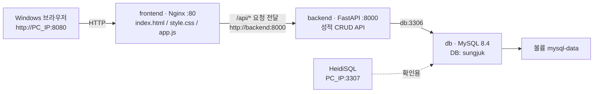

# Docker로 풀스택 성적 관리 서비스 배포하기

**구성:** 프론트엔드(HTML·CSS·바닐라 JS) + 백엔드(FastAPI) + DB(MySQL 8.4)
**목표:** 브라우저에서 성적을 **조회·등록·수정·삭제**하는 웹 서비스를 만들고, Docker Compose로 VirtualBox 우분투 서버에 배포해 같은 내부망의 수강생이 접속하게 한다.
**권장 시간:** 4시간 30분
**환경:** Windows PC + VirtualBox Ubuntu 24.04 VM (NAT + 포트 포워딩), Windows PowerShell에서 SSH로 접속해 작업
**완성본:** `E:\AX_FullStack_Builder\Docker\sungjuk-service\` (이 문서의 모든 파일이 들어 있음)

| 항목 | 값 |
|---|---|
| DB 이름 | `sungjuk` |
| DB 사용자 / 비밀번호 | `simple` / `pjc0129` |
| DB root 비밀번호 | `root1234` |
| 테이블 | `score` |

---

## 0. 완성 모습



| 서비스 | 이미지 | 역할 | 외부 공개 포트 |
|---|---|---|---|
| `frontend` | 직접 빌드 (`nginx:1.27-alpine`) | 화면 파일 제공, `/api` 요청을 backend로 전달 | **8080** |
| `backend` | 직접 빌드 (`python:3.12-slim`) | 성적 조회·등록·수정·삭제 API | 없음 (VM 안에서만 8000) |
| `db` | `mysql:8.4` 공식 이미지 | 데이터 저장 | **3307** (HeidiSQL 확인용) |

> **핵심 설계:** 브라우저는 **frontend(Nginx) 하나에만** 접속합니다. 화면과 API가 같은 주소(`:8080`)에서 나오므로 CORS 설정이 필요 없고, 백엔드는 외부에 노출되지 않습니다.

### 최종 폴더 구조

```
~/sungjuk-service/
├── .env                  # 포트, DB 계정 등 설정값
├── compose.yaml          # 전체 서비스 구성
├── db/
│   └── init.sql          # DB 최초 생성 시 실행할 SQL (테이블 + 샘플 데이터)
├── backend/
│   ├── Dockerfile
│   ├── requirements.txt
│   └── main.py           # FastAPI 서버
└── frontend/
    ├── Dockerfile
    ├── nginx.conf        # /api 프록시 설정
    ├── index.html        # 화면 구조
    ├── style.css         # 디자인
    └── app.js            # API 호출 (fetch)
```

---

## 1. 수업 진행 절차 (전체 흐름)

| 순서 | 단계 | 시간 | 확인할 결과 |
|---|---|---|---|
| 0 | **[강사] 사전 준비** | 수업 전 | VM 메모리, SSH, 포트 포워딩, Docker 설치, 이미지 다운로드 |
| 1 | **프로젝트 구조와 설정** | 20분 | 폴더 구조와 `.env`, `compose.yaml` 이해 |
| 2 | **DB 구성** | 30분 | `sungjuk` DB와 `score` 테이블 생성, HeidiSQL로 확인 |
| 3 | **백엔드(FastAPI)** | 70분 | API 5개 구현, curl로 CRUD 테스트 |
| 4 | **프론트엔드** | 70분 | HTML·CSS·JS 작성, Nginx 프록시, 브라우저에서 CRUD |
| 5 | **통합 배포와 운영** | 40분 | 명령 한 번으로 전체 배포, 코드 수정 후 재배포, 로그 확인 |
| 6 | **내부망 공개** | 30분 | 수강생 PC 브라우저에서 접속 |
| 7 | **정리와 과제** | 20분 | 확인 문제, 확장 과제 |

---

## 2. [강사 사전 준비] 환경 점검

### 2-1. VM 메모리 확인

MySQL 컨테이너 하나가 약 400~500MB를 씁니다. 이 서비스 전체는 약 1GB가 필요합니다.

```bash
free -h          # available 값이 1.5GB 이상이면 충분
```

부족하면 VM을 끈 상태에서 **VirtualBox 설정 → 시스템 → 기본 메모리**를 늘립니다.

### 2-2. SSH 접속 확인

이후 모든 작업은 **Windows PowerShell에서 SSH로 접속한 창**에서 합니다. 이 창에서는 복사·붙여넣기가 됩니다.

```powershell
ssh -p 2222 vboxuser@127.0.0.1
```

> SSH가 아직 안 되면 우분투 콘솔에서 `sudo apt install -y openssh-server`를 먼저 실행하고, 아래 포트 포워딩의 `ssh` 규칙을 추가합니다.

### 2-3. VirtualBox 포트 포워딩

VirtualBox 관리자 → VM 선택 → **설정 → 네트워크 → 어댑터 1(NAT) → 포트 포워딩**에서 규칙을 추가합니다. VM이 실행 중이어도 바로 적용됩니다.

| 이름 | 프로토콜 | 호스트 IP | 호스트 포트 | 게스트 IP | 게스트 포트 | 용도 |
|---|---|---|---|---|---|---|
| ssh | TCP | (비움) | 2222 | (비움) | 22 | SSH 접속 |
| web | TCP | (비움) | **8080** | (비움) | **8080** | 성적 관리 화면 |
| sungjuk-db | TCP | (비움) | **3307** | (비움) | **3307** | HeidiSQL 접속 |

> **호스트 IP를 비우면** 내부망의 다른 PC에서도 접속할 수 있습니다. 강사 PC에서만 쓰려면 `127.0.0.1`을 넣습니다.
> 기존 실습용 `mysql-lab` 컨테이너가 3306을 쓰고 있으므로 이 서비스의 DB는 **3307**로 엽니다.
 
## port Forwarding을 설정하는 이유


## NAT란?


## 사설IP와 공인IP란?


## VPN과 VPC


---


### 2-4. Docker 설치 확인

```bash
docker --version
docker compose version
```

둘 다 버전이 나오면 [2-5](#2-5-docker-그룹-권한-설정)로 넘어갑니다.

**`docker compose`만 안 되는 경우** (Ubuntu 기본 패키지 `docker.io`로 설치한 경우):

```bash
sudo apt update
sudo apt install -y docker-compose-v2
```

**Docker가 아예 없는 경우** (Docker 공식 저장소로 설치):

```bash
sudo apt update
sudo apt install -y ca-certificates curl
sudo install -m 0755 -d /etc/apt/keyrings
sudo curl -fsSL https://download.docker.com/linux/ubuntu/gpg -o /etc/apt/keyrings/docker.asc
sudo chmod a+r /etc/apt/keyrings/docker.asc

echo "deb [arch=$(dpkg --print-architecture) signed-by=/etc/apt/keyrings/docker.asc] \
https://download.docker.com/linux/ubuntu $(. /etc/os-release && echo "$VERSION_CODENAME") stable" \
| sudo tee /etc/apt/sources.list.d/docker.list > /dev/null

sudo apt update
sudo apt install -y docker-ce docker-ce-cli containerd.io docker-buildx-plugin docker-compose-plugin
sudo systemctl enable --now docker
```

### 2-5. Docker 그룹 권한 설정

매번 `sudo`를 붙이지 않도록 현재 사용자를 `docker` 그룹에 넣습니다.

```bash
sudo usermod -aG docker $USER
exit
```

SSH로 **다시 접속**한 뒤 확인합니다.

```bash
docker ps        # 오류 없이 목록(비어 있어도 됨)이 나오면 성공
```

> 이 문서의 명령은 그룹 설정을 했다고 가정하고 `sudo` 없이 씁니다. 그룹 설정을 하지 않았다면 `docker` 앞에 `sudo`를 붙이세요.

### 2-6. 이미지 미리 받기

수업 중 다운로드 시간을 줄이기 위해 미리 받아 둡니다.

```bash
docker pull mysql:8.4
docker pull python:3.12-slim
docker pull nginx:1.27-alpine
```

---

## 3. 1단계 — 프로젝트 구조와 설정 (20분)

### 3-1. 폴더 만들기

```bash
mkdir -p ~/sungjuk-service/{db,backend,frontend}
cd ~/sungjuk-service
```

> **파일 만드는 방법:** 이 문서의 각 파일은 `nano 파일이름`으로 열고, 내용을 복사해 **마우스 오른쪽 클릭**으로 붙여넣은 뒤 `Ctrl+O` → `Enter` → `Ctrl+X`로 저장합니다.
>
> 시간이 부족하면 Windows PowerShell(새 창)에서 완성본을 한 번에 복사할 수 있습니다.
> ```powershell
> scp -P 2222 -r E:\AX_FullStack_Builder\Docker\sungjuk-service vboxuser@127.0.0.1:~
> ```

### 3-2. 설정값 파일 `.env`

```bash
nano .env
```

```ini
# 서비스 설정값 (compose.yaml에서 ${이름}으로 사용)
# 수강생별로 따로 띄울 때는 COMPOSE_PROJECT_NAME과 포트 3개를 서로 다르게 바꾼다.
COMPOSE_PROJECT_NAME=sungjuk

# 외부(브라우저, HeidiSQL)에서 접속할 포트
WEB_PORT=8080
DB_PORT=3307
# VM 안에서만 쓰는 API 테스트용 포트
API_PORT=8000

# MySQL 설정 (DB 볼륨이 처음 만들어질 때 한 번만 적용됨)
DB_ROOT_PASSWORD=root1234
DB_NAME=sungjuk
DB_USER=simple
DB_PASSWORD=pjc0129
```

> **왜 `.env`를 따로 두나?** 비밀번호·포트 같은 **환경마다 바뀌는 값**을 코드와 분리하기 위해서입니다. `compose.yaml`은 그대로 두고 `.env`만 바꾸면 다른 서버나 다른 수강생 환경에서도 그대로 쓸 수 있습니다.

### 3-3. 전체 구성 파일 `compose.yaml`

```bash
nano compose.yaml
```

```yaml
services:
  db:
    image: mysql:8.4
    environment:
      MYSQL_ROOT_PASSWORD: ${DB_ROOT_PASSWORD}
      MYSQL_DATABASE: ${DB_NAME}        # sungjuk DB 생성
      MYSQL_USER: ${DB_USER}            # simple 계정 생성 + sungjuk DB 전체 권한
      MYSQL_PASSWORD: ${DB_PASSWORD}
    ports:
      - "${DB_PORT}:3306"               # HeidiSQL 확인용 (기존 mysql-lab의 3306과 겹치지 않게 3307)
    volumes:
      - mysql-data:/var/lib/mysql
      - ./db/init.sql:/docker-entrypoint-initdb.d/init.sql:ro
    healthcheck:
      # TCP(127.0.0.1)로 확인해야 초기화용 임시 서버가 아닌 진짜 서버가 떴을 때 healthy가 된다
      test: ["CMD-SHELL", "mysqladmin ping -h 127.0.0.1 -uroot -p$$MYSQL_ROOT_PASSWORD --silent"]
      interval: 5s
      timeout: 3s
      retries: 20
      start_period: 30s
    restart: unless-stopped

  backend:
    build: ./backend
    environment:
      DB_HOST: db                       # 서비스 이름이 곧 주소
      DB_PORT: 3306                     # 컨테이너끼리는 원래 포트(3306)로 통신
      DB_NAME: ${DB_NAME}
      DB_USER: ${DB_USER}
      DB_PASSWORD: ${DB_PASSWORD}
    ports:
      - "127.0.0.1:${API_PORT}:8000"    # VM 안에서 curl 테스트용 (외부에는 열리지 않음)
    depends_on:
      db:
        condition: service_healthy      # DB가 접속 가능해진 뒤에 시작
    restart: unless-stopped

  frontend:
    build: ./frontend
    ports:
      - "${WEB_PORT}:80"                # 브라우저가 접속하는 유일한 입구
    depends_on:
      - backend
    restart: unless-stopped

volumes:
  mysql-data:
```

**설명할 포인트**

| 설정 | 의미 |
|---|---|
| `DB_HOST: db` | Compose는 서비스마다 같은 네트워크를 만들어 주고, **서비스 이름으로 서로를 찾습니다.** `localhost`가 아닙니다. |
| `"${DB_PORT}:3306"` | `외부포트:컨테이너포트`. 외부는 3307로 들어오고, 컨테이너 안의 MySQL은 그대로 3306입니다. |
| `127.0.0.1:${API_PORT}:8000` | VM 안에서만 접속 가능. 수강생은 백엔드에 직접 접속할 수 없습니다. |
| `condition: service_healthy` | DB가 완전히 준비된 뒤에 백엔드를 시작합니다. 이게 없으면 백엔드가 먼저 떠서 DB 연결 오류가 납니다. |
| `$$MYSQL_ROOT_PASSWORD` | `$$`는 Compose가 치환하지 않고 컨테이너 안의 환경 변수를 그대로 쓰라는 뜻입니다. |
| `restart: unless-stopped` | VM이 재부팅되어도 서비스가 자동으로 다시 올라옵니다. |

이 단계에서는 파일을 **한 번에 다 작성해 두고**, 다음 단계부터 서비스를 **하나씩** 띄우며 확인합니다.

---

## 4. 2단계 — DB 구성 (30분)

### 4-1. 테이블 설계

| 컬럼 | 타입 | 설명 |
|---|---|---|
| `id` | INT, PK, AUTO_INCREMENT | 내부 번호 |
| `hakbun` | VARCHAR(20), UNIQUE | 학번 (중복 불가) |
| `name` | VARCHAR(30) | 이름 |
| `kor`, `eng`, `math` | TINYINT UNSIGNED, 0~100 | 국어·영어·수학 점수 |
| `created_at`, `updated_at` | DATETIME | 등록·수정 시각 (자동) |

> **총점·평균·학점은 저장하지 않습니다.** 점수에서 계산할 수 있는 값을 저장하면, 점수를 고칠 때 함께 고치지 않으면 값이 어긋납니다. 계산은 백엔드가 합니다.

### 4-2. 초기화 SQL `db/init.sql`

```bash
nano db/init.sql
```

```sql
-- DB 볼륨이 처음 만들어질 때 한 번만 실행된다.
-- MYSQL_DATABASE(sungjuk)가 선택된 상태로 실행되므로 USE 문은 필요 없다.
SET NAMES utf8mb4;   -- 한글 샘플 데이터가 깨지지 않도록

CREATE TABLE IF NOT EXISTS score (
  id         INT AUTO_INCREMENT PRIMARY KEY,
  hakbun     VARCHAR(20)      NOT NULL UNIQUE,      -- 학번 (중복 불가)
  name       VARCHAR(30)      NOT NULL,             -- 이름
  kor        TINYINT UNSIGNED NOT NULL DEFAULT 0,   -- 국어
  eng        TINYINT UNSIGNED NOT NULL DEFAULT 0,   -- 영어
  math       TINYINT UNSIGNED NOT NULL DEFAULT 0,   -- 수학
  created_at DATETIME NOT NULL DEFAULT CURRENT_TIMESTAMP,
  updated_at DATETIME NOT NULL DEFAULT CURRENT_TIMESTAMP ON UPDATE CURRENT_TIMESTAMP,
  CONSTRAINT chk_kor  CHECK (kor  BETWEEN 0 AND 100),
  CONSTRAINT chk_eng  CHECK (eng  BETWEEN 0 AND 100),
  CONSTRAINT chk_math CHECK (math BETWEEN 0 AND 100)
) DEFAULT CHARSET=utf8mb4;

INSERT INTO score (hakbun, name, kor, eng, math) VALUES
  ('20260001', '홍길동', 95, 88, 92),
  ('20260002', '김철수', 78, 85, 80),
  ('20260003', '이영희', 88, 92, 95),
  ('20260004', '박민수', 65, 70, 58),
  ('20260005', '최지우', 100, 97, 99);
```

### 4-3. DB만 먼저 실행

```bash
cd ~/sungjuk-service
docker compose up -d db
docker compose ps
```

`STATUS`가 `Up ... (healthy)`가 될 때까지 30초 정도 기다립니다. 진행 상황은 로그로 볼 수 있습니다.

```bash
docker compose logs -f db       # "ready for connections" 가 보이면 Ctrl+C
```

### 4-4. 컨테이너 안에서 확인

```bash
docker compose exec db mysql -usimple -ppjc0129 sungjuk -e "SELECT * FROM score;"
```

샘플 5명이 나오면 성공입니다.

### 4-5. HeidiSQL로 확인 (Windows)

| 항목 | 값 |
|---|---|
| 네트워크 유형 | MySQL (TCP/IP) |
| 호스트명 / IP | `127.0.0.1` |
| 사용자 / 암호 | `simple` / `pjc0129` |
| 포트 | `3307` |
| 데이터베이스 | `sungjuk` |

> `Authentication plugin 'caching_sha2_password' cannot be loaded` 오류가 나면 HeidiSQL을 최신 버전으로 업데이트하거나, 라이브러리를 `libmysql-8.x.dll`로 바꿉니다.

---

## 5. 3단계 — 백엔드: FastAPI로 API 서버 만들기 (70분)

### 5-1. API 설계

| 기능 | 메서드 | 주소 | 요청 본문 | 성공 응답 |
|---|---|---|---|---|
| 서버 상태 | GET | `/api/health` | — | 200 |
| 목록 조회·검색 | GET | `/api/scores?q=검색어` | — | 200 + 배열 |
| 한 명 조회 | GET | `/api/scores/{id}` | — | 200 / 없으면 404 |
| 등록 | POST | `/api/scores` | 학번·이름·점수 JSON | 201 / 학번 중복 409 |
| 수정 | PUT | `/api/scores/{id}` | 학번·이름·점수 JSON | 200 / 없으면 404 |
| 삭제 | DELETE | `/api/scores/{id}` | — | 204 / 없으면 404 |

요청 본문 예시:

```json
{ "hakbun": "20260006", "name": "정수빈", "kor": 90, "eng": 85, "math": 80 }
```

응답 예시 (백엔드가 총점·평균·학점을 계산해서 붙임):

```json
{ "id": 6, "hakbun": "20260006", "name": "정수빈", "kor": 90, "eng": 85, "math": 80,
  "created_at": "2026-11-23T05:10:00", "updated_at": "2026-11-23T05:10:00",
  "total": 255, "avg": 85.0, "grade": "B" }
```

> **REST 규칙 정리:** 주소는 **대상(명사)** 을 나타내고(`/scores`, `/scores/6`), **무엇을 할지**는 메서드(GET·POST·PUT·DELETE)로 표현합니다.

### 5-2. 라이브러리 목록 `backend/requirements.txt`

```bash
nano backend/requirements.txt
```

```text
fastapi==0.115.6
uvicorn[standard]==0.32.1
pymysql==1.1.1
cryptography==44.0.0
```

| 라이브러리 | 역할 |
|---|---|
| `fastapi` | API 서버 프레임워크 (입력 검증, Swagger 문서 자동 생성) |
| `uvicorn` | FastAPI를 실행하는 웹 서버 |
| `pymysql` | Python에서 MySQL에 접속 |
| `cryptography` | MySQL 8의 기본 인증 방식(`caching_sha2_password`)에 필요 |

> 버전을 고정해 두면 수업 날과 나중에 다시 빌드할 때 똑같이 동작합니다.

### 5-3. 서버 코드 `backend/main.py`

```bash
nano backend/main.py
```

```python
import os

import pymysql
from fastapi import APIRouter, FastAPI, HTTPException
from pydantic import BaseModel, Field


# ── DB 연결 ─────────────────────────────────────────
# 접속 정보는 코드에 적지 않고 환경 변수(compose.yaml)로 받는다.
def get_conn():
    return pymysql.connect(
        host=os.getenv("DB_HOST", "db"),
        port=int(os.getenv("DB_PORT", "3306")),
        user=os.getenv("DB_USER", "simple"),
        password=os.getenv("DB_PASSWORD", ""),
        database=os.getenv("DB_NAME", "sungjuk"),
        charset="utf8mb4",
        cursorclass=pymysql.cursors.DictCursor,  # 결과를 dict로 받기
        autocommit=True,
    )


# ── 요청 데이터 형식 (입력값 검증) ───────────────────
class ScoreIn(BaseModel):
    hakbun: str = Field(min_length=1, max_length=20, examples=["20260006"])
    name: str = Field(min_length=1, max_length=30, examples=["정수빈"])
    kor: int = Field(ge=0, le=100, examples=[90])
    eng: int = Field(ge=0, le=100, examples=[85])
    math: int = Field(ge=0, le=100, examples=[80])


COLUMNS = "id, hakbun, name, kor, eng, math, created_at, updated_at"


def calc_grade(avg: float) -> str:
    if avg >= 90:
        return "A"
    if avg >= 80:
        return "B"
    if avg >= 70:
        return "C"
    if avg >= 60:
        return "D"
    return "F"


def with_result(row: dict) -> dict:
    """DB에서 읽은 한 행에 총점·평균·학점을 계산해서 붙인다."""
    total = row["kor"] + row["eng"] + row["math"]
    avg = round(total / 3, 1)
    return {**row, "total": total, "avg": avg, "grade": calc_grade(avg)}


def find_score(cur, score_id: int):
    cur.execute(f"SELECT {COLUMNS} FROM score WHERE id = %s", (score_id,))
    return cur.fetchone()


app = FastAPI(
    title="성적 관리 API",
    docs_url="/api/docs",              # Swagger 화면 주소
    openapi_url="/api/openapi.json",
)
router = APIRouter(prefix="/api")


@router.get("/health")
def health():
    try:
        with get_conn() as conn, conn.cursor() as cur:
            cur.execute("SELECT 1")
        return {"status": "ok", "db": "ok"}
    except pymysql.MySQLError as e:
        raise HTTPException(status_code=503, detail=f"DB 연결 실패: {e}")


# 목록 조회 (q가 있으면 학번 또는 이름으로 검색)
@router.get("/scores")
def list_scores(q: str | None = None):
    sql = f"SELECT {COLUMNS} FROM score"
    params = None
    if q:
        sql += " WHERE hakbun LIKE %s OR name LIKE %s"
        params = (f"%{q}%", f"%{q}%")
    sql += " ORDER BY hakbun"
    with get_conn() as conn, conn.cursor() as cur:
        cur.execute(sql, params)
        return [with_result(row) for row in cur.fetchall()]


# 한 명 조회
@router.get("/scores/{score_id}")
def get_score(score_id: int):
    with get_conn() as conn, conn.cursor() as cur:
        row = find_score(cur, score_id)
    if row is None:
        raise HTTPException(status_code=404, detail="없는 성적입니다")
    return with_result(row)


# 등록
@router.post("/scores", status_code=201)
def create_score(score: ScoreIn):
    try:
        with get_conn() as conn, conn.cursor() as cur:
            # %s 자리표시자를 쓰면 PyMySQL이 값을 안전하게 처리한다 (SQL 인젝션 방지)
            cur.execute(
                "INSERT INTO score (hakbun, name, kor, eng, math) "
                "VALUES (%s, %s, %s, %s, %s)",
                (score.hakbun, score.name, score.kor, score.eng, score.math),
            )
            return with_result(find_score(cur, cur.lastrowid))
    except pymysql.err.IntegrityError:
        raise HTTPException(status_code=409, detail="이미 등록된 학번입니다")


# 수정
@router.put("/scores/{score_id}")
def update_score(score_id: int, score: ScoreIn):
    try:
        with get_conn() as conn, conn.cursor() as cur:
            if find_score(cur, score_id) is None:
                raise HTTPException(status_code=404, detail="없는 성적입니다")
            cur.execute(
                "UPDATE score SET hakbun = %s, name = %s, kor = %s, eng = %s, math = %s "
                "WHERE id = %s",
                (score.hakbun, score.name, score.kor, score.eng, score.math, score_id),
            )
            return with_result(find_score(cur, score_id))
    except pymysql.err.IntegrityError:
        raise HTTPException(status_code=409, detail="이미 등록된 학번입니다")


# 삭제
@router.delete("/scores/{score_id}", status_code=204)
def delete_score(score_id: int):
    with get_conn() as conn, conn.cursor() as cur:
        deleted = cur.execute("DELETE FROM score WHERE id = %s", (score_id,))
    if deleted == 0:
        raise HTTPException(status_code=404, detail="없는 성적입니다")


app.include_router(router)
```

**코드 설명 포인트**

| 부분 | 설명 |
|---|---|
| `os.getenv(...)` | 비밀번호를 코드에 쓰지 않고 `compose.yaml` → `.env`에서 받습니다. |
| `class ScoreIn(BaseModel)` | 점수가 0~100이 아니거나 이름이 비어 있으면 FastAPI가 **자동으로 422 오류**를 돌려줍니다. 검증 코드를 직접 쓸 필요가 없습니다. |
| `%s` 자리표시자 | 값을 문자열로 이어 붙이지 않고 PyMySQL에 맡겨 **SQL 인젝션을 막습니다.** (`f"... '{name}'"` 처럼 쓰면 안 됨) |
| `with_result()` | DB에는 점수만 있고, 총점·평균·학점은 응답할 때 계산합니다. |
| `IntegrityError` → 409 | 학번 `UNIQUE` 제약에 걸리면 "이미 등록된 학번"으로 바꿔서 알려 줍니다. |
| `APIRouter(prefix="/api")` | 모든 주소 앞에 `/api`가 붙습니다. Nginx가 `/api/`로 시작하는 요청만 백엔드로 넘기기 때문입니다. |

### 5-4. 이미지 설계도 `backend/Dockerfile`

```bash
nano backend/Dockerfile
```

```dockerfile
FROM python:3.12-slim

WORKDIR /app

# 라이브러리 먼저 설치 (코드만 바뀌면 이 단계는 캐시를 재사용해서 빌드가 빨라진다)
COPY requirements.txt .
RUN pip install --no-cache-dir -r requirements.txt

COPY main.py .

EXPOSE 8000

# 0.0.0.0: 컨테이너 밖(다른 컨테이너, 포트 포워딩)에서 오는 요청도 받는다
CMD ["uvicorn", "main:app", "--host", "0.0.0.0", "--port", "8000"]
```

### 5-5. 빌드하고 실행

```bash
docker compose up -d --build backend
docker compose ps
docker compose logs backend      # "Uvicorn running on http://0.0.0.0:8000" 확인
```

### 5-6. curl로 API 테스트 (VM 안에서)

```bash
# 서버 상태
curl -s localhost:8000/api/health; echo

# 목록 조회
curl -s localhost:8000/api/scores; echo

# 검색
curl -s "localhost:8000/api/scores?q=%ED%99%8D"; echo        # '홍' 검색 (URL 인코딩)

# 등록 → 응답의 id 확인 (아래에서는 6이라고 가정)
curl -s -X POST localhost:8000/api/scores \
  -H "Content-Type: application/json" \
  -d '{"hakbun":"20260006","name":"정수빈","kor":90,"eng":85,"math":80}'; echo

# 수정
curl -s -X PUT localhost:8000/api/scores/6 \
  -H "Content-Type: application/json" \
  -d '{"hakbun":"20260006","name":"정수빈","kor":90,"eng":85,"math":100}'; echo

# 삭제 → HTTP/1.1 204 No Content
curl -i -X DELETE localhost:8000/api/scores/6
```

**오류 상황도 꼭 확인합니다.**

```bash
# 점수 150 → 422 (Pydantic 검증)
curl -s -X POST localhost:8000/api/scores -H "Content-Type: application/json" \
  -d '{"hakbun":"20269999","name":"테스트","kor":150,"eng":0,"math":0}'; echo

# 이미 있는 학번 → 409
curl -s -X POST localhost:8000/api/scores -H "Content-Type: application/json" \
  -d '{"hakbun":"20260001","name":"중복","kor":1,"eng":1,"math":1}'; echo

# 없는 id → 404
curl -s localhost:8000/api/scores/999; echo
```

> **Swagger 화면**(`/api/docs`)은 다음 단계에서 Nginx를 띄운 뒤 Windows 브라우저로 `http://localhost:8080/api/docs`에 접속해서 봅니다. 버튼으로 API를 직접 실행해 볼 수 있습니다.

---

## 6. 4단계 — 프론트엔드: HTML·CSS·바닐라 JS (70분)

### 6-1. 화면 구조 `frontend/index.html`

```bash
nano frontend/index.html
```

```html
<!DOCTYPE html>
<html lang="ko">
<head>
  <meta charset="UTF-8">
  <meta name="viewport" content="width=device-width, initial-scale=1.0">
  <title>성적 관리</title>
  <link rel="stylesheet" href="style.css">
</head>
<body>
  <header>
    <h1>성적 관리 시스템</h1>
    <span id="status" class="status">서버 확인 중…</span>
  </header>

  <main>
    <!-- 등록 / 수정 폼 -->
    <section class="card">
      <h2 id="form-title">성적 등록</h2>
      <form id="score-form">
        <div class="grid">
          <label>학번 <input id="hakbun" required maxlength="20" placeholder="20260006"></label>
          <label>이름 <input id="name" required maxlength="30" placeholder="정수빈"></label>
          <label>국어 <input id="kor"  type="number" min="0" max="100" required></label>
          <label>영어 <input id="eng"  type="number" min="0" max="100" required></label>
          <label>수학 <input id="math" type="number" min="0" max="100" required></label>
        </div>
        <div class="buttons">
          <button type="submit" id="submit-btn" class="primary">등록</button>
          <button type="button" id="cancel-btn" class="hidden">취소</button>
        </div>
      </form>
      <p id="message" class="message"></p>
    </section>

    <!-- 조회 / 검색 목록 -->
    <section class="card">
      <div class="toolbar">
        <h2>성적 목록 <small id="count"></small></h2>
        <form id="search-form">
          <input id="keyword" placeholder="학번 또는 이름">
          <button type="submit">검색</button>
          <button type="button" id="reset-search">전체</button>
        </form>
      </div>
      <div class="table-wrap">
        <table>
          <thead>
            <tr>
              <th>학번</th><th>이름</th><th>국어</th><th>영어</th><th>수학</th>
              <th>총점</th><th>평균</th><th>학점</th><th>관리</th>
            </tr>
          </thead>
          <tbody id="score-body"></tbody>
        </table>
      </div>
    </section>
  </main>

  <script src="app.js"></script>
</body>
</html>
```

> `<script>`를 `</body>` 바로 앞에 두면 HTML 요소가 모두 만들어진 뒤에 JS가 실행되어 `getElementById`가 요소를 찾을 수 있습니다.

### 6-2. 디자인 `frontend/style.css`

```bash
nano frontend/style.css
```

```css
:root {
  --primary: #2563eb;
  --danger: #dc2626;
  --bg: #f3f4f6;
  --card: #ffffff;
  --text: #111827;
  --muted: #6b7280;
  --border: #e5e7eb;
}

* { box-sizing: border-box; }

body {
  margin: 0;
  font-family: "Malgun Gothic", "Apple SD Gothic Neo", sans-serif;
  background: var(--bg);
  color: var(--text);
}

header {
  display: flex;
  justify-content: space-between;
  align-items: center;
  padding: 16px 24px;
  background: var(--primary);
  color: #fff;
}
header h1 { margin: 0; font-size: 1.4rem; }
.status {
  font-size: 0.9rem;
  background: rgba(255, 255, 255, 0.15);
  padding: 4px 12px;
  border-radius: 999px;
}

main {
  max-width: 1000px;
  margin: 24px auto;
  padding: 0 16px;
  display: grid;
  gap: 20px;
}

.card {
  background: var(--card);
  border-radius: 10px;
  padding: 20px;
  box-shadow: 0 1px 3px rgba(0, 0, 0, 0.08);
}
.card h2 { margin: 0 0 16px; font-size: 1.1rem; }

/* 폼 */
.grid {
  display: grid;
  grid-template-columns: repeat(auto-fit, minmax(150px, 1fr));
  gap: 12px;
}
label {
  display: flex;
  flex-direction: column;
  gap: 4px;
  font-size: 0.9rem;
  color: var(--muted);
}
input {
  padding: 8px 10px;
  border: 1px solid var(--border);
  border-radius: 6px;
  font-size: 1rem;
}
input:focus { outline: 2px solid var(--primary); border-color: transparent; }

.buttons { margin-top: 16px; display: flex; gap: 8px; }
button {
  padding: 8px 16px;
  border: 1px solid var(--border);
  border-radius: 6px;
  background: #fff;
  cursor: pointer;
  font-size: 0.95rem;
}
button:hover { filter: brightness(0.95); }
button.primary { background: var(--primary); border-color: var(--primary); color: #fff; }
button.danger { color: var(--danger); border-color: var(--danger); }
button.small { padding: 4px 10px; font-size: 0.85rem; margin: 0 2px; }
.hidden { display: none; }

.message { min-height: 1.2em; margin: 12px 0 0; font-size: 0.9rem; }
.message.ok { color: #15803d; }
.message.error { color: var(--danger); }

/* 목록 */
.toolbar {
  display: flex;
  justify-content: space-between;
  align-items: center;
  flex-wrap: wrap;
  gap: 12px;
  margin-bottom: 12px;
}
.toolbar h2 { margin: 0; }
.toolbar small { color: var(--muted); font-weight: normal; }
#search-form { display: flex; gap: 6px; }

.table-wrap { overflow-x: auto; }
table { width: 100%; border-collapse: collapse; font-size: 0.95rem; }
th, td {
  padding: 10px 8px;
  border-bottom: 1px solid var(--border);
  text-align: center;
  white-space: nowrap;
}
th { background: #f9fafb; color: var(--muted); font-weight: 600; }
tbody tr:hover { background: #f9fafb; }
.empty { color: var(--muted); padding: 24px; }

.grade { font-weight: 700; }
.grade-A { color: #15803d; }
.grade-B { color: #2563eb; }
.grade-C { color: #ca8a04; }
.grade-D { color: #ea580c; }
.grade-F { color: var(--danger); }
```

### 6-3. 동작 `frontend/app.js`

```bash
nano frontend/app.js
```

```javascript
// 같은 주소(Nginx)의 /api 로 요청 → Nginx가 FastAPI로 전달하므로 CORS 설정이 필요 없다
const API = "/api/scores";
const $ = (id) => document.getElementById(id);

let editingId = null; // null이면 등록 모드, 숫자면 그 id를 수정하는 모드

// ── 공통: API 요청 ──────────────────────────────────
async function request(url, options = {}) {
  const res = await fetch(url, {
    headers: { "Content-Type": "application/json" },
    ...options,
  });
  if (res.status === 204) return null; // 삭제 성공 (본문 없음)

  const data = await res.json().catch(() => null);
  if (!res.ok) {
    let msg = `요청 실패 (${res.status})`;
    if (data && data.detail) {
      // 422(입력값 오류)는 detail이 배열, 나머지는 문자열
      msg = Array.isArray(data.detail)
        ? data.detail.map((d) => `${d.loc.at(-1)}: ${d.msg}`).join(", ")
        : data.detail;
    }
    throw new Error(msg);
  }
  return data;
}

// 사용자가 입력한 글자를 HTML로 넣을 때는 반드시 이스케이프 (XSS 방지)
function escapeHtml(value) {
  const map = { "&": "&amp;", "<": "&lt;", ">": "&gt;", '"': "&quot;", "'": "&#39;" };
  return String(value).replace(/[&<>"']/g, (c) => map[c]);
}

function showMessage(text, type = "ok") {
  $("message").textContent = text;
  $("message").className = `message ${type}`;
}

// ── 서버 상태 확인 ──────────────────────────────────
async function checkHealth() {
  try {
    await request("/api/health");
    $("status").textContent = "🟢 서버 정상";
  } catch (err) {
    $("status").textContent = `🔴 ${err.message}`;
  }
}

// ── 조회 ───────────────────────────────────────────
async function loadScores() {
  const q = $("keyword").value.trim();
  const url = q ? `${API}?q=${encodeURIComponent(q)}` : API;
  try {
    render(await request(url));
  } catch (err) {
    showMessage(`목록 조회 실패: ${err.message}`, "error");
  }
}

function render(rows) {
  $("count").textContent = `(${rows.length}명)`;
  if (rows.length === 0) {
    $("score-body").innerHTML =
      '<tr><td colspan="9" class="empty">등록된 성적이 없습니다.</td></tr>';
    return;
  }
  $("score-body").innerHTML = rows
    .map(
      (r) => `
      <tr>
        <td>${escapeHtml(r.hakbun)}</td>
        <td>${escapeHtml(r.name)}</td>
        <td>${r.kor}</td>
        <td>${r.eng}</td>
        <td>${r.math}</td>
        <td>${r.total}</td>
        <td>${r.avg.toFixed(1)}</td>
        <td class="grade grade-${r.grade}">${r.grade}</td>
        <td>
          <button class="small" data-action="edit" data-id="${r.id}">수정</button>
          <button class="small danger" data-action="delete" data-id="${r.id}">삭제</button>
        </td>
      </tr>`
    )
    .join("");
}

// ── 등록 / 수정 ─────────────────────────────────────
function getFormData() {
  return {
    hakbun: $("hakbun").value.trim(),
    name: $("name").value.trim(),
    kor: Number($("kor").value),
    eng: Number($("eng").value),
    math: Number($("math").value),
  };
}

async function onSubmit(event) {
  event.preventDefault(); // 폼 기본 동작(페이지 새로고침) 막기
  const body = JSON.stringify(getFormData());
  try {
    if (editingId === null) {
      await request(API, { method: "POST", body });
      showMessage("등록되었습니다.");
    } else {
      await request(`${API}/${editingId}`, { method: "PUT", body });
      showMessage("수정되었습니다.");
    }
    resetForm(false);
    loadScores();
  } catch (err) {
    showMessage(err.message, "error");
  }
}

async function startEdit(id) {
  try {
    const s = await request(`${API}/${id}`);
    ["hakbun", "name", "kor", "eng", "math"].forEach((key) => {
      $(key).value = s[key];
    });
    editingId = id;
    $("form-title").textContent = `성적 수정 (${s.name})`;
    $("submit-btn").textContent = "수정";
    $("cancel-btn").classList.remove("hidden");
    showMessage("");
    $("hakbun").focus();
  } catch (err) {
    showMessage(err.message, "error");
  }
}

function resetForm(clearMessage = true) {
  $("score-form").reset();
  editingId = null;
  $("form-title").textContent = "성적 등록";
  $("submit-btn").textContent = "등록";
  $("cancel-btn").classList.add("hidden");
  if (clearMessage) showMessage("");
}

// ── 삭제 ───────────────────────────────────────────
async function deleteScore(id) {
  if (!confirm("정말 삭제할까요?")) return;
  try {
    await request(`${API}/${id}`, { method: "DELETE" });
    showMessage("삭제되었습니다.");
    if (editingId === id) resetForm(false);
    loadScores();
  } catch (err) {
    showMessage(err.message, "error");
  }
}

// ── 이벤트 연결 ─────────────────────────────────────
$("score-form").addEventListener("submit", onSubmit);
$("cancel-btn").addEventListener("click", () => resetForm());

$("search-form").addEventListener("submit", (event) => {
  event.preventDefault();
  loadScores();
});
$("reset-search").addEventListener("click", () => {
  $("keyword").value = "";
  loadScores();
});

// 표 안의 수정/삭제 버튼은 tbody 하나에서 한꺼번에 처리 (이벤트 위임)
$("score-body").addEventListener("click", (event) => {
  const btn = event.target.closest("button[data-action]");
  if (!btn) return;
  const id = Number(btn.dataset.id);
  if (btn.dataset.action === "edit") startEdit(id);
  if (btn.dataset.action === "delete") deleteScore(id);
});

// 페이지가 열리면 바로 실행
checkHealth();
loadScores();
```

**코드 설명 포인트**

| 부분 | 설명 |
|---|---|
| `fetch` + `async/await` | 서버에 요청을 보내고 응답을 기다립니다. `request()` 함수 하나로 모든 API 호출과 오류 처리를 통일했습니다. |
| `editingId` | 폼 하나로 등록과 수정을 함께 처리합니다. `null`이면 POST, 숫자면 PUT으로 보냅니다. |
| `escapeHtml()` | 이름에 `<script>` 같은 글자를 넣어도 실행되지 않고 글자로만 보이게 합니다(XSS 방지). |
| 이벤트 위임 | 표가 다시 그려질 때마다 버튼에 이벤트를 붙이지 않고, `tbody` 하나에서 `data-action`으로 구분합니다. |
| 422 오류 처리 | FastAPI 검증 오류는 `detail`이 배열이라 `kor: Input should be ...`처럼 보기 좋게 바꿉니다. |

### 6-4. Nginx 설정 `frontend/nginx.conf`

```bash
nano frontend/nginx.conf
```

```nginx
server {
    listen 80;

    # 화면 파일 (index.html, style.css, app.js)
    location / {
        root  /usr/share/nginx/html;
        index index.html;
    }

    # /api 로 시작하는 요청은 FastAPI 컨테이너로 전달
    location /api/ {
        proxy_pass http://backend:8000;      # 'backend' = compose 서비스 이름
        proxy_set_header Host $host;
        proxy_set_header X-Real-IP $remote_addr;
    }
}
```

> **리버스 프록시:** 브라우저는 `http://PC_IP:8080/api/scores`로 요청하지만, 실제로는 Nginx가 이 요청을 `http://backend:8000/api/scores`로 대신 전달합니다. 브라우저 입장에서는 화면과 API가 같은 주소라서 **CORS 문제가 생기지 않습니다.**

### 6-5. 이미지 설계도 `frontend/Dockerfile`

```bash
nano frontend/Dockerfile
```

```dockerfile
FROM nginx:1.27-alpine
COPY nginx.conf /etc/nginx/conf.d/default.conf
COPY index.html style.css app.js /usr/share/nginx/html/
```

### 6-6. 빌드하고 실행

```bash
docker compose up -d --build frontend
docker compose ps
```

### 6-7. 브라우저에서 확인 (Windows)

| 주소 | 확인할 내용 |
|---|---|
| `http://localhost:8080` | 성적 관리 화면, 오른쪽 위 **🟢 서버 정상**, 샘플 5명 목록 |
| `http://localhost:8080/api/docs` | Swagger 화면에서 API 직접 실행 |

**기능 체크리스트**

- [ ] 목록에 총점·평균·학점이 계산되어 나온다
- [ ] 새 학생을 **등록**하면 목록에 바로 추가된다
- [ ] **수정** 버튼 → 폼에 값이 채워지고, 고친 뒤 저장하면 목록에 반영된다
- [ ] **삭제** 버튼 → 확인 창 → 목록에서 사라진다
- [ ] 이름이나 학번으로 **검색**된다
- [ ] 이미 있는 학번으로 등록하면 "이미 등록된 학번입니다"가 나온다
- [ ] 이름에 `<b>테스트</b>`를 넣어도 굵게 표시되지 않고 글자 그대로 보인다
- [ ] HeidiSQL에서 `score` 테이블을 새로고침하면 같은 데이터가 보인다

> 브라우저 **F12 → Network** 탭을 열어 두고 버튼을 누르면 어떤 메서드·주소로 요청이 가는지, 응답 코드가 무엇인지 함께 보여 주면 이해가 빠릅니다.

---

## 7. 5단계 — 통합 배포와 운영 (40분)

### 7-1. 명령 한 번으로 전체 배포

지금까지는 서비스를 하나씩 올렸지만, 실제로는 한 번에 올립니다.

```bash
cd ~/sungjuk-service
docker compose down              # 전체 중지·삭제 (데이터 볼륨은 유지)
docker compose up -d --build     # 전체 빌드 + 실행
docker compose ps
```

브라우저를 새로고침하면 등록했던 데이터가 **그대로 남아 있습니다.** 데이터는 컨테이너가 아니라 볼륨(`mysql-data`)에 있기 때문입니다.

### 7-2. 자주 쓰는 운영 명령

| 목적 | 명령 |
|---|---|
| 상태 보기 | `docker compose ps` |
| 전체 로그 실시간 보기 | `docker compose logs -f` |
| 특정 서비스 로그 | `docker compose logs -f backend` |
| 서비스 재시작 | `docker compose restart backend` |
| 코드 수정 후 재배포 | `docker compose up -d --build backend` (또는 `frontend`) |
| 전체 중지 (데이터 유지) | `docker compose down` |
| 전체 삭제 (**데이터까지 삭제**) | `docker compose down -v` |
| DB 접속 | `docker compose exec db mysql -usimple -ppjc0129 sungjuk` |
| 볼륨 확인 | `docker volume ls` |

### 7-3. 실습: 코드 수정 후 재배포

학점 기준을 바꿔 봅니다. `backend/main.py`의 `calc_grade`에서 A 기준을 95점으로 수정합니다.

```bash
nano backend/main.py             # if avg >= 90: → if avg >= 95:
docker compose up -d --build backend
```

브라우저를 새로고침하면 홍길동(91.7)이 A → B로 바뀝니다. **DB나 화면은 다시 만들지 않고 백엔드만 교체**된 것을 확인합니다.

> 화면 파일(`index.html`, `style.css`, `app.js`)도 이미지 안에 복사되어 있으므로, 수정한 뒤에는 `docker compose up -d --build frontend`로 다시 빌드해야 반영됩니다.

### 7-4. 함정: `init.sql`은 처음 한 번만 실행된다

`init.sql`을 고치고 다시 `up`해도 반영되지 않습니다. MySQL 이미지는 **볼륨이 비어 있을 때만** 초기화 스크립트를 실행합니다. `.env`의 DB 비밀번호를 바꿔도 마찬가지입니다.

처음부터 다시 만들려면 볼륨까지 지웁니다. **데이터가 모두 삭제됩니다.**

```bash
docker compose down -v
docker compose up -d --build
```

### 7-5. 장애 재현: DB가 멈추면?

```bash
docker compose stop db
```

브라우저를 새로고침하면 오른쪽 위에 **🔴 DB 연결 실패**가 나오고 목록 조회도 실패합니다. 로그로 원인을 찾아봅니다.

```bash
docker compose logs --tail 20 backend
```

복구합니다.

```bash
docker compose start db
```

---

## 8. 6단계 — 내부망 공개: 수강생 접속 (30분)

### 8-1. 포트 포워딩 확인

[2-3](#2-3-virtualbox-포트-포워딩)의 `web`(8080), `sungjuk-db`(3307) 규칙에서 **호스트 IP가 비어 있는지** 확인합니다. `127.0.0.1`로 되어 있으면 강사 PC에서만 접속됩니다.

### 8-2. Windows 방화벽 열기

**PowerShell을 관리자 권한으로 실행**한 뒤 입력합니다.

```powershell
New-NetFirewallRule -DisplayName "Sungjuk Web 8080" -Direction Inbound -Protocol TCP -LocalPort 8080 -Action Allow
```

```powershell
New-NetFirewallRule -DisplayName "Sungjuk DB 3307" -Direction Inbound -Protocol TCP -LocalPort 3307 -Action Allow
```

> 네트워크 프로필이 **공용**이면 막힐 수 있습니다. **설정 → 네트워크 및 인터넷 → 연결된 네트워크 → 개인 네트워크**로 바꿉니다.

### 8-3. 강사 PC IP 확인

```powershell
ipconfig
```

사용 중인 어댑터의 **IPv4 주소**를 확인합니다. 예: `192.168.0.25`

### 8-4. 수강생에게 안내할 주소

| 용도 | 주소 |
|---|---|
| 성적 관리 화면 | `http://192.168.0.25:8080` |
| API 문서 (Swagger) | `http://192.168.0.25:8080/api/docs` |
| HeidiSQL | 호스트 `192.168.0.25`, 포트 `3307`, `simple` / `pjc0129`, DB `sungjuk` |

수강생 PC에서 접속이 안 되면 포트가 열려 있는지 확인합니다.

```powershell
Test-NetConnection 192.168.0.25 -Port 8080
```

`TcpTestSucceeded : True`면 네트워크는 정상입니다.

> 학원·학교 네트워크가 PC끼리 통신을 막는 경우(AP 격리 등)에는 위 설정을 해도 접속되지 않습니다. 그때는 네트워크 관리자에게 문의합니다.

### 8-5. (선택) 수강생이 각자 서비스를 띄우는 경우

수강생이 SSH로 접속해 자기 계정에서 같은 서비스를 띄우려면, 각자 `.env`에서 **프로젝트 이름과 포트 3개를 겹치지 않게** 바꿉니다.

```ini
COMPOSE_PROJECT_NAME=student01
WEB_PORT=8101
DB_PORT=3401
API_PORT=8201
```

- 수강생 계정도 `docker` 그룹에 들어 있어야 합니다(`sudo usermod -aG docker student01`). docker 그룹은 사실상 root 권한이므로 실습용 VM에서만 허용합니다.
- 서비스 하나에 메모리가 약 1GB 필요합니다. 인원이 많으면 2~3인 1조로 운영합니다.
- NAT 방식에서는 수강생 포트마다 포트 포워딩 규칙을 추가해야 합니다. 인원이 많으면 VM 네트워크를 **어댑터에 브리지**로 바꾸는 것이 편합니다(VM이 내부망 IP를 직접 받음).

---

## 9. 자주 나오는 오류

| 증상 | 원인 | 해결 |
|---|---|---|
| `docker: 'compose' is not a docker command` | Compose 플러그인 없음 | `sudo apt install -y docker-compose-v2` |
| `permission denied ... docker.sock` | docker 그룹 미적용 | `sudo usermod -aG docker $USER` 후 SSH **재접속** |
| `port is already allocated` | 같은 포트를 다른 컨테이너가 사용 중 | `docker ps`로 확인, `.env`의 포트 변경 |
| backend가 계속 재시작됨 | DB 접속 정보 오류 | `docker compose logs backend`, `.env` 값 확인 |
| 화면 오른쪽 위 🔴 `DB 연결 실패` | db 컨테이너가 멈춤 / 아직 준비 중 | `docker compose ps`로 db가 `healthy`인지 확인 |
| 브라우저에 `502 Bad Gateway` | Nginx는 떴지만 backend가 죽어 있음 | `docker compose logs backend` |
| frontend가 바로 종료, 로그에 `host not found in upstream "backend"` | backend 서비스가 없거나 이름이 다름 | `nginx.conf`의 `backend`와 compose 서비스 이름 일치 확인 |
| 한글 샘플 데이터가 `???`로 보임 | `init.sql`에 `SET NAMES utf8mb4` 누락 | 추가 후 `docker compose down -v` → `up -d` |
| `init.sql` 수정이 반영되지 않음 | 이미 초기화된 볼륨 | `docker compose down -v` (데이터 삭제) |
| HeidiSQL `Access denied for user 'simple'` | 비밀번호를 바꿨지만 볼륨은 예전 값 | 처음 만들 때의 비밀번호 사용 또는 볼륨 재생성 |
| 수정한 화면이 그대로 | 이미지를 다시 빌드하지 않음 / 브라우저 캐시 | `up -d --build frontend` 후 `Ctrl+F5` |
| Windows 브라우저에서 접속 안 됨 | 포트 포워딩 없음 / 방화벽 | [2-3](#2-3-virtualbox-포트-포워딩), [8-2](#8-2-windows-방화벽-열기) 확인 |

---

## 10. 확인 문제

1. 브라우저는 `:8080`에만 접속하는데 어떻게 FastAPI(8000)와 MySQL(3306)까지 요청이 전달되는가?
2. 백엔드 코드에서 DB 주소를 `localhost`가 아니라 `db`로 쓰는 이유는?
3. `docker compose down`과 `docker compose down -v`의 차이는?
4. 점수에 150을 넣었을 때 422 오류를 만드는 것은 어느 코드인가? DB의 `CHECK` 제약과 무엇이 다른가?
5. 총점·평균·학점을 DB에 저장하지 않고 백엔드에서 계산하는 이유는?
6. `app.js`에서 `escapeHtml()`을 빼면 어떤 문제가 생길 수 있는가?
7. 프론트엔드를 Nginx 없이 `file://`로 열면 API 호출이 실패하는 이유는?

### 확장 과제 (선택)

| 난이도 | 과제 |
|---|---|
| ★ | 과목에 **과학(sci)** 추가: `init.sql`, `ScoreIn`, SQL, 화면 표·폼 모두 수정 (볼륨 재생성 필요) |
| ★ | 목록을 **평균 높은 순**으로 정렬하는 옵션 추가 (`?sort=avg`) |
| ★★ | 반 전체 통계 API `GET /api/stats` (인원, 과목별 평균, 최고·최저 점수) 와 화면 표시 |
| ★★ | 목록 **페이지 나누기** (`?page=1&size=10`, SQL `LIMIT`/`OFFSET`) |
| ★★★ | 수강생별 서비스 배포: `.env`만 바꿔 같은 VM에 여러 벌 띄우고 서로 접속해 보기 |
