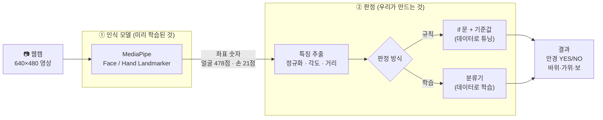
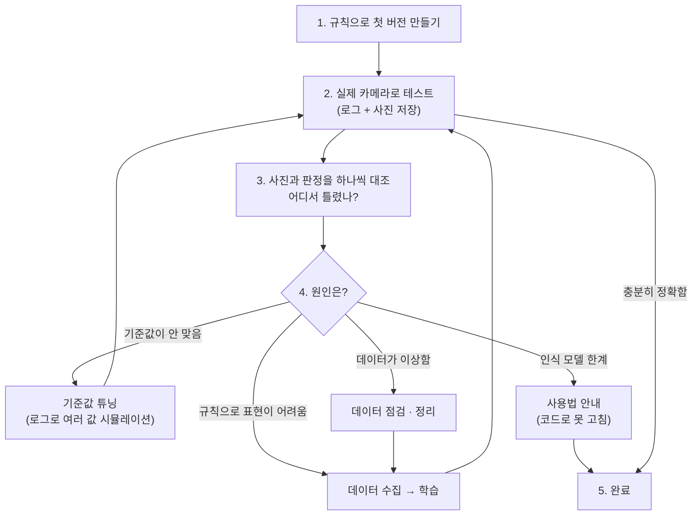
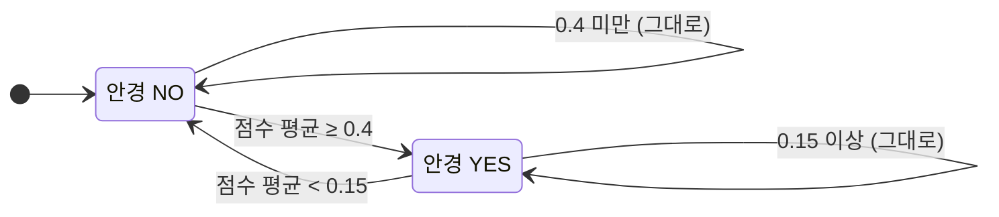
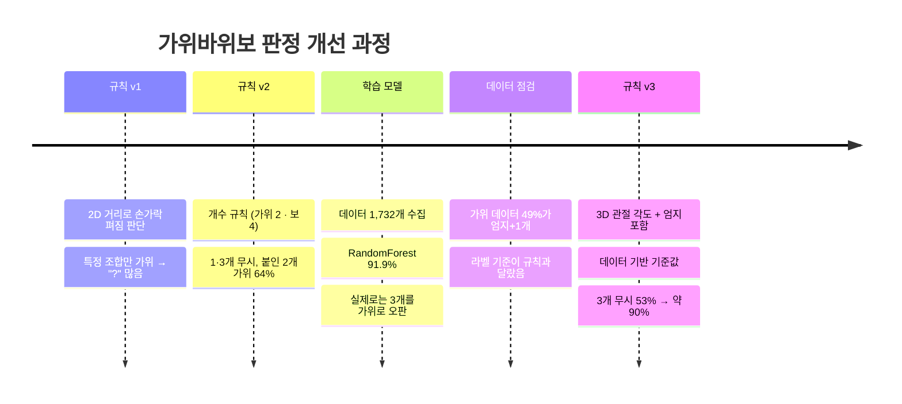
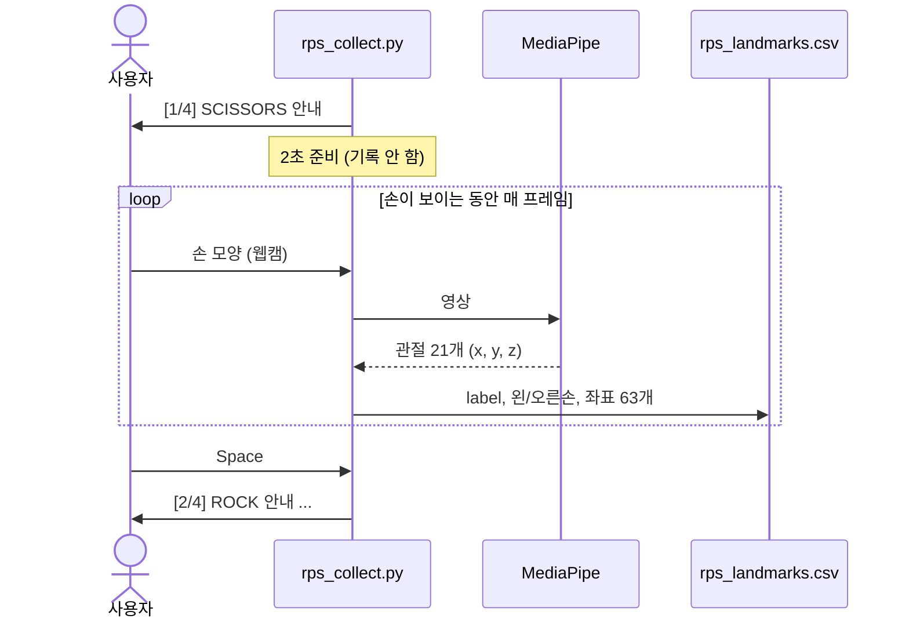
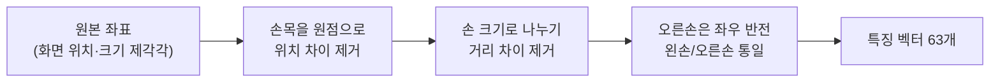
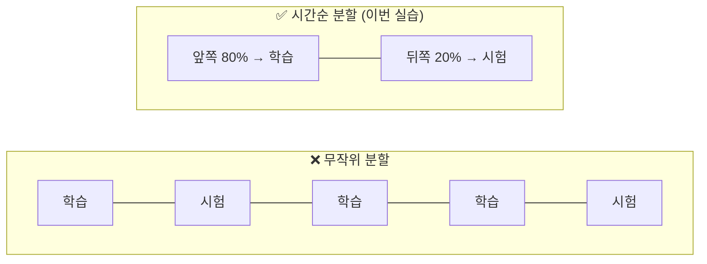
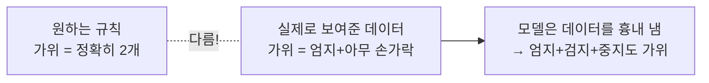
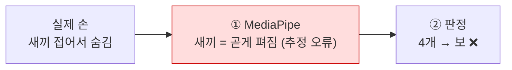

# 카메라로 AI 학습시키기와 튜닝: 실습 정리

웹캠으로 **얼굴(안경 착용 판별)** 과 **손(가위바위보)** 을 인식하는 프로그램을 만들면서,
AI를 **어떻게 학습시키고, 어떻게 튜닝하고, 어떻게 검증했는지** 실제 과정과 수치로 정리한 문서입니다.

| 관련 파일 | 역할 |
|---|---|
| `face_tracker.py` | 얼굴 특징점 + 귀 추정 + **안경 판별(튜닝 사례 1)** |
| `rps_detector.py` | 가위바위보 판정 (규칙 / 학습 모델) |
| `rps_collect.py` | **학습 데이터 수집** 도구 |
| `rps_train.py` | **분류기 학습** + 정확도 측정 |
| `data/rps_landmarks.csv` | 수집한 데이터 (손 관절 좌표, 1,732개) |
| `models/*.task` | Google이 미리 학습시킨 MediaPipe 모델 |
| `models/rps_classifier.joblib` | 우리가 직접 학습시킨 분류기 |

> 그림은 **Mermaid** 문법입니다. VS Code에서는 확장 "Markdown Preview Mermaid Support"를 설치한 뒤
> `Ctrl+Shift+V`로 미리보기 하면 보입니다.

---

## 1. 큰 그림: 카메라 AI는 두 단계로 나뉜다



| 단계 | 누가 만들었나 | 우리가 바꿀 수 있나 |
|---|---|---|
| ① 인식 모델 (영상 → 좌표) | Google이 수만 장의 사진으로 학습 | **사실상 불가.** 다시 학습하려면 대량의 라벨 데이터가 필요 |
| ② 판정 (좌표 → 결과) | **우리** | **가능.** 이번 실습에서 튜닝과 학습을 한 곳이 모두 여기 |

**핵심:** 영상을 직접 학습시키지 않고, ①이 뽑아준 **좌표 숫자**를 가지고 ②를 학습시킵니다.
그래서 데이터가 수백 개만 있어도, 일반 PC CPU로 몇 초 만에 학습이 끝납니다.

---

## 2. 전체 작업 흐름: 만들고 → 측정하고 → 고치고

이번 실습에서 실제로 반복한 순서입니다. AI 개발의 대부분은 **2~5번을 반복하는 일**입니다.



---

## 3. 튜닝 사례 1: 안경 판별 (기준값 + 히스테리시스)

### 3-1. 아이디어: 숫자 하나로 만들기

MediaPipe에는 안경 판별 기능이 없습니다. 그래서 **두 눈 사이(안경 브리지 위치)에 가로 경계선이 얼마나 걸쳐 있는지**를 0~1 점수로 만들었습니다.

```python
# face_tracker.py
def glasses_score(gray, pts):
    ...  # 두 눈 안쪽 끝(133, 362번 점) 사이 영역을 잘라낸다
    edge = np.abs(cv2.Sobel(patch, cv2.CV_32F, 0, 1, ksize=3))   # 가로 경계선
    return float((edge > EDGE_STRENGTH).any(axis=0).mean())    # 선이 지나가는 열의 비율
```

### 3-2. 먼저 데이터로 "구분이 되는지" 확인

점수를 만들었다고 바로 쓰지 않습니다. **같은 계산을 맨살 부분에도 해서** 점수가 확실히 다른지 확인했습니다.

| 측정 위치 | 첫 시도 (기준값 40) | 개선 (기준값 200) |
|---|---|---|
| 안경 브리지 | 1.00 | **0.97** |
| 미간 (맨살) | 0.95 ❌ 구분 안 됨 | **0.00** ✅ |
| 콧등 (맨살) | 0.83 ❌ | **0.30** ✅ |

> **교훈:** 특징값을 만들면 **"정답 쪽"과 "오답 쪽" 둘 다** 측정해서 구분이 되는지부터 봅니다.

### 3-3. 실제 테스트 → 로그로 기준값 튜닝

안경을 썼다 벗었다 하며 40초(1,114프레임)를 기록했습니다. 그리고 **로그를 다시 돌려서 여러 설정을 시뮬레이션**했습니다. 카메라 앞에서 다시 테스트할 필요가 없습니다.

| 설정 | 안경 썼는데 NO | 안경 벗었는데 YES | 판정 전환 (실제 4번) |
|---|---|---|---|
| 처음: 기준 0.5 | **19.0%** | 0% | 20번 깜빡임 |
| 기준 0.3 | 6.7% | 0% | 16번 |
| **켜짐 0.4 / 꺼짐 0.15 + 평균 0.9** | **0.4%** | **0%** | **4번** ✅ |

### 3-4. 히스테리시스: 기준값을 두 개 쓰기

기준값이 하나면, 점수가 그 근처에서 흔들릴 때 YES/NO가 계속 깜빡입니다.
**켜질 때와 꺼질 때 기준을 다르게** 두면 해결됩니다. 에어컨 온도 조절과 같은 원리입니다.



```python
# face_tracker.py
GLASSES_ON = 0.4        # NO → YES
GLASSES_OFF = 0.15      # YES → NO
GLASSES_SMOOTH = 0.9    # 이동 평균: 이전 값 90% + 새 값 10%

state["avg"] = GLASSES_SMOOTH * state["avg"] + (1 - GLASSES_SMOOTH) * score
if not state["on"] and state["avg"] >= GLASSES_ON:
    state["on"] = True
elif state["on"] and state["avg"] < GLASSES_OFF:
    state["on"] = False
```

> ⚠ **주의:** 이 기준값은 **튜닝한 데이터와 검증한 데이터가 같습니다**(1명, 조명 1개, 안경 1개).
> 실제 정확도는 표보다 낮을 수 있으므로 **새로 찍은 데이터로 다시 검증**해야 합니다.

---

## 4. 튜닝 사례 2: 가위바위보, 규칙에서 학습으로, 다시 규칙으로

### 4-1. 손 관절 21개

```
        손 관절 번호 (MediaPipe)
              8   12  16  20      ← 손가락 끝(TIP)
              7   11  15  19      ← 끝 마디(DIP)
         4    6   10  14  18      ← 가운데 마디(PIP)
         3    5    9  13  17      ← 손가락 뿌리(MCP)
          2
           1        0             ← 손목(WRIST)
```

### 4-2. 진행 과정 한눈에 보기



### 4-3. 데이터 수집: `rps_collect.py`

화면에 보여줄 모양을 안내하고, **손이 보이는 동안 관절 좌표를 자동으로 기록**합니다. 다 보여줬으면 Space로 넘어갑니다.



```bash
python rps_collect.py            # 4가지 모두: 가위 → 바위 → 보 → NONE
python rps_collect.py NONE       # 부족한 모양만 추가 수집 (기존 파일 뒤에 이어 씀)
```

저장 형식 (한 줄 = 한 프레임):

```
label,handedness,x0,y0,z0,x1,y1,z1, ... ,x20,y20,z20
SCISSORS,Left,0.51234,0.80211,0.00000, ...
```

실제로 모은 양:

| 가위 | 바위 | 보 | NONE(무시) | 합계 |
|---|---|---|---|---|
| 784 | 248 | 363 | 337 | **1,732** |

> **실제로 겪은 실수:** 첫 수집에서 Space를 두 번 눌러 **NONE이 0개**가 됐습니다.
> NONE이 없으면 모델은 1개, 3개 같은 모양도 **무조건** 가위, 바위, 보 중 하나로 판정합니다.
> → 준비 시간 2초 동안에는 Space를 무시하도록 수집 도구를 고쳤습니다.

### 4-4. 정규화: 같은 모양이면 같은 숫자가 되도록

같은 가위라도 손이 화면 어디에 있는지, 얼마나 큰지, 왼손인지에 따라 좌표가 다릅니다. 학습 전에 이런 차이를 없앱니다.



```python
# rps_detector.py: 학습과 실행에서 "같은 함수"를 써야 한다
def landmark_features(xyz, side):
    a = np.asarray(xyz, dtype=np.float32).reshape(21, 3).copy()
    a -= a[WRIST]                                   # 위치
    if side == "Right":
        a[:, 0] = -a[:, 0]                          # 좌우
    scale = np.linalg.norm(a[:, :2], axis=1).max()
    return (a / max(scale, 1e-6)).ravel()           # 크기
```

### 4-5. 학습과 정확도 측정: `rps_train.py`

**중요: 무작위로 나누면 안 됩니다.** 웹캠은 1초에 30장을 찍기 때문에 연속된 프레임이 거의 똑같습니다.
무작위로 나누면 "거의 같은 사진"이 학습과 시험에 동시에 들어가서 **정확도가 부풀려집니다.**



```python
# rps_train.py
def split(by_label):
    for label, feats in by_label.items():
        n_test = max(int(len(feats) * TEST_RATIO), 1)
        Xtr += feats[:-n_test]      # 앞쪽: 학습
        Xte += feats[-n_test:]      # 뒤쪽 (나중에 찍은 것): 시험
```

모델 3개를 비교해서 가장 좋은 것을 저장합니다.

| 모델 | 시험 정확도 |
|---|---|
| k-NN (가까운 이웃 7개) | 88.4% |
| **RandomForest (결정 트리 200개)** | **91.9%** ✅ 선택 |
| MLP (작은 신경망 64-32) | 90.4% |

```bash
python rps_train.py      # 학습 → 정확도 출력 → models/rps_classifier.joblib 저장
```

### 4-6. 확신도 기준: 모르면 "모른다"고 하기

분류기는 각 모양일 확률을 줍니다. **가장 높은 확률이 60% 미만이면 판정하지 않게** 했습니다.

| 시험 데이터 (확신 기준 0.6) | 맞음 | 표시 안 함 | 오답 |
|---|---|---|---|
| 바위 | 98% | 2% | 0% |
| 가위 | 78% | 22% | **0%** |
| 보 | 100% | 0% | 0% |
| 무시 | 94% | | 6% |

```python
# rps_detector.py
proba = model.predict_proba([feat])[0]
best = int(np.argmax(proba))
if model.classes_[best] == "NONE" or proba[best] < MIN_CONFIDENCE:   # 0.6
    return None
```

> 틀리는 것보다 "모르겠다"가 낫습니다. 오답이 거의 사라진 대신, 일부는 표시하지 않습니다.

### 4-7. 그런데 실제 테스트에서 틀렸다: 데이터 점검

시험 정확도는 92%였지만 **실제 카메라 테스트에서는 OK 사인(3개)을 가위로 판정**했습니다.
수집 데이터를 손가락 상태별로 나눠 보니 원인이 **데이터**에 있었습니다.

| 라벨 | 실제로 들어 있던 모양 |
|---|---|
| 가위 784개 | **49%가 "엄지 + 손가락 1개"**, 깨끗한 "손가락 2개"는 39% |
| NONE 337개 | **36%가 "네 손가락 모두 펴짐"**으로 읽힘 |



> **가장 중요한 교훈:** 모델은 **우리가 원하는 규칙**이 아니라 **우리가 보여준 데이터**를 배웁니다.
> 라벨 기준이 흔들리면, 시험 정확도가 높아도 실제로는 틀립니다.
> → 수집 전에 **"각 라벨에 어떤 모양이 들어가는지" 기준을 글로 정하고** 수집해야 합니다.

### 4-8. 규칙을 데이터로 튜닝하기 (최종 방식)

판정 기준이 "손가락 개수"로 명확하므로 **규칙**이 더 맞다고 판단했습니다.
대신 규칙에 쓰는 **기준값을 수집 데이터로 정했습니다.** 학습 데이터를 버리지 않고 측정 도구로 쓴 셈입니다.

**① 손가락 펴짐: 2D 거리 → 3D 관절 각도**

```python
# rps_detector.py
def bend_angle(p, joints):
    """손목→뿌리→마디→마디→끝을 잇는 선이 꺾인 각도의 합 (곧으면 0도, 주먹은 200도+)"""
    chain = [p[WRIST]] + [p[j] for j in joints]
    total = 0.0
    for k in range(1, len(chain) - 1):
        v1, v2 = chain[k] - chain[k - 1], chain[k + 1] - chain[k]
        cos = v1 @ v2 / (np.linalg.norm(v1) * np.linalg.norm(v2) + 1e-9)
        total += np.degrees(np.arccos(np.clip(cos, -1, 1)))
    return total

BEND_LIMIT = 100   # 실측: 보 평균 약 30도, 바위 평균 약 210도
```

**② 엄지 펴짐: 거리 비율 분포를 보고 기준 결정**

엄지 끝과 중지 뿌리 사이 거리를 손바닥 길이로 나눈 값의 분포입니다.

```
값 구간          0.3  0.4  0.5  0.6  0.7  0.8  0.9  1.0  1.1  1.2
엄지 접음(V 가위)  ███  ████ ███  █    ▏    █    ▏
엄지 폄 (L 가위)                  ▏    █    ██   ██   ███  ████ █
                                  ↑ 기준 0.75
```

```python
THUMB_OUT_RATIO = 0.75   # 접은 엄지 대부분 0.3~0.6 / 편 엄지 대부분 0.8 이상
```

**③ 최종 판정 규칙**

```python
def classify(states):
    four = sum([states["Index"], states["Middle"], states["Ring"], states["Pinky"]])
    total = four + states["Thumb"]
    if four == 0:   return "ROCK"       # 엄지를 세운 주먹도 바위
    if total == 2:  return "SCISSORS"   # V, L자, 엄지+새끼 ...
    if total >= 4:  return "PAPER"
    return None                         # 1개, 3개 → 무시
```

**④ 다수결: 최근 7프레임**

손 모양을 바꾸는 순간 한두 프레임이 이상하게 읽혀도 결과가 깜빡이지 않습니다.

```python
vote.append(classify(states))                   # None(무시)도 한 표
label = Counter(vote).most_common(1)[0][0]      # 최근 7프레임 다수결
```

### 4-9. 결과 비교

| 테스트 | 이전 방식 | 최종 방식 |
|---|---|---|
| 수집 데이터 - 바위 | 93% (2D 거리) | **99%** |
| 수집 데이터 - 가위 | 42% (엄지 안 셈) | **83%** |
| 수집 데이터 - 보 | 95% | **96%** |
| 실제 테스트 - 손가락 3개 무시 | 53% | **약 90%** |
| 실제 테스트 - 붙인 2개 가위 | 64% (규칙 v2) | 따로 측정하지 않음 (학습 모델 방식에서는 4/4) |

---

## 5. 코드로 고칠 수 없는 것: 인식 모델의 한계

새끼손가락을 엄지로 눌러 **숨기면**, MediaPipe가 숨은 손가락을 **펴진 것으로 추정**해서 그립니다.
① 인식 모델이 이미 틀린 좌표를 주기 때문에 ② 판정을 아무리 튜닝해도 고칠 수 없습니다.



| 문제 | 어디서 고치나 |
|---|---|
| 기준값이 안 맞음 | ② 판정: 튜닝 |
| 규칙으로 표현이 어려움 | ② 판정: 학습 |
| 라벨이 일관되지 않음 | 데이터: 다시 수집 |
| **인식 모델이 좌표를 틀림** | **사용 방법 안내** (접는 손가락이 카메라에 보이게) |

---

## 6. 카메라 AI를 학습시키는 방법: 체크리스트

### 수집 전
- [ ] **라벨 기준을 글로 정한다.** 예: "가위 = 엄지 포함 정확히 2개, 1·3개는 NONE"
- [ ] **"아무것도 아님(NONE)" 라벨을 꼭 만든다.** 없으면 모든 입력을 억지로 분류한다
- [ ] 판정 기준이 단순하고 명확하면 **규칙**, 말로 설명하기 어려우면 **학습**을 고른다

### 수집할 때
- [ ] 손 각도, 거리, 왼손/오른손, 조명을 **다양하게** 한다
- [ ] 라벨별 양을 **비슷하게** 맞춘다 (이번: 가위 784 대 바위 248로 불균형)
- [ ] **여러 사람**의 손을 모은다. 1명 데이터로 학습하면 그 사람 손에만 맞는다
- [ ] 수집할 때 **사진도 몇 장 남긴다.** 나중에 "이 라벨에 뭐가 들어갔지?"를 확인할 수 있다

### 학습과 검증
- [ ] 연속 프레임은 **시간순으로 나눠서** 시험한다 (무작위 분할 금지)
- [ ] 가능하면 **다른 날, 다른 사람** 데이터로 따로 시험한다
- [ ] **확신도 기준**을 둬서 애매하면 판정하지 않는다
- [ ] 학습과 실행에서 **같은 정규화 함수**를 쓴다

### 실제 테스트
- [ ] 실제 카메라로 테스트하고 **로그 + 사진**을 남긴다
- [ ] 정답과 대조한다. 안내대로 하기 어려우면 **사진을 보고 직접 대조**한다
- [ ] 로그를 저장해 두면 기준값을 바꿔 가며 **다시 촬영하지 않고 시뮬레이션**할 수 있다
- [ ] 틀린 사례는 **원인(기준값 / 데이터 / 인식 모델)** 을 나눠서 고친다

---

## 7. 직접 해보기

```bash
# 1) 데이터 수집 (자기 손으로)
python rps_collect.py

# 2) 학습 + 정확도 확인
python rps_train.py

# 3) 학습 모델로 실행하려면 rps_detector.py 에서
#    USE_MODEL = True 로 바꾼 뒤
python rps_detector.py
```

**실습 과제**

1. 라벨 기준을 먼저 글로 정한 뒤 데이터를 다시 수집해서, 학습 모델(`USE_MODEL = True`)과 규칙 방식의 정확도를 비교해 보세요.
2. 친구 손 데이터만 따로 모아서, **내 손으로 학습한 모델**이 친구 손에서는 몇 %가 나오는지 측정해 보세요.
3. `rps_train.py`의 `TEST_RATIO` 분할을 무작위 분할(`train_test_split`)로 바꾸면 정확도가 어떻게 달라지는지 확인해 보세요. 왜 부풀려지는지 설명해 보세요.
4. `face_tracker.py`의 `GLASSES_ON`, `GLASSES_OFF` 값을 바꿔 가며 깜빡임과 반응 속도가 어떻게 달라지는지 관찰해 보세요.
