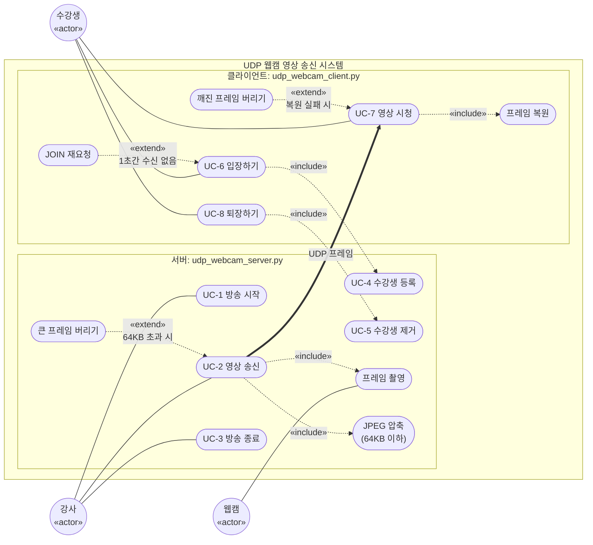
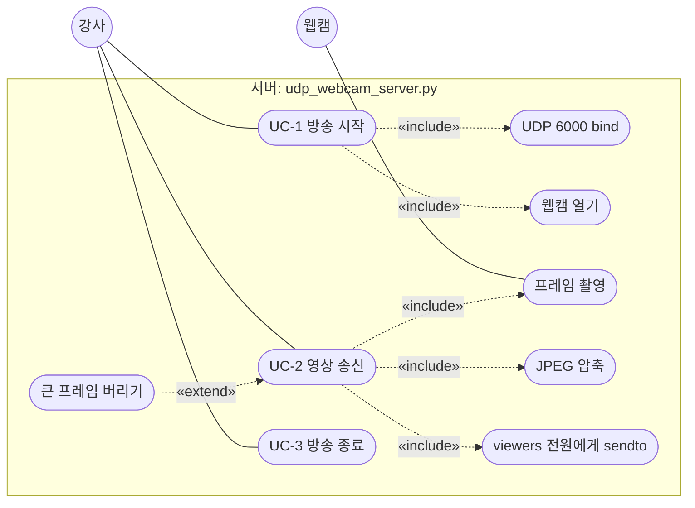
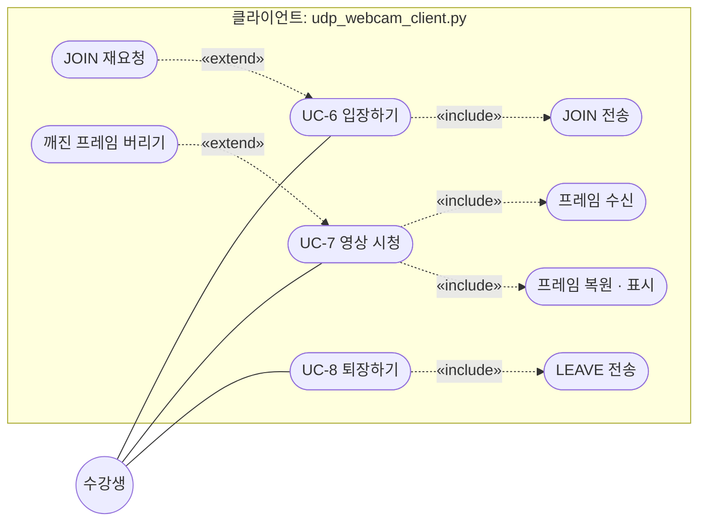
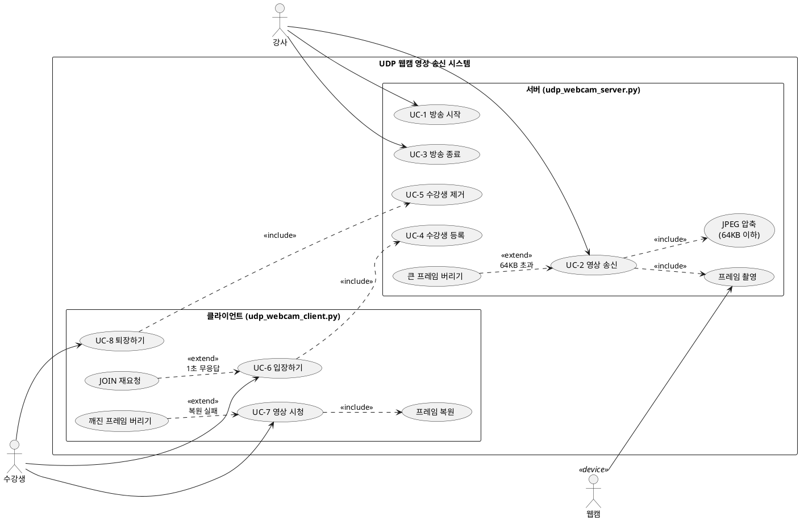

# UDP 웹캠 영상 송신: Use Case Diagram

대상 코드: `udp_webcam_server.py` (강사), `udp_webcam_client.py` (수강생)
관련 문서: `webcam_viewer.md` (코드 설명), `udp_userStory.md` (User Story)

> Mermaid에는 Use Case Diagram 전용 문법이 없어서, **flowchart로 UML 표기법을 흉내 내어** 그렸습니다.
>
> - 동그라미 = 액터, 둥근 사각형 = 유스케이스, 큰 상자 = 시스템 경계
> - 실선 = 액터와 유스케이스의 연결, 점선 = `«include»` / `«extend»`
>
> 표준 UML 표기를 원하면 맨 아래 **부록의 PlantUML 코드**를 사용하세요.
> VS Code에서는 확장 **"Markdown Preview Mermaid Support"** 를 설치한 뒤 `Ctrl+Shift+V`로 보면 됩니다.

---

## 1. 전체 Use Case Diagram

### 표기 읽는 법

| 관계 | 의미 | 이 다이어그램의 예 |
|---|---|---|
| `«include»` | **항상** 함께 실행되는 하위 기능 | 영상 송신은 **반드시** 촬영과 압축을 포함 |
| `«extend»` | **조건이 맞을 때만** 덧붙는 기능 (화살표가 기본 유스케이스 쪽을 향함) | 1초간 아무것도 안 오면 **그때만** JOIN 재요청 |
| 굵은 화살표 | 유스케이스 사이의 데이터 흐름 (UML 표준은 아니고 이해를 돕기 위한 표시) | 서버의 영상 송신 → 클라이언트의 영상 시청 |

---

## 2. 액터 (Actor)

| 액터 | 종류 | 설명 |
|---|---|---|
| 강사 | 주 액터 (Primary) | 서버를 실행하고 방송을 시작하거나 끝낸다 |
| 수강생 | 주 액터 (Primary) | 클라이언트를 실행하고 영상을 본다. 여러 명이 동시에 참여할 수 있다 |
| 웹캠 | 보조 액터 (Secondary) | 시스템 밖의 장치. 서버가 프레임을 받아온다 (`cv2.VideoCapture(0)`) |

---

## 3. 액터별로 나눠 보기

### 3-1. 강사 관점

### 3-2. 수강생 관점

---

## 4. 유스케이스 명세

| ID | 유스케이스 | 액터 | 사전 조건 | 기본 흐름 | 대안 흐름 | 코드 |
|---|---|---|---|---|---|---|
| UC-1 | 방송 시작 | 강사 | 웹캠 연결됨 | ① 서버 실행 ② UDP 6000 bind, 논블로킹 설정 ③ 웹캠 열기 ④ 미리보기 창 표시 | 웹캠을 읽지 못하면 종료 | `sock.bind()`, `VideoCapture(0)` |
| UC-2 | 영상 송신 | 강사, 웹캠 | UC-1 완료 | ① 프레임 촬영 ② 640×480 축소 ③ JPEG(품질 50) 압축 ④ `viewers` 전원에게 `sendto` ⑤ 반복 | 64KB를 넘으면 그 프레임은 버림 | `imencode()`, `sendto()` |
| UC-3 | 방송 종료 | 강사 | 방송 중 | ① 미리보기 창에서 `q` ② 웹캠, 소켓 정리 | — | `cap.release()`, `sock.close()` |
| UC-4 | 수강생 등록 | (UC-6에 포함) | 서버 실행 중 | ① `JOIN` 수신 ② 보낸 주소를 `viewers`에 추가 | 이미 등록된 주소면 변화 없음 (set) | `viewers.add(addr)` |
| UC-5 | 수강생 제거 | (UC-8에 포함) | 등록되어 있음 | ① `LEAVE` 수신 ② `viewers`에서 제거 | 강제로 끈 경우 LEAVE가 없어서 제거되지 않음 | `viewers.discard(addr)` |
| UC-6 | 입장하기 | 수강생 | 서버 주소를 앎 | ① 클라이언트 실행 ② `JOIN` 전송 ③ 프레임 수신 시작 | 1초간 아무것도 오지 않으면 `JOIN` 재전송 | `sendto(b"JOIN")`, `settimeout(1)` |
| UC-7 | 영상 시청 | 수강생 | UC-6 완료 | ① `recvfrom` ② JPEG 복원 ③ 화면 표시 ④ 반복 | 복원에 실패하면 버리고 다음 프레임 | `imdecode()`, `imshow()` |
| UC-8 | 퇴장하기 | 수강생 | 시청 중 | ① 영상 창에서 `q` ② `LEAVE` 전송 ③ 소켓 닫기 | — | `sendto(b"LEAVE")` |

---

## 5. 유스케이스로 보는 UDP의 특징

| 유스케이스 | UDP 특징 |
|---|---|
| UC-4 / UC-5 수강생 등록·제거 | 연결이 없어서 `accept()` 대신 **주소 목록을 직접 관리**한다 |
| UC-2 영상 송신 | **보내고 끝**이다. 받았는지 확인(ACK)하지 않는다 |
| UC-2 확장: 큰 프레임 버리기 | **패킷 하나의 크기 제한(약 64KB)** 이 있다 |
| UC-6 확장: JOIN 재요청 | **신뢰성이 없어서** 요청 패킷도 유실될 수 있고, 앱이 직접 재시도한다 |
| UC-7 확장: 깨진 프레임 버리기 | **재전송이 없다**. 버리고 최신 프레임을 보여줘서 지연이 없다 |

---

## 부록: 표준 UML 표기 (PlantUML)

PlantUML을 지원하는 도구(VS Code의 **PlantUML** 확장, plantuml.com 온라인 서버 등)에 붙여 넣으면 표준 Use Case Diagram으로 그려집니다.

