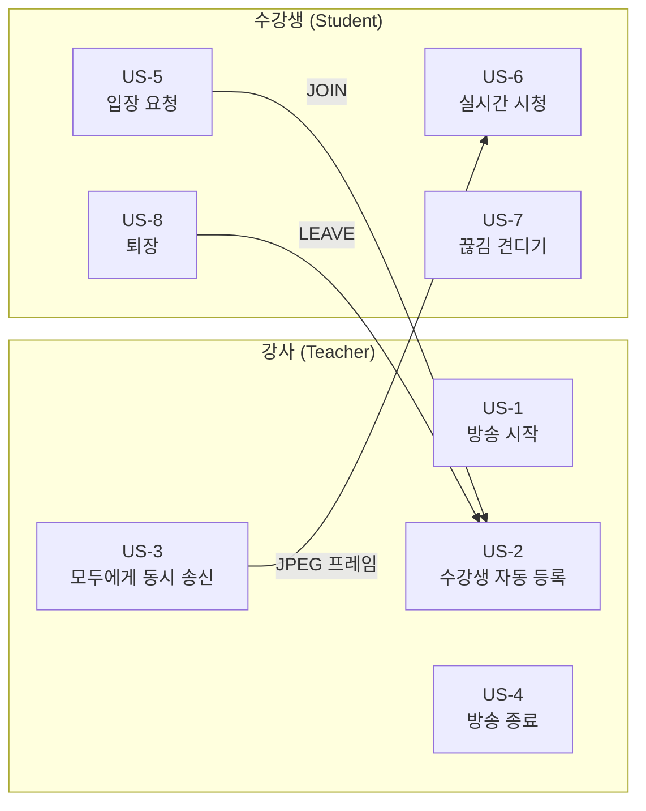
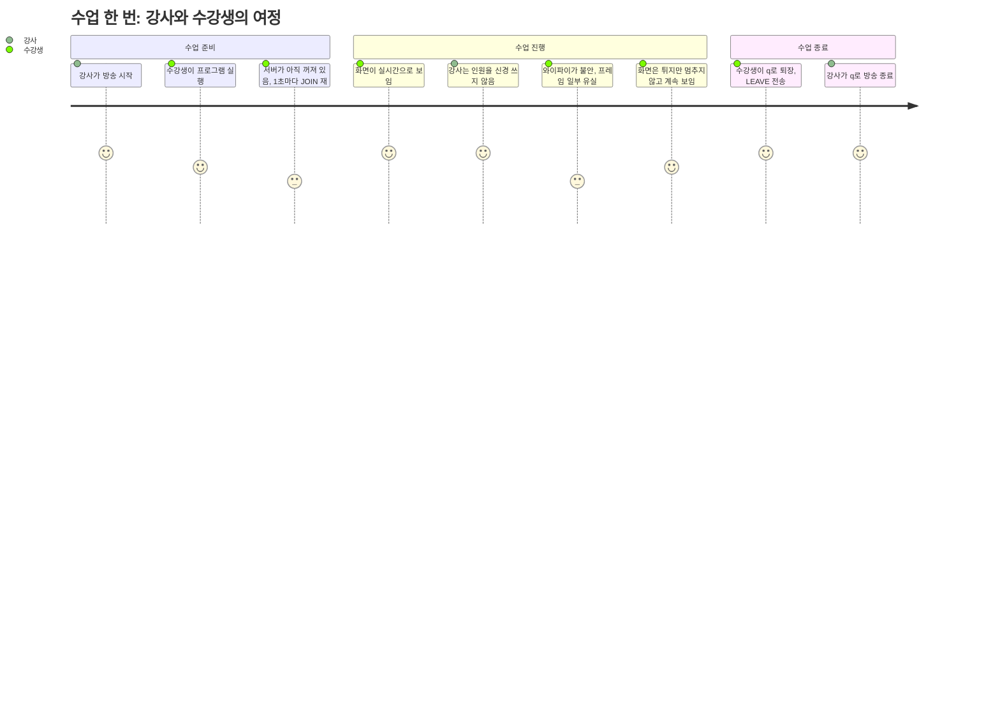
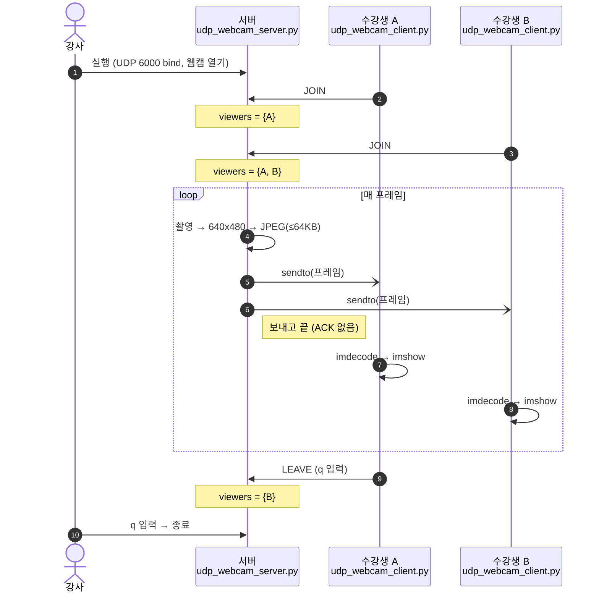
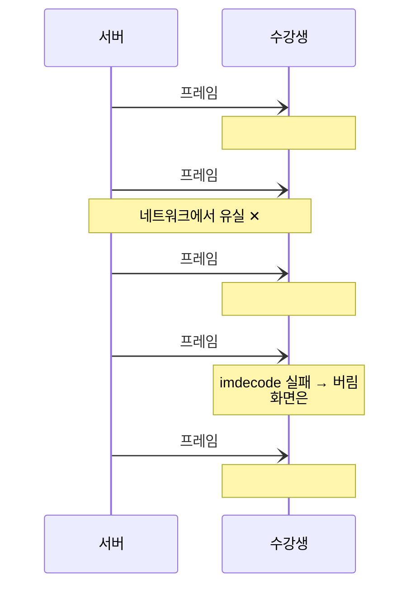
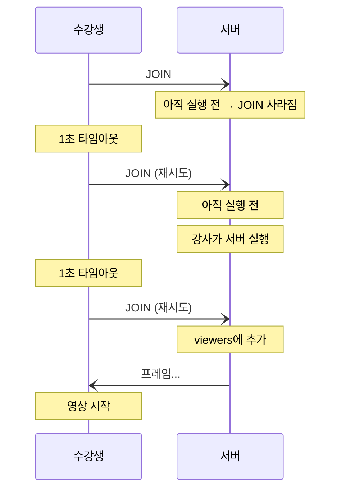
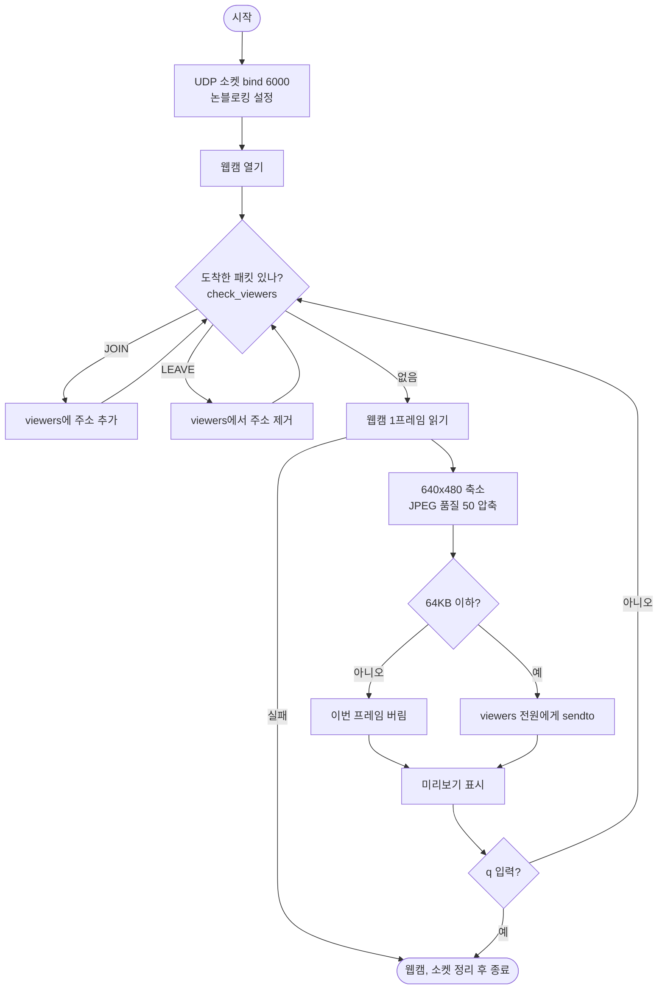
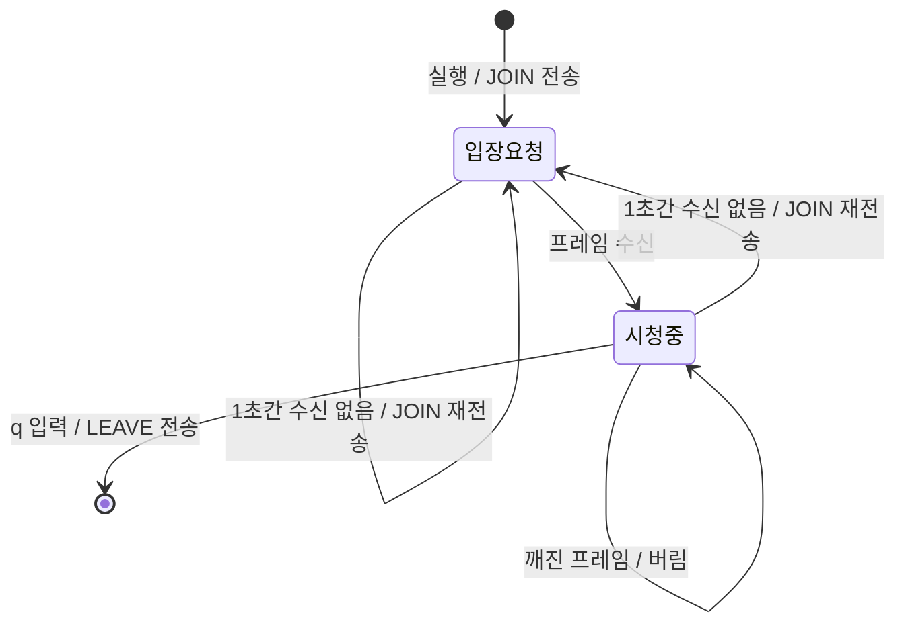

# UDP 웹캠 영상 송신: User Story

대상 코드: `udp_webcam_server.py` (강사), `udp_webcam_client.py` (수강생)
상세 설명: `webcam_viewer.md`

> 이 문서의 그림은 **Mermaid** 문법입니다. GitHub에서는 바로 보이고,
> VS Code에서는 확장 **"Markdown Preview Mermaid Support"** 를 설치한 뒤 미리보기(`Ctrl+Shift+V`)로 보면 됩니다.

---

## 1. 등장인물 (Persona)

| | 강사 (Teacher) | 수강생 (Student) |
|---|---|---|
| 실행 프로그램 | `udp_webcam_server.py` | `udp_webcam_client.py` |
| 하는 일 | 웹캠 앞에서 수업 진행 | 강사 화면을 실시간으로 시청 |
| 원하는 것 | 수강생이 몇 명이든 신경 쓰지 않고 방송 | 지연 없이 **지금** 강사의 모습을 보기 |
| 신경 쓰지 않는 것 | 각 수강생이 프레임을 다 받았는지 | 지나간 프레임 몇 장 |

---

## 2. User Story 목록

| ID | 사용자 | User Story | 인수 조건 (Acceptance Criteria) | 코드 위치 |
|---|---|---|---|---|
| US-1 | 강사 | 강사로서 **웹캠 방송을 시작**하고 싶다. 수강생에게 내 모습을 보여주기 위해서. | UDP 6000 포트에서 대기한다. 내 미리보기 창이 뜬다. | `sock.bind()`, `cv2.VideoCapture(0)` |
| US-2 | 강사 | 강사로서 **수강생이 들어오면 자동으로 등록**되기를 원한다. 한 명씩 직접 받아줄 필요가 없도록. | `JOIN`을 받으면 보낸 주소를 `viewers`에 추가한다. 이 확인 때문에 영상이 멈추지 않는다. | `check_viewers()`, `setblocking(False)` |
| US-3 | 강사 | 강사로서 **모든 수강생에게 같은 화면을 동시에** 보내고 싶다. 수강생이 늘어도 방송이 느려지지 않도록. | 프레임을 64KB 이하 JPEG로 압축해서 `viewers` 전원에게 `sendto` 한다. 받았는지 확인하지 않는다. | `cv2.imencode()`, `sendto()` 반복 |
| US-4 | 강사 | 강사로서 **`q` 하나로 방송을 끝내고** 싶다. | 웹캠과 소켓을 정리하고 종료한다. | `cap.release()`, `sock.close()` |
| US-5 | 수강생 | 수강생으로서 **서버 주소만 알면 바로 입장**하고 싶다. | 실행하면 `JOIN`을 보낸다. 서버가 늦게 켜져도 1초마다 다시 요청해서 자동으로 연결된다. | `sendto(b"JOIN")`, `settimeout(1)` |
| US-6 | 수강생 | 수강생으로서 **강사 화면을 지연 없이** 보고 싶다. 수업을 실시간으로 따라가기 위해서. | 받은 패킷 하나를 프레임 하나로 복원해서 바로 표시한다. | `recvfrom()`, `cv2.imdecode()` |
| US-7 | 수강생 | 수강생으로서 **네트워크가 불안해도 화면이 멈추지 않기를** 원한다. 몇 장 빠져도 최신 화면을 보는 게 낫다. | 깨진 패킷은 버린다. 빠진 프레임을 기다리거나 재전송을 요청하지 않는다. | `if frame is None: continue` |
| US-8 | 수강생 | 수강생으로서 **`q`로 퇴장하면 서버가 더는 보내지 않기를** 원한다. | `LEAVE`를 보내면 서버가 내 주소를 `viewers`에서 지운다. | `sendto(b"LEAVE")`, `viewers.discard()` |

---

## 3. 사용자 여정 (User Journey)

수업 한 번 동안 강사와 수강생의 체감도입니다. 점수가 높을수록 만족합니다(1~5).

---

## 4. 시나리오별 시퀀스

### 4-1. 기본 흐름: 입장 → 시청 → 퇴장 (US-1, 2, 3, 5, 6, 8)

### 4-2. 패킷 유실: 화면은 멈추지 않는다 (US-7)

> **TCP였다면?** #11이 재전송될 때까지 #12, #13, #14가 모두 대기해서 **화면이 멈춥니다.**

### 4-3. 서버보다 수강생이 먼저 켜졌을 때 (US-5)

---

## 5. 프로그램 내부 흐름

### 5-1. 서버 메인 루프

### 5-2. 클라이언트 상태

---

## 6. User Story로 보는 UDP의 특징

| User Story | 드러나는 UDP 특징 | TCP였다면 |
|---|---|---|
| US-2 수강생 자동 등록 | **연결이 없음**: 주소 목록을 직접 관리 | `accept()`로 연결 생성, 연결마다 스레드 |
| US-3 동시 송신 | **보내고 끝**: 확인을 기다리지 않아 인원이 늘어도 단순함 | 느린 수강생 한 명이 송신을 막을 수 있음 |
| US-3 64KB 이하 | **패킷 = 메시지 경계**: 프레임 구분이 자동이지만 크기 제한 있음 | 스트림이라 길이 정보를 직접 붙여야 함 |
| US-5 JOIN 재시도 | **신뢰성 없음**: 요청 패킷도 유실될 수 있어서 앱이 직접 재시도 | `connect()`가 실패를 바로 알려줌 |
| US-7 끊김 견디기 | **재전송 없음**: 유실 = 건너뛰기라서 지연이 없음 | 재전송을 기다리느라 화면이 멈춤 |
| US-8 퇴장 | **상대 상태를 모름**: LEAVE를 보내지 않으면 서버는 계속 보냄 | 연결이 끊기면 서버가 바로 앎 |

---

## 7. 다음 Story 후보 (실습 과제와 연결)

| ID | User Story | 구현 힌트 |
|---|---|---|
| US-9 | 수강생으로서 **내 화면의 손실률을 보고** 싶다. | 패킷 앞에 프레임 번호 4바이트 추가 |
| US-10 | 강사로서 **창을 강제로 끈 수강생은 자동으로 정리**되기를 원한다. | 하트비트: 2초마다 JOIN, 5초 동안 소식 없으면 제거 |
| US-11 | 수강생으로서 **고화질(1080p)로** 보고 싶다. | 프레임을 여러 패킷으로 나누고 번호 붙여 재조립 |
| US-12 | 강사로서 **허가된 수강생만** 보게 하고 싶다. | JOIN에 수업 코드 포함, 서버에서 검증 |
